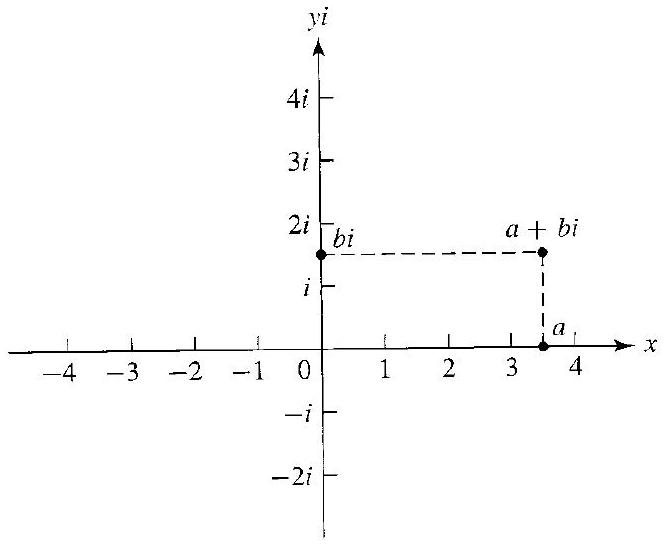
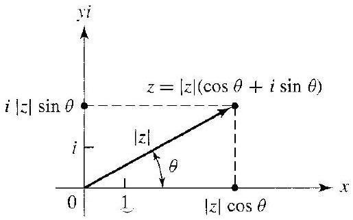
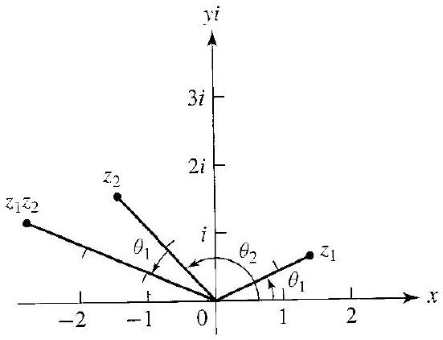
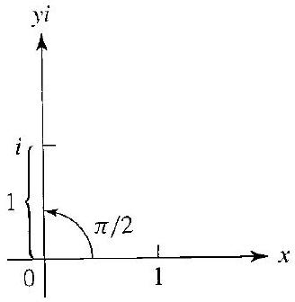
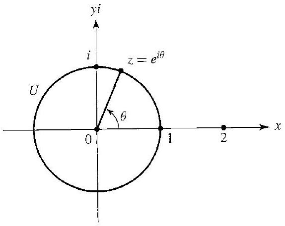

# Editorial records — Section 1: Introduction and Examples

Status: source-reviewed formatting and saved-note lint complete; native rendered review and receiver receipt pending.

Original OCR preserved in Original Markdown; printed pp.11–20.

## Heading formatting only.

Before:

```text
## section 1 Introduction and Examples
```

After:

```text
# 1 Introduction and Examples
```

## Correct printed p.13 typo: imaginary component uses i, consistent with displayed product immediately below.

Before:

```text
z_{1}=a+b c
```

After:

```text
z_{1}=a+b i
```

## Restore distinct set-builder separator and modulus bars, printed p.15.

Before:

```text
\mathbb{C}| | z \mid=1
```

After:

```text
\mathbb{C}\mid |z|=1
```

## Restore complete equation within inline math, Example 1.7.

Before:

```text
$z^{4}=$ -16
```

After:

```text
$z^{4}=-16$
```

## Restore modular-addition subscript, printed pp.16–17.

Before:

```text
$+2 \pi$
```

After:

```text
$+_{2 \pi}$
```

## Restore modular-addition subscript in formulas, examples and Exercise 26, printed pp.16–19.

Before:

```text
+2 \pi 
```

After:

```text
+_{2 \pi} 
```

## Restore modular-addition subscript in Eq.(9) and Example 1.13, printed p.17.

Before:

```text
+4 \pi 
```

After:

```text
+_{4 \pi} 
```

## Restore modular-addition subscript in Example 1.10, printed p.16.

Before:

```text
6+8.58
```

After:

```text
6+_{8.5}8
```

## Restore modular-addition subscript in Eq.(11), printed p.18.

Before:

```text
(i+n j)
```

After:

```text
(i+_{n} j)
```

## Restore modular-addition subscript in Exercise 27, printed p.19.

Before:

```text
2 \sqrt{2}+\sqrt{32} 3 \sqrt{2}
```

After:

```text
2 \sqrt{2}+_{\sqrt{32}} 3 \sqrt{2}
```

## Restore pi misrecognized as T in Exercise 37, printed p.19.

Before:

```text
e^{i(T / 3)}
```

After:

```text
e^{i(\pi / 3)}
```

## Join OCR page break within sentence.

Before:

```text
interested in algebraic
properties.
```

After:

```text
interested in algebraic properties.
```

## Restore spacing after inline math.

Before:

```text
\mathbb{R}^{+}$of
```

After:

```text
\mathbb{R}^{+}$ of
```

## Put display delimiter on its own line.

Before:

```text
$$ $\square$
```

After:

```text
$$

$\square$
```

## Display-math container formatting for Obsidian; mathematical content and source labels retained.

Before:

```text
\begin{equation*}
```

After:

```text

```

## Display-math container formatting for Obsidian; mathematical content and source labels retained.

Before:

```text
\end{equation*}
```

After:

```text

```

## Display-math container formatting for Obsidian; mathematical content and source labels retained.

Before:

```text
\begin{align*}
```

After:

```text
\begin{aligned}
```

## Display-math container formatting for Obsidian; mathematical content and source labels retained.

Before:

```text
\end{align*}
```

After:

```text
\end{aligned}
```

## Display-math container formatting for Obsidian; mathematical content and source labels retained.

Before:

```text
\begin{gather*}
```

After:

```text
\begin{gathered}
```

## Display-math container formatting for Obsidian; mathematical content and source labels retained.

Before:

```text
\end{gather*}
```

After:

```text
\end{gathered}
```

## Preserve author title and formula; restore angle domain from preceding polar-angle context for independent use.

Before:

```text
$$
e^{i \theta}=\cos \theta+i \sin \theta .
$$

## Euler's Formula
```

After:

```text
> [!identity] Euler's Formula
> For $\theta\in\mathbb{R}$,
>
> $$
> e^{i \theta}=\cos \theta+i \sin \theta .
> $$
```

## Supply missing prompt for the task already worked; author solution retained.

Before:

```text
Example 1.9 has no separate prompt
```

After:

```text
In $\mathbb{R}_{2\pi}$, compute $\frac{3\pi}{2}+_{2\pi}\frac{5\pi}{4}$.
```

## Supply missing prompt for the task already worked; author solution retained.

Before:

```text
Example 1.10 has no separate prompt
```

After:

```text
Compute $16+_{23}19$ in $\mathbb{R}_{23}$ and $6+_{8.5}8$ in $\mathbb{R}_{8.5}$.
```

## Supply missing prompt for the task already worked; author solution retained.

Before:

```text
Example 1.11 has no separate prompt
```

After:

```text
Find the multiplicative identity in $U=\{z\in\mathbb{C}\mid |z|=1\}$ and its corresponding additive identity in $\mathbb{R}_{2\pi}$.
```

## Supply missing prompt for the task already worked; author solution retained.

Before:

```text
Example 1.12 has no separate prompt
```

After:

```text
Find the solutions of $z\cdot z\cdot z\cdot z=1$ in $U$ and the corresponding solutions of $x+_{2\pi}x+_{2\pi}x+_{2\pi}x=0$ in $\mathbb{R}_{2\pi}$.
```

## Supply missing prompt for the task already worked; author solution retained.

Before:

```text
Example 1.13 has no separate prompt
```

After:

```text
Find all solutions of $x+_{4\pi}x+_{4\pi}x+_{4\pi}x=0$ in $\mathbb{R}_{4\pi}$.
```

## Supply missing prompt for the task already worked; author solution retained.

Before:

```text
Example 1.14 has no separate prompt
```

After:

```text
Solve $x+5=3$ in $\mathbb{Z}_{8}$.
```

## Supply missing prompt for the task already worked; author solution retained.

Before:

```text
Example 1.15 has no separate prompt
```

After:

```text
An isomorphism from $U_8$ to $\mathbb{Z}_8$ sends $\zeta=e^{i2\pi/8}$ to $5$. Find the element corresponding to $\zeta^2$.
```

## Formatting-only changes

Wrapped existing example prompts and all 41 exercises. Existing worked prose and mathematics remain outside callouts under `##### solution`. Only the printed Euler identity is made a reusable callout in this introductory section; contextual teaching discussions remain in place.

## Figure 1.1

Formatting only: preserved image and printed caption in scientific figure component.

Before:

```text

1.1 Figure

```

After:

```text
```scientific-figure
id: e3ec9d8a-4d9a-499a-8182-0dcc97a4efae
numbered: false
title: ""
caption: Figure 1.1
captionVisible: true
captionPosition: below
columns: 1
panels:
  - path: images/15b9d5af-cac3-4d4f-a9ff-bf6549d301c7-02_544_663_243_795.jpg
    caption: ""
```
```

## Figure 1.3

Formatting only: preserved image and printed caption in scientific figure component.

Before:

```text

1.3 Figure

```

After:

```text
```scientific-figure
id: 4039f4bf-4ec8-471a-bef7-001121f188f4
numbered: false
title: ""
caption: Figure 1.3
captionVisible: true
captionPosition: below
columns: 1
panels:
  - path: images/15b9d5af-cac3-4d4f-a9ff-bf6549d301c7-03_322_515_1746_855.jpg
    caption: ""
```
```

## Figure 1.4

Formatting only: preserved image and printed caption in scientific figure component.

Before:

```text

1.4 Figure

```

After:

```text
```scientific-figure
id: af40afaf-0847-4838-ba30-ed5f01d72a7b
numbered: false
title: ""
caption: Figure 1.4
captionVisible: true
captionPosition: below
columns: 1
panels:
  - path: images/15b9d5af-cac3-4d4f-a9ff-bf6549d301c7-04_422_551_852_665.jpg
    caption: ""
```
```

## Figure 1.5

Formatting only: preserved image and printed caption in scientific figure component.

Before:

```text

1.5 Figure

```

After:

```text
```scientific-figure
id: e456c0d7-740d-4751-91d3-d65b6be01187
numbered: false
title: ""
caption: Figure 1.5
captionVisible: true
captionPosition: below
columns: 1
panels:
  - path: images/15b9d5af-cac3-4d4f-a9ff-bf6549d301c7-04_336_328_946_1282.jpg
    caption: ""
```
```

## Figure 1.8

Formatting only: preserved image and printed caption in scientific figure component.

Before:

```text

1.8 Figure

```

After:

```text
```scientific-figure
id: 4ae32e59-e53c-4087-baf6-1dd655e7393f
numbered: false
title: ""
caption: Figure 1.8
captionVisible: true
captionPosition: below
columns: 1
panels:
  - path: images/15b9d5af-cac3-4d4f-a9ff-bf6549d301c7-06_456_574_249_845.jpg
    caption: ""
```
```

## MathJax tag placement

Moved source equation label outside the inner alignment environment; formula and source number unchanged.

Before:

```text
\begin{aligned}
z_{1} z_{2} & =\left|z_{1}\right| e^{i \theta_{1}}\left|z_{2}\right| e^{i \theta_{2}}=\left|z_{1}\right|\left|z_{2}\right| e^{i\left(\theta_{1}+\theta_{2}\right)} \\
& =\left|z_{1}\right|\left|z_{2}\right|\left[\cos \left(\theta_{1}+\theta_{2}\right)+i \sin \left(\theta_{1}+\theta_{2}\right)\right] . \tag{5}
\end{aligned}
```

After:

```text
\begin{aligned}
z_{1} z_{2} & =\left|z_{1}\right| e^{i \theta_{1}}\left|z_{2}\right| e^{i \theta_{2}}=\left|z_{1}\right|\left|z_{2}\right| e^{i\left(\theta_{1}+\theta_{2}\right)} \\
& =\left|z_{1}\right|\left|z_{2}\right|\left[\cos \left(\theta_{1}+\theta_{2}\right)+i \sin \left(\theta_{1}+\theta_{2}\right)\right] . 
\end{aligned}
\tag{5}
```

## MathJax tag placement

Moved source equation label outside the inner alignment environment; formula and source number unchanged.

Before:

```text
\begin{aligned}
\frac{a+b i}{c+d i} & =\frac{a+b i}{c+d i} \cdot \frac{c-d i}{c-d i}=\frac{(a c+b d)+(b c-a d) i}{c^{2}+d^{2}} \\
& =\frac{a c+b d}{c^{2}+d^{2}}+\frac{b c-a d}{c^{2}+d^{2}} i . \tag{7}
\end{aligned}
```

After:

```text
\begin{aligned}
\frac{a+b i}{c+d i} & =\frac{a+b i}{c+d i} \cdot \frac{c-d i}{c-d i}=\frac{(a c+b d)+(b c-a d) i}{c^{2}+d^{2}} \\
& =\frac{a c+b d}{c^{2}+d^{2}}+\frac{b c-a d}{c^{2}+d^{2}} i . 
\end{aligned}
\tag{7}
```

## MathJax tag placement

Moved source equation label outside the inner alignment environment; formula and source number unchanged.

Before:

```text
\begin{gathered}
\text { if } a \leftrightarrow 2 a \text { and } b \leftrightarrow 2 b \text { then }(a+_{2 \pi} b) \leftrightarrow(2 a+_{4 \pi} 2 b) .  \tag{9}\\
\text { isomorphism }
\end{gathered}
```

After:

```text
\begin{gathered}
\text { if } a \leftrightarrow 2 a \text { and } b \leftrightarrow 2 b \text { then }(a+_{2 \pi} b) \leftrightarrow(2 a+_{4 \pi} 2 b) .  \\
\text { isomorphism }
\end{gathered}
\tag{9}
```

## MathJax tag placement

Moved source equation label outside the inner alignment environment; formula and source number unchanged.

Before:

```text
\begin{gathered}
\text { if } \quad \zeta^{i} \leftrightarrow i \quad \text { and } \quad \zeta^{j} \leftrightarrow j, \quad \text { then } \quad\left(\zeta^{i} \cdot \zeta^{j}\right) \leftrightarrow(i+_{n} j) .  \tag{11}\\
\text { isomorphism }
\end{gathered}
```

After:

```text
\begin{gathered}
\text { if } \quad \zeta^{i} \leftrightarrow i \quad \text { and } \quad \zeta^{j} \leftrightarrow j, \quad \text { then } \quad\left(\zeta^{i} \cdot \zeta^{j}\right) \leftrightarrow(i+_{n} j) .  \\
\text { isomorphism }
\end{gathered}
\tag{11}
```
