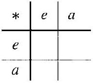
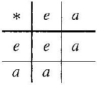

# Editorial records — Section 4: Groups

Status: source-reviewed, formatted and linted; no lint findings. Native review pending.

## Heading formatting.

Before:

```text
## SECTION 4 Groups
```

After:

```text
# 4 Groups
```

## Join paragraph across page break, pp.36–37.

Before:

```text
The steps in
the solution
```

After:

```text
The steps in the solution
```

## Restore hyphen at source line break, p.38.

Before:

```text
grouptheoretic
```

After:

```text
group-theoretic
```

## Restore group axiom symbol misrecognized in Exercise 22, p.46.

Before:

```text
\mathscr{F}_{3}
```

After:

```text
\mathscr{G}_{3}
```

## Restore group axiom symbol misrecognized in Exercise 24, p.47.

Before:

```text
\mathscr{S}_{1}
```

After:

```text
\mathscr{G}_{1}
```

## Restore modular multiplication dot, Exercise 8, p.45.

Before:

```text
multiplication ${ }_{n}
```

After:

```text
multiplication $\cdot_{n}$
```

## Repair modular multiplication notation, Exercise 8.

Before:

```text
5 \cdot{ }_{7} 6
```

After:

```text
5 \cdot_{7}6
```

## Repair modular multiplication dot and subscript, Exercise 8.

Before:

```text
multiplication ${ }_{\cdot 8}$
```

After:

```text
multiplication $\cdot_{8}$
```

## Join interrupted inline math.

Before:

```text
$5 \cdot 6=30=$ $4(7)+2$
```

After:

```text
$5 \cdot 6=30=4(7)+2$
```

## Join interrupted inline map notation.

Before:

```text
$T: \mathbb{R}^{n} \rightarrow$ $\mathbb{R}^{n}$
```

After:

```text
$T: \mathbb{R}^{n} \rightarrow \mathbb{R}^{n}$
```

## Join sentence across page break.

Before:

```text
six possible
orders
```

After:

```text
six possible orders
```

## Put closing display delimiter on its own line.

Before:

```text
$$ $\square$
```

After:

```text
$$

$\square$
```

## Correct missing qualification in Example 4.13: GL(1,R) is abelian, so noncommutativity requires n at least 2.

Before:

```text
This group is not commutative. It is our first example of a nonabelian group.
```

After:

```text
This group is not commutative for $n\geq2$. In this case, it is our first example of a nonabelian group.
```

## Restore missing math/prose spacing.

Before:

```text
\mathbb{Z}^{+}$under
```

After:

```text
\mathbb{Z}^{+}$ under
```

## Restore missing math/prose spacing.

Before:

```text
\mathbb{Q}^{+}$and
```

After:

```text
\mathbb{Q}^{+}$ and
```

## Restore missing math/prose spacing.

Before:

```text
\mathbb{R}^{+}$of
```

After:

```text
\mathbb{R}^{+}$ of
```

## Restore missing math/prose spacing.

Before:

```text
\mathbb{Q}^{+}$by
```

After:

```text
\mathbb{Q}^{+}$ by
```

## Restore missing math/prose spacing.

Before:

```text
\mathbb{Q}^{+}$with
```

After:

```text
\mathbb{Q}^{+}$ with
```

## Restore missing math/prose spacing.

Before:

```text
\mathbb{R}^{+}$by
```

After:

```text
\mathbb{R}^{+}$ by
```

## Restore missing math/prose spacing.

Before:

```text
\mathbb{Z}^{+}$such
```

After:

```text
\mathbb{Z}^{+}$ such
```

## Restore continuous source paragraph around floating sidebar, pp.38–39; all historical prose retained.

Before:

```text
Historical sidebar splits the sentence "the group G under *"
```

After:

```text
Historical sidebar follows the complete paragraph
```

## Restore minimum missing operation and inverse notation from Definition 4.1 for independent use.

Before:

```text
Let $G$ be a group. For all $a, b \in G$, we have $(a * b)^{\prime}=b^{\prime} * a^{\prime}$.
```

After:

```text
Let $G$ be a group. For all $a, b \in G$, we have $(a * b)^{\prime}=b^{\prime} * a^{\prime}$. Here $*$ is the group operation and $x^{\prime}$ denotes the inverse of $x$.
```

## Restore missing prompt from task demonstrated; preserve author solution.

Before:

```text
Example 4.2 has no separate prompt
```

After:

```text
Show that $\langle U,\cdot\rangle$, $\langle U_n,\cdot\rangle$, $\langle\mathbb{R}_c,+_c\rangle$, and $\langle\mathbb{Z}_n,+_n\rangle$ are groups.
```

## Restore missing prompt from task demonstrated; preserve author solution.

Before:

```text
Example 4.4 has no separate prompt
```

After:

```text
Is $\mathbb{Z}^{+}$ under addition a group?
```

## Restore missing prompt from task demonstrated; preserve author solution.

Before:

```text
Example 4.5 has no separate prompt
```

After:

```text
Is the set of nonnegative integers under addition a group?
```

## Restore missing prompt from task demonstrated; preserve author solution.

Before:

```text
Example 4.6 has no separate prompt
```

After:

```text
Are $\mathbb{Z}$, $\mathbb{Q}$, $\mathbb{R}$, and $\mathbb{C}$ under addition abelian groups?
```

## Restore missing prompt from task demonstrated; preserve author solution.

Before:

```text
Example 4.7 has no separate prompt
```

After:

```text
Is $\mathbb{Z}^{+}$ under multiplication a group?
```

## Restore missing prompt from task demonstrated; preserve author solution.

Before:

```text
Example 4.8 has no separate prompt
```

After:

```text
Are $\mathbb{Q}^{+}$, $\mathbb{R}^{+}$, $\mathbb{Q}^{*}$, $\mathbb{R}^{*}$, and $\mathbb{C}^{*}$ under multiplication abelian groups?
```

## Restore missing prompt from task demonstrated; preserve author solution.

Before:

```text
Example 4.9 has no separate prompt
```

After:

```text
Is the set of all real-valued functions with domain $\mathbb{R}$ under function addition a group? Is it abelian?
```

## Restore missing prompt from task demonstrated; preserve author solution.

Before:

```text
Example 4.10 has no separate prompt
```

After:

```text
What group properties follow from the vector-addition axioms for a vector space $V$?
```

## Restore missing prompt from task demonstrated; preserve author solution.

Before:

```text
Example 4.11 has no separate prompt
```

After:

```text
Is $M_{m\times n}(\mathbb{R})$ under matrix addition a group? Identify its identity element and determine whether it is abelian.
```

## Restore missing prompt from task demonstrated; preserve author solution.

Before:

```text
Example 4.12 has no separate prompt
```

After:

```text
Is $M_n(\mathbb{R})$ under matrix multiplication a group?
```

## Restore missing prompt from task demonstrated; preserve author solution.

Before:

```text
Example 4.14 has no separate prompt
```

After:

```text
Does $a*b=ab/2$ define a group on $\mathbb{Q}^{+}$?
```

## Restore prose synopsis with inline mathematics, exactly the wording printed on p.48.

Before:

```text
$$
\text { Assuming that } a * a^{\prime}=e \text { and } a * a^{\prime \prime}=e \text {, apply the left cancellation law to the equation } a * a^{\prime}=a * a^{\prime \prime} \text {. }
$$
```

After:

```text
> Assuming that $a*a^{\prime}=e$ and $a*a^{\prime\prime}=e$, apply the left cancellation law to the equation $a*a^{\prime}=a*a^{\prime\prime}$.
```

## Formatting-only changes

Two definitions, three theorems and one corollary wrapped. Source numbering and group axiom label mapping stay outside reusable callouts. Group axioms retain their order with local list numbers. Eleven missing worked-example prompts supplied and the existing Example 4.13 prompt wrapped; all author working stays outside. Both Historical Notes retain every paragraph in aside callouts, excluded from Index. All 41 exercises wrapped; shared directions and synopsis teaching text kept outside. Exercise 23 deliberately reproduces flawed student definitions, including spelling and punctuation: these are preserved, not corrected.

## Table 4.19

Formatting only: editable scientific table, source cells and printed caption preserved; single-letter mathematical entries receive math delimiters.

Before:

```text
4.19 Table

| * | $e$ | $a$ |
| :--- | :--- | :--- |
| $e$ | $e$ | $a$ |
| $a$ | $a$ | $e$ |

```

After:

```text
```scientific-table
id: 4367b18e-73f5-48ed-b5c1-ead24c6413c8
numbered: false
title: ""
caption: Table 4.19
captionVisible: true
captionPosition: below
rows:
  - - text: $*$
      align: center
    - text: $e$
      align: center
    - text: $a$
      align: center
  - - text: $e$
      align: center
    - text: $e$
      align: center
    - text: $a$
      align: center
  - - text: $a$
      align: center
    - text: $a$
      align: center
    - text: $e$
      align: center
headerRows: 1
rowHeaders: true
style: scientific
```

```

## Table 4.20

Formatting only: editable scientific table, source cells and printed caption preserved; single-letter mathematical entries receive math delimiters.

Before:

```text
4.20 Table

| * | $e$ | $a$ | $b$ |
| :--- | :--- | :--- | :--- |
| $e$ | $e$ | $a$ | $b$ |
| $a$ | $a$ |  |  |
| $b$ | $b$ |  |  |

```

After:

```text
```scientific-table
id: 2f02eaec-3461-48fc-a59f-aa4689174130
numbered: false
title: ""
caption: Table 4.20
captionVisible: true
captionPosition: below
rows:
  - - text: $*$
      align: center
    - text: $e$
      align: center
    - text: $a$
      align: center
    - text: $b$
      align: center
  - - text: $e$
      align: center
    - text: $e$
      align: center
    - text: $a$
      align: center
    - text: $b$
      align: center
  - - text: $a$
      align: center
    - text: $a$
      align: center
    - text: ""
      align: center
    - text: ""
      align: center
  - - text: $b$
      align: center
    - text: $b$
      align: center
    - text: ""
      align: center
    - text: ""
      align: center
headerRows: 1
rowHeaders: true
style: scientific
```

```

## Table 4.21

Formatting only: editable scientific table, source cells and printed caption preserved; single-letter mathematical entries receive math delimiters.

Before:

```text
4.21 Table

| * | $e$ | $a$ | $b$ |
| :--- | :--- | :--- | :--- |
| $e$ | $e$ | $a$ | $b$ |
| $a$ | $a$ | $b$ | $e$ |
| $b$ | $b$ | $e$ | $a$ |

```

After:

```text
```scientific-table
id: a6bc3655-30f3-477c-be05-3302c424a77f
numbered: false
title: ""
caption: Table 4.21
captionVisible: true
captionPosition: below
rows:
  - - text: $*$
      align: center
    - text: $e$
      align: center
    - text: $a$
      align: center
    - text: $b$
      align: center
  - - text: $e$
      align: center
    - text: $e$
      align: center
    - text: $a$
      align: center
    - text: $b$
      align: center
  - - text: $a$
      align: center
    - text: $a$
      align: center
    - text: $b$
      align: center
    - text: $e$
      align: center
  - - text: $b$
      align: center
    - text: $b$
      align: center
    - text: $e$
      align: center
    - text: $a$
      align: center
headerRows: 1
rowHeaders: true
style: scientific
```

```

## Table 4.22

Formatting only: editable scientific table, source cells and printed caption preserved; single-letter mathematical entries receive math delimiters.

Before:

```text
4.22 Table

| * | $e$ | $a$ | $b$ | $c$ |
| :--- | :--- | :--- | :--- | :--- |
| $e$ | $e$ | $a$ | $b$ | $c$ |
| $a$ | $a$ | ? |  |  |
| $b$ | $b$ |  |  |  |
| $c$ | $c$ |  |  |  |

```

After:

```text
```scientific-table
id: da08cc2b-2100-4ce1-bd61-2a482c5c2777
numbered: false
title: ""
caption: Table 4.22
captionVisible: true
captionPosition: below
rows:
  - - text: $*$
      align: center
    - text: $e$
      align: center
    - text: $a$
      align: center
    - text: $b$
      align: center
    - text: $c$
      align: center
  - - text: $e$
      align: center
    - text: $e$
      align: center
    - text: $a$
      align: center
    - text: $b$
      align: center
    - text: $c$
      align: center
  - - text: $a$
      align: center
    - text: $a$
      align: center
    - text: "?"
      align: center
    - text: ""
      align: center
    - text: ""
      align: center
  - - text: $b$
      align: center
    - text: $b$
      align: center
    - text: ""
      align: center
    - text: ""
      align: center
    - text: ""
      align: center
  - - text: $c$
      align: center
    - text: $c$
      align: center
    - text: ""
      align: center
    - text: ""
      align: center
    - text: ""
      align: center
headerRows: 1
rowHeaders: true
style: scientific
```

```

## Developing the two-element group table

Transcribed source table cells from printed pp.43–44 into editable scientific component. Empty cells remain empty; no answers added.

Before:

```text

```

After:

```text
```scientific-table
id: eaf84212-b16d-40b4-83db-b0c13aaa8e23
numbered: false
title: ""
caption: ""
captionVisible: false
captionPosition: below
rows:
  - - text: $*$
      align: center
    - text: $e$
      align: center
    - text: $a$
      align: center
  - - text: $e$
      align: center
    - text: ""
      align: center
    - text: ""
      align: center
  - - text: $a$
      align: center
    - text: ""
      align: center
    - text: ""
      align: center
headerRows: 1
rowHeaders: true
style: scientific
```
```

## Developing the two-element group table

Transcribed source table cells from printed pp.43–44 into editable scientific component. Empty cells remain empty; no answers added.

Before:

```text

```

After:

```text
```scientific-table
id: 1b9e923f-25d5-4013-a599-ed748973ba0e
numbered: false
title: ""
caption: ""
captionVisible: false
captionPosition: below
rows:
  - - text: $*$
      align: center
    - text: $e$
      align: center
    - text: $a$
      align: center
  - - text: $e$
      align: center
    - text: $e$
      align: center
    - text: $a$
      align: center
  - - text: $a$
      align: center
    - text: $a$
      align: center
    - text: ""
      align: center
headerRows: 1
rowHeaders: true
style: scientific
```
```

## Developing the two-element group table

Transcribed source table cells from printed pp.43–44 into editable scientific component. Empty cells remain empty; no answers added.

Before:

```text
| * | $e$ | $a$ |
| :--- | :--- | :--- |
| $e$ | $e$ | $a$ |
| $a$ | $a$ | $e$ |
```

After:

```text
```scientific-table
id: 326f6ea7-cfc5-42dc-9120-10de3b01ca9b
numbered: false
title: ""
caption: ""
captionVisible: false
captionPosition: below
rows:
  - - text: $*$
      align: center
    - text: $e$
      align: center
    - text: $a$
      align: center
  - - text: $e$
      align: center
    - text: $e$
      align: center
    - text: $a$
      align: center
  - - text: $a$
      align: center
    - text: $a$
      align: center
    - text: $e$
      align: center
headerRows: 1
rowHeaders: true
style: scientific
```
```

## Mathematical operation stars — Markdown delimiter repair

Bare operation symbols were parsed as Markdown emphasis, breaking surrounding math rendering. Added math delimiters only; prime suffixes remain part of the symbol. Existing mathematical formulas, author wording and callout identities are unchanged.

Source line 173: `*` → `$*$`. Context: `Let * be defined on $\mathbb{Q}^{+}$ by $a * b=a b / 2$. Then`

Source line 181: `*` → `$*$`. Context: `Thus * is associative. Computation shows that`

Source line 199: `*` → `$*$`. Context: `> If $G$ is a group with binary operation *, then the left and right cancellation laws hold in $G$, that is, $a * b=a * c$ impli`

Source line 257: `*` → `$*$`. Context: `> In a group $G$ with binary operation *, there is only one element $e$ in $G$ such that`

Source line 307: `*` → `$*$`. Context: `1. The binary operation * on $G$ is associative.`

Source line 317: `*` → `$*$`. Context: `ive rise to a group is a one-element set $\{e\}$. The only possible binary operation * on $\{e\}$ is defined by $e * e=e$. The three group axioms hold. The identity elemen`

Source line 434: `*` → `$*$`. Context: `let the set be $\{e, a, b\}$. For $e$ to be an identity element, a binary operation * on this set has to have a table of the form shown in Table 4.20. This leaves four pl`

Source line 564: `*` → `$*$`. Context: `> Let * be defined on $\mathbb{Z}$ by letting $a * b=a b$.`

Source line 567: `*` → `$*$`. Context: `> Let * be defined on $2 \mathbb{Z}=\{2 n \mid n \in \mathbb{Z}\}$ by letting $a * b=a+b$.`

Source line 570: `*` → `$*$`. Context: `> Let * be defined on $\mathbb{R}^{+}$ by letting $a * b=\sqrt{a b}$.`

Source line 579: `*` → `$*$`. Context: `> Let * be defined on $\mathbb{C}$ by letting $a * b=|a b|$.`

Source line 622: `*` → `$*$`. Context: `> Let $S$ be the set of all real numbers except -1. Define * on $S$ by`

Source line 710: `*` → `$*$`. Context: `> a. A group $G$ is a set of elements together with a binary operation * such that the following conditions are satisfied`

Source line 728: `*` → `$*$`. Context: `> d. A set $G$ is called a group over the binery operation * such that for all $a, b \in G$`

Source line 729: `*` → `$*$`. Context: `> Binary operation * is associative under addition`

Source line 783: `*` → `$*$`. Context: `> a. Show that * gives an associative binary operation on $\mathbb{R}^{*}$.`

Source line 813: `*` → `$*$`. Context: `> Prove that a nonempty set $G$, together with an associative binary operation * on $G$ such that`

Source line 820: `*` → `$*$`. Context: `> Let $\langle G, \cdot\rangle$ be a group. Consider the binary operation * on the set $G$ defined by`
