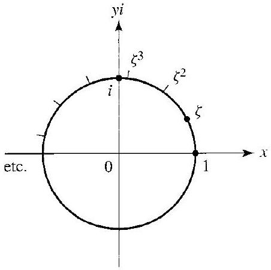
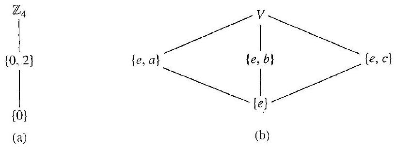

# Editorial records — Section 5: Subgroups

Status: source-reviewed and formatted. Lint has only two figure-size advisories; native review pending.

## Heading formatting.

Before:

```text
## section 5 Subgroups
```

After:

```text
# 5 Subgroups
```

## Restore math/prose spacing.

Before:

```text
$\mathbb{Q}^{+}$is
```

After:

```text
$\mathbb{Q}^{+}$ is
```

## Restore math/prose spacing.

Before:

```text
$\mathbb{Q}^{+}$under
```

After:

```text
$\mathbb{Q}^{+}$ under
```

## Restore math/prose spacing.

Before:

```text
$\mathbb{R}^{+}$under
```

After:

```text
$\mathbb{R}^{+}$ under
```

## Restore math/prose spacing.

Before:

```text
\mathbb{Z}^{+}$such
```

After:

```text
\mathbb{Z}^{+}$ such
```

## Restore group angle brackets, p.50.

Before:

```text
$(\mathbb{Z},+)$
```

After:

```text
$\langle\mathbb{Z},+\rangle$
```

## Restore missing set math delimiters, p.51.

Before:

```text
since \{0, 3\} is
```

After:

```text
since $\{0,3\}$ is
```

## Join interrupted inline equation, p.53.

Before:

```text
\operatorname{det}\left(A^{-1}\right)=$ $\operatorname{det}
```

After:

```text
\operatorname{det}\left(A^{-1}\right)=\operatorname{det}
```

## Restore missing math delimiters, p.53.

Before:

```text
containing the element a must
```

After:

```text
containing the element $a$ must
```

## Restore missing math delimiters, p.53.

Before:

```text
(or na for additive groups)
```

After:

```text
(or $na$ for additive groups)
```

## Restore cyclic subgroup angle brackets misread as parentheses, p.54.

Before:

```text
Let us find (3).
```

After:

```text
Let us find $\langle3\rangle$.
```

## Restore cyclic subgroup angle brackets, p.54.

Before:

```text
and (3) must contain
```

After:

```text
and $\langle3\rangle$ must contain
```

## Restore blackboard Z and math delimiters, Exercise 21a, p.56.

Before:

```text
a. 25Z under addition
```

After:

```text
a. $25\mathbb{Z}$ under addition
```

## Restore mathematical equivalence-relation symbol, Exercise 53, p.58.

Before:

```text
Show that ~ is
```

After:

```text
Show that $\sim$ is
```

## Repair prematurely closed math and unmatched escaped set delimiter, Exercise 52a, p.58.

Before:

```text
$H_{S}=\{x \in G \mid x s=s x$ for all $s \in S\}$
```

After:

```text
$H_{S}=\{x \in G \mid xs=sx\text{ for all }s\in S\}$
```

## Restore source prose around floating margin objects, pp.49–50.

Before:

```text
Tables 5.1 and 5.2 interrupt "are used as identity elements"
```

After:

```text
Both tables follow the complete paragraph
```

## Preserve group label Z4 in scientific-table caption in finishing step, rather than as an extra table row.

Before:

```text
5.10 Table
$\mathbb{Z}_{4}$ :
```

After:

```text
5.10 Table
```

## Restore source Table 5.11 geometry: V is a label beside the table, not a blank extra column. Preserve V in component caption.

Before:

```text
| $V$ : |  | $e$ | $a$ | $b$ | $c$ |
| :--- | :--- | :--- | :--- | :--- | :--- |
|  | $e$ | $e$ | $a$ | $b$ | $c$ |
|  | $a$ | $a$ | $e$ | $c$ | $b$ |
|  | $b$ | $b$ | $c$ | $e$ | $a$ |
|  | $c$ | $c$ | $b$ | $a$ | $e$ |
```

After:

```text
|  | $e$ | $a$ | $b$ | $c$ |
| :--- | :--- | :--- | :--- | :--- |
| $e$ | $e$ | $a$ | $b$ | $c$ |
| $a$ | $a$ | $e$ | $c$ | $b$ |
| $b$ | $b$ | $c$ | $e$ | $a$ |
| $c$ | $c$ | $b$ | $a$ | $e$ |
```

## Remove textbook-specific cross-reference from Definition 5.3 without changing mathematical text.

Before:

```text
(Recall from Section 0 that, for any set $S,|S|$ is the cardinality of $S$.)
```

After:

```text
(For any set $S,|S|$ is the cardinality of $S$.)
```

## Remove textbook-specific reference from Definition 5.18.

Before:

```text
of $G$, characterized in Theorem 5.17, is called
```

After:

```text
of $G$ is called
```

## Restore minimum notation from preceding source paragraph for independent Definition 5.5.

Before:

```text
The subgroup $\{e\}$ is the trivial subgroup of $G$.
```

After:

```text
The subgroup $\{e\}$ is the trivial subgroup of $G$, where $e$ is the identity element of $G$.
```

## Restore minimum cyclic-subgroup notation from Definition 5.18 for independent Definition 5.19.

Before:

```text
if $\langle a\rangle=G$. A group
```

After:

```text
if $\langle a\rangle=G$, where $\langle a\rangle=\{a^n\mid n\in\mathbb{Z}\}$. A group
```

## Restore author footnote; keep its chapter-specific references outside reusable statement.

Before:

```text
Displaced footnote marker before proof; footnote body at end of OCR part
```

After:

```text
Footnote anchored at external Theorem 5.17 source label, full author text retained at section end
```

## Restore faithful prompt for demonstrated task; all author solution text retained.

Before:

```text
Example 5.6 has no separate question prompt
```

After:

```text
Let $\mathbb{R}^{n}$ be the additive group of all $n$-component row vectors with real number entries. Is the subset of vectors having 0 as entry in the first component a subgroup?
```

## Restore faithful prompt for demonstrated task; all author solution text retained.

Before:

```text
Example 5.7 has no separate question prompt
```

After:

```text
Is $\mathbb{Q}^{+}$ under multiplication a proper subgroup of $\mathbb{R}^{+}$ under multiplication?
```

## Restore faithful prompt for demonstrated task; all author solution text retained.

Before:

```text
Example 5.8 has no separate question prompt
```

After:

```text
Do the $n$th roots of unity in $\mathbb{C}$ form a subgroup of $\mathbb{C}^{*}$ under multiplication?
```

## Restore faithful prompt for demonstrated task; all author solution text retained.

Before:

```text
Example 5.9 has no separate question prompt
```

After:

```text
Describe the two group structures of order 4, $\mathbb{Z}_{4}$ and $V$, and their nontrivial proper subgroups.
```

## Restore faithful prompt for demonstrated task; all author solution text retained.

Before:

```text
Example 5.13 has no separate question prompt
```

After:

```text
Let $F$ be the group of all real-valued functions with domain $\mathbb{R}$ under addition. Is its subset of continuous functions a subgroup?
```

## Restore faithful prompt for demonstrated task; all author solution text retained.

Before:

```text
Example 5.15 has no separate question prompt
```

After:

```text
Let $F$ be the group of all real-valued functions with domain $\mathbb{R}$ under addition. Is its subset of differentiable functions a subgroup?
```

## Restore faithful prompt for demonstrated task; all author solution text retained.

Before:

```text
Example 5.16 has no separate question prompt
```

After:

```text
Let $G$ be the multiplicative group of invertible $n\times n$ matrices with entries in $\mathbb{C}$. Is its subset of matrices with determinant 1 a subgroup?
```

## Restore faithful prompt for demonstrated task; all author solution text retained.

Before:

```text
Example 5.20 has no separate question prompt
```

After:

```text
Are the groups $\mathbb{Z}_{4}$ and $V$ of Example 5.9 cyclic? Determine their generators.
```

## Restore faithful prompt for demonstrated task; all author solution text retained.

Before:

```text
Example 5.21 has no separate question prompt
```

After:

```text
Are $\mathbb{Z}$ under addition and $\mathbb{Z}_{n}$ under addition modulo $n$ cyclic? Identify generators.
```

## Restore faithful prompt for demonstrated task; all author solution text retained.

Before:

```text
Example 5.23 has no separate question prompt
```

After:

```text
For a positive integer $n$, show that the multiplicative group $U_n$ of the $n$th roots of unity in $\mathbb{C}$ is cyclic, and identify a generator.
```

## Formatting-only changes

Five definitions and two theorems wrapped; printed labels outside reusable statements. Eleven worked examples have prompts in callouts and author solutions outside. All 57 exercises wrapped with shared directions outside; intentional false statements and incorrect definitions in exercises preserved. Original OCR unchanged.

## Table 5.1

Formatting only: editable scientific table, source cells and printed caption preserved; single-letter mathematical entries receive math delimiters.

Before:

```text
5.1 Table

|  | 1 | $a$ | $b$ |
| :--- | :--- | :--- | :--- |
| 1 | 1 | $a$ | $b$ |
| $a$ | $a$ | $b$ | 1 |
| $b$ | $b$ | 1 | $a$ |

```

After:

```text
```scientific-table
id: 3ce29aee-45ec-4f16-9341-f7932013329f
numbered: false
title: ""
caption: Table 5.1
captionVisible: true
captionPosition: below
rows:
  - - text: ""
      align: center
    - text: "1"
      align: center
    - text: $a$
      align: center
    - text: $b$
      align: center
  - - text: "1"
      align: center
    - text: "1"
      align: center
    - text: $a$
      align: center
    - text: $b$
      align: center
  - - text: $a$
      align: center
    - text: $a$
      align: center
    - text: $b$
      align: center
    - text: "1"
      align: center
  - - text: $b$
      align: center
    - text: $b$
      align: center
    - text: "1"
      align: center
    - text: $a$
      align: center
headerRows: 1
rowHeaders: true
style: scientific
```

```

## Table 5.2

Formatting only: editable scientific table, source cells and printed caption preserved; single-letter mathematical entries receive math delimiters.

Before:

```text
5.2 Table

| + | 0 | $a$ | $b$ |
| :--- | :--- | :--- | :--- |
| 0 | 0 | $a$ | $b$ |
| $a$ | $a$ | $b$ | 0 |
| $b$ | $b$ | 0 | $a$ |

```

After:

```text
```scientific-table
id: 8d954d7e-6112-41af-9842-8773c03d5780
numbered: false
title: ""
caption: Table 5.2
captionVisible: true
captionPosition: below
rows:
  - - text: +
      align: center
    - text: "0"
      align: center
    - text: $a$
      align: center
    - text: $b$
      align: center
  - - text: "0"
      align: center
    - text: "0"
      align: center
    - text: $a$
      align: center
    - text: $b$
      align: center
  - - text: $a$
      align: center
    - text: $a$
      align: center
    - text: $b$
      align: center
    - text: "0"
      align: center
  - - text: $b$
      align: center
    - text: $b$
      align: center
    - text: "0"
      align: center
    - text: $a$
      align: center
headerRows: 1
rowHeaders: true
style: scientific
```

```

## Table 5.10

Formatting only: editable scientific table, source cells and printed caption preserved; single-letter mathematical entries receive math delimiters.

Before:

```text
5.10 Table

| + | 0 | 1 | 2 | 3 |
| :--- | :--- | :--- | :--- | :--- |
| 0 | 0 | 1 | 2 | 3 |
| 1 | 1 | 2 | 3 | 0 |
| 2 | 2 | 3 | 0 | 1 |
| 3 | 3 | 0 | 1 | 2 |

```

After:

```text
```scientific-table
id: 5890e4da-b9ed-4219-a602-519f9d59772e
numbered: false
title: ""
caption: Table 5.10
captionVisible: true
captionPosition: below
rows:
  - - text: +
      align: center
    - text: "0"
      align: center
    - text: "1"
      align: center
    - text: "2"
      align: center
    - text: "3"
      align: center
  - - text: "0"
      align: center
    - text: "0"
      align: center
    - text: "1"
      align: center
    - text: "2"
      align: center
    - text: "3"
      align: center
  - - text: "1"
      align: center
    - text: "1"
      align: center
    - text: "2"
      align: center
    - text: "3"
      align: center
    - text: "0"
      align: center
  - - text: "2"
      align: center
    - text: "2"
      align: center
    - text: "3"
      align: center
    - text: "0"
      align: center
    - text: "1"
      align: center
  - - text: "3"
      align: center
    - text: "3"
      align: center
    - text: "0"
      align: center
    - text: "1"
      align: center
    - text: "2"
      align: center
headerRows: 1
rowHeaders: true
style: scientific
```

```

## Table 5.11

Formatting only: editable scientific table, source cells and printed caption preserved; single-letter mathematical entries receive math delimiters.

Before:

```text
5.11 Table

|  | $e$ | $a$ | $b$ | $c$ |
| :--- | :--- | :--- | :--- | :--- |
| $e$ | $e$ | $a$ | $b$ | $c$ |
| $a$ | $a$ | $e$ | $c$ | $b$ |
| $b$ | $b$ | $c$ | $e$ | $a$ |
| $c$ | $c$ | $b$ | $a$ | $e$ |

```

After:

```text
```scientific-table
id: eb9df042-2268-4331-8566-569f084f1e6a
numbered: false
title: ""
caption: Table 5.11
captionVisible: true
captionPosition: below
rows:
  - - text: ""
      align: center
    - text: $e$
      align: center
    - text: $a$
      align: center
    - text: $b$
      align: center
    - text: $c$
      align: center
  - - text: $e$
      align: center
    - text: $e$
      align: center
    - text: $a$
      align: center
    - text: $b$
      align: center
    - text: $c$
      align: center
  - - text: $a$
      align: center
    - text: $a$
      align: center
    - text: $e$
      align: center
    - text: $c$
      align: center
    - text: $b$
      align: center
  - - text: $b$
      align: center
    - text: $b$
      align: center
    - text: $c$
      align: center
    - text: $e$
      align: center
    - text: $a$
      align: center
  - - text: $c$
      align: center
    - text: $c$
      align: center
    - text: $b$
      align: center
    - text: $a$
      align: center
    - text: $e$
      align: center
headerRows: 1
rowHeaders: true
style: scientific
```

```

## Figure 5.24

Formatting only: preserved image and printed caption in scientific figure component.

Before:

```text

5.24 Figure

```

After:

```text
```scientific-figure
id: 9b217393-4cce-4bcc-94cc-808c760c875d
numbered: false
title: ""
caption: Figure 5.24
captionVisible: true
captionPosition: below
columns: 1
panels:
  - path: images/15b9d5af-cac3-4d4f-a9ff-bf6549d301c7-45_451_452_492_875.jpg
    caption: ""
```
```

## Figure 5.12

Formatting only: source image and full author caption retained in scientific figure component.

Before:

```text

5.12 Figure (a) Subgroup diagram for $\mathbb{Z}_{4}$. (b) Subgroup diagram for V.
```

After:

```text
```scientific-figure
id: 300bafa2-f7d4-48bc-b13a-acc0843204f7
numbered: false
title: ""
caption: Figure 5.12 — (a) Subgroup diagram for $\mathbb{Z}_{4}$. (b) Subgroup diagram for $V$.
captionVisible: true
captionPosition: below
columns: 1
panels:
  - path: images/15b9d5af-cac3-4d4f-a9ff-bf6549d301c7-42_308_817_486_740.jpg
    caption: ""
```
```

## Table 5.25

Formatting only: editable table in Exercise 36; source cells preserved and blanks left unanswered, printed p.57.

Before:

```text
> ### 5.25 Table
>
> $$
> \mathbb{Z}_{6}: \begin{array}{c|c|c|c|c|c|c}
> + & 0 & 1 & 2 & 3 & 4 & 5 \\
> \hline 0 & 0 & 1 & 2 & 3 & 4 & 5 \\
> \hline 1 & 1 & 2 & 3 & 4 & 5 & 0 \\
> \hline 2 & 2 & & & & & \\
> \hline 3 & 3 & & & & & \\
> \hline 4 & 4 & & & & & \\
> \hline 5 & 5 & & & & &
> \end{array}
> $$
```

After:

```text
> ```scientific-table
> id: e8f2e955-0d76-4c46-a40a-c74c104f91d7
> numbered: false
> title: ""
> caption: Table 5.25 — $\mathbb{Z}_{6}$
> captionVisible: true
> captionPosition: below
> rows:
>   - - text: +
>       align: center
>     - text: "0"
>       align: center
>     - text: "1"
>       align: center
>     - text: "2"
>       align: center
>     - text: "3"
>       align: center
>     - text: "4"
>       align: center
>     - text: "5"
>       align: center
>   - - text: "0"
>       align: center
>     - text: "0"
>       align: center
>     - text: "1"
>       align: center
>     - text: "2"
>       align: center
>     - text: "3"
>       align: center
>     - text: "4"
>       align: center
>     - text: "5"
>       align: center
>   - - text: "1"
>       align: center
>     - text: "1"
>       align: center
>     - text: "2"
>       align: center
>     - text: "3"
>       align: center
>     - text: "4"
>       align: center
>     - text: "5"
>       align: center
>     - text: "0"
>       align: center
>   - - text: "2"
>       align: center
>     - text: "2"
>       align: center
>     - text: ""
>       align: center
>     - text: ""
>       align: center
>     - text: ""
>       align: center
>     - text: ""
>       align: center
>     - text: ""
>       align: center
>   - - text: "3"
>       align: center
>     - text: "3"
>       align: center
>     - text: ""
>       align: center
>     - text: ""
>       align: center
>     - text: ""
>       align: center
>     - text: ""
>       align: center
>     - text: ""
>       align: center
>   - - text: "4"
>       align: center
>     - text: "4"
>       align: center
>     - text: ""
>       align: center
>     - text: ""
>       align: center
>     - text: ""
>       align: center
>     - text: ""
>       align: center
>     - text: ""
>       align: center
>   - - text: "5"
>       align: center
>     - text: "5"
>       align: center
>     - text: ""
>       align: center
>     - text: ""
>       align: center
>     - text: ""
>       align: center
>     - text: ""
>       align: center
>     - text: ""
>       align: center
> headerRows: 1
> rowHeaders: true
> style: scientific
> ```
```

## Mathematical operation stars — Markdown delimiter repair

Bare operation symbols were parsed as Markdown emphasis, breaking surrounding math rendering. Added math delimiters only; prime suffixes remain part of the symbol. Existing mathematical formulas, author wording and callout identities are unchanged.

Source line 6: `*` → `$*$`. Context: `terminology used in group theory. Algebraists as a rule do not use a special symbol * to denote a binary operation different from the usual addition and multiplication. T`
