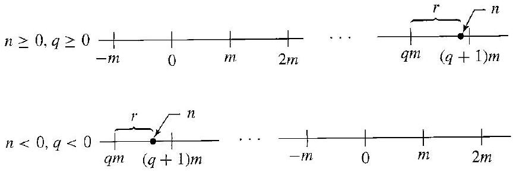
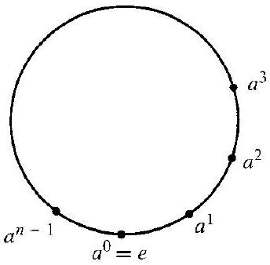
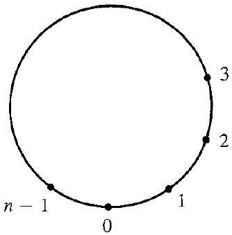
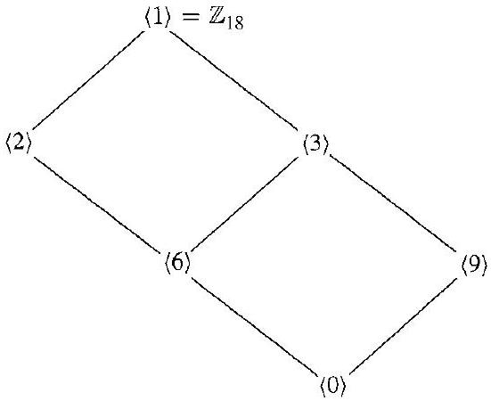

# Editorial records — Section 6: Cyclic Groups

Status: source-reviewed and formatted; lint has only figure-size advisories. Native review pending.

## Join source paragraph across pp.60–61.

Before:

```text
We will have to
use the definition
```

After:

```text
We will have to use the definition
```

## Join source paragraph across pp.63–64.

Before:

```text
To see arithmetically
where
```

After:

```text
To see arithmetically where
```

## Restore math/prose spacing.

Before:

```text
\mathbb{Z}^{+}$such
```

After:

```text
\mathbb{Z}^{+}$ such
```

## Restore math/prose spacing.

Before:

```text
\mathbb{Z}^{+}$if
```

After:

```text
\mathbb{Z}^{+}$ if
```

## Correct printed mathematical error, p.60: a nonmultiple cannot have zero remainder.

Before:

```text
is not a multiple of $m$ so that we can take $r=0$
```

After:

```text
is not a multiple of $m$ so that we cannot take $r=0$
```

## Correct omitted zero exponent in proof, p.63: the displayed list includes a^0=e, which must also be covered by distinctness argument.

Before:

```text
$0<k<h<n$
```

After:

```text
$0\leq k<h<n$
```

## Restore modular-addition subscript misread as ordinary addition, p.63.

Before:

```text
$k=i+n j$
```

After:

```text
$k=i+_{n}j$
```

## Attach modular-addition subscript to its operation symbol.

Before:

```text
+{ }_{n}
```

After:

```text
+_{n}
```

## Restore subgroup angle brackets, p.65.

Before:

```text
The element 6 of (2)
```

After:

```text
The element 6 of $\langle2\rangle$
```

## Restore subgroup angle brackets in Exercise 19, p.66.

Before:

```text
cyclic subgroup $(i)$
```

After:

```text
cyclic subgroup $\langle i\rangle$
```

## Correct spelling in Exercise 44, p.67.

Before:

```text
isomophisms
```

After:

```text
isomorphisms
```

## Join interrupted inline equation.

Before:

```text
\operatorname{gcd}(s, n)=$ $\operatorname{gcd}(t, n)
```

After:

```text
\operatorname{gcd}(s, n)=\operatorname{gcd}(t, n)
```

## Restore minimum modular group notation from Sections 1 and 5 for independent theorem use.

Before:

```text
Let $G$ be a cyclic group with generator $a$. If the order of $G$ is infinite, then $G$ is isomorphic to $\langle\mathbb{Z},+\rangle$. If $G$ has finite order $n$, then $G$ is isomorphic to $\left\langle\mathbb{Z}_{n},+_{n}\right\rangle$.
```

After:

```text
Let $G$ be a cyclic group with generator $a$. If the order of $G$ is infinite, then $G$ is isomorphic to $\langle\mathbb{Z},+\rangle$. If $G$ has finite order $n$, then $G$ is isomorphic to $\left\langle\mathbb{Z}_{n},+_{n}\right\rangle$. Here $\mathbb{Z}_n=\{0,1,\ldots,n-1\}$ and $+_n$ denotes addition modulo $n$.
```

## Wrap source boxed division property, p.62; source label (1) stays outside. Restore positive-integer context from preceding paragraph and integer multiplier required by divisibility.

Before:

```text
If $r$ and $s$ are relatively prime and if $r$ divides $s m$, then $r$ must divide $m$.

(1)
```

After:

```text
Let $r$ and $s$ be positive integers and let $m$ be an integer. If $r$ and $s$ are relatively prime and if $r$ divides $s m$, then $r$ must divide $m$.
```

## Restore faithful question for demonstrated task; preserve all author solution text.

Before:

```text
Example 6.13 has no separate prompt
```

After:

```text
For a cyclic group of order $n$ generated by $a$, visualize multiplication of $a^h$ and $a^k$ on a circle and determine the resulting exponent using the division algorithm.
```

## Restore faithful question for demonstrated task; preserve all author solution text.

Before:

```text
Example 6.15 has no separate prompt
```

After:

```text
In the additive group $\mathbb{Z}_{12}$, determine the subgroups generated by 3, 8, and 5 and their orders.
```

## Formatting-only changes

Five theorem/result statements, two corollaries, one definition and the boxed divisibility property wrapped; source labels outside. The Division Algorithm for Z retains its author title and uses theorem type because its content is an existence-and-uniqueness statement, not a procedural algorithm. Six worked examples have prompts in callouts and original working outside under ##### solution. All 56 exercises wrapped; shared directions and intentional false claims retained. Author wording and source order otherwise preserved.

## Figure 6.2

Formatting only: preserved image and printed caption in scientific figure component.

Before:

```text

6.2 Figure
```

After:

```text
```scientific-figure
id: cc2302a3-c7c4-497c-bf0c-38a798ed304d
numbered: false
title: ""
caption: Figure 6.2
captionVisible: true
captionPosition: below
columns: 1
panels:
  - path: images/15b9d5af-cac3-4d4f-a9ff-bf6549d301c7-50_290_864_339_735.jpg
    caption: ""
```
```

## Figure 6.11

Formatting only: preserved image and printed caption in scientific figure component.

Before:

```text

6.11 Figure
```

After:

```text
```scientific-figure
id: 7def8324-17e5-4182-b09e-2f688a931f28
numbered: false
title: ""
caption: Figure 6.11
captionVisible: true
captionPosition: below
columns: 1
panels:
  - path: images/15b9d5af-cac3-4d4f-a9ff-bf6549d301c7-53_338_344_1496_733.jpg
    caption: ""
```
```

## Figure 6.12

Formatting only: preserved image and printed caption in scientific figure component.

Before:

```text

6.12 Figure
```

After:

```text
```scientific-figure
id: 9c567d0c-78d3-4f17-895f-0e3293b227ab
numbered: false
title: ""
caption: Figure 6.12
captionVisible: true
captionPosition: below
columns: 1
panels:
  - path: images/15b9d5af-cac3-4d4f-a9ff-bf6549d301c7-53_339_334_1513_1144.jpg
    caption: ""
```
```

## Figure 6.18

Formatting only: preserved image and printed caption in scientific figure component.

Before:

```text

6.18 Figure Subgroup diagram for $\mathbb{Z}_{18}$.
```

After:

```text
```scientific-figure
id: 893819e6-0cd4-4b53-b48c-1a47bb667013
numbered: false
title: ""
caption: Figure 6.18 — Subgroup diagram for $\mathbb{Z}_{18}$.
captionVisible: true
captionPosition: below
columns: 1
panels:
  - path: images/15b9d5af-cac3-4d4f-a9ff-bf6549d301c7-55_450_551_1497_821.jpg
    caption: ""
```
```
