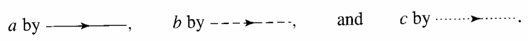
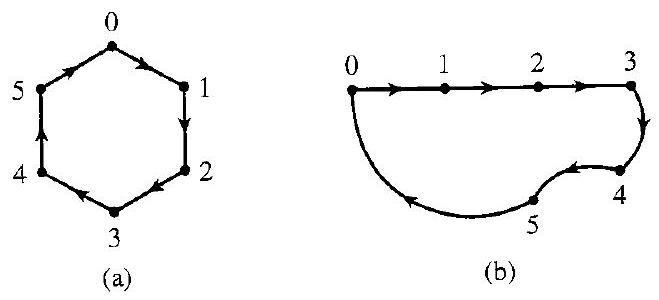
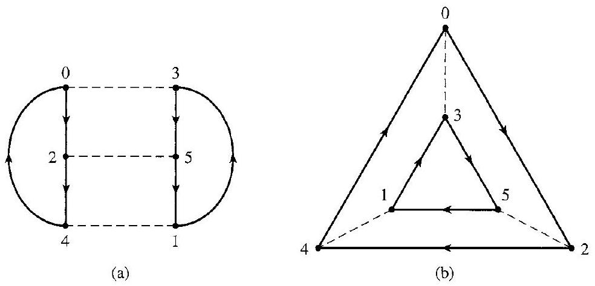
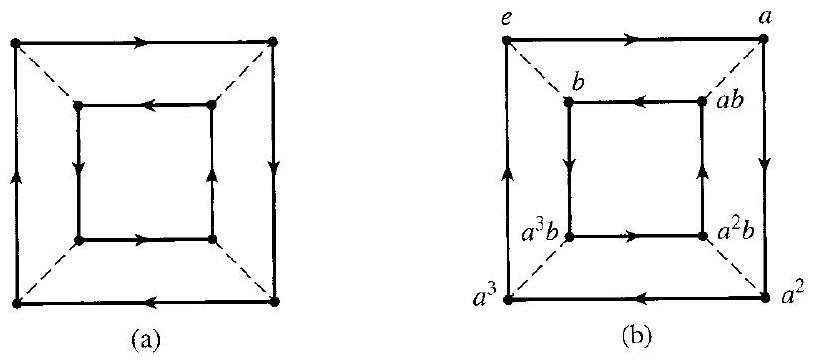
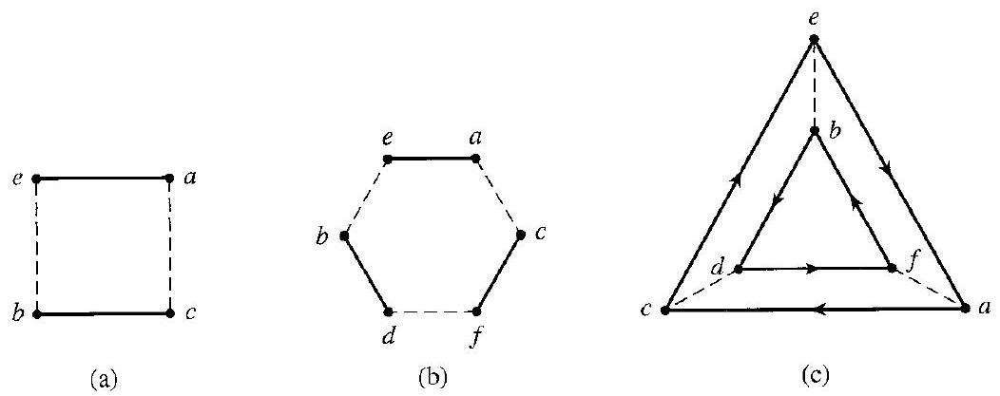
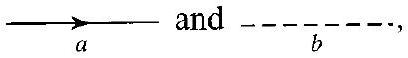

# Editorial records — Section 7: Generating Sets and Cayley Digraphs

Status: source-reviewed and formatted; lint has only figure-size advisories. Native review pending.

## Restore missing math delimiters, Example 7.2.

Before:

```text
and \{5\}.
```

After:

```text
and $\{5\}$.
```

## Join source paragraph across pp.69–70.

Before:

```text
the opposite
sign
```

After:

```text
the opposite sign
```

## Separate closing display delimiter and source end marker.

Before:

```text
$$ $\square$
```

After:

```text
$$

$\square$
```

## Restore the single directed arc printed on p.70, rather than two OCR arrows.

Before:

```text
$x \longrightarrow \longrightarrow y$
```

After:

```text
$x\longrightarrow y$
```

## Restore dashed undirected arc symbol on p.70; OCR underscores are not an answer blank.

Before:

```text
by \_\_\_\_
```

After:

```text
by $\text{-------}$
```

## Restore full set math delimiters, Example 7.10.

Before:

```text
$S=$ \{2, 3\}
```

After:

```text
$S=\{2,3\}$
```

## Join interrupted inline equation in the property/reason table.

Before:

```text
$u q=$ $u g^{-1} h=u r$
```

After:

```text
$u q=u g^{-1}h=ur$
```

## Restore opening parenthesis inside math, Example 7.12, p.72.

Before:

```text
To compute ( $\left.a^{3} b\right)\left(a^{2} b\right)$
```

After:

```text
To compute $\left(a^{3}b\right)\left(a^{2}b\right)$
```

## Restore missing set math delimiters in Exercises 1–6, p.72.

Before:

```text
subset \{2, 3\} of
```

After:

```text
subset $\{2, 3\}$ of
```

## Restore missing set math delimiters in Exercises 1–6, p.72.

Before:

```text
subset \{4, 6\} of
```

After:

```text
subset $\{4, 6\}$ of
```

## Restore missing set math delimiters in Exercises 1–6, p.72.

Before:

```text
subset \{8, 10\} of
```

After:

```text
subset $\{8, 10\}$ of
```

## Restore missing set math delimiters in Exercises 1–6, p.72.

Before:

```text
subset \{12, 30\} of
```

After:

```text
subset $\{12, 30\}$ of
```

## Restore missing set math delimiters in Exercises 1–6, p.72.

Before:

```text
subset \{12, 42\} of
```

After:

```text
subset $\{12, 42\}$ of
```

## Restore missing set math delimiters in Exercises 1–6, p.72.

Before:

```text
subset \{18, 24, 39\} of
```

After:

```text
subset $\{18, 24, 39\}$ of
```

## Restore source arrow legend by direct PDF crop, p.70; no graphics redrawn or generated.

Before:

```text
$$
a \text { by } \longrightarrow, \quad b \text { by } \longrightarrow, \quad \text { and } \quad c \text { by } \cdots, \cdots,
$$
```

After:

```text

```

## Restore generator label beneath caption arrow, p.70.

Before:

```text
7.8 Figure Two digraphs for $\mathbb{Z}_{6}$ with $S=\{1\}$ using ⟶ .
```

After:

```text
7.8 Figure Two digraphs for $\mathbb{Z}_{6}$ with $S=\{1\}$ using $\underset{1}{\longrightarrow}$.
```

## Restore both generator labels and dashed line in caption, p.71.

Before:

```text
7.9 Figure Two digraphs for $\mathbb{Z}_{6}$ with $S=\{2,3\}$ using ⟶ and -------..
```

After:

```text
7.9 Figure Two digraphs for $\mathbb{Z}_{6}$ with $S=\{2,3\}$ using $\underset{2}{\longrightarrow}$ and $\underset{3}{\text{-------}}$.
```

## Restore faithful prompt for demonstrated task; keep original working outside.

Before:

```text
Example 7.1 has no separate prompt
```

After:

```text
Which of $\{a,b\}$, $\{a,c\}$, $\{b,c\}$, and $\{a,b,c\}$ generate the Klein 4-group $V=\{e,a,b,c\}$?
```

## Restore faithful prompt for demonstrated task; keep original working outside.

Before:

```text
Example 7.2 has no separate prompt
```

After:

```text
Which of $\{1\}$, $\{5\}$, $\{2,3\}$, $\{3,4\}$, $\{2,3,4\}$, $\{1,3\}$, $\{3,5\}$, and $\{2,4\}$ generate $\mathbb{Z}_6$?
```

## Restore faithful prompt for demonstrated task; keep original working outside.

Before:

```text
Example 7.7 has no separate prompt
```

After:

```text
What group and generating set do the two digraphs in Fig. 7.8 represent? Do the lengths and shapes of arcs or the angles between arcs affect the representation?
```

## Restore faithful prompt for demonstrated task; keep original working outside.

Before:

```text
Example 7.10 has no separate prompt
```

After:

```text
What group and generating set do the digraphs in Fig. 7.9 represent? Explain why the dashed arcs have no arrowheads.
```

## Restore faithful prompt for demonstrated task; keep original working outside.

Before:

```text
Example 7.12 has no separate prompt
```

After:

```text
Label the digraph in Fig. 7.11(a) using generators $a$ and $b$ and an identity vertex $e$. Identify its elements and compute $(a^3b)(a^2b)$ using the labeled digraph.
```

## Remove duplicate part-end OCR footnotes from Section 7 after verifying their restoration to corresponding sections; immutable part OCR retains them.

Before:

```text

[^0]:    ${ }^{\dagger}$ Most students of abstract algebra have studied linear algebra and are familiar with matrices and matrix operations. For the benefit of those students, examples involving matrices are often given. The reader who is not familiar with matrices can either skip all references to them or turn to the Appendix at the back of the text, where there is a short summary.

[^1]:    ${ }^{\dagger}$ Remember that boldface type indicates that a term is being defined.

[^2]:    ${ }^{\dagger}$ We may find occasion to distinguish between the terms minimal and smallest as applied to subsets of a set $S$ that have some property. A subset $H$ of $S$ is minimal with respect to the property if $H$ has the property, and no subset $K \subset H, K \neq H$, has the property. If $H$ has the property and $H \subseteq K$ for every subset $K$ with the property, then $H$ is the smallest subset with the property. There may be many minimal subsets, but there can be only one smallest subset. To illustrate, $\{e, a\},\{e, b\}$, and $\{e, c\}$ are all minimal nontrivial subgroups of the group $V$. (See Fig. 5.12.) However, $V$ contains no smallest nontrivial subgroup.


```

After:

```text
Footnotes are in Sections 2, 3 and 5 beside their actual anchors.
```

## Formatting-only changes

Two definitions and two theorems wrapped with source numbers outside. Five worked-example prompts supplied; all author solutions preserved outside. All 19 exercises wrapped; shared directions and Figure 7.13 stay outside Exercise 7 because the figure belongs to Exercises 8–10. Property/reason table remains a table, not an Index callout.

## Figure 7.8

Formatting only: preserved image and printed caption in scientific figure component.

Before:

```text

7.8 Figure Two digraphs for $\mathbb{Z}_{6}$ with $S=\{1\}$ using $\underset{1}{\longrightarrow}$.
```

After:

```text
```scientific-figure
id: 90af3871-1b60-4f7e-95a5-eac7b7a4f9cf
numbered: false
title: ""
caption: Figure 7.8 — Two digraphs for $\mathbb{Z}_{6}$ with $S=\{1\}$ using $\underset{1}{\longrightarrow}$.
captionVisible: true
captionPosition: below
columns: 1
panels:
  - path: images/15b9d5af-cac3-4d4f-a9ff-bf6549d301c7-60_300_659_1724_880.jpg
    caption: ""
```
```

## Figure 7.9

Formatting only: preserved image and printed caption in scientific figure component.

Before:

```text

7.9 Figure Two digraphs for $\mathbb{Z}_{6}$ with $S=\{2,3\}$ using $\underset{2}{\longrightarrow}$ and $\underset{3}{\text{-------}}$.
```

After:

```text
```scientific-figure
id: dbe16a41-00a7-4d9b-ab89-c33218cac2af
numbered: false
title: ""
caption: Figure 7.9 — Two digraphs for $\mathbb{Z}_{6}$ with $S=\{2,3\}$ using $\underset{2}{\longrightarrow}$ and $\underset{3}{\text{-------}}$.
captionVisible: true
captionPosition: below
columns: 1
panels:
  - path: images/15b9d5af-cac3-4d4f-a9ff-bf6549d301c7-61_474_984_236_622.jpg
    caption: ""
```
```

## Figure 7.11

Formatting only: preserved image and printed caption in scientific figure component.

Before:

```text

7.11 Figure
```

After:

```text
```scientific-figure
id: 2ff338c9-615c-43ed-8ecd-b6162b3ce8b9
numbered: false
title: ""
caption: Figure 7.11
captionVisible: true
captionPosition: below
columns: 1
panels:
  - path: images/15b9d5af-cac3-4d4f-a9ff-bf6549d301c7-62_360_813_230_777.jpg
    caption: ""
```
```

## Figure 7.13

Formatting only: preserved image and printed caption in scientific figure component.

Before:

```text

7.13 Figure
```

After:

```text
```scientific-figure
id: 3ec3f4ff-27e5-4df2-ac8e-bc3b6724ca0f
numbered: false
title: ""
caption: Figure 7.13
captionVisible: true
captionPosition: below
columns: 1
panels:
  - path: images/15b9d5af-cac3-4d4f-a9ff-bf6549d301c7-62_417_1052_1667_656.jpg
    caption: ""
```
```

## Unnumbered source arrow legend

Formatting only: preserve original diagram in captionless scientific figure.

Before:

```text

```

After:

```text
```scientific-figure
id: 6c2dd01f-b837-4319-86fb-a80bae874d0a
numbered: false
title: ""
caption: ""
captionVisible: false
captionPosition: below
columns: 1
panels:
  - path: images/cayley-generator-arrow-legend.png
    caption: ""
```
```

## Unnumbered source arrow legend

Formatting only: preserve original diagram in captionless scientific figure.

Before:

```text

```

After:

```text
```scientific-figure
id: 812414d6-79fb-468b-98f0-019258fd8eb8
numbered: false
title: ""
caption: ""
captionVisible: false
captionPosition: below
columns: 1
panels:
  - path: images/15b9d5af-cac3-4d4f-a9ff-bf6549d301c7-62_58_408_776_977.jpg
    caption: ""
```
```

## Cayley digraph properties and reasons

Formatting only: editable two-column source table; all four property/reason pairs retained.

Before:

```text
| Property | Reason |
| :--- | :--- |
| 1. The digraph is connected, that is, we can get from any vertex $g$ to any vertex $h$ by traveling along consecutive arcs, starting at $g$ and ending at $h$. | Every equation $g x=h$ has a solution in a group. |
| 2. At most one arc goes from a vertex $g$ to a vertex $h$. | The solution of $g x=h$ is unique. |
| 3. Each vertex $g$ has exactly one arc of each type starting at $g$, and one of each type ending at $g$. | For $g \in G$ and each generator $b$ we can compute $g b$, and $\left(g b^{-1}\right) b=g$. |
| 4. If two different sequences of arc types starting from vertex $g$ lead to the same vertex $h$, then those same sequences of arc types starting from any vertex $u$ will lead to the same vertex $v$. | If $g q=h$ and $g r=h$, then $u q=u g^{-1}h=ur$. |

```

After:

```text
```scientific-table
id: 323953c5-5b1f-41d0-9f7d-a55f2c823d0b
numbered: false
title: ""
caption: ""
captionVisible: false
captionPosition: below
rows:
  - - text: Property
      align: left
    - text: Reason
      align: left
  - - text: 1. The digraph is connected, that is, we can get from any vertex $g$ to any vertex $h$ by traveling along consecutive arcs, starting at $g$ and ending at $h$.
      align: left
    - text: Every equation $g x=h$ has a solution in a group.
      align: left
  - - text: 2. At most one arc goes from a vertex $g$ to a vertex $h$.
      align: left
    - text: The solution of $g x=h$ is unique.
      align: left
  - - text: 3. Each vertex $g$ has exactly one arc of each type starting at $g$, and one of each type ending at $g$.
      align: left
    - text: For $g \in G$ and each generator $b$ we can compute $g b$, and $\left(g b^{-1}\right) b=g$.
      align: left
  - - text: 4. If two different sequences of arc types starting from vertex $g$ lead to the same vertex $h$, then those same sequences of arc types starting from any vertex $u$ will lead to the same vertex $v$.
      align: left
    - text: If $g q=h$ and $g r=h$, then $u q=u g^{-1}h=ur$.
      align: left
headerRows: 1
rowHeaders: false
style: scientific
```
```
