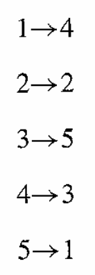
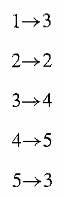
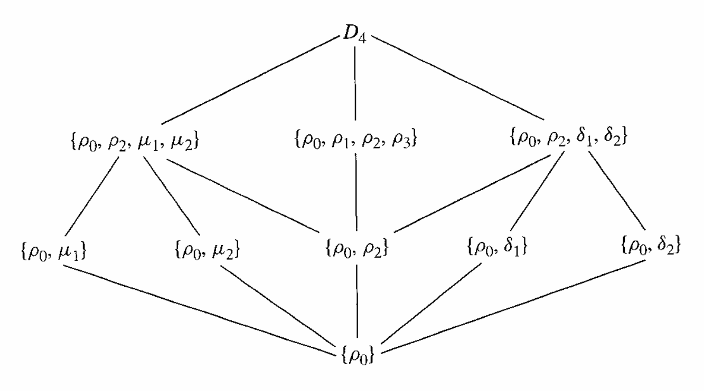
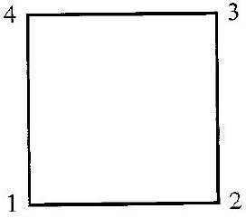
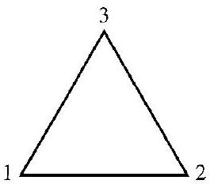
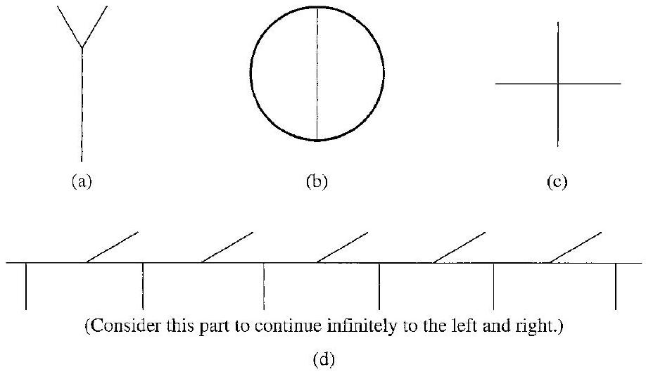

# Editorial records — Section 8: Groups of Permutations

Status: source review and mathematical formatting complete; scientific components complete; lint has six figure-size advisories only; native review pending.

## Restore bold vector math, p.75.

Before:

```text
regard x as
```

After:

```text
regard $\mathbf{x}$ as
```

## Restore missing math delimiters, p.75.

Before:

```text
\{1, 2, 3, 4, 5\}
```

After:

```text
$\{1, 2, 3, 4, 5\}$
```

## Restore missing math delimiters, p.75.

Before:

```text
\{4, 2, 5, 3, 1\}
```

After:

```text
$\{4, 2, 5, 3, 1\}$
```

## Restore composition symbol inside math, p.76.

Before:

```text
composition ○
```

After:

```text
composition $\circ$
```

## Restore composition symbol inside math, p.76.

Before:

```text
symbol ○
```

After:

```text
symbol $\circ$
```

## Restore set variable math, p.76.

Before:

```text
on A must
```

After:

```text
on $A$ must
```

## Restore set variable math, p.77.

Before:

```text
nonempty set A forms
```

After:

```text
nonempty set $A$ forms
```

## Correct digit-for-letter OCR in historical name, p.77.

Before:

```text
Abu-1-
```

After:

```text
Abu-l-
```

## Restore missing math delimiters, p.78.

Before:

```text
\{1,2,3,..., n\}
```

After:

```text
$\{1,2,3,\ldots,n\}$
```

## Restore missing math delimiters, p.78.

Before:

```text
\{1, 2, 3\}
```

After:

```text
$\{1, 2, 3\}$
```

## Restore closing parenthesis printed on p.79.

Before:

```text
(see Fig. 8.9 can
```

After:

```text
(see Fig. 8.9) can
```

## Restore printed hyphen across column line break, p.81.

Before:

```text
abstractsounding
```

After:

```text
abstract-sounding
```

## Correct printed cross-reference error, p.82: subgroup criterion is Theorem5.14;8.14 is the definition of image.

Before:

```text
given in Theorem 8.14
```

After:

```text
given in Theorem 5.14
```

## Join interrupted inline equation, p.82.

Before:

```text
$\phi(x y)=$ $\phi(x) \phi(y)$
```

After:

```text
$\phi(x y)=\phi(x) \phi(y)$
```

## Join paragraph split at page turn, pp.82–83.

Before:

```text
but provided by

a map
```

After:

```text
but provided by a map
```

## Restore integer-multiple group notation, p.84.

Before:

```text
17Z under addition
```

After:

```text
$17\mathbb{Z}$ under addition
```

## Restore integer-multiple group notation, p.84.

Before:

```text
3Z under addition
```

After:

```text
$3\mathbb{Z}$ under addition
```

## Restore word spacing, p.84.

Before:

```text
$\mathbb{R}^{+}$under
```

After:

```text
$\mathbb{R}^{+}$ under
```

## Correct OCR in Exercise44 against p.86.

Before:

```text
permutations in a group
```

After:

```text
permutations is a group
```

## Remove OCR-added word in Exercise47 against p.86.

Before:

```text
the only element of $\sigma$
```

After:

```text
the only element $\sigma$
```

## Restore matrix dimensions math, p.87.

Before:

```text
4 × 4 matrix
```

After:

```text
$4\times4$ matrix
```

## Join equation across pp.86–87; avoid dangling inline math and spurious paragraph.

Before:

```text
$a *(b * c)=$


$(a * b) * c$
```

After:

```text
$a *(b * c)=(a * b) * c$
```

## Separate display closer and source end marker.

Before:

```text
$$ $\square$
```

After:

```text
$$

$\square$
```

## Restore continuous author solution around floating sidebar, pp.76–77.

Before:

```text
Historical Note inside Example8.4 at page turn
```

After:

```text
Historical Note after complete Example8.4
```

## Restore two source mapping diagrams instead of OCR-combined table, p.76. Remove displaced part-opener footnote anchor; part opener retains it.

Before:

```text
[^0]| 1→4 | 1→3 |
| :--- | :--- |
| 2→2 | 2→2 |
| $3 \rightarrow 5$ | 3→4 |
| $4 \rightarrow 3$ | 4→5 |
| $5 \rightarrow 1$ | 5→3 |

8.1 Figure 8.2 Figure
```

After:

```text

8.1 Figure


8.2 Figure
```

## Restore complete subgroup diagram, p.80; OCR had merged two partial labels into Table8.12 and omitted all edges.

Before:

```text
| $\left\{\rho_{0}, \mu_{1}\right\}$ | $\left\{\rho_{0}, \rho_{2}, \mu_{1}, \mu_{2}\right\} \quad \quad\left\{\rho_{0}, \rho_{1}, \rho_{2}, \rho_{3}\right\}$ |  |  |  |  |  |  |  |
|  |  |  |  |  |  |  |  |  |

8.13 Figure Subgroup diagram for $D_{4}$.
```

After:

```text


8.13 Figure Subgroup diagram for $D_{4}$.
```

## Restore source float placement, p.79.

Before:

```text
Figure8.9 between Example8.7 prompt and array
```

After:

```text
Figure8.9 beside the following triangle-symmetry discussion
```

## Join Example8.10 opening paragraph around floating Figure8.11, pp.79–80; misplaced footnote1 moved to actual anchor.

Before:

```text
arbitrary

[^1]
8.11 Figure
notation
```

After:

```text
arbitrary notation
```

## Restore dihedral notation footnote at its printed anchor, p.79.

Before:

```text
See Exercise 44. ${ }^{\dagger}$
```

After:

```text
See Exercise 44.[^1]
```

## Restore complete footnote beside its Section8 anchor, p.79.

Before:

```text
Footnote body displaced to end of PartII OCR
```

After:

```text

[^1]: Many people denote the $n$th dihedral group by $D_{2n}$, rather than by $D_n$, since the order of the group is $2n$.

```

## Replace book-specific references by the minimum maps and notation from the immediately preceding source proof/comment, pp.82–83.

Before:

```text
The map $\phi$ in the proof of Theorem 8.16 is the left regular representation of $G$, and the map $\mu$ in the preceding comment is the right regular representation of $G$.
```

After:

```text
Let $G$ be a group and let $S_G$ be the group of all permutations of $G$ under function composition. For $x,g\in G$, let $\lambda_x(g)=xg$ and $\rho_x(g)=gx$, and define $\phi,\mu:G\to S_G$ by $\phi(x)=\lambda_x$ and $\mu(x)=\rho_{x^{-1}}$.

The map $\phi$ is the left regular representation of $G$, and the map $\mu$ is the right regular representation of $G$.
```

## Restore necessary operation convention from preceding source, pp.76–77.

Before:

```text
Let $A$ be a nonempty set, and let $S_{A}$ be the collection of all permutations of $A$. Then $S_{A}$ is a group under permutation multiplication.
```

After:

```text
Let $A$ be a nonempty set, and let $S_{A}$ be the collection of all permutations of $A$. Then $S_{A}$ is a group under permutation multiplication.

Permutation multiplication is function composition: $(\sigma\tau)(a)=\sigma(\tau(a))$.
```

## Supply prompt for the task demonstrated; preserve all original worked text outside.

Before:

```text
Example8.4 has no separate question prompt
```

After:

```text
Let $A=\{1,2,3,4,5\}$, $\sigma=\begin{pmatrix}1&2&3&4&5\\4&2&5&3&1\end{pmatrix}$, and $\tau=\begin{pmatrix}1&2&3&4&5\\3&5&4&2&1\end{pmatrix}$. Compute $\sigma\tau$.
```

## Supply prompt for the task demonstrated; preserve all original worked text outside.

Before:

```text
Example8.7 has no separate question prompt
```

After:

```text
List all permutations of $\{1,2,3\}$ and construct the multiplication table for $S_3$.
```

## Supply prompt for the task demonstrated; preserve all original worked text outside.

Before:

```text
Example8.10 has no separate question prompt
```

After:

```text
Form the dihedral group $D_4$ of symmetries of a square with vertices $1,2,3,4$. List its permutations, give its multiplication table, and give its subgroup diagram.
```

## Format the source two-column group list as a list; no cells are headers, p.84.

Before:

```text
| $\mathbb{Z}$ under addition | $S_{2}$ |
| :--- | :--- |
| $\mathbb{Z}_{6}$ | $\mathbb{R}^{*}$ under multiplication |
| $\mathbb{Z}_{2}$ | $\mathbb{R}^{+}$ under multiplication |
| $S_{6}$ | $\mathbb{Q}^{*}$ under multiplication |
| $17\mathbb{Z}$ under addition | $\mathbb{C}^{*}$ under multiplication |
| $\mathbb{Q}$ under addition | The subgroup $\langle\pi\rangle$ of $\mathbb{R}^{*}$ under multiplication |
| $3\mathbb{Z}$ under addition | The subgroup $G$ of $S_{5}$ generated by $\left(\begin{array}{ccccc}1 & 2 & 3 & 4 & 5 \\ 3 & 5 & 4 & 1 & 2\end{array}\right)$ |

$\mathbb{R}$ under addition
```

After:

```text
- $\mathbb{Z}$ under addition
- $S_{2}$
- $\mathbb{Z}_{6}$
- $\mathbb{R}^{*}$ under multiplication
- $\mathbb{Z}_{2}$
- $\mathbb{R}^{+}$ under multiplication
- $S_{6}$
- $\mathbb{Q}^{*}$ under multiplication
- $17\mathbb{Z}$ under addition
- $\mathbb{C}^{*}$ under multiplication
- $\mathbb{Q}$ under addition
- The subgroup $\langle\pi\rangle$ of $\mathbb{R}^{*}$ under multiplication
- $3\mathbb{Z}$ under addition
- The subgroup $G$ of $S_{5}$ generated by $\left(\begin{array}{ccccc}1 & 2 & 3 & 4 & 5 \\ 3 & 5 & 4 & 1 & 2\end{array}\right)$
- $\mathbb{R}$ under addition
```

## Formatting-only changes

Four definitions, two theorems and one lemma wrapped with source numbers outside; only previously untitled statements receive titles. Four example prompts separated from unchanged author solutions. All53 exercises wrapped; shared directions and figures remain outside individual prompts. The intentionally incomplete definition in Exercise28 is preserved. Both historical notes use aside callouts. Source table and figure labels remain in component captions. Original OCR untouched.

## Earlier staged record (status superseded above)

Status: staged original OCR; content/callout/source review pending.

## Heading formatting

Before: `## section 8 Groups of Permutations`

After: `# 8 Groups of Permutations`

Section heading separated and normalized to level one; body wording unchanged. Original chapter OCR archive retained in conversion records.

## Mathematical operation stars — Markdown delimiter repair

Bare operation symbols were parsed as Markdown emphasis, breaking surrounding math rendering. Added math delimiters only; prime suffixes remain part of the symbol. Existing mathematical formulas, author wording and callout identities are unchanged.

Source line 382: `*` → `$*$`. Context: `the following collection of groups into subcollections of isomorphic groups. Here a * superscript means all nonzero elements of the set.`

Source line 517: `*` → `$*$`. Context: `51. (See the warning on page 78). Let $G$ be a group with binary operation *. Let $G^{\prime}$ be the same set as $G$, and define a binary operation $*^{\prime}$`

Source line 522: `*` → `$*$`. Context: `$(a * b) * c$ of the associative property for $G$ under * were written on the wall with a magic marker. What would a person see when looking a`


## Table 8.8

Formatting only: editable scientific table, source cells and printed caption preserved; single-letter mathematical entries receive math delimiters.

Before:

```text
### 8.8 Table

|  | $\rho_{0}$ | $\rho_{1}$ | $\rho_{2}$ | $\mu_{1}$ | $\mu_{2}$ | $\mu_{3}$ |
| :--- | :--- | :--- | :--- | :--- | :--- | :--- |
| $\rho_{0}$ | $\rho_{0}$ | $\rho_{1}$ | $\rho_{2}$ | $\mu_{1}$ | $\mu_{2}$ | $\mu_{3}$ |
| $\rho_{1}$ | $\rho_{1}$ | $\rho_{2}$ | $\rho_{0}$ | $\mu_{3}$ | $\mu_{1}$ | $\mu_{2}$ |
| $\rho_{2}$ | $\rho_{2}$ | $\rho_{0}$ | $\rho_{1}$ | $\mu_{2}$ | $\mu_{3}$ | $\mu_{1}$ |
| $\mu_{1}$ | $\mu_{1}$ | $\mu_{2}$ | $\mu_{3}$ | $\rho_{0}$ | $\rho_{1}$ | $\rho_{2}$ |
| $\mu_{2}$ | $\mu_{2}$ | $\mu_{3}$ | $\mu_{1}$ | $\rho_{2}$ | $\rho_{0}$ | $\rho_{1}$ |
| $\mu_{3}$ | $\mu_{3}$ | $\mu_{1}$ | $\mu_{2}$ | $\rho_{1}$ | $\rho_{2}$ | $\rho_{0}$ |

```

After:

```text
```scientific-table
id: 9329dac4-d1db-4453-baab-bd0ca25ffbf1
numbered: false
title: ""
caption: Table 8.8
captionVisible: true
captionPosition: below
rows:
  - - text: ""
      align: center
    - text: $\rho_{0}$
      align: center
    - text: $\rho_{1}$
      align: center
    - text: $\rho_{2}$
      align: center
    - text: $\mu_{1}$
      align: center
    - text: $\mu_{2}$
      align: center
    - text: $\mu_{3}$
      align: center
  - - text: $\rho_{0}$
      align: center
    - text: $\rho_{0}$
      align: center
    - text: $\rho_{1}$
      align: center
    - text: $\rho_{2}$
      align: center
    - text: $\mu_{1}$
      align: center
    - text: $\mu_{2}$
      align: center
    - text: $\mu_{3}$
      align: center
  - - text: $\rho_{1}$
      align: center
    - text: $\rho_{1}$
      align: center
    - text: $\rho_{2}$
      align: center
    - text: $\rho_{0}$
      align: center
    - text: $\mu_{3}$
      align: center
    - text: $\mu_{1}$
      align: center
    - text: $\mu_{2}$
      align: center
  - - text: $\rho_{2}$
      align: center
    - text: $\rho_{2}$
      align: center
    - text: $\rho_{0}$
      align: center
    - text: $\rho_{1}$
      align: center
    - text: $\mu_{2}$
      align: center
    - text: $\mu_{3}$
      align: center
    - text: $\mu_{1}$
      align: center
  - - text: $\mu_{1}$
      align: center
    - text: $\mu_{1}$
      align: center
    - text: $\mu_{2}$
      align: center
    - text: $\mu_{3}$
      align: center
    - text: $\rho_{0}$
      align: center
    - text: $\rho_{1}$
      align: center
    - text: $\rho_{2}$
      align: center
  - - text: $\mu_{2}$
      align: center
    - text: $\mu_{2}$
      align: center
    - text: $\mu_{3}$
      align: center
    - text: $\mu_{1}$
      align: center
    - text: $\rho_{2}$
      align: center
    - text: $\rho_{0}$
      align: center
    - text: $\rho_{1}$
      align: center
  - - text: $\mu_{3}$
      align: center
    - text: $\mu_{3}$
      align: center
    - text: $\mu_{1}$
      align: center
    - text: $\mu_{2}$
      align: center
    - text: $\rho_{1}$
      align: center
    - text: $\rho_{2}$
      align: center
    - text: $\rho_{0}$
      align: center
headerRows: 1
rowHeaders: true
style: scientific
```

```

## Table 8.12

Formatting only: editable scientific table, source cells and printed caption preserved; single-letter mathematical entries receive math delimiters.

Before:

```text
8.12 Table

|  | $\rho_{0}$ | $\rho_{1}$ | $\rho_{2}$ | $\rho_{3}$ | $\mu_{1}$ | $\mu_{2}$ | $\delta_{1}$ | $\delta_{2}$ |
| :--- | :--- | :--- | :--- | :--- | :--- | :--- | :--- | :--- |
| $\rho_{0}$ | $\rho_{0}$ | $\rho_{1}$ | $\rho_{2}$ | $\rho_{3}$ | $\mu_{1}$ | $\mu_{2}$ | $\delta_{1}$ | $\delta_{2}$ |
| $\rho_{1}$ | $\rho_{1}$ | $\rho_{2}$ | $\rho_{3}$ | $\rho_{0}$ | $\delta_{1}$ | $\delta_{2}$ | $\mu_{2}$ | $\mu_{1}$ |
| $\rho_{2}$ | $\rho_{2}$ | $\rho_{3}$ | $\rho_{0}$ | $\rho_{1}$ | $\mu_{2}$ | $\mu_{1}$ | $\delta_{2}$ | $\delta_{1}$ |
| $\rho_{3}$ | $\rho_{3}$ | $\rho_{0}$ | $\rho_{1}$ | $\rho_{2}$ | $\delta_{2}$ | $\delta_{1}$ | $\mu_{1}$ | $\mu_{2}$ |
| $\mu_{1}$ | $\mu_{1}$ | $\delta_{2}$ | $\mu_{2}$ | $\delta_{1}$ | $\rho_{0}$ | $\rho_{2}$ | $\rho_{3}$ | $\rho_{1}$ |
| $\mu_{2}$ | $\mu_{2}$ | $\delta_{1}$ | $\mu_{1}$ | $\delta_{2}$ | $\rho_{2}$ | $\rho_{0}$ | $\rho_{1}$ | $\rho_{3}$ |
| $\delta_{1}$ | $\delta_{1}$ | $\mu_{1}$ | $\delta_{2}$ | $\mu_{2}$ | $\rho_{1}$ | $\rho_{3}$ | $\rho_{0}$ | $\rho_{2}$ |
| $\delta_{2}$ | $\delta_{2}$ | $\mu_{2}$ | $\delta_{1}$ | $\mu_{1}$ | $\rho_{3}$ | $\rho_{1}$ | $\rho_{2}$ | $\rho_{0}$ |

```

After:

```text
```scientific-table
id: 2cc277cf-9105-495e-baee-43eff0988e92
numbered: false
title: ""
caption: Table 8.12
captionVisible: true
captionPosition: below
rows:
  - - text: ""
      align: center
    - text: $\rho_{0}$
      align: center
    - text: $\rho_{1}$
      align: center
    - text: $\rho_{2}$
      align: center
    - text: $\rho_{3}$
      align: center
    - text: $\mu_{1}$
      align: center
    - text: $\mu_{2}$
      align: center
    - text: $\delta_{1}$
      align: center
    - text: $\delta_{2}$
      align: center
  - - text: $\rho_{0}$
      align: center
    - text: $\rho_{0}$
      align: center
    - text: $\rho_{1}$
      align: center
    - text: $\rho_{2}$
      align: center
    - text: $\rho_{3}$
      align: center
    - text: $\mu_{1}$
      align: center
    - text: $\mu_{2}$
      align: center
    - text: $\delta_{1}$
      align: center
    - text: $\delta_{2}$
      align: center
  - - text: $\rho_{1}$
      align: center
    - text: $\rho_{1}$
      align: center
    - text: $\rho_{2}$
      align: center
    - text: $\rho_{3}$
      align: center
    - text: $\rho_{0}$
      align: center
    - text: $\delta_{1}$
      align: center
    - text: $\delta_{2}$
      align: center
    - text: $\mu_{2}$
      align: center
    - text: $\mu_{1}$
      align: center
  - - text: $\rho_{2}$
      align: center
    - text: $\rho_{2}$
      align: center
    - text: $\rho_{3}$
      align: center
    - text: $\rho_{0}$
      align: center
    - text: $\rho_{1}$
      align: center
    - text: $\mu_{2}$
      align: center
    - text: $\mu_{1}$
      align: center
    - text: $\delta_{2}$
      align: center
    - text: $\delta_{1}$
      align: center
  - - text: $\rho_{3}$
      align: center
    - text: $\rho_{3}$
      align: center
    - text: $\rho_{0}$
      align: center
    - text: $\rho_{1}$
      align: center
    - text: $\rho_{2}$
      align: center
    - text: $\delta_{2}$
      align: center
    - text: $\delta_{1}$
      align: center
    - text: $\mu_{1}$
      align: center
    - text: $\mu_{2}$
      align: center
  - - text: $\mu_{1}$
      align: center
    - text: $\mu_{1}$
      align: center
    - text: $\delta_{2}$
      align: center
    - text: $\mu_{2}$
      align: center
    - text: $\delta_{1}$
      align: center
    - text: $\rho_{0}$
      align: center
    - text: $\rho_{2}$
      align: center
    - text: $\rho_{3}$
      align: center
    - text: $\rho_{1}$
      align: center
  - - text: $\mu_{2}$
      align: center
    - text: $\mu_{2}$
      align: center
    - text: $\delta_{1}$
      align: center
    - text: $\mu_{1}$
      align: center
    - text: $\delta_{2}$
      align: center
    - text: $\rho_{2}$
      align: center
    - text: $\rho_{0}$
      align: center
    - text: $\rho_{1}$
      align: center
    - text: $\rho_{3}$
      align: center
  - - text: $\delta_{1}$
      align: center
    - text: $\delta_{1}$
      align: center
    - text: $\mu_{1}$
      align: center
    - text: $\delta_{2}$
      align: center
    - text: $\mu_{2}$
      align: center
    - text: $\rho_{1}$
      align: center
    - text: $\rho_{3}$
      align: center
    - text: $\rho_{0}$
      align: center
    - text: $\rho_{2}$
      align: center
  - - text: $\delta_{2}$
      align: center
    - text: $\delta_{2}$
      align: center
    - text: $\mu_{2}$
      align: center
    - text: $\delta_{1}$
      align: center
    - text: $\mu_{1}$
      align: center
    - text: $\rho_{3}$
      align: center
    - text: $\rho_{1}$
      align: center
    - text: $\rho_{2}$
      align: center
    - text: $\rho_{0}$
      align: center
headerRows: 1
rowHeaders: true
style: scientific
```

```

## Table 8.19

Formatting only: editable scientific table, source cells and printed caption preserved; single-letter mathematical entries receive math delimiters.

Before:

```text
> 8.19 Table
> |  | $e$ | $a$ | $b$ |
> | :--- | :--- | :--- | :--- |
> | $e$ | $e$ | $a$ | $b$ |
> | $a$ | $a$ | $b$ | $e$ |
> | $b$ | $b$ | $e$ | $a$ |

```

After:

```text
> ```scientific-table
> id: 1100d077-9de1-42c7-8066-9755a9887c0e
> numbered: false
> title: ""
> caption: Table 8.19
> captionVisible: true
> captionPosition: below
> rows:
>   - - text: ""
>       align: center
>     - text: $e$
>       align: center
>     - text: $a$
>       align: center
>     - text: $b$
>       align: center
>   - - text: $e$
>       align: center
>     - text: $e$
>       align: center
>     - text: $a$
>       align: center
>     - text: $b$
>       align: center
>   - - text: $a$
>       align: center
>     - text: $a$
>       align: center
>     - text: $b$
>       align: center
>     - text: $e$
>       align: center
>   - - text: $b$
>       align: center
>     - text: $b$
>       align: center
>     - text: $e$
>       align: center
>     - text: $a$
>       align: center
> headerRows: 1
> rowHeaders: true
> style: scientific
> ```

```

## Table 8.20

Formatting only: editable scientific table, source cells and printed caption preserved; single-letter mathematical entries receive math delimiters.

Before:

```text
8.20 Table
|  | $\lambda_{e}$ | $\lambda_{a}$ | $\lambda_{b}$ |
| :--- | :--- | :--- | :--- |
| $\lambda_{e}$ | $\lambda_{e}$ | $\lambda_{a}$ | $\lambda_{b}$ |
| $\lambda_{a}$ | $\lambda_{a}$ | $\lambda_{b}$ | $\lambda_{e}$ |
| $\lambda_{b}$ | $\lambda_{b}$ | $\lambda_{e}$ | $\lambda_{a}$ |

```

After:

```text
```scientific-table
id: afd6ede0-bd4a-42d9-940f-cce886ade5fc
numbered: false
title: ""
caption: Table 8.20
captionVisible: true
captionPosition: below
rows:
  - - text: ""
      align: center
    - text: $\lambda_{e}$
      align: center
    - text: $\lambda_{a}$
      align: center
    - text: $\lambda_{b}$
      align: center
  - - text: $\lambda_{e}$
      align: center
    - text: $\lambda_{e}$
      align: center
    - text: $\lambda_{a}$
      align: center
    - text: $\lambda_{b}$
      align: center
  - - text: $\lambda_{a}$
      align: center
    - text: $\lambda_{a}$
      align: center
    - text: $\lambda_{b}$
      align: center
    - text: $\lambda_{e}$
      align: center
  - - text: $\lambda_{b}$
      align: center
    - text: $\lambda_{b}$
      align: center
    - text: $\lambda_{e}$
      align: center
    - text: $\lambda_{a}$
      align: center
headerRows: 1
rowHeaders: true
style: scientific
```

```

## Figure 8.1

Formatting only: preserved image and printed caption in scientific figure component.

Before:

```text

8.1 Figure
```

After:

```text
```scientific-figure
id: 178e1e5d-17b1-4973-8d0f-fc936d4aff26
numbered: false
title: ""
caption: Figure 8.1
captionVisible: true
captionPosition: below
columns: 1
panels:
  - path: images/figure-8-1.png
    caption: ""
```
```

## Figure 8.2

Formatting only: preserved image and printed caption in scientific figure component.

Before:

```text

8.2 Figure
```

After:

```text
```scientific-figure
id: 3d8aec5b-0b76-4408-874f-9869a119bae4
numbered: false
title: ""
caption: Figure 8.2
captionVisible: true
captionPosition: below
columns: 1
panels:
  - path: images/figure-8-2.png
    caption: ""
```
```

## Figure 8.9

Formatting only: preserved image and printed caption in scientific figure component.

Before:

```text

8.9 Figure
```

After:

```text
```scientific-figure
id: b256bd5d-0010-4c54-a92e-9a47e308774f
numbered: false
title: ""
caption: Figure 8.9
captionVisible: true
captionPosition: below
columns: 1
panels:
  - path: images/24cf3c6e-9e8a-4349-a621-7639cdf966bb-05_233_265_1446_189.jpg
    caption: ""
```
```

## Figure 8.11

Formatting only: preserved image and printed caption in scientific figure component.

Before:

```text

8.11 Figure
```

After:

```text
```scientific-figure
id: 271bea02-bb9d-45a9-90e2-edc95f80b769
numbered: false
title: ""
caption: Figure 8.11
captionVisible: true
captionPosition: below
columns: 1
panels:
  - path: images/24cf3c6e-9e8a-4349-a621-7639cdf966bb-06_241_272_254_238.jpg
    caption: ""
```
```

## Figure 8.13

Formatting only: preserved image and printed caption in scientific figure component.

Before:

```text

8.13 Figure Subgroup diagram for $D_{4}$.
```

After:

```text
```scientific-figure
id: a23eef38-b09e-42c2-84b8-7d0e051f1a06
numbered: false
title: ""
caption: Figure 8.13 — Subgroup diagram for $D_{4}$.
captionVisible: true
captionPosition: below
columns: 1
panels:
  - path: images/figure-8-13.png
    caption: ""
```
```

## Figure 8.21

Formatting only: preserved image and printed caption in scientific figure component.

Before:

```text

8.21 Figure
```

After:

```text
```scientific-figure
id: 3a4804c8-2e99-4120-862a-3d7c1d5ce3a7
numbered: false
title: ""
caption: Figure 8.21
captionVisible: true
captionPosition: below
columns: 1
panels:
  - path: images/24cf3c6e-9e8a-4349-a621-7639cdf966bb-11_532_918_233_498.jpg
    caption: ""
```
```

## Table verification

All36 multiplication entries in Table8.8 and all64 in Table8.12 independently agree with composition of the source permutations. Source diagrams visually checked after extraction.

## Figure 8.11: native layout correction

Native preview enlarged the narrow source crop to the full reading width. Set the supported column layout to 3 to constrain its panel width. Image, identity, caption and source content unchanged.

Before:

```scientific-figure
id: 271bea02-bb9d-45a9-90e2-edc95f80b769
numbered: false
title: ""
caption: Figure 8.11
captionVisible: true
captionPosition: below
columns: 1
panels:
  - path: images/24cf3c6e-9e8a-4349-a621-7639cdf966bb-06_241_272_254_238.jpg
    caption: ""
```

After:

```scientific-figure
id: 271bea02-bb9d-45a9-90e2-edc95f80b769
numbered: false
title: ""
caption: Figure 8.11
captionVisible: true
captionPosition: below
columns: 3
panels:
  - path: images/24cf3c6e-9e8a-4349-a621-7639cdf966bb-06_241_272_254_238.jpg
    caption: ""
```

## Figure 8.9: native layout correction

Native preview enlarged the narrow source crop to the full reading width. Set the supported column layout to 3 to constrain its panel width. Image, identity, caption and source content unchanged.

Before:

```scientific-figure
id: b256bd5d-0010-4c54-a92e-9a47e308774f
numbered: false
title: ""
caption: Figure 8.9
captionVisible: true
captionPosition: below
columns: 1
panels:
  - path: images/24cf3c6e-9e8a-4349-a621-7639cdf966bb-05_233_265_1446_189.jpg
    caption: ""
```

After:

```scientific-figure
id: b256bd5d-0010-4c54-a92e-9a47e308774f
numbered: false
title: ""
caption: Figure 8.9
captionVisible: true
captionPosition: below
columns: 3
panels:
  - path: images/24cf3c6e-9e8a-4349-a621-7639cdf966bb-05_233_265_1446_189.jpg
    caption: ""
```

## Figure 8.2: native layout correction

Native preview enlarged the narrow source crop to the full reading width. Set the supported column layout to 6 to constrain its panel width. Image, identity, caption and source content unchanged.

Before:

```scientific-figure
id: 3d8aec5b-0b76-4408-874f-9869a119bae4
numbered: false
title: ""
caption: Figure 8.2
captionVisible: true
captionPosition: below
columns: 1
panels:
  - path: images/figure-8-2.png
    caption: ""
```

After:

```scientific-figure
id: 3d8aec5b-0b76-4408-874f-9869a119bae4
numbered: false
title: ""
caption: Figure 8.2
captionVisible: true
captionPosition: below
columns: 6
panels:
  - path: images/figure-8-2.png
    caption: ""
```

## Figure 8.1: native layout correction

Native preview enlarged the narrow source crop to the full reading width. Set the supported column layout to 6 to constrain its panel width. Image, identity, caption and source content unchanged.

Before:

```scientific-figure
id: 178e1e5d-17b1-4973-8d0f-fc936d4aff26
numbered: false
title: ""
caption: Figure 8.1
captionVisible: true
captionPosition: below
columns: 1
panels:
  - path: images/figure-8-1.png
    caption: ""
```

After:

```scientific-figure
id: 178e1e5d-17b1-4973-8d0f-fc936d4aff26
numbered: false
title: ""
caption: Figure 8.1
captionVisible: true
captionPosition: below
columns: 6
panels:
  - path: images/figure-8-1.png
    caption: ""
```

## Mapping-figure layout verified against installed renderer

The column count is clamped to the number of panels, so the preceding column-only attempt did not resize a single panel; reverted those counts to1. Figures8.1–8.2 now use wider direct PDF crops retaining surrounding source whitespace: page84, normalized to1875×2327, rectangles(875,225,1215,500) and(1115,225,1455,500). Diagram content and captions unchanged. The original tight crops remain intact.
