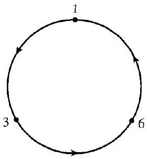
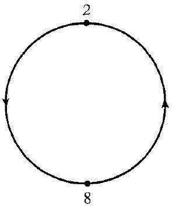
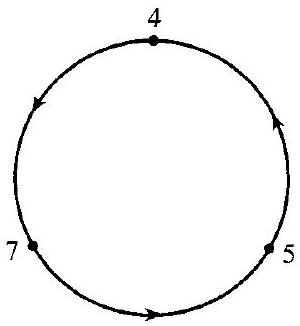
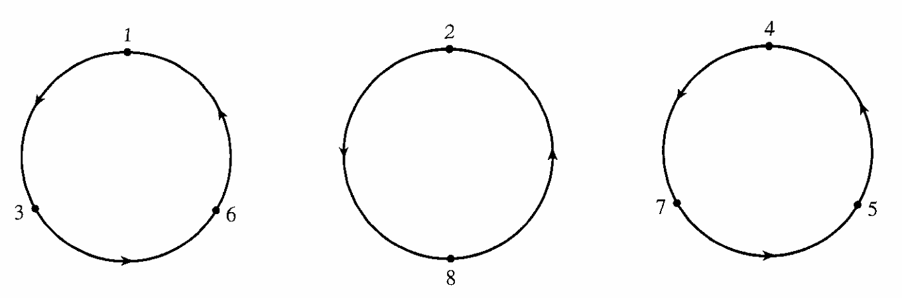
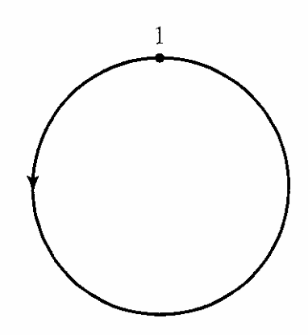
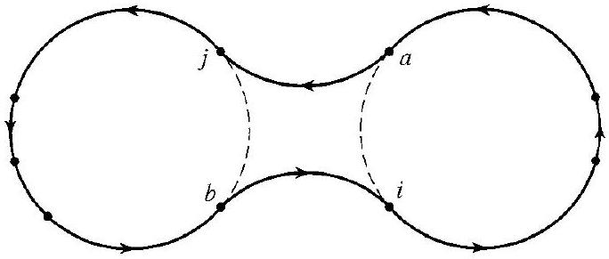
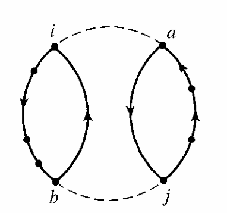
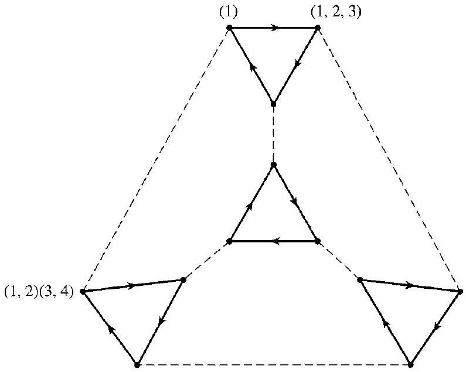

# Editorial records — Section9: Orbits, Cycles, and the Alternating Groups

Status: source review and mathematical formatting complete; scientific components complete; saved-file lint has image-size advisories only; native review pending.

## Restore equivalence-relation math symbol, p.87.

Before:

```text
check that ~ defined
```

After:

```text
check that $\sim$ defined
```

## Restore missing set math delimiters, p.88.

Before:

```text
\{1, 3, 6\}
```

After:

```text
$\{1, 3, 6\}$
```

## Restore missing set math delimiters, p.88.

Before:

```text
\{2, 8\}
```

After:

```text
$\{2, 8\}$
```

## Restore missing set math delimiters, p.88.

Before:

```text
\{4, 7, 5\}
```

After:

```text
$\{4, 7, 5\}$
```

## Restore missing set math delimiters, pp.89,94.

Before:

```text
\{1, 2, 3, 4, 5, 6, 7, 8\}
```

After:

```text
$\{1, 2, 3, 4, 5, 6, 7, 8\}$
```

## Restore dropped final subscript in Theorem9.8 proof, p.89.

Before:

```text
$B_{1}, B_{2}, \cdots, B$
```

After:

```text
$B_{1}, B_{2}, \cdots, B_r$
```

## Restore missing cycle math delimiters, p.90.

Before:

```text
cycle ( 1,6 )
```

After:

```text
cycle $(1,6)$
```

## Restore missing cycle math delimiters, p.90.

Before:

```text
or (2, 5, 3)
```

After:

```text
or $(2,5,3)$
```

## Restore missing cycle math delimiters, p.90.

Before:

```text
and (2, 5, 3) is
```

After:

```text
and $(2,5,3)$ is
```

## Restore missing cycle math delimiters, p.90.

Before:

```text
cycles (1,4,5,6) and (2,1,5)
```

After:

```text
cycles $(1,4,5,6)$ and $(2,1,5)$
```

## Restore missing cycle math delimiters, p.91.

Before:

```text
that (1, 6) (2, 5, 3) is
```

After:

```text
that $(1,6)(2,5,3)$ is
```

## Restore complete source proof label omitted by OCR, p.91.

Before:

```text
Proof 1 (From We remarked
```

After:

```text
##### proof 1 (From linear algebra)

We remarked
```

## Restore omitted source proof subtitle, p.91.

Before:

```text
Proof 2 Let
```

After:

```text
##### proof 2 (Counting orbits)

Let
```

## Restore symbolic placeholder math, p.91.

Before:

```text
symbols × denote
```

After:

```text
symbols $\times$ denote
```

## Correct missing article in printed sentence, p.92.

Before:

```text
should be only element
```

After:

```text
should be the only element
```

## Restore missing cycle math delimiters, p.92.

Before:

```text
permutation (1, 4, 5, 6) (2, 1, 5) in
```

After:

```text
permutation $(1,4,5,6)(2,1,5)$ in
```

## Restore plural printed on p.92.

Before:

```text
number of odd permutation;
```

After:

```text
number of odd permutations;
```

## Restore missing cycle math delimiters in Exercise13, p.94.

Before:

```text
cycle (1, 4, 5, 7)
```

After:

```text
cycle $(1,4,5,7)$
```

## Keep Exercise19 generating set in one math span, p.94.

Before:

```text
$S=\{(1,2,3)$, $(1,2)(3,4)\}$
```

After:

```text
$S=\{(1,2,3),(1,2)(3,4)\}$
```

## Correct printed Exercise31 group symbol, p.96: A is infinite and H consists of permutations of A; finite S_n is not the ambient group.

Before:

```text
Show that $H$ is a subgroup of $S_{n}$.
```

After:

```text
Show that $H$ is a subgroup of $S_A$.
```

## Join product split into adjacent math spans, Exercise39, p.96.

Before:

```text
$(1,2,3, \cdots, n)^{r}(1,2)$ $(1,2,3, \cdots, n)^{n-r}$
```

After:

```text
$(1,2,3, \cdots, n)^{r}(1,2)(1,2,3, \cdots, n)^{n-r}$
```

## Separate display closer and source end marker.

Before:

```text
$$ $\square$
```

After:

```text
$$

$\square$
```

## Restore exercise cycle expression inside math, p.94.

Before:

```text
7. (1, 4, 5)(7, 8)(2, 5, 7)
```

After:

```text
7. $(1, 4, 5)(7, 8)(2, 5, 7)$
```

## Restore exercise cycle expression inside math, p.94.

Before:

```text
8. (1, 3, 2, 7)(4, 8, 6)
```

After:

```text
8. $(1, 3, 2, 7)(4, 8, 6)$
```

## Restore exercise cycle expression inside math, p.94.

Before:

```text
9. (1, 2)(4, 7, 8)(2, 1)(7, 2, 8, 1, 5)
```

After:

```text
9. $(1, 2)(4, 7, 8)(2, 1)(7, 2, 8, 1, 5)$
```

## Remove redundant display wrapper; printed labels1–4 remain outside reusable callouts.

Before:

```text
Nested equation* environments inside $$
```

After:

```text
Single $$ display with original equation tags retained
```

## Restore source Figure9.4 as a single figure with all three circles and no invented panel labels, p.88.

Before:

```text




9.4 Figure
```

After:

```text

9.4 Figure
```

## Restore identity-permutation circle from p.88, before definition of a cycle.

Before:

```text
Figure9.5 omitted from OCR
```

After:

```text
Figure9.5 restored from direct PDF crop
```

## Restore split-orbit diagram from p.92 beside its author explanation.

Before:

```text
Figure9.17 omitted from OCR
```

After:

```text
Figure9.17 restored from direct PDF crop
```

## Restore defining relation from source condition1 in place of book-specific reference; retain original definition wording, p.87.

Before:

```text
Let $\sigma$ be a permutation of a set $A$. The equivalence classes in $A$ determined by the equivalence relation (1) are the orbits of $\sigma$.
```

After:

```text
Let $\sigma$ be a permutation of a set $A$.

For $a,b\in A$, let $a\sim b$ if and only if $b=\sigma^n(a)$ for some $n\in\mathbb{Z}$.

The equivalence classes in $A$ determined by the equivalence relation are the orbits of $\sigma$.
```

## Supply faithful prompt for the demonstrated task; preserve original working outside.

Before:

```text
Example9.2 lacks separate question prompt
```

After:

```text
What are the orbits of the identity permutation $\iota$ of a set $A$?
```

## Supply faithful prompt for the demonstrated task; preserve original working outside.

Before:

```text
Example9.7 lacks separate question prompt
```

After:

```text
Working in $S_5$, write $(1,3,5,4)$ in two-row notation and give equivalent cyclic notations.
```

## Supply faithful prompt for the demonstrated task; preserve original working outside.

Before:

```text
Example9.10 lacks separate question prompt
```

After:

```text
Consider the cycles $(1,4,5,6)$ and $(2,1,5)$ in $S_6$. Compute their products in both orders.
```

## Supply faithful prompt for the demonstrated task; preserve original working outside.

Before:

```text
Example9.13 lacks separate question prompt
```

After:

```text
Express $(1,6)(2,5,3)$ as a product of transpositions.
```

## Supply faithful prompt for the demonstrated task; preserve original working outside.

Before:

```text
Example9.14 lacks separate question prompt
```

After:

```text
Express the identity permutation in $S_n$, for $n\geq2$, as a product of transpositions.
```

## Supply faithful prompt for the demonstrated task; preserve original working outside.

Before:

```text
Example9.19 lacks separate question prompt
```

After:

```text
Determine the parity of the identity permutation in $S_n$ and of $(1,4,5,6)(2,1,5)$ in $S_6$.
```

## Formatting-only changes

Five definitions, three theorems and one corollary wrapped with source numbers outside. Eight examples have prompt-only callouts and author work outside. All39 exercises wrapped; common directions remain outside. Figure9.22 moved into its actual Exercise19. Intentionally incomplete definitions in Exercises20–22 retained. Source equation labels1–4 retained in surrounding prose/math; no editorial notices in reading text. Original OCR unchanged.

## Earlier staging record

# Editorial records — Section 09 - Orbits, Cycles, and the Alternating Groups

Status: staged original OCR; content/callout/source review pending.

## Heading formatting

Before: `## section 9 Orbits, Cycles, and the Alternating Groups Orbits`

After: `# 9 Orbits, Cycles, and the Alternating Groups`

Section heading separated and normalized to level one; body wording unchanged. Original chapter OCR archive retained in conversion records.


## Figure 9.4

Formatting only: preserved image and printed caption in scientific figure component.

Before:

```text

9.4 Figure
```

After:

```text
```scientific-figure
id: 9e7ede20-d111-453b-96f2-abdc6dc7d0dc
numbered: false
title: ""
caption: Figure 9.4
captionVisible: true
captionPosition: below
columns: 1
panels:
  - path: images/figure-9-4.png
    caption: ""
```
```

## Figure 9.5

Formatting only: preserved image and printed caption in scientific figure component.

Before:

```text

9.5 Figure
```

After:

```text
```scientific-figure
id: aec508cd-b7cc-487f-92fc-e95510266f8e
numbered: false
title: ""
caption: Figure 9.5
captionVisible: true
captionPosition: below
columns: 1
panels:
  - path: images/figure-9-5.png
    caption: ""
```
```

## Figure 9.16

Formatting only: preserved image and printed caption in scientific figure component.

Before:

```text

9.16 Figure
```

After:

```text
```scientific-figure
id: f62409fe-d8ae-4502-8520-ece0d32441d6
numbered: false
title: ""
caption: Figure 9.16
captionVisible: true
captionPosition: below
columns: 1
panels:
  - path: images/24cf3c6e-9e8a-4349-a621-7639cdf966bb-17_291_684_1773_763.jpg
    caption: ""
```
```

## Figure 9.17

Formatting only: preserved image and printed caption in scientific figure component.

Before:

```text

9.17 Figure
```

After:

```text
```scientific-figure
id: 2ecaae52-a70c-4e62-aa98-3f74ea37119f
numbered: false
title: ""
caption: Figure 9.17
captionVisible: true
captionPosition: below
columns: 1
panels:
  - path: images/figure-9-17.png
    caption: ""
```
```

## Figure 9.22

Formatting only: preserved image and printed caption in scientific figure component.

Before:

```text
> 
> 9.22 Figure
```

After:

```text
> ```scientific-figure
> id: f9420a52-16ca-4e28-ba23-c9c0ce434cec
> numbered: false
> title: ""
> caption: Figure 9.22
> captionVisible: true
> captionPosition: below
> columns: 1
> panels:
>   - path: images/24cf3c6e-9e8a-4349-a621-7639cdf966bb-21_635_795_239_543.jpg
>     caption: ""
> ```
```

## Portrait diagram layout

Place caption beside the portrait diagram using the supported component field; retain figure identity, source image and caption.

Before:

```scientific-figure
id: 2ecaae52-a70c-4e62-aa98-3f74ea37119f
numbered: false
title: ""
caption: Figure 9.17
captionVisible: true
captionPosition: below
columns: 1
panels:
  - path: images/figure-9-17.png
    caption: ""
```

After:

```scientific-figure
id: 2ecaae52-a70c-4e62-aa98-3f74ea37119f
numbered: false
title: ""
caption: Figure 9.17
captionVisible: true
captionPosition: right
columns: 1
panels:
  - path: images/figure-9-17.png
    caption: ""
```

## Portrait diagram layout

Place caption beside the portrait diagram using the supported component field; retain figure identity, source image and caption.

Before:

```scientific-figure
id: aec508cd-b7cc-487f-92fc-e95510266f8e
numbered: false
title: ""
caption: Figure 9.5
captionVisible: true
captionPosition: below
columns: 1
panels:
  - path: images/figure-9-5.png
    caption: ""
```

After:

```scientific-figure
id: aec508cd-b7cc-487f-92fc-e95510266f8e
numbered: false
title: ""
caption: Figure 9.5
captionVisible: true
captionPosition: right
columns: 1
panels:
  - path: images/figure-9-5.png
    caption: ""
```
