# Editorial records — Section12: Plane Isometries

Status: source reviewed (printed114–123); components converted; no lint errors; targeted native review pending.

## Restore optional-section footnote to its source title, p.114.

Before:

```text
# 12 Plane Isometries
```

After:

```text
# 12 Plane Isometries[^2]
```

## Remove displaced footnote anchor from Figure12.1; it belongs at the section title.

Before:

```text
[^2]![]
```

After:

```text
![]
```

## Remove duplicated PartII footnote already filed at its proper source location (part opener for0; Section8 for1).

Before:

```text
[^0]:    ${ }^{\dagger}$ Section 12 is not used in the remainder of the text.

```

After:

```text

```

## Remove duplicated PartII footnote already filed at its proper source location (part opener for0; Section8 for1).

Before:

```text
[^1]:    ${ }^{\dagger}$ Many people denote the $n$th dihedral group by $D_{2 n}$ rather than by $D_{n}$ since the order of the group is $2 n$.

```

After:

```text

```

## Use the native footnote marker in place of the duplicated printed dagger; preserve footnote text.

Before:

```text
[^2]:    ${ }^{\dagger}$ This section
```

After:

```text
[^2]: This section
```

## Remove spurious OCR code fence and restore four source list paragraphs with rendered mathematics, p.114; no new statements.

Before:

```text
```
translation $\tau$ : Slide every point the same distance in the same direction. See
Fig. 12.1. (Example: $\tau(x, y)=(x, y)+(2,-3)=(x+2, y-3)$.)
rotation $\rho$ : Rotate the plane about a point $P$ through an angle $\theta$. See Fig. 12.2.
(Example: $\rho(x, y)=(-y, x)$ is a rotation through $90^{\circ}$ counterclockwise about the
origin (0, 0).)
reflection $\mu$ : Map each point into its mirror image ( $\mu$ for mirror) across a line
$L$, each point of which is left fixed by $\mu$. See Fig. 12.3. The line $L$ is the axis of
reflection. (Example: $\mu(x, y)=(y, x)$ is a reflection across the line $y=x$.)
glide reflection $\gamma$ : The product of a translation and a reflection across a line mapped
into itself by the translation. See Fig. 12.4. (Example: $\gamma(x, y)=(x+4,-y)$ is a
glide reflection along the $x$-axis.)
```
```

After:

```text
translation $\tau$ : Slide every point the same distance in the same direction. See Fig. 12.1. (Example: $\tau(x, y)=(x, y)+(2,-3)=(x+2, y-3)$.)

rotation $\rho$ : Rotate the plane about a point $P$ through an angle $\theta$. See Fig. 12.2. (Example: $\rho(x, y)=(-y, x)$ is a rotation through $90^{\circ}$ counterclockwise about the origin $(0,0)$.)

reflection $\mu$ : Map each point into its mirror image ( $\mu$ for mirror) across a line $L$, each point of which is left fixed by $\mu$. See Fig. 12.3. The line $L$ is the axis of reflection. (Example: $\mu(x, y)=(y, x)$ is a reflection across the line $y=x$.)

glide reflection $\gamma$ : The product of a translation and a reflection across a line mapped into itself by the translation. See Fig. 12.4. (Example: $\gamma(x, y)=(x+4,-y)$ is a

glide reflection along the $x$-axis.)
```

## Correct OCR closing square bracket to the printed closing brace and join split math, p.115.

Before:

```text
\phi_{i}\left\{\phi_{j}(0,0)\right]=$ $\phi_{k}(0,0)
```

After:

```text
\phi_{i}\left\{\phi_{j}(0,0)\right\}=\phi_{k}(0,0)
```

## Join page-split sentence, pp.115–116.

Before:

```text
contains
some reflections
```

After:

```text
contains some reflections
```

## Join page-split sentence, pp.116–117.

Before:

```text
glide reflections across
the horizontal line
```

After:

```text
glide reflections across the horizontal line
```

## Keep the full angle bound inside math, Exercise31–37 directions, p.121.

Before:

```text
$0<\theta \leq$ 180°
```

After:

```text
$0<\theta \leq 180^{\circ}$
```

## Restore tuple math delimiters, Exercise32, p.122.

Before:

```text
vectors (1, 1/2) and (0, 1)
```

After:

```text
vectors $(1,1/2)$ and $(0,1)$
```

## Restore vector math delimiters, Exercises31 and33–35, p.122.

Before:

```text
and (0, 1)
```

After:

```text
and $(0,1)$
```

## Remove OCR-added closing parenthesis in Figure12.9 copyright caption, p.121.

Before:

```text
(©) 1936
```

After:

```text
(© 1936
```

## Restore four separate entries from the source two-column list, p.116.

Before:

```text
rotation horizontal axis reflection
vertical axis reflection nontrivial glide reflection
```

After:

```text
- rotation
- horizontal axis reflection
- vertical axis reflection
- nontrivial glide reflection
```

## Replace OCR multiple-integral operators with the actual evenly spaced integral-sign frieze, p.116.

Before:

```text
$$
\cdots \iiint \iiint \iiint \iiint \iiint \iiint \iiint \iiint \iiint \iiint \iiint \iint \cdots
$$
```

After:

```text
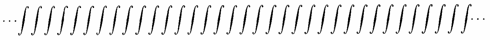
```

## Restore source D-frieze image; it is a geometric pattern, not a heading, p.116.

Before:

```text
## ⋯DDDDDDDDDDD⋯
```

After:

```text
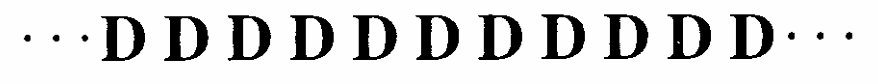
```

## Replace false OCR table with the actual staggered D-frieze, p.117.

Before:

```text
|  | ... | D | D | D | D |  | D | ⋯ |
| :--- | :--- | :--- | :--- | :--- | :--- | :--- | :--- | :--- |
| ... | D | D | D | D | D | ... |  |  |

```

After:

```text
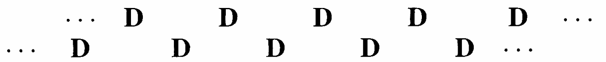

```

## Preserve the printed typeface and spacing that determine the frieze symmetries, Exercise24, p.120.

Before:

```text
24. FFFFFFFFFFFFFFF
```

After:

```text
24. 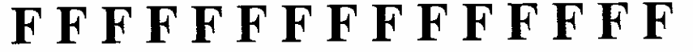
```

## Preserve the printed typeface and spacing that determine the frieze symmetries, Exercise25, p.120.

Before:

```text
25. TTTTTTTTTT
```

After:

```text
25. 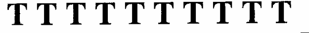
```

## Preserve the printed typeface and spacing that determine the frieze symmetries, Exercise26, p.120.

Before:

```text
26. E E E E E E E E E E E E
```

After:

```text
26. 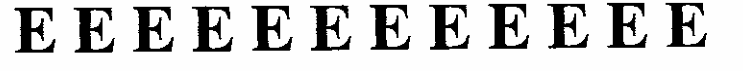
```

## Restore two separate exercises and exact source friezes, p.121.

Before:

```text
## 27. Z Z Z Z Z Z Z Z Z Z Z Z 28. HHHHHHHHHH
```

After:

```text
27. 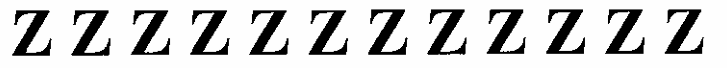
28. 
```

## Restore missing Exercise30 label and split the combined source image into its two distinct friezes, p.121.

Before:

```text
29. 

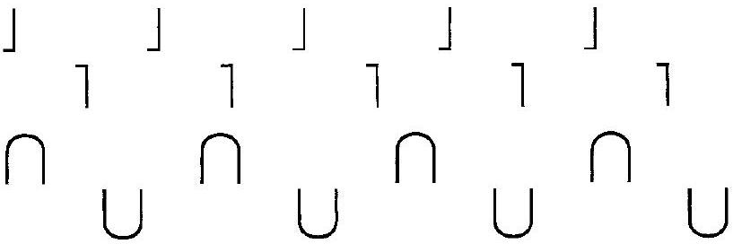
```

After:

```text
29. 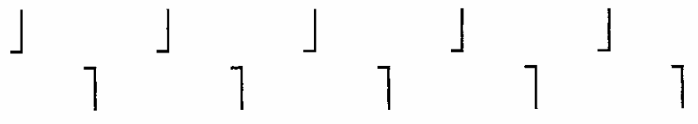
30. 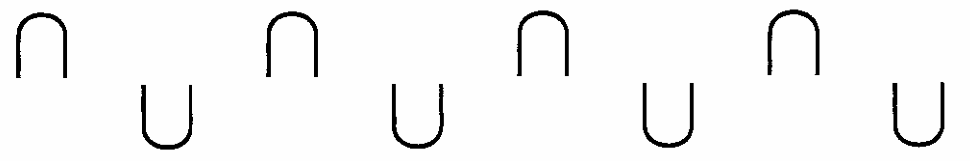
```

## Formatting only: relocate page floats to their logical references; retain image/caption content.

Before:

```text
Figures12.6–12.11 interrupt source paragraphs/exercise directions
```

After:

```text
Figures12.6–12.7 beside their discussions; Figures12.8–12.11 beside Exercises38–41
```

## Formatting-only changes

Theorem12.5 wrapped with number outside, source wording preserved. All42 exercises wrapped; shared directions stay outside. The four introductory isometry descriptions remain author prose, with the erroneous code fence removed. Source art credits preserved. Original OCR untouched.

## Earlier staging record

# Editorial records — Section 12 - Plane Isometries

Status: staged original OCR; content/callout/source review pending.

## Heading formatting

Before: `## section $12{ }^{\dagger}$ Plane Isometries`

After: `# 12 Plane Isometries`

Section heading separated and normalized to level one; body wording unchanged. Original chapter OCR archive retained in conversion records.


## Figure 12.1

Formatting only: preserved image and printed caption in scientific figure component.

Before:

```text
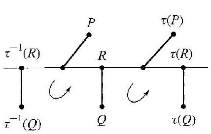
12.1 Figure Translation $\tau$.
```

After:

```text
```scientific-figure
id: 211a66ad-2ddb-4c95-8d0f-727a87fefb4f
numbered: false
title: ""
caption: Figure 12.1 — Translation $\tau$.
captionVisible: true
captionPosition: below
columns: 1
panels:
  - path: images/24cf3c6e-9e8a-4349-a621-7639cdf966bb-41_273_428_227_627.jpg
    caption: ""
```
```

## Figure 12.2

Formatting only: preserved image and printed caption in scientific figure component.

Before:

```text
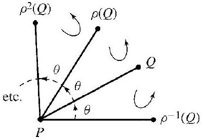
12.2 Figure Rotation $\rho$.
```

After:

```text
```scientific-figure
id: 8d64f8a3-4dce-421a-b544-156dc92925bb
numbered: false
title: ""
caption: Figure 12.2 — Rotation $\rho$.
captionVisible: true
captionPosition: below
columns: 1
panels:
  - path: images/24cf3c6e-9e8a-4349-a621-7639cdf966bb-41_278_399_228_1092.jpg
    caption: ""
```
```

## Figure 12.3

Formatting only: preserved image and printed caption in scientific figure component.

Before:

```text
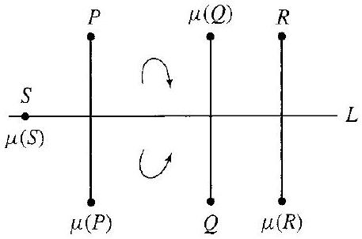
12.3 Figure Reflection $\mu$.
```

After:

```text
```scientific-figure
id: 3fa24038-8508-49af-902a-c72ee38f3393
numbered: false
title: ""
caption: Figure 12.3 — Reflection $\mu$.
captionVisible: true
captionPosition: below
columns: 1
panels:
  - path: images/24cf3c6e-9e8a-4349-a621-7639cdf966bb-41_302_457_612_627.jpg
    caption: ""
```
```

## Figure 12.4

Formatting only: preserved image and printed caption in scientific figure component.

Before:

```text
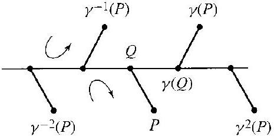
12.4 Figure Glide reflection $\gamma$.
```

After:

```text
```scientific-figure
id: 5b36b03e-9cbb-4e94-a51b-b704638552bd
numbered: false
title: ""
caption: Figure 12.4 — Glide reflection $\gamma$.
captionVisible: true
captionPosition: below
columns: 1
panels:
  - path: images/24cf3c6e-9e8a-4349-a621-7639cdf966bb-41_239_465_664_1125.jpg
    caption: ""
```
```

## Figure 12.6

Formatting only: preserved image and printed caption in scientific figure component.

Before:

```text
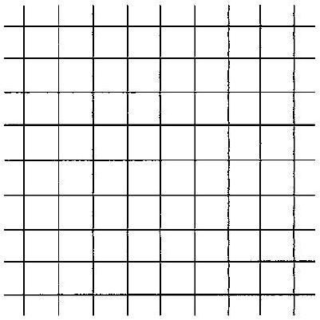
12.6 Figure
```

After:

```text
```scientific-figure
id: c0d5a99f-0b75-4fb2-b7ec-882ab6e8bd3f
numbered: false
title: ""
caption: Figure 12.6
captionVisible: true
captionPosition: below
columns: 1
panels:
  - path: images/24cf3c6e-9e8a-4349-a621-7639cdf966bb-43_401_401_1705_895.jpg
    caption: ""
```
```

## Figure 12.7

Formatting only: preserved image and printed caption in scientific figure component.

Before:

```text
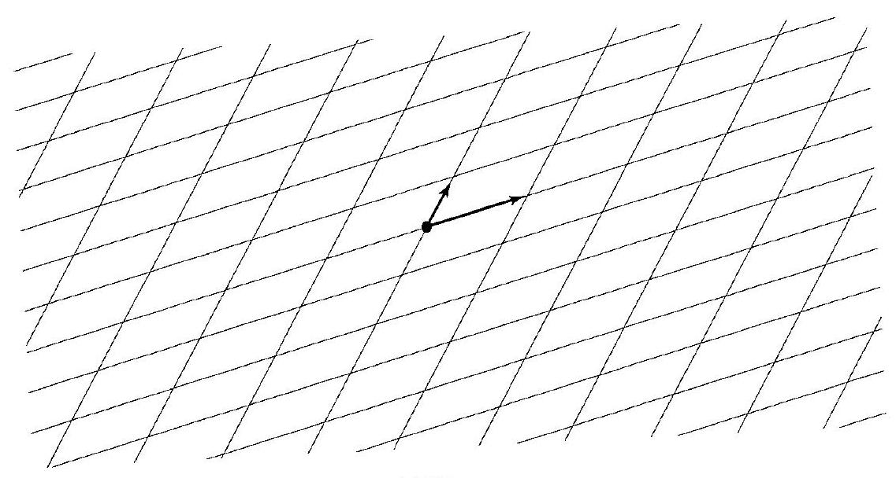
12.7 Figure
```

After:

```text
```scientific-figure
id: 8db48e77-cc50-4028-b6e2-c99698fbedcb
numbered: false
title: ""
caption: Figure 12.7
captionVisible: true
captionPosition: below
columns: 1
panels:
  - path: images/24cf3c6e-9e8a-4349-a621-7639cdf966bb-44_608_1137_211_502.jpg
    caption: ""
```
```

## Figure 12.8

Formatting only: preserved image and printed caption in scientific figure component.

Before:

```text
> 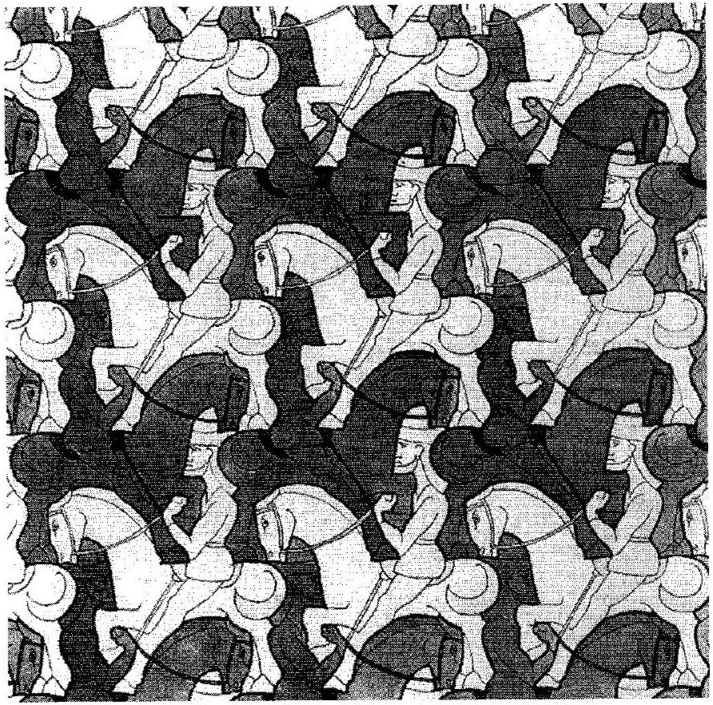
> 12.8 Figure The Study of Regular Division of the Plane with Horsemen (© 1946 M. C. Escher Foundation-Baarn-Holland. All rights reserved.)
```

After:

```text
> ```scientific-figure
> id: 9a3d3de5-733d-486d-b25a-7dbb154d5c79
> numbered: false
> title: ""
> caption: Figure 12.8 — The Study of Regular Division of the Plane with Horsemen (© 1946 M. C. Escher Foundation-Baarn-Holland. All rights reserved.)
> captionVisible: true
> captionPosition: below
> columns: 1
> panels:
>   - path: images/24cf3c6e-9e8a-4349-a621-7639cdf966bb-46_882_892_1150_717.jpg
>     caption: ""
> ```
```

## Figure 12.9

Formatting only: preserved image and printed caption in scientific figure component.

Before:

```text
> 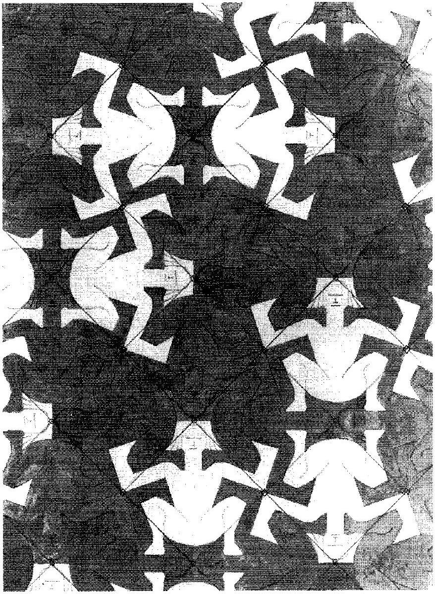
> 12.9 Figure The Study of Regular Division of the Plane with Imaginary Human Figures (© 1936 M. C. Escher Foundation-Baarn-Holland. All rights reserved.)
```

After:

```text
> ```scientific-figure
> id: 829f92e0-7079-46d8-812d-4ca17aeb3c4b
> numbered: false
> title: ""
> caption: Figure 12.9 — The Study of Regular Division of the Plane with Imaginary Human Figures (© 1936 M. C. Escher Foundation-Baarn-Holland. All rights reserved.)
> captionVisible: true
> captionPosition: below
> columns: 1
> panels:
>   - path: images/24cf3c6e-9e8a-4349-a621-7639cdf966bb-47_1198_878_826_672.jpg
>     caption: ""
> ```
```

## Figure 12.10

Formatting only: preserved image and printed caption in scientific figure component.

Before:

```text
> 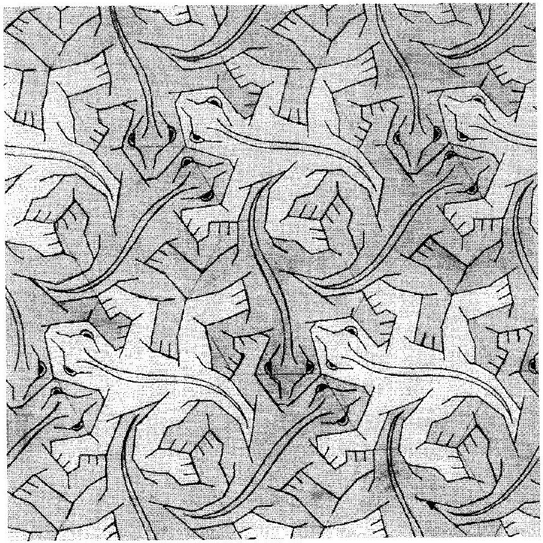
> 12.10 Figure The Study of Regular Division of the Plane with Reptiles (© 1939 M. C. Escher Foundation-Baarn-Holland. All rights reserved.)
```

After:

```text
> ```scientific-figure
> id: 45c8a3c0-0429-4310-83b8-d01b71f8101b
> numbered: false
> title: ""
> caption: Figure 12.10 — The Study of Regular Division of the Plane with Reptiles (© 1939 M. C. Escher Foundation-Baarn-Holland. All rights reserved.)
> captionVisible: true
> captionPosition: below
> columns: 1
> panels:
>   - path: images/24cf3c6e-9e8a-4349-a621-7639cdf966bb-48_900_899_228_699.jpg
>     caption: ""
> ```
```

## Figure 12.11

Formatting only: preserved image and printed caption in scientific figure component.

Before:

```text
> 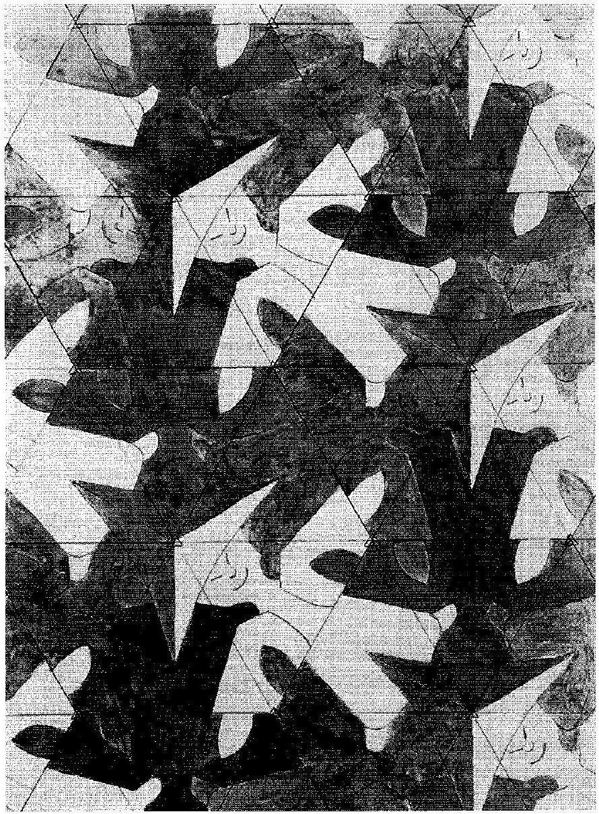
> 12.11 Figure The Study of Regular Division of the Plane with Human Figures (© 1936 M. C. Escher Foundation-Baarn-Holland. All rights reserved.)
```

After:

```text
> ```scientific-figure
> id: 90250b09-61cc-4543-856d-be0db9bb5090
> numbered: false
> title: ""
> caption: Figure 12.11 — The Study of Regular Division of the Plane with Human Figures (© 1936 M. C. Escher Foundation-Baarn-Holland. All rights reserved.)
> captionVisible: true
> captionPosition: below
> columns: 1
> panels:
>   - path: images/24cf3c6e-9e8a-4349-a621-7639cdf966bb-49_1209_890_224_653.jpg
>     caption: ""
> ```
```

## images/integral-frieze.png

Source geometric pattern preserved as an unnumbered figure with no invented caption.

Before:

```text

```

After:

```text
```scientific-figure
id: 9b6cb459-e35a-4b87-848b-77d1c17103ff
numbered: false
title: ""
caption: ""
captionVisible: true
captionPosition: below
columns: 1
panels:
  - path: images/integral-frieze.png
    caption: ""
```
```

## images/d-frieze.png

Source geometric pattern preserved as an unnumbered figure with no invented caption.

Before:

```text

```

After:

```text
```scientific-figure
id: 41d97547-96e9-41b1-ad4e-24ff2b87b207
numbered: false
title: ""
caption: ""
captionVisible: true
captionPosition: below
columns: 1
panels:
  - path: images/d-frieze.png
    caption: ""
```
```

## images/staggered-d-frieze.png

Source geometric pattern preserved as an unnumbered figure with no invented caption.

Before:

```text

```

After:

```text
```scientific-figure
id: 58fb65f3-19e9-4cc9-bb9d-af3b6be746b1
numbered: false
title: ""
caption: ""
captionVisible: true
captionPosition: below
columns: 1
panels:
  - path: images/staggered-d-frieze.png
    caption: ""
```
```

## images/24cf3c6e-9e8a-4349-a621-7639cdf966bb-44_217_214_1958_872.jpg

Source answer table converted to editable cells; all answer cells remain blank.

Before:

```text
> 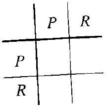
```

After:

```text
> ```scientific-table
> id: 8f9e5463-121b-47e9-9f62-c5d0e7d906ff
> numbered: false
> title: ""
> caption: ""
> captionVisible: true
> captionPosition: below
> rows:
>   - - text: ""
>     - text: $P$
>       align: center
>     - text: $R$
>       align: center
>   - - text: $P$
>       align: center
>     - text: ""
>       align: center
>     - text: ""
>       align: center
>   - - text: $R$
>       align: center
>     - text: ""
>       align: center
>     - text: ""
>       align: center
> headerRows: 1
> rowHeaders: true
> style: grid
> ```
```

## images/24cf3c6e-9e8a-4349-a621-7639cdf966bb-45_318_316_384_799.jpg

Source answer table converted to editable cells; all answer cells remain blank.

Before:

```text
> 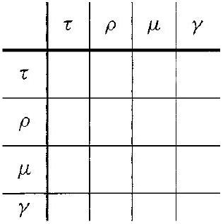
```

After:

```text
> ```scientific-table
> id: c1b63c6f-8195-4943-a956-7b3971dcfb72
> numbered: false
> title: ""
> caption: ""
> captionVisible: true
> captionPosition: below
> rows:
>   - - text: ""
>     - text: $\tau$
>       align: center
>     - text: $\rho$
>       align: center
>     - text: $\mu$
>       align: center
>     - text: $\gamma$
>       align: center
>   - - text: $\tau$
>       align: center
>     - text: ""
>       align: center
>     - text: ""
>       align: center
>     - text: ""
>       align: center
>     - text: ""
>       align: center
>   - - text: $\rho$
>       align: center
>     - text: ""
>       align: center
>     - text: ""
>       align: center
>     - text: ""
>       align: center
>     - text: ""
>       align: center
>   - - text: $\mu$
>       align: center
>     - text: ""
>       align: center
>     - text: ""
>       align: center
>     - text: ""
>       align: center
>     - text: ""
>       align: center
>   - - text: $\gamma$
>       align: center
>     - text: ""
>       align: center
>     - text: ""
>       align: center
>     - text: ""
>       align: center
>     - text: ""
>       align: center
> headerRows: 1
> rowHeaders: true
> style: grid
> ```
```

## images/exercise-24.png

Source geometric pattern preserved as an unnumbered figure with no invented caption.

Before:

```text
> 
```

After:

```text
> ```scientific-figure
> id: 6c4c488c-40d9-4368-8915-e6caee226c36
> numbered: false
> title: ""
> caption: ""
> captionVisible: true
> captionPosition: below
> columns: 1
> panels:
>   - path: images/exercise-24.png
>     caption: ""
> ```
```

## images/exercise-25.png

Source geometric pattern preserved as an unnumbered figure with no invented caption.

Before:

```text
> 
```

After:

```text
> ```scientific-figure
> id: 0de336ac-4b7b-410e-a41f-6d7b069154db
> numbered: false
> title: ""
> caption: ""
> captionVisible: true
> captionPosition: below
> columns: 1
> panels:
>   - path: images/exercise-25.png
>     caption: ""
> ```
```

## images/exercise-26.png

Source geometric pattern preserved as an unnumbered figure with no invented caption.

Before:

```text
> 
```

After:

```text
> ```scientific-figure
> id: 45656570-41ca-48c5-939f-97fd2081b7ef
> numbered: false
> title: ""
> caption: ""
> captionVisible: true
> captionPosition: below
> columns: 1
> panels:
>   - path: images/exercise-26.png
>     caption: ""
> ```
```

## images/exercise-27.png

Source geometric pattern preserved as an unnumbered figure with no invented caption.

Before:

```text
> 
```

After:

```text
> ```scientific-figure
> id: 197b5fd4-8aea-41d9-8a0c-b8dd7a5ca7a5
> numbered: false
> title: ""
> caption: ""
> captionVisible: true
> captionPosition: below
> columns: 1
> panels:
>   - path: images/exercise-27.png
>     caption: ""
> ```
```

## images/exercise-28.png

Source geometric pattern preserved as an unnumbered figure with no invented caption.

Before:

```text
> 
```

After:

```text
> ```scientific-figure
> id: c33f64f6-b9f4-4e3a-919f-96d0fcae2511
> numbered: false
> title: ""
> caption: ""
> captionVisible: true
> captionPosition: below
> columns: 1
> panels:
>   - path: images/exercise-28.png
>     caption: ""
> ```
```

## images/exercise-29.png

Source geometric pattern preserved as an unnumbered figure with no invented caption.

Before:

```text
> 
```

After:

```text
> ```scientific-figure
> id: a10a2420-dd17-4255-af68-d3085802abf8
> numbered: false
> title: ""
> caption: ""
> captionVisible: true
> captionPosition: below
> columns: 1
> panels:
>   - path: images/exercise-29.png
>     caption: ""
> ```
```

## images/exercise-30.png

Source geometric pattern preserved as an unnumbered figure with no invented caption.

Before:

```text
> 
```

After:

```text
> ```scientific-figure
> id: 02f1878e-e7c7-49ff-9256-f7c26a7baa2d
> numbered: false
> title: ""
> caption: ""
> captionVisible: true
> captionPosition: below
> columns: 1
> panels:
>   - path: images/exercise-30.png
>     caption: ""
> ```
```

## Figure 12.6: caption layout

Place caption beside the square/portrait source figure to keep its full geometry visible at reading width. Source image and caption unchanged.

## Figure12.8 caption layout

Formatting only: captionPosition below → right. Preserve figure ID, source pixels, and original caption/credit. Keep the complete square/portrait artwork visible beside its caption.

## Figure12.9 caption layout

Formatting only: captionPosition below → right. Preserve figure ID, source pixels, and original caption/credit. Keep the complete square/portrait artwork visible beside its caption.

## Figure12.10 caption layout

Formatting only: captionPosition below → right. Preserve figure ID, source pixels, and original caption/credit. Keep the complete square/portrait artwork visible beside its caption.

## Figure12.11 caption layout

Formatting only: captionPosition below → right. Preserve figure ID, source pixels, and original caption/credit. Keep the complete square/portrait artwork visible beside its caption.

## Paragraph-boundary check

Join the wrapped continuation “is a / glide reflection along” within its original definition paragraph (p.114). Dedent the shared part(d) for Exercises38–41 and separate shared question lines; source wording unchanged.
