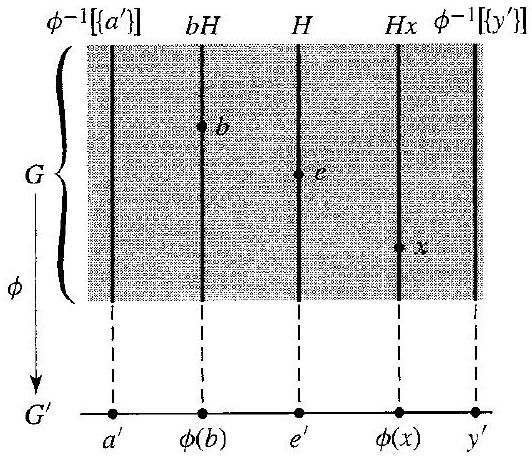

# Editorial records — Section13: Homomorphisms

Status: printed125–135 source reviewed; figure converted; saved-file lint has one image-size advisory and zero errors. Targeted native review pending.

## Remove displaced PartIII prerequisite footnote anchor from ordinary prose, p.126; restore at the part opener.

Before:

```text
[^0]Let us
```

After:

```text
Let us
```

## Join split math span in Example13.2, p.126.

Before:

```text
\phi(b a)=$ $\phi(b)
```

After:

```text
\phi(b a)=\phi(b)
```

## Join split membership expression in Example13.5, p.127.

Before:

```text
$\mathbf{v}, \mathbf{w} \in$ $\mathbb{R}^{n}$
```

After:

```text
$\mathbf{v}, \mathbf{w} \in \mathbb{R}^{n}$
```

## Restore printed sentence-ending period, p.128.

Before:

```text
Example 13.8 We have
```

After:

```text
Example 13.8. We have
```

## Join kernel formula split across line, p.129.

Before:

```text
\right]=$ $\left\{x \in G
```

After:

```text
\right]=\left\{x \in G
```

## Restore printed pair of set braces in notation discussion, p.129.

Before:

```text
(), [], and $\left\}\right.$
```

After:

```text
(), [], and $\{\}$
```

## Join split math in Theorem13.15 proof, p.130.

Before:

```text
$x=$ $a h \in a H$
```

After:

```text
$x=a h \in a H$
```

## Restore absolute-value symbol as math, p.131.

Before:

```text
absolute value function | |
```

After:

```text
absolute value function $|\ |$
```

## Restore lost word space, p.131.

Before:

```text
$\mathbb{R}^{+}$of
```

After:

```text
$\mathbb{R}^{+}$ of
```

## Restore source word of, p.131.

Before:

```text
is a subgroup $\mathbb{R}^{+}$
```

After:

```text
is a subgroup of $\mathbb{R}^{+}$
```

## Restore prose word map outside math, p.131.

Before:

```text
a $\operatorname{map} \phi: D \rightarrow F$
```

After:

```text
a map $\phi: D \rightarrow F$
```

## Correct printed domain letter in Example13.17, p.131: differentiation is defined on D, not all functions F.

Before:

```text
where $\phi(f)=f^{\prime}$ for $f \in F$
```

After:

```text
where $\phi(f)=f^{\prime}$ for $f \in D$
```

## Correct undefined printed G to the stated domain D in Example13.17, p.131.

Before:

```text
all functions in $G$ mapped into $x^{2}$
```

After:

```text
all functions in $D$ mapped into $x^{2}$
```

## Join page-split sentence, pp.132–133.

Before:

```text
importance of
$
```

After:

```text
importance of $
```

## Restore missing set math delimiters in Exercise48, p.135.

Before:

```text
the multiplicative group \{1, -1\}
```

After:

```text
the multiplicative group $\{1,-1\}$
```

## Join split set condition in Exercise52, p.135.

Before:

```text
\phi(x)=$ $\phi(a)\}
```

After:

```text
\phi(x)=\phi(a)\}
```

## Correct the index range in Exercise55 to the elements0,…,n−1 of Z_n, p.135; requested homomorphism criterion unchanged.

Before:

```text
for $0 \leq i \leq n$
```

After:

```text
for $0 \leq i<n$
```

## Supply missing restriction for the printed surjectivity assertion in Exercise48, p.135: S_1 has no odd permutation and cannot map onto both signs.

Before:

```text
48. The sign of
```

After:

```text
48. Let $n\geq2$. The sign of
```

## Formatting only: preserve statement/equality, remove book equation tag from reusable body.

Before:

```text
### 13.1 Definition A map $\phi$ of a group $G$ into a group $G^{\prime}$ is a homomorphism if the homomorphism property

$$
\begin{equation*}
\phi(a b)=\phi(a) \phi(b) \tag{1}
\end{equation*}
$$

holds for all $a, b \in G$. $\square$
```

After:

```text
Definition callout with equation(1) label outside
```

## Restore the meaning of e-prime from the immediately preceding source paragraph, p.129.

Before:

```text
Let $\phi: G \rightarrow G^{\prime}$ be a homomorphism of groups. The subgroup $\phi^{-1}\left[\left\{e^{\prime}\right\}\right]=\left\{x \in G \mid \phi(x)=e^{\prime}\right\}$ is the kernel of $\phi$, denoted by $\operatorname{Ker}(\phi)$. 
```

After:

```text
Let $\phi: G \rightarrow G^{\prime}$ be a homomorphism of groups. Let $e^{\prime}$ be the identity element of $G^{\prime}$. The subgroup $\phi^{-1}\left[\left\{e^{\prime}\right\}\right]=\left\{x \in G \mid \phi(x)=e^{\prime}\right\}$ is the kernel of $\phi$, denoted by $\operatorname{Ker}(\phi)$. 
```

## Restore e identity notation from the source proof/Theorem13.12, p.131.

Before:

```text
A group homomorphism $\phi: G \rightarrow G^{\prime}$ is a one-to-one map if and only if $\operatorname{Ker}(\phi)=\{e\}$.
```

After:

```text
A group homomorphism $\phi: G \rightarrow G^{\prime}$ is a one-to-one map if and only if $\operatorname{Ker}(\phi)=\{e\}$. Here $e$ is the identity element in $G$.
```

## Format the unnumbered source box by its mathematical role, p.130; body unchanged.

Before:

```text
There is a standard way to show that two sets are equal; show that each is a subset of the other.
```

After:

```text
[!guideline] Proving Set Equality by Mutual Inclusion: There is a standard way to show that two sets are equal; show that each is a subset of the other.
```

## Preserve source boxed title/three steps; restore groups premise from preceding paragraph, p.132.

Before:

```text
> To Show $\phi: \boldsymbol{G} \rightarrow \boldsymbol{G}^{\prime}$ Is an Isomorphism

Step 1 Show $\phi$ is a homomorphism.
Step 2 Show $\operatorname{Ker}(\phi)=\{e\}$.
Step 3 Show $\phi$ maps $G$ onto $G^{\prime}$.
```

After:

```text
Let $G$ and $G^{\prime}$ be groups.

Step 1 Show $\phi$ is a homomorphism.

Step 2 Show $\operatorname{Ker}(\phi)=\{e\}$.

Step 3 Show $\phi$ maps $G$ onto $G^{\prime}$.
```

## Supply only the task demonstrated by the unchanged author working; source givens preserved.

Before:

```text
Example13.2 has no separate question prompt
```

After:

```text
Let $\phi:G\rightarrow G^{\prime}$ be a group homomorphism of $G$ onto $G^{\prime}$. Show that if $G$ is abelian, then $G^{\prime}$ is abelian.
```

## Supply only the task demonstrated by the unchanged author working; source givens preserved.

Before:

```text
Example13.4 has no separate question prompt
```

After:

```text
Let $F$ be the additive group of all functions mapping $\mathbb{R}$ into $\mathbb{R}$, and let $c\in\mathbb{R}$. Define $\phi_c:F\rightarrow\mathbb{R}$ by $\phi_c(f)=f(c)$, with addition in $\mathbb{R}$. Show that $\phi_c$ is a homomorphism.
```

## Supply only the task demonstrated by the unchanged author working; source givens preserved.

Before:

```text
Example13.5 has no separate question prompt
```

After:

```text
Let $\mathbb{R}^{n}$ and $\mathbb{R}^{m}$ be additive groups of real column vectors, and let $A$ be an $m\times n$ real matrix. Show that $\phi:\mathbb{R}^{n}\rightarrow\mathbb{R}^{m}$ defined by $\phi(\mathbf v)=A\mathbf v$ is a homomorphism.
```

## Supply only the task demonstrated by the unchanged author working; source givens preserved.

Before:

```text
Example13.6 has no separate question prompt
```

After:

```text
Let $GL(n,\mathbb{R})$ be the multiplicative group of invertible $n\times n$ real matrices and $\mathbb{R}^{*}$ the multiplicative group of nonzero real numbers. Show that the determinant map $\det:GL(n,\mathbb{R})\rightarrow\mathbb{R}^{*}$ is a homomorphism.
```

## Supply only the task demonstrated by the unchanged author working; source givens preserved.

Before:

```text
Example13.7 has no separate question prompt
```

After:

```text
Let $r\in\mathbb{Z}$ and define $\phi_r:\mathbb{Z}\rightarrow\mathbb{Z}$ by $\phi_r(n)=rn$, using addition. Show that $\phi_r$ is a homomorphism and determine when it maps $\mathbb{Z}$ onto $\mathbb{Z}$.
```

## Supply only the task demonstrated by the unchanged author working; source givens preserved.

Before:

```text
Example13.8 has no separate question prompt
```

After:

```text
Let $G=G_1\times G_2\times\cdots\times G_n$ be a direct product of groups. For $i=1,\ldots,n$, show that the projection map $\pi_i:G\rightarrow G_i$ defined by $\pi_i(g_1,\ldots,g_n)=g_i$ is a homomorphism.
```

## Supply only the task demonstrated by the unchanged author working; source givens preserved.

Before:

```text
Example13.9 has no separate question prompt
```

After:

```text
Let $F$ be the additive group of continuous real-valued functions on $[0,1]$, and let $\mathbb{R}$ be additive. Show that $\sigma:F\rightarrow\mathbb{R}$ defined by $\sigma(f)=\int_0^1 f(x)\,dx$ is a homomorphism.
```

## Supply only the task demonstrated by the unchanged author working; source givens preserved.

Before:

```text
Example13.16 has no separate question prompt
```

After:

```text
Show that absolute value is a homomorphism from the multiplicative group $\mathbb{C}^{*}$ of nonzero complex numbers onto the multiplicative group $\mathbb{R}^{+}$ of positive real numbers. Identify its kernel and describe the cosets and their images geometrically.
```

## Supply only the task demonstrated by the unchanged author working; source givens preserved.

Before:

```text
Example13.17 has no separate question prompt
```

After:

```text
Let $D$ be the additive group of differentiable functions mapping $\mathbb{R}$ into $\mathbb{R}$, and let $F$ be the additive group of all functions mapping $\mathbb{R}$ into $\mathbb{R}$. For $\phi:D\rightarrow F$ defined by $\phi(f)=f^{\prime}$, show that $\phi$ is a homomorphism, determine its kernel, and find all functions mapped to $x^2$.
```

## Formatting-only changes

Four definitions, two theorems, two corollaries, one source-boxed guideline and one source-boxed procedure prepared; printed numbers outside reusable statements. Eleven example prompts separated from author solutions;55 exercises wrapped. Keep deliberately defective definition in Exercise30 for the student to correct. Historical Note uses aside. Source wording/proof sequence retained and original OCR unchanged.

## Earlier staging record

# Editorial records — Section 13 - Homomorphisms

Status: staged original OCR; content/callout/source review pending.

## Heading formatting

Before: `## section 13 Homomorphisms`

After: `# 13 Homomorphisms`

Section heading separated and normalized to level one; body wording unchanged. Original chapter OCR archive retained in conversion records.


## Figure 13.14

Formatting only: preserved image and printed caption in scientific figure component.

Before:

```text

13.14 Figure Cosets of $H$ collapsed by $\phi$.
```

After:

```text
```scientific-figure
id: 577eb4a2-7d1f-4ca7-ad7a-34c3c110bc88
numbered: false
title: ""
caption: Figure 13.14 — Cosets of $H$ collapsed by $\phi$.
captionVisible: true
captionPosition: below
columns: 1
panels:
  - path: images/7653b598-92eb-4ac8-be2a-997e71bdf19a-06_458_532_218_908.jpg
    caption: ""
```
```
