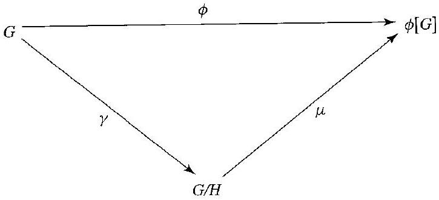

# Editorial records — Section14: Factor Groups

Status: source reviewed (printed135–144); figure converted; saved-file lint has one image-size advisory and zero errors. Native review pending.

## Remove stray a in the correspondence sentence, p.136.

Before:

```text
with a those of a group
```

After:

```text
with those of a group
```

## Join split equality, p.136.

Before:

```text
$\mu(z H)=$ $\phi(x) \phi(y)$
```

After:

```text
$\mu(z H)=\phi(x) \phi(y)$
```

## Join page-split sentence, pp.136–137.

Before:

```text
such
that $h_{1}
```

After:

```text
such that $h_{1}
```

## Join split coset sum in Example14.3, p.137.

Before:

```text
$(2+5 \mathbb{Z})+$ $(4+5 \mathbb{Z})$
```

After:

```text
$(2+5 \mathbb{Z})+(4+5 \mathbb{Z})$
```

## Restore sentence boundary in the reference discussion, p.138.

Before:

```text
Theorem 14.1 Equation 4
```

After:

```text
Theorem 14.1. Equation 4
```

## Join split identity calculation, p.139.

Before:

```text
\left(a a^{-1}\right) H=$ $(a H)
```

After:

```text
\left(a a^{-1}\right) H=(a H)
```

## Remove erroneous of before the element variable in Example14.8, p.139.

Before:

```text
one element of $x$
```

After:

```text
one element $x$
```

## Restore coset formula and subgroup brackets in Example14.8, p.139.

Before:

```text
coset 8.07 + (5.37)
```

After:

```text
coset $8.07+\langle5.37\rangle$
```

## Restore the printed addition-modulo subscript, p.139.

Before:

```text
$4.65+5.37$ 3.42
```

After:

```text
$4.65+_{5.37}3.42$
```

## Restore omitted integer2 in the printed set of all nonnegative integers below n, p.139.

Before:

```text
\mathbb{Z}_{n}=\{0,1,3,4, \cdots, n-1\}
```

After:

```text
\mathbb{Z}_{n}=\{0,1,2,3,4, \cdots, n-1\}
```

## Correct missing d in the biconditional, p.140.

Before:

```text
if an only if
```

After:

```text
if and only if
```

## Remove line-break hyphen within homomorphism, p.140.

Before:

```text
group homo-morphism
```

After:

```text
group homomorphism
```

## Join split subset expression, p.141.

Before:

```text
$H g \subseteq$ $g H$
```

After:

```text
$H g \subseteq g H$
```

## Correct printed condition references: conjugation invariance is(2), coset equality is(3), p.141.

Before:

```text
equivalence of conditions (1) and (2) in Theorem 14.13
```

After:

```text
equivalence of conditions (2) and (3) in Theorem 14.13
```

## Restore coset expression and subgroup brackets, Exercise10, p.142.

Before:

```text
10. 26 + (12) in
```

After:

```text
10. $26+\langle12\rangle$ in
```

## Join split subset relation, Exercise39, p.143.

Before:

```text
$\phi[H] \subseteq$ $H^{\prime}$
```

After:

```text
$\phi[H] \subseteq H^{\prime}$
```

## Restore mathematical sign notation in Exercise40b, p.144.

Before:

```text
determinant ±1
```

After:

```text
determinant $\pm1$
```

## Format the source correspondence-direction symbol in math, p.136.

Before:

```text
↔
```

After:

```text
$\leftrightarrow$
```

## Format the source correspondence-direction symbol in math, p.136.

Before:

```text
⟷
```

After:

```text
$\leftrightarrow$
```

## Format the source correspondence-direction symbol in math, p.136.

Before:

```text
→
```

After:

```text
$\rightarrow$
```

## Format the source correspondence-direction symbol in math, p.136.

Before:

```text
←
```

After:

```text
$\leftarrow$
```

## Move the source page float beside its actual discussion; proof wording/order unchanged, pp.139–140.

Before:

```text

14.10 Figure between equality and “so gamma is a homomorphism”
```

After:

```text

14.10 Figure after the paragraph explaining its maps
```

## Restore only the necessary context from the immediately preceding source: normality and coset operation for14.6; g in G for14.15. Remove book-context dependency from reusable definition.

Before:

```text
The group $G / H$ in the preceding corollary is the factor group (or quotient group) of $G$ by $H$. 
```

After:

```text
Let $H$ be a normal subgroup of a group $G$. The group $G / H$ under the binary operation $(aH)(bH)=(ab)H$ is the factor group (or quotient group) of $G$ by $H$. 
```

## Restore only the necessary context from the immediately preceding source: normality and coset operation for14.6; g in G for14.15. Remove book-context dependency from reusable definition.

Before:

```text
An isomorphism $\phi: G \rightarrow G$ of a group $G$ with itself is an automorphism of $G$. The automorphism $i_{g}: G \rightarrow G$, where $i_{g}(x)=g x g^{-1}$ for all $x \in G$, is the inner automorphism of $G$ by $g$. Performing $i_{g}$ on $x$ is called conjugation of $x$ by $g$. 
```

After:

```text
An isomorphism $\phi: G \rightarrow G$ of a group $G$ with itself is an automorphism of $G$. Let $g\in G$. The automorphism $i_{g}: G \rightarrow G$, where $i_{g}(x)=g x g^{-1}$ for all $x \in G$, is the inner automorphism of $G$ by $g$. Performing $i_{g}$ on $x$ is called conjugation of $x$ by $g$. 
```

## Add only a prompt for the task demonstrated by the unchanged author working.

Before:

```text
Example14.2 has no separate prompt
```

After:

```text
Let $\gamma:\mathbb{Z}\rightarrow\mathbb{Z}_n$ map each integer to its remainder modulo $n$. Use this homomorphism to identify $\mathbb{Z}/n\mathbb{Z}$. For $n=5$, list the cosets of $5\mathbb{Z}$ and describe the induced isomorphism.
```

## Add only a prompt for the task demonstrated by the unchanged author working.

Before:

```text
Example14.3 has no separate prompt
```

After:

```text
In $\mathbb{Z}/5\mathbb{Z}$, compute $(2+5\mathbb{Z})+(4+5\mathbb{Z})$ first using representatives 2 and 4, then using representatives 27 and $-16$.
```

## Add only a prompt for the task demonstrated by the unchanged author working.

Before:

```text
Example14.7 has no separate prompt
```

After:

```text
Use the normal subgroup $n\mathbb{Z}$ of the additive group $\mathbb{Z}$ to construct $\mathbb{Z}/n\mathbb{Z}$ without reference to a homomorphism, and identify the factor group.
```

## Add only a prompt for the task demonstrated by the unchanged author working.

Before:

```text
Example14.8 has no separate prompt
```

After:

```text
Let $\mathbb{R}$ be additive and let $c>0$. Describe the cosets of $\langle c\rangle$ using representatives $x$ with $0\leq x<c$, and relate $\mathbb{R}/\langle c\rangle$ to $\mathbb{R}_c$ and the circle group $U$. For $c=5.37$, compute the sum of $4.65+\langle5.37\rangle$ and $3.42+\langle5.37\rangle$.
```

## Add only a prompt for the task demonstrated by the unchanged author working.

Before:

```text
Example14.14 has no separate prompt
```

After:

```text
Show that every subgroup $H$ of an abelian group $G$ is normal.
```

## Formatting-only changes

Five theorems, one corollary and two definitions wrapped; printed labels outside reusable statements. Existing Fundamental Homomorphism Theorem title preserved. Six example prompts separated from source solutions;41 exercises wrapped. Deliberately flawed definitions and student proof openings in Exercises17–19 and21–22 preserved as question material. Original OCR unchanged.

## Earlier staging record

# Editorial records — Section 14 - Factor Groups

Status: staged original OCR; content/callout/source review pending.

## Heading formatting

Before: `## section 14 Factor Groups`

After: `# 14 Factor Groups`

Section heading separated and normalized to level one; body wording unchanged. Original chapter OCR archive retained in conversion records.


## Figure 14.10

Formatting only: preserved image and printed caption in scientific figure component.

Before:

```text

14.10 Figure
```

After:

```text
```scientific-figure
id: 3df76d89-164d-4975-a5de-135c7e50723d
numbered: false
title: ""
caption: Figure 14.10
captionVisible: true
captionPosition: below
columns: 1
panels:
  - path: images/7653b598-92eb-4ac8-be2a-997e71bdf19a-16_330_725_231_796.jpg
    caption: ""
```
```
