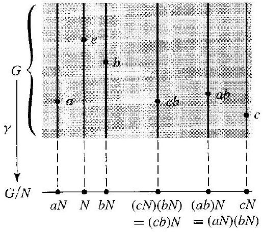
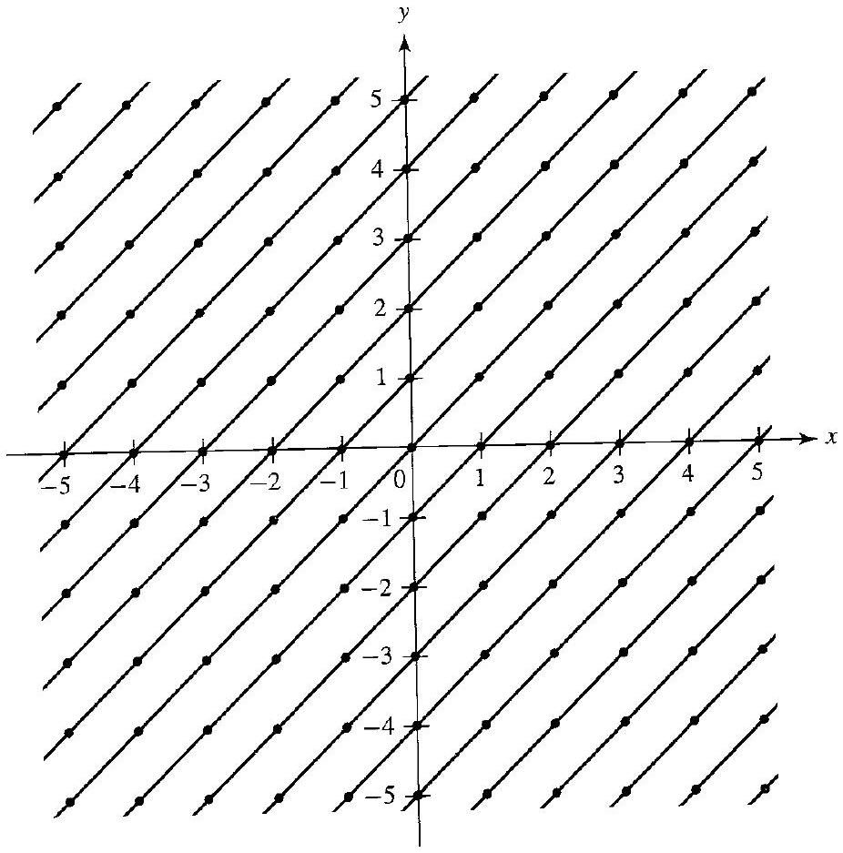

# Editorial records — Section15: Factor-Group Computations and Simple Groups

Status: source-reviewed printed144–154; components converted; saved-file lint has two image-size advisories and zero errors. Native review pending.

## Restore subgroup opening bracket in Example15.11, p.147.

Before:

```text
/\{(2,3)\rangle
```

After:

```text
/\langle(2,3)\rangle
```

## Separate source example label.

Before:

```text
15.12Example
```

After:

```text
15.12 Example
```

## Close printed parenthesis before the object to classify, p.148.

Before:

```text
classify as in Theorem 11.12 the group
```

After:

```text
classify as in Theorem 11.12) the group
```

## Restore source spelling, p.148.

Before:

```text
visulaize
```

After:

```text
visualize
```

## Restore source subgroup brackets and math boundaries, p.148.

Before:

```text
The subgroup (( 1,1$)$ )
```

After:

```text
The subgroup $\langle(1,1)\rangle$
```

## Restore mathematical angle notation, p.148.

Before:

```text
the 45° lines
```

After:

```text
the $45^{\circ}$ lines
```

## Join split membership expression, p.150.

Before:

```text
$g \in$ $G$
```

After:

```text
$g \in G$
```

## Join split equality in proof, p.151.

Before:

```text
\left(a^{-1} N\right)\left(b^{-1} N\right)=$ $\left(b^{-1} N\right)
```

After:

```text
\left(a^{-1} N\right)\left(b^{-1} N\right)=\left(b^{-1} N\right)
```

## Join split commutator calculation, p.151.

Before:

```text
\rho_{2} \mu_{1}$ $=\mu_{3}
```

After:

```text
\rho_{2} \mu_{1}=\mu_{3}
```

## Remove OCR-added of before subgroup name; retain the false proposition for the true/false question, p.152.

Before:

```text
the commutator subgroup of $C$ of $G$ contains $H$
```

After:

```text
the commutator subgroup $C$ of $G$ contains $H$
```

## Restore subgroup bracket, Exercise25, p.152.

Before:

```text
$U /(-1\rangle$
```

After:

```text
$U /\langle-1\rangle$
```

## Restore math comparison, p.153.

Before:

```text
finite order > 1
```

After:

```text
finite order $>1$
```

## Restore missing indefinite article, Exercise35, p.153.

Before:

```text
is normal subgroup of $\phi[G]$
```

After:

```text
is a normal subgroup of $\phi[G]$
```

## Correct missing distinctness required for the stated 3-cycles, Exercise39c, p.153.

Before:

```text
Let $r$ and $s$ be fixed elements
```

After:

```text
Let $r$ and $s$ be fixed distinct elements
```

## Correct printed count: the two fixed entries cannot be the third entry of a 3-cycle, p.153.

Before:

```text
the $n$ "special" 3-cycles
```

After:

```text
the $n-2$ "special" 3-cycles
```

## Correct the printed third-entry range to exclude the two fixed entries of a 3-cycle, p.153.

Before:

```text
for $1 \leq i \leq n$ [Hint:
```

After:

```text
for $1\leq i\leq n$ with $i\ne r,s$. [Hint:
```

## Remove prose hint-closing bracket from display math, Exercise39d, p.153.

Before:

```text
\left.((r, s)(i, j))(r, s, i)^{2}((r, s)(i, j))^{-1} .\right]
```

After:

```text
((r, s)(i, j))(r, s, i)^{2}((r, s)(i, j))^{-1}.
```

## Join split conjugation expression, p.154.

Before:

```text
$\sigma^{-1}\left(a_{1}, a_{2}, a_{4}\right)$ $\sigma\left(a_{1}, a_{2}, a_{4}\right)^{-1}$
```

After:

```text
$\sigma^{-1}\left(a_{1}, a_{2}, a_{4}\right)\sigma\left(a_{1}, a_{2}, a_{4}\right)^{-1}$
```

## Restore source cycle/tuple math formatting, pp.146–147.

Before:

```text
so (1, 2, 3) and (1, 3, 2)
```

After:

```text
so $(1,2,3)$ and $(1,3,2)$
```

## Restore source cycle/tuple math formatting, pp.146–147.

Before:

```text
(1, 2, 4), (1, 4, 2), (1, 3, 4), (1, 4, 3), (2, 3, 4), and (2, 4, 3)
```

After:

```text
$(1,2,4)$, $(1,4,2)$, $(1,3,4)$, $(1,4,3)$, $(2,3,4)$, and $(2,4,3)$
```

## Restore source cycle/tuple math formatting, pp.146–147.

Before:

```text
generated by (0, 1)
```

After:

```text
generated by $(0,1)$
```

## Restore source cycle/tuple math formatting, pp.146–147.

Before:

```text
Setting (2, 3)
```

After:

```text
Setting $(2,3)$
```

## Restore only missing source-context notation/premise: the analogous embedded K factor in15.8, normal subgroup M in15.18.

Before:

```text
Let $G=H \times K$ be the direct product of groups $H$ and $K$. Then $\bar{H}=\{(h, e) \mid h \in H\}$ is a normal subgroup of $G$. Also $G / \bar{H}$ is isomorphic to $K$ in a natural way. Similarly, $G / \bar{K} \simeq H$ in a natural way.
```

After:

```text
Let $G=H \times K$ be the direct product of groups $H$ and $K$. Then $\bar{H}=\{(h, e) \mid h \in H\}$ is a normal subgroup of $G$. Also $G / \bar{H}$ is isomorphic to $K$ in a natural way. Similarly, for $\bar{K}=\{(e,k)\mid k\in K\}$, $G / \bar{K} \simeq H$ in a natural way.
```

## Restore only missing source-context notation/premise: the analogous embedded K factor in15.8, normal subgroup M in15.18.

Before:

```text
$M$ is a maximal normal subgroup of $G$ if and only if $G / M$ is simple.
```

After:

```text
Let $M$ be a normal subgroup of a group $G$. $M$ is a maximal normal subgroup of $G$ if and only if $G / M$ is simple.
```

## Restore group G from the immediately preceding source sentence for the standalone center definition, p.150.

Before:

```text
The center $Z(G)$ is defined by

$$
Z(G)=\{z \in G \mid z g=g z \text { for all } g \in G\} .
$$
```

After:

```text
The center $Z(G)$ of a group $G$ is defined by

$$
Z(G)=\{z \in G \mid z g=g z \text { for all } g \in G\} .
$$
```

## Add only the question demonstrated by the unchanged author working. In15.4 n>=2 is the source condition for permutation parity.

Before:

```text
Example15.4 has no separate prompt
```

After:

```text
For $n\geq2$, describe multiplication in $S_n/A_n$ and what it says about the parity of products of permutations.
```

## Add only the question demonstrated by the unchanged author working. In15.4 n>=2 is the source condition for permutation parity.

Before:

```text
Example15.19 has no separate prompt
```

After:

```text
Find the centers of $S_3$ and $S_3\times\mathbb{Z}_5$.
```

## Add only the question demonstrated by the unchanged author working. In15.4 n>=2 is the source condition for permutation parity.

Before:

```text
Example15.21 has no separate prompt
```

After:

```text
Find the commutator subgroup of $S_3$.
```

## Separate only the demonstrated question, preserving the source title and entire introductory explanation.

Before:

```text
Example15.6 introductory statement and working
```

After:

```text
Source introductory paragraph retained; prompt asks to prove A4 has no subgroup of order6.
```

## Formatting-only changes

Six theorems and three definitions wrapped; printed theorem/definition numbers outside reusable statements. Ten example prompts separated from author solutions.42 exercises wrapped, retaining deliberately defective definitions17–18 and true/false19 without solving them. Historical classification discussion retained verbatim as an aside; no modernization of the author historical account. Mathematical displays separated from end markers; the prose closing bracket for Exercise39d returned outside its display. Original OCR unchanged.

## Figure 15.1

Formatting only: preserved image and printed caption in scientific figure component.

Before:

```text

15.1 Figure
```

After:

```text
```scientific-figure
id: fab331f5-e22b-436b-964e-8705d8d9f70d
numbered: false
title: ""
caption: Figure 15.1
captionVisible: true
captionPosition: below
columns: 1
panels:
  - path: images/7653b598-92eb-4ac8-be2a-997e71bdf19a-20_456_516_1599_933.jpg
    caption: ""
```
```

## Figure 15.13

Formatting only: preserved image and printed caption in scientific figure component.

Before:

```text

15.13 Figure
```

After:

```text
```scientific-figure
id: a093e320-1932-4d2f-951f-8083fd999bc8
numbered: false
title: ""
caption: Figure 15.13
captionVisible: true
captionPosition: below
columns: 1
panels:
  - path: images/7653b598-92eb-4ac8-be2a-997e71bdf19a-24_937_926_818_680.jpg
    caption: ""
```
```

## Table 15.5

Formatting only: editable scientific table, source cells and printed caption preserved; single-letter mathematical entries receive math delimiters.

Before:

```text
15.5 Table
|  | $A_{n}$ | $\sigma A_{n}$ |
| :--- | :--- | :--- |
| $A_{n}$ | $A_{n}$ | $\sigma A_{n}$ |
| $\sigma A_{n}$ | $\sigma A_{n}$ | $A_{n}$ |

```

After:

```text
```scientific-table
id: 27316443-483a-4f1c-8dbd-f467e0da8cb3
numbered: false
title: ""
caption: Table 15.5
captionVisible: true
captionPosition: below
rows:
  - - text: ""
      align: center
    - text: $A_{n}$
      align: center
    - text: $\sigma A_{n}$
      align: center
  - - text: $A_{n}$
      align: center
    - text: $A_{n}$
      align: center
    - text: $\sigma A_{n}$
      align: center
  - - text: $\sigma A_{n}$
      align: center
    - text: $\sigma A_{n}$
      align: center
    - text: $A_{n}$
      align: center
headerRows: 1
rowHeaders: true
style: scientific
```

```
