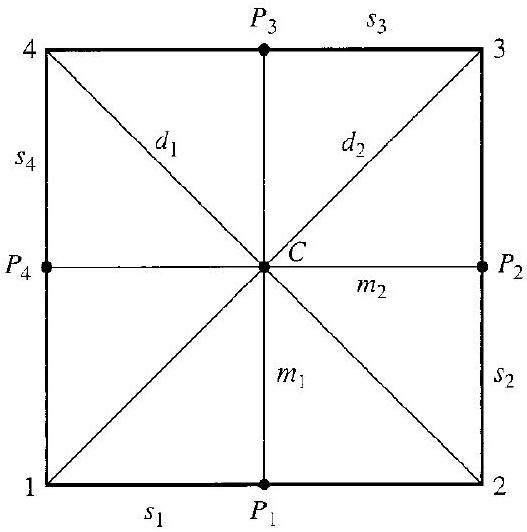

# Editorial records — Section16: Group Action on a Set

Status: source reviewed printed154–161; all136 table cells independently verified; components converted; saved-file lint has one image-size advisory and zero errors. Native review pending.

## Restore source section-title footnote marker, p.154.

Before:

```text
# 16 Group Action on a Set
```

After:

```text
# 16 Group Action on a Set[^1]
```

## Remove displaced title-footnote marker before Example16.2.

Before:

```text
[^1]16.2 Example
```

After:

```text
16.2 Example
```

## Join the operation symbol and map signature into one math expression.

Before:

```text
a map $*$ : $G \times X \rightarrow X$
```

After:

```text
a map $*:G\times X\rightarrow X$
```

## Restore source parentheses around the inner action in surjectivity proof, p.155.

Before:

```text
=g\left(g^{-1}\right) x=
```

After:

```text
=g\left(g^{-1}x\right)=
```

## Restore missing article, p.155.

Before:

```text
if $X$ is $G$-set
```

After:

```text
if $X$ is a $G$-set
```

## Separate example label.

Before:

```text
16.8Example
```

After:

```text
16.8 Example
```

## Restore real-number notation in scalar-action example, p.156.

Before:

```text
\mathrm{R}^{*}
```

After:

```text
\mathbb{R}^{*}
```

## Restore complex-number notation in scalar-action example, p.156.

Before:

```text
\mathrm{C}^{*}
```

After:

```text
\mathbb{C}^{*}
```

## Join split closure equality, p.157.

Before:

```text
\left(g_{1} g_{2}\right) x=$ $g_{1}
```

After:

```text
\left(g_{1} g_{2}\right) x=g_{1}
```

## Join split inverse calculation, p.157.

Before:

```text
g^{-1}(g x)=$ $g^{-1} x
```

After:

```text
g^{-1}(g x)=g^{-1} x
```

## Restore the point subscript x in the isotropy-subgroup proof, p.157.

Before:

```text
G_{X}
```

After:

```text
G_{x}
```

## Restore set math delimiters, p.158.

Before:

```text
subset \{1, 2, 3, 4\}
```

After:

```text
subset $\{1,2,3,4\}$
```

## Restore equivalence-relation symbol in math, p.158.

Before:

```text
Then ~ is
```

After:

```text
Then $\sim$ is
```

## Join split symmetry calculation, p.158.

Before:

```text
g^{-1}\left(g x_{1}\right)=$ $\left(g^{-1} g\right)
```

After:

```text
g^{-1}\left(g x_{1}\right)=\left(g^{-1} g\right)
```

## Correct printed right/left mismatch: the proof constructs left cosets throughout, p.158.

Before:

```text
onto the collection of right cosets
```

After:

```text
onto the collection of left cosets
```

## Join split orbit cardinality equality, p.159.

Before:

```text
$|G 1|=$ $\left(G: G_{1}\right)=4$
```

After:

```text
$|G 1|=\left(G: G_{1}\right)=4$
```

## Restore the isotropy-subgroup subscript in the coset description, p.159.

Before:

```text
left coset $g_{1} G x$
```

After:

```text
left coset $g_{1}G_x$
```

## Restore source compound notation without OCR-added spaces.

Before:

```text
sub- $G$-set
```

After:

```text
sub-$G$-set
```

## Restore source compound notation without OCR-added spaces.

Before:

```text
sub- $D_{4}$-sets
```

After:

```text
sub-$D_{4}$-sets
```

## Restore source compound notation without OCR-added spaces.

Before:

```text
sub- $D_{4}$-set
```

After:

```text
sub-$D_{4}$-set
```

## Repair set-builder math boundaries, Exercise12, p.160.

Before:

```text
$G_{Y}=\{g \in G \mid g y=y$ for all $y \in Y\}$
```

After:

```text
$G_Y=\{g\in G\mid gy=y\text{ for all }y\in Y\}$
```

## Restore the final permutation to the math list, Exercise20, p.161.

Before:

```text
$\iota,(1,2,3),(1,3,2),(2,3),(1,3)$, (1, 2)
```

After:

```text
$\iota,(1,2,3),(1,3,2),(2,3),(1,3),(1,2)$
```

## Rejoin source sentence and place objects according to their given/answer roles, pp.156–157. Add only the demonstrated action-table task.

Before:

```text
Figure16.9 and Table16.10 interrupt the source sentence after mu_i
```

After:

```text
Given diagram stays with prompt; completed action table follows the author working.
```

## Restore identity e and the source shorthand gx=*(g,x) from the preceding action discussion; move misplaced end marker outside the complete definition.

Before:

```text
16.1 Definition Let $X$ be a set and $G$ a group. An action of $G$ on $X$ is a map $*:G\times X\rightarrow X$ such that $\square$

1. $e x=x$ for all $x \in X$,
2. $\left(g_{1} g_{2}\right)(x)=g_{1}\left(g_{2} x\right)$ for all $x \in X$ and all $g_{1}, g_{2} \in G$.

Under these conditions, $X$ is a $G$-set.
```

After:

```text
Let $X$ be a set and $G$ a group with identity $e$. An action of $G$ on $X$ is a map $*:G\times X\rightarrow X$ , writing $gx=*(g,x)$, such that 

1. $e x=x$ for all $x \in X$,
2. $\left(g_{1} g_{2}\right)(x)=g_{1}\left(g_{2} x\right)$ for all $x \in X$ and all $g_{1}, g_{2} \in G$.

Under these conditions, $X$ is a $G$-set.
```

## Restore G-set and N context verbatim from the preceding source for the standalone faithful-action definition.

Before:

```text
If $N=\{e\}$, then the identity element of $G$ is the only element that leaves every $x \in X$ fixed; we then say that $G$ acts faithfully on $X$.
```

After:

```text
Let $X$ be a $G$-set, and let $N$ be the subset of $G$ leaving every element of $X$ fixed. If $N=\{e\}$, then the identity element of $G$ is the only element that leaves every $x \in X$ fixed; we then say that $G$ acts faithfully on $X$.
```

## Restore only notation needed to read the result independently, from the preceding source definitions.

Before:

```text
Let $X$ be a $G$-set. For each $g \in G$, the function $\sigma_{g}: X \rightarrow X$ defined by $\sigma_{g}(x)=g x$ for $x \in X$ is a permutation of $X$. Also, the map $\phi: G \rightarrow S_{X}$ defined by $\phi(g)=\sigma_{g}$ is a homomorphism with the property that $\phi(g)(x)=g x$.
```

After:

```text
Let $X$ be a $G$-set. Let $S_X$ be the group of all permutations of $X$. For each $g \in G$, the function $\sigma_{g}: X \rightarrow X$ defined by $\sigma_{g}(x)=g x$ for $x \in X$ is a permutation of $X$. Also, the map $\phi: G \rightarrow S_{X}$ defined by $\phi(g)=\sigma_{g}$ is a homomorphism with the property that $\phi(g)(x)=g x$.
```

## Restore only notation needed to read the result independently, from the preceding source definitions.

Before:

```text
Let $X$ be a $G$-set. Then $G_{x}$ is a subgroup of $G$ for each $x \in X$.
```

After:

```text
Let $X$ be a $G$-set. Let $G_x=\{g\in G\mid gx=x\}$. Then $G_{x}$ is a subgroup of $G$ for each $x \in X$.
```

## Restore only notation needed to read the result independently, from the preceding source definitions.

Before:

```text
Let $X$ be a $G$-set and let $x \in X$. Then $|G x|=\left(G: G_{x}\right)$. If $|G|$ is finite, then $|G x|$ is a divisor of $|G|$.
```

After:

```text
Let $X$ be a $G$-set and let $x \in X$. Let $Gx$ be the orbit of $x$ and let $G_x=\{g\in G\mid gx=x\}$. Then $|G x|=\left(G: G_{x}\right)$. If $|G|$ is finite, then $|G x|$ is a divisor of $|G|$.
```

## Restore the source definition of G_x or the equivalence relation in place of missing context/book-number dependency.

Before:

```text
Let $X$ be a $G$-set and let $x \in X$. The subgroup $G_{x}$ is the isotropy subgroup of $x$. $\square$
```

After:

```text
Let $X$ be a $G$-set and let $x \in X$. The subgroup $G_x=\{g\in G\mid gx=x\}$ is the isotropy subgroup of $x$. 
```

## Restore the source definition of G_x or the equivalence relation in place of missing context/book-number dependency.

Before:

```text
Let $X$ be a $G$-set. Each cell in the partition of the equivalence relation described in Theorem 16.14 is an orbit in $X$ under $G$. If $x \in X$, the cell containing $x$ is the orbit of $x$. We let this cell be $G x$. $\square$
```

After:

```text
Let $X$ be a $G$-set. For $x_1,x_2\in X$, let $x_1\sim x_2$ if and only if there exists $g\in G$ such that $gx_1=x_2$. Each cell in the partition of the equivalence relation $\sim$ is an orbit in $X$ under $G$. If $x \in X$, the cell containing $x$ is the orbit of $x$. We let this cell be $G x$. 
```

## Add only the task demonstrated by the unchanged source working.

Before:

```text
Example16.2 supplies working without a separate prompt
```

After:

```text
Let $X$ be a set, and let $H$ be a subgroup of the group $S_X$ of all permutations of $X$. Show that $\sigma x=\sigma(x)$ defines an action of $H$ on $X$.
```

## Add only the task demonstrated by the unchanged source working.

Before:

```text
Example16.4 supplies working without a separate prompt
```

After:

```text
Show that left multiplication defines an action of a group $G$ on itself and, for a subgroup $H$ of $G$, an action of $H$ on $G$.
```

## Add only the task demonstrated by the unchanged source working.

Before:

```text
Example16.5 supplies working without a separate prompt
```

After:

```text
Let $H$ be a subgroup of a group $G$. Show that $*(h,g)=hgh^{-1}$ defines an action of $H$ on $G$.
```

## Add only the task demonstrated by the unchanged source working.

Before:

```text
Example16.6 supplies working without a separate prompt
```

After:

```text
For a vector space over the real or complex numbers, show that scalar multiplication defines an action of the multiplicative group of nonzero scalars on the set of vectors.
```

## Add only the task demonstrated by the unchanged source working.

Before:

```text
Example16.7 supplies working without a separate prompt
```

After:

```text
Let $H$ be a subgroup of a group $G$, and let $L_H$ be the set of all left cosets of $H$. Show that $g(xH)=(gx)H$ defines a well-defined action of $G$ on $L_H$.
```

## Add only the task demonstrated by the unchanged source working.

Before:

```text
Example16.11 supplies working without a separate prompt
```

After:

```text
For the $D_4$-set $X$ in Example 16.8, with $G=D_4$, find $X_{\rho_0}$, $X_{\rho_1}$, $X_{\mu_1}$, $G_1$, $G_{s_3}$ and $G_{d_1}$.
```

## Add only the task demonstrated by the unchanged source working.

Before:

```text
Example16.17 supplies working without a separate prompt
```

After:

```text
For the $D_4$-set $X$ in Example 16.8, find the orbit of 1 and its isotropy subgroup, and verify the orbit–stabilizer equality for that orbit.
```

## Formatting-only changes

Four theorems, five definitions and one notation convention wrapped. Printed statement numbers outside reusable callouts. Eight example prompts separated from source working;20 exercises wrapped. Deliberately defective definitions in Exercises4–5 and true/false statements unchanged. Table16.10 two plain C labels restored to math. Source prerequisite footnote restored from p.154. Original OCR unchanged.

## Earlier staging/star-repair record

# Editorial records — Section 16 - Group Action on a Set

Status: staged original OCR; content/callout/source review pending.

## Heading formatting

Before: `## section $16{ }^{\dagger}$ Group Action on a Set`

After: `# 16 Group Action on a Set`

Section heading separated and normalized to level one; body wording unchanged. Original chapter OCR archive retained in conversion records.

## Mathematical operation stars — Markdown delimiter repair

Bare operation symbols were parsed as Markdown emphasis, breaking surrounding math rendering. Added math delimiters only; prime suffixes remain part of the symbol. Existing mathematical formulas, author wording and callout identities are unchanged.

Source line 7: `*` → `$*$`. Context: `Definition 2.1 defines a binary operation * on a set $S$ to be a function mapping $S \times S$ into $S$. The function * gives us`

Source line 7: `*` → `$*$`. Context: `peration * on a set $S$ to be a function mapping $S \times S$ into $S$. The function * gives us a rule for "multiplying" an element $s_{1}$ in $S$ and an element $s_{2}$ i`

Source line 10: `*` → `$*$`. Context: `16.1 Definition Let $X$ be a set and $G$ a group. An action of $G$ on $X$ is a map * : $G \times X \rightarrow X$ such that $\square$`


## Pre-import checks

Corrected generated convention-block boundaries so both display delimiters and the complete source formula remain inside the callout. Normalized blank lines between callouts and surrounding prose. Independently verified all136 action-table cells using coordinate transformations of the source square; no mismatches.

## Figure 16.9

Formatting only: preserved image and printed caption in scientific figure component.

Before:

```text
> 
> 16.9 Figure
```

After:

```text
> ```scientific-figure
> id: 160c5050-559d-433e-9d81-2ae611375332
> numbered: false
> title: ""
> caption: Figure 16.9
> captionVisible: true
> captionPosition: below
> columns: 1
> panels:
>   - path: images/7653b598-92eb-4ac8-be2a-997e71bdf19a-32_532_527_1518_927.jpg
>     caption: ""
> ```
```

## Table 16.10

Formatting only: editable scientific table, source cells and printed caption preserved; single-letter mathematical entries receive math delimiters.

Before:

```text
16.10 Table

|  | 1 | 2 | 3 | 4 | $s_{1}$ | $s_{2}$ | $s_{3}$ | $s_{4}$ | $m_{1}$ | $m_{2}$ | $d_{1}$ | $d_{2}$ | $C$ | $P_{1}$ | $P_{2}$ | $P_{3}$ | $P_{4}$ |
| :--- | :--- | :--- | :--- | :--- | :--- | :--- | :--- | :--- | :--- | :--- | :--- | :--- | :--- | :--- | :--- | :--- | :--- |
| $\rho_{0}$ | 1 | 2 | 3 | 4 | $s_{1}$ | $s_{2}$ | $s_{3}$ | $s_{4}$ | $m_{1}$ | $m_{2}$ | $d_{1}$ | $d_{2}$ | $C$ | $P_{1}$ | $P_{2}$ | $P_{3}$ | $P_{4}$ |
| $\rho_{1}$ | 2 | 3 | 4 | 1 | $s_{2}$ | $s_{3}$ | $s_{4}$ | $s_{1}$ | $m_{2}$ | $m_{1}$ | $d_{2}$ | $d_{1}$ | $C$ | $P_{2}$ | $P_{3}$ | $P_{4}$ | $P_{1}$ |
| $\rho_{2}$ | 3 | 4 | 1 | 2 | $s_{3}$ | $s_{4}$ | $s_{1}$ | $s_{2}$ | $m_{1}$ | $m_{2}$ | $d_{1}$ | $d_{2}$ | $C$ | $P_{3}$ | $P_{4}$ | $P_{1}$ | $P_{2}$ |
| $\rho_{3}$ | 4 | 1 | 2 | 3 | $s_{4}$ | $s_{1}$ | $s_{2}$ | $s_{3}$ | $m_{2}$ | $m_{1}$ | $d_{2}$ | $d_{1}$ | $C$ | $P_{4}$ | $P_{1}$ | $P_{2}$ | $P_{3}$ |
| $\mu_{1}$ | 2 | 1 | 4 | 3 | $s_{1}$ | $s_{4}$ | $s_{3}$ | $s_{2}$ | $m_{1}$ | $m_{2}$ | $d_{2}$ | $d_{1}$ | $C$ | $P_{1}$ | $P_{4}$ | $P_{3}$ | $P_{2}$ |
| $\mu_{2}$ | 4 | 3 | 2 | 1 | $s_{3}$ | $s_{2}$ | $s_{1}$ | $s_{4}$ | $m_{1}$ | $m_{2}$ | $d_{2}$ | $d_{1}$ | $C$ | $P_{3}$ | $P_{2}$ | $P_{1}$ | $P_{4}$ |
| $\delta_{1}$ | 3 | 2 | 1 | 4 | $s_{2}$ | $s_{1}$ | $s_{4}$ | $s_{3}$ | $m_{2}$ | $m_{1}$ | $d_{1}$ | $d_{2}$ | $C$ | $P_{2}$ | $P_{1}$ | $P_{4}$ | $P_{3}$ |
| $\delta_{2}$ | 1 | 4 | 3 | 2 | $s_{4}$ | $s_{3}$ | $s_{2}$ | $s_{1}$ | $m_{2}$ | $m_{1}$ | $d_{1}$ | $d_{2}$ | $C$ | $P_{4}$ | $P_{3}$ | $P_{2}$ | $P_{1}$ |

```

After:

```text
```scientific-table
id: 4c1bb84c-a6a8-4b3e-aec9-e39d164fdee8
numbered: false
title: ""
caption: Table 16.10
captionVisible: true
captionPosition: below
rows:
  - - text: ""
      align: center
    - text: "1"
      align: center
    - text: "2"
      align: center
    - text: "3"
      align: center
    - text: "4"
      align: center
    - text: $s_{1}$
      align: center
    - text: $s_{2}$
      align: center
    - text: $s_{3}$
      align: center
    - text: $s_{4}$
      align: center
    - text: $m_{1}$
      align: center
    - text: $m_{2}$
      align: center
    - text: $d_{1}$
      align: center
    - text: $d_{2}$
      align: center
    - text: $C$
      align: center
    - text: $P_{1}$
      align: center
    - text: $P_{2}$
      align: center
    - text: $P_{3}$
      align: center
    - text: $P_{4}$
      align: center
  - - text: $\rho_{0}$
      align: center
    - text: "1"
      align: center
    - text: "2"
      align: center
    - text: "3"
      align: center
    - text: "4"
      align: center
    - text: $s_{1}$
      align: center
    - text: $s_{2}$
      align: center
    - text: $s_{3}$
      align: center
    - text: $s_{4}$
      align: center
    - text: $m_{1}$
      align: center
    - text: $m_{2}$
      align: center
    - text: $d_{1}$
      align: center
    - text: $d_{2}$
      align: center
    - text: $C$
      align: center
    - text: $P_{1}$
      align: center
    - text: $P_{2}$
      align: center
    - text: $P_{3}$
      align: center
    - text: $P_{4}$
      align: center
  - - text: $\rho_{1}$
      align: center
    - text: "2"
      align: center
    - text: "3"
      align: center
    - text: "4"
      align: center
    - text: "1"
      align: center
    - text: $s_{2}$
      align: center
    - text: $s_{3}$
      align: center
    - text: $s_{4}$
      align: center
    - text: $s_{1}$
      align: center
    - text: $m_{2}$
      align: center
    - text: $m_{1}$
      align: center
    - text: $d_{2}$
      align: center
    - text: $d_{1}$
      align: center
    - text: $C$
      align: center
    - text: $P_{2}$
      align: center
    - text: $P_{3}$
      align: center
    - text: $P_{4}$
      align: center
    - text: $P_{1}$
      align: center
  - - text: $\rho_{2}$
      align: center
    - text: "3"
      align: center
    - text: "4"
      align: center
    - text: "1"
      align: center
    - text: "2"
      align: center
    - text: $s_{3}$
      align: center
    - text: $s_{4}$
      align: center
    - text: $s_{1}$
      align: center
    - text: $s_{2}$
      align: center
    - text: $m_{1}$
      align: center
    - text: $m_{2}$
      align: center
    - text: $d_{1}$
      align: center
    - text: $d_{2}$
      align: center
    - text: $C$
      align: center
    - text: $P_{3}$
      align: center
    - text: $P_{4}$
      align: center
    - text: $P_{1}$
      align: center
    - text: $P_{2}$
      align: center
  - - text: $\rho_{3}$
      align: center
    - text: "4"
      align: center
    - text: "1"
      align: center
    - text: "2"
      align: center
    - text: "3"
      align: center
    - text: $s_{4}$
      align: center
    - text: $s_{1}$
      align: center
    - text: $s_{2}$
      align: center
    - text: $s_{3}$
      align: center
    - text: $m_{2}$
      align: center
    - text: $m_{1}$
      align: center
    - text: $d_{2}$
      align: center
    - text: $d_{1}$
      align: center
    - text: $C$
      align: center
    - text: $P_{4}$
      align: center
    - text: $P_{1}$
      align: center
    - text: $P_{2}$
      align: center
    - text: $P_{3}$
      align: center
  - - text: $\mu_{1}$
      align: center
    - text: "2"
      align: center
    - text: "1"
      align: center
    - text: "4"
      align: center
    - text: "3"
      align: center
    - text: $s_{1}$
      align: center
    - text: $s_{4}$
      align: center
    - text: $s_{3}$
      align: center
    - text: $s_{2}$
      align: center
    - text: $m_{1}$
      align: center
    - text: $m_{2}$
      align: center
    - text: $d_{2}$
      align: center
    - text: $d_{1}$
      align: center
    - text: $C$
      align: center
    - text: $P_{1}$
      align: center
    - text: $P_{4}$
      align: center
    - text: $P_{3}$
      align: center
    - text: $P_{2}$
      align: center
  - - text: $\mu_{2}$
      align: center
    - text: "4"
      align: center
    - text: "3"
      align: center
    - text: "2"
      align: center
    - text: "1"
      align: center
    - text: $s_{3}$
      align: center
    - text: $s_{2}$
      align: center
    - text: $s_{1}$
      align: center
    - text: $s_{4}$
      align: center
    - text: $m_{1}$
      align: center
    - text: $m_{2}$
      align: center
    - text: $d_{2}$
      align: center
    - text: $d_{1}$
      align: center
    - text: $C$
      align: center
    - text: $P_{3}$
      align: center
    - text: $P_{2}$
      align: center
    - text: $P_{1}$
      align: center
    - text: $P_{4}$
      align: center
  - - text: $\delta_{1}$
      align: center
    - text: "3"
      align: center
    - text: "2"
      align: center
    - text: "1"
      align: center
    - text: "4"
      align: center
    - text: $s_{2}$
      align: center
    - text: $s_{1}$
      align: center
    - text: $s_{4}$
      align: center
    - text: $s_{3}$
      align: center
    - text: $m_{2}$
      align: center
    - text: $m_{1}$
      align: center
    - text: $d_{1}$
      align: center
    - text: $d_{2}$
      align: center
    - text: $C$
      align: center
    - text: $P_{2}$
      align: center
    - text: $P_{1}$
      align: center
    - text: $P_{4}$
      align: center
    - text: $P_{3}$
      align: center
  - - text: $\delta_{2}$
      align: center
    - text: "1"
      align: center
    - text: "4"
      align: center
    - text: "3"
      align: center
    - text: "2"
      align: center
    - text: $s_{4}$
      align: center
    - text: $s_{3}$
      align: center
    - text: $s_{2}$
      align: center
    - text: $s_{1}$
      align: center
    - text: $m_{2}$
      align: center
    - text: $m_{1}$
      align: center
    - text: $d_{1}$
      align: center
    - text: $d_{2}$
      align: center
    - text: $C$
      align: center
    - text: $P_{4}$
      align: center
    - text: $P_{3}$
      align: center
    - text: $P_{2}$
      align: center
    - text: $P_{1}$
      align: center
headerRows: 1
rowHeaders: true
style: scientific
```

```

## Final classification check

Before:
```text
> [!convention] Fixed-Point and Isotropy Subgroup Notation
> Let $X$ be a $G$-set. Let $x \in X$ and $g \in G$. It will be important to know when $g x=x$. We let
>
> $$
> X_{g}=\{x \in X \mid g x=x\} \quad \text { and } \quad G_{x}=\{g \in G \mid g x=x\} .
> $$
```
After:
```text
Let $X$ be a $G$-set. Let $x \in X$ and $g \in G$. It will be important to know when $g x=x$. We let

$$
X_{g}=\{x \in X \mid g x=x\} \quad \text { and } \quad G_{x}=\{g \in G \mid g x=x\} .
$$
```
Reason: this is notation, not a convention. Preserve all author text as ordinary prose; exclude from Index review.
