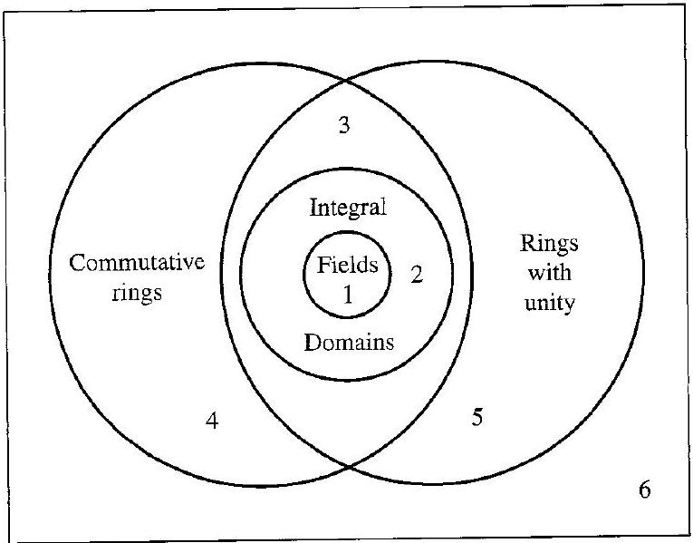

# Editorial records — Section19: Integral Domains

Status: source reviewed printed177–184 (PDF183–190); figure conversion, saved-file lint and native review pending.

## Join page-split sentence, pp.178–179.

Before:

```text
These
are multiplicative
```

After:

```text
These are multiplicative
```

## Restore math boundary separating reference and equality, p.179.

Before:

```text
Theorem $19.5 x_{1}=x_{2}$
```

After:

```text
Theorem 19.5, $x_{1}=x_{2}$
```

## Restore proof end marker.

Before:

```text
proved. ◇
```

After:

```text
proved. $\square$
```

## Restore opening parenthesis inside math, Exercise11, p.182.

Before:

```text
simplify ( $a+b)^{4}$
```

After:

```text
simplify $(a+b)^{4}$
```

## Restore integer-set font, Exercise30, p.183.

Before:

```text
$S=R \times Z$
```

After:

```text
$S=R \times \mathbb{Z}$
```

## Format printed subsection heading.

Before:

```text

Computations

```

After:

```text

### Computations

```

## Format printed subsection heading.

Before:

```text

Concepts

```

After:

```text

## Concepts

```

## Restore printed sum label under the complete sum; OCR made it an aligned second row, p.181.

Before:

```text
\begin{aligned}
p \cdot 1=1+ & 1+\cdots+1=0 \\
& p \text { summands }
\end{aligned}
```

After:

```text
p\cdot1=\underset{p\text{ summands}}{1+1+\cdots+1}=0
```

## Restore only the repeated-addition notation defined in the immediately preceding source paragraph.

Before:

```text
If for a ring $R$ a positive integer $n$ exists such that $n \cdot a=0$ for all $a \in R$, then the least such positive integer is the characteristic of the ring $R$. If no such positive integer exists, then $R$ is of characteristic 0.
```

After:

```text
If for a ring $R$ a positive integer $n$ exists such that $n \cdot a=0$ for all $a \in R$, where $n\cdot a$ means $a+a+\cdots+a$ for $n$ summands, then the least such positive integer is the characteristic of the ring $R$. If no such positive integer exists, then $R$ is of characteristic 0.
```

## Restore the type of cancellation specified immediately above the theorem; additive cancellation is a different statement.

Before:

```text
The cancellation laws hold in a ring $R$ if and only if $R$ has no divisors of 0.
```

After:

```text
The multiplicative cancellation laws hold in a ring $R$ if and only if $R$ has no divisors of 0.
```

## Restore only the demonstrated task; preserve the source answer outside the callout.

Before:

```text
Example19.7: source gives a demonstration without a distinct prompt
```

After:

```text
Determine whether $\mathbb{Z}$, $\mathbb{Z}_n$, and a direct product $R\times S$ of two nonzero rings are integral domains.
```

## Restore only the demonstrated task; preserve the source answer outside the callout.

Before:

```text
Example19.14: source gives a demonstration without a distinct prompt
```

After:

```text
Find the characteristics of $\mathbb{Z}_n$, $\mathbb{Z}$, $\mathbb{Q}$, $\mathbb{R}$, and $\mathbb{C}$.
```

## Restore the ten source true/false rows and empty answer spaces, pp.182–183.

Before:

```text
17. Mark each of the following true or false.

\_\_\_\_ a. $n \mathbb{Z}$ has zero divisors if $n$ is not prime.
\_\_\_\_
b. Every field is an integral domain.
\_\_\_\_
c. The characteristic of $n \mathbb{Z}$ is $n$.


\_\_\_\_ d. As a ring, $\mathbb{Z}$ is isomorphic to $n \mathbb{Z}$ for all $n \geq 1$.
\_\_\_\_ e. The cancellation law holds in any ring that is isomorphic to an integral domain.
\_\_\_\_ f. Every integral domain of characteristic 0 is infinite.
\_\_\_\_ g. The direct product of two integral domains is again an integral domain.
\_\_\_\_ h. A divisor of zero in a commutative ring with unity can have no multiplicative inverse.
\_\_\_\_ i. $n \mathbb{Z}$ is a subdomain of $\mathbb{Z}$.
\_\_\_\_ j. $\mathbb{Z}$ is a subfield of $\mathbb{Q}$.
```

After:

```text
17. Mark each of the following true or false.

a. \_\_\_\_ $n\mathbb{Z}$ has zero divisors if $n$ is not prime.

b. \_\_\_\_ Every field is an integral domain.

c. \_\_\_\_ The characteristic of $n\mathbb{Z}$ is $n$.

d. \_\_\_\_ As a ring, $\mathbb{Z}$ is isomorphic to $n\mathbb{Z}$ for all $n\geq1$.

e. \_\_\_\_ The cancellation law holds in any ring that is isomorphic to an integral domain.

f. \_\_\_\_ Every integral domain of characteristic 0 is infinite.

g. \_\_\_\_ The direct product of two integral domains is again an integral domain.

h. \_\_\_\_ A divisor of zero in a commutative ring with unity can have no multiplicative inverse.

i. \_\_\_\_ $n\mathbb{Z}$ is a subdomain of $\mathbb{Z}$.

j. \_\_\_\_ $\mathbb{Z}$ is a subfield of $\mathbb{Q}$.

```

## Formatting-only changes

Three numbered definitions, one explicit inline definition, five theorems and two corollaries wrapped. Source numbering remains outside reusable callouts. Four example prompts separated from source working; thirty exercises wrapped. Printed italicized terms restored in deliberately flawed definitions15–16 without correcting their content. Figure19.10 original image inspected against the PDF: all labels and regions retained. Original OCR unchanged.

## Earlier staging record

# Editorial records — Section 19 - Integral Domains

Status: staged original OCR; content/callout/source review pending.

## Heading formatting

Before: `## section 19 Integral Domains`

After: `# 19 Integral Domains`

Section heading separated and normalized to level one; body wording unchanged. Original chapter OCR archive retained in conversion records.


## Figure 19.10

Formatting only: preserved image and printed caption in scientific figure component.

Before:

```text

19.10 Figure A collection of rings.
```

After:

```text
```scientific-figure
id: f4a5773f-7506-4c49-b336-e74efb99810e
numbered: false
title: ""
caption: Figure 19.10 — A collection of rings.
captionVisible: true
captionPosition: below
columns: 1
panels:
  - path: images/11d405bb-bfc3-4370-b15e-6cfa693e67ba-14_599_765_1466_781.jpg
    caption: ""
```
```

## Native review

Saved-file lint: zero errors, one image advisory. Native spot check passed: complete Figure19.10 including all six regions and caption, Theorem19.11 and its initial proof displays. Other passage-level rendering remains pending.
