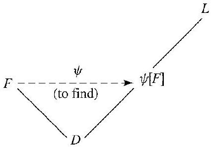

# Editorial records — Section21: The Field of Quotients of an Integral Domain

Status: source reviewed printed190–197 (PDF196–203); figure component converted; saved-file lint passed with zero errors and one image-size advisory; native review pending.

## Restore printed subsection heading.

Before:

```text

The Construction

```

After:

```text

## The Construction

```

## Restore printed subsection heading.

Before:

```text

Uniqueness

```

After:

```text

## Uniqueness

```

## Restore relation symbol in math, Lemma21.2.

Before:

```text
relation ~ between
```

After:

```text
relation $\sim$ between
```

## Restore relation symbol in math following Lemma21.2.

Before:

```text
that ~ gives
```

After:

```text
that $\sim$ gives
```

## Restore complete equivalence-class math boundaries, Step3 item4, p.193.

Before:

```text
[ $(-a, b)$ ]
```

After:

```text
$[(-a,b)]$
```

## Restore complete equivalence-class math boundaries, Step3 item4.

Before:

```text
[ $(a, b)$ ]
```

After:

```text
$[(a,b)]$
```

## Restore equivalence-class math, Step3 item8, p.193.

Before:

```text
8. [(1, 1)]
```

After:

```text
8. $[(1,1)]$
```

## Restore variable math, proof21.4, p.194.

Before:

```text
Thus i is an isomorphism
```

After:

```text
Thus $i$ is an isomorphism
```

## Restore field-labelled quotient slash subscripts, pp.195–196.

Before:

```text
a / F b
```

After:

```text
a /_{F} b
```

## Restore field-labelled quotient slash subscript, pp.195–196.

Before:

```text
c / F d
```

After:

```text
c /_{F} d
```

## Restore field-labelled quotient slash subscript, proof21.9, p.196.

Before:

```text
a / L b
```

After:

```text
a /_{L} b
```

## Restore field-labelled quotient slash subscript, proof21.6, p.195.

Before:

```text
/ L \psi
```

After:

```text
/_{L} \psi
```

## Remove OCR duplicated division slash, proof21.6, p.196.

Before:

```text
a / /_{F} b
```

After:

```text
a /_{F} b
```

## Restore printed subsection heading.

Before:

```text

Computations

```

After:

```text

### Computations

```

## Restore printed subsection heading.

Before:

```text

Concepts

```

After:

```text

## Concepts

```

## Restore word boundary, Exercise16.

Before:

```text
\right)$by
```

After:

```text
\right)$ by
```

## Restore printed variable math, Exercise17, p.197.

Before:

```text
an element a that is a divisor
```

After:

```text
an element $a$ that is a divisor
```

## Formatting only: keep the author’s equation sequence and sentence uninterrupted; preserve the image and printed label.

Before:

```text
Figure21.7 between the multiplicative and additive homomorphism equations
```

After:

```text
Figure21.7 immediately after its first source reference
```

## Restore D and S from the source setup; the equivalence definition itself is unchanged.

Before:

```text
Two elements $(a, b)$ and $(c, d)$ in $S$ are equivalent, denoted by $(a, b) \sim(c, d)$, if and only if $a d=b c$.
```

After:

```text
Let $D$ be an integral domain, and let $S=\{(a,b)\mid a,b\in D,\ b\neq0\}$. Two elements $(a, b)$ and $(c, d)$ in $S$ are equivalent, denoted by $(a, b) \sim(c, d)$, if and only if $a d=b c$.
```

## Restore only source definitions of D, S, the equivalence relation, and where needed F and its operations; keep the lemma statement and proof. Source pp.191–194.

Before:

```text
The relation $\sim$ between elements of the set $S$ as just described is an equivalence relation.
```

After:

```text
Let $D$ be an integral domain, and let $S=\{(a,b)\mid a,b\in D,\ b\neq0\}$. Define $(a,b)\sim(c,d)$ if and only if $ad=bc$.

The relation $\sim$ between elements of the set $S$ is an equivalence relation.
```

## Restore only source definitions of D, S, the equivalence relation, and where needed F and its operations; keep the lemma statement and proof. Source pp.191–194.

Before:

```text
For $[(a, b)]$ and $[(c, d)]$ in $F$, the equations

$$
[(a, b)]+[(c, d)]=[(a d+b c, b d)]
$$

and

$$
[(a, b)][(c, d)]=[(a c, b d)]
$$

give well-defined operations of addition and multiplication on $F$.
```

After:

```text
Let $D$ be an integral domain, and let $S=\{(a,b)\mid a,b\in D,\ b\neq0\}$. Define $(a,b)\sim(c,d)$ if and only if $ad=bc$. Let $F$ be the set of all equivalence classes $[(a,b)]$ for $(a,b)\in S$ under this relation.

For $[(a, b)]$ and $[(c, d)]$ in $F$, the equations

$$
[(a, b)]+[(c, d)]=[(a d+b c, b d)]
$$

and

$$
[(a, b)][(c, d)]=[(a c, b d)]
$$

give well-defined operations of addition and multiplication on $F$.
```

## Restore only source definitions of D, S, the equivalence relation, and where needed F and its operations; keep the lemma statement and proof. Source pp.191–194.

Before:

```text
The map $i: D \rightarrow F$ given by $i(a)=[(a, 1)]$ is an isomorphism of $D$ with a subring of $F$.
```

After:

```text
Let $D$ be an integral domain, and let $S=\{(a,b)\mid a,b\in D,\ b\neq0\}$. Define $(a,b)\sim(c,d)$ if and only if $ad=bc$. Let $F$ be the set of all equivalence classes $[(a,b)]$ for $(a,b)\in S$ under this relation.

The operations on $F$ are given by

$$
[(a,b)]+[(c,d)]=[(ad+bc,bd)]
$$

and

$$
[(a,b)][(c,d)]=[(ac,bd)].
$$

The map $i: D \rightarrow F$ given by $i(a)=[(a, 1)]$ is an isomorphism of $D$ with a subring of $F$.
```

## Restore the integral-domain hypothesis on D from the section setup.

Before:

```text
Let $F$ be a field of quotients of $D$ and let $L$ be any field containing $D$. Then there exists a map $\psi: F \rightarrow L$ that gives an isomorphism of $F$ with a subfield of $L$ such that $\psi(a)=a$ for $a \in D$.
```

After:

```text
Let $F$ be a field of quotients of an integral domain $D$ and let $L$ be any field containing $D$. Then there exists a map $\psi: F \rightarrow L$ that gives an isomorphism of $F$ with a subfield of $L$ such that $\psi(a)=a$ for $a \in D$.
```

## Restore the ten true/false rows and blank response spaces; no statements answered or altered.

Before:

```text
4. Mark each of the following true or false.
\_\_\_\_ a. $\mathbb{Q}$ is a field of quotients of $\mathbb{Z}$.
\_\_\_\_ b. $\mathbb{R}$ is a field of quotients of $\mathbb{Z}$.
\_\_\_\_ c. $\mathbb{R}$ is a field of quotients of $\mathbb{R}$.
\_\_\_\_ d. $\mathbb{C}$ is a field of quotients of $\mathbb{R}$.
\_\_\_\_ e. If $D$ is a field, then any field of quotients of $D$ is isomorphic to $D$.
\_\_\_\_ f. The fact that $D$ has no divisors of 0 was used strongly several times in the construction of a field $F$ of quotients of the integral domain $D$.
\_\_\_\_ g. Every element of an integral domain $D$ is a unit in a field $F$ of quotients of $D$.
\_\_\_\_ h. Every nonzero element of an integral domain $D$ is a unit in a field $F$ of quotients of $D$.
\_\_\_\_ i. A field of quotients $F^{\prime}$ of a subdomain $D^{\prime}$ of an integral domain $D$ can be regarded as a subfield of some field of quotients of $D$.

\_\_\_\_ j. Every field of quotients of $\mathbb{Z}$ is isomorphic to $\mathbb{Q}$.
```

After:

```text
4. Mark each of the following true or false.

a. \_\_\_\_ $\mathbb{Q}$ is a field of quotients of $\mathbb{Z}$.

b. \_\_\_\_ $\mathbb{R}$ is a field of quotients of $\mathbb{Z}$.

c. \_\_\_\_ $\mathbb{R}$ is a field of quotients of $\mathbb{R}$.

d. \_\_\_\_ $\mathbb{C}$ is a field of quotients of $\mathbb{R}$.

e. \_\_\_\_ If $D$ is a field, then any field of quotients of $D$ is isomorphic to $D$.

f. \_\_\_\_ The fact that $D$ has no divisors of 0 was used strongly several times in the construction of a field $F$ of quotients of the integral domain $D$.

g. \_\_\_\_ Every element of an integral domain $D$ is a unit in a field $F$ of quotients of $D$.

h. \_\_\_\_ Every nonzero element of an integral domain $D$ is a unit in a field $F$ of quotients of $D$.

i. \_\_\_\_ A field of quotients $F^{\prime}$ of a subdomain $D^{\prime}$ of an integral domain $D$ can be regarded as a subfield of some field of quotients of $D$.


j. \_\_\_\_ Every field of quotients of $\mathbb{Z}$ is isomorphic to $\mathbb{Q}$.
```

## Formatting-only changes

One definition, three lemmas, two theorems and two corollaries wrapped; original numbering outside reusable callouts. The four construction steps and nine field-axiom checks remain lesson text, in source order, with source proofs retained. Seventeen exercises wrapped; the intentionally inadequate definition in Exercise3 retained with its printed italicized term. Original OCR unchanged.

## Earlier staging record

# Editorial records — Section 21 - The Field of Quotients of an Integral Domain

Status: staged original OCR; content/callout/source review pending.

## Heading formatting

Before: `section 21 The Field of Quotients of an Integral Domain`

After: `# 21 The Field of Quotients of an Integral Domain`

Section heading separated and normalized to level one; body wording unchanged. Original chapter OCR archive retained in conversion records.


## Figure 21.7

Formatting only: preserved image and printed caption in scientific figure component.

Before:

```text

21.7 Figure
```

After:

```text
```scientific-figure
id: 73506c10-5f82-4a99-a811-730ee9c511bb
numbered: false
title: ""
caption: Figure 21.7
captionVisible: true
captionPosition: below
columns: 1
panels:
  - path: images/11d405bb-bfc3-4370-b15e-6cfa693e67ba-29_296_425_1753_899.jpg
    caption: ""
```
```
