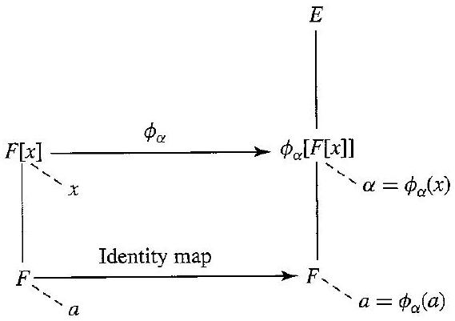

# Editorial records — Section22: Rings of Polynomials

Status: source reviewed printed198–209 (PDF204–215); figure converted; saved-file lint complete with zero errors and one image-size advisory. Native review pending.

## Join split formal-sum math, p.199.

Before:

```text
$0+a_{1} x+$ $0 x^{2}$
```

After:

```text
$0+a_{1}x+0x^{2}$
```

## Join split polynomial math, p.199.

Before:

```text
$f(x)=a_{0}+a_{1} x+\cdots+$ $a_{n} x^{n}+\cdots$
```

After:

```text
$f(x)=a_{0}+a_{1}x+\cdots+a_nx^n+\cdots$
```

## Move displaced degree-zero footnote marker to the printed definition label.

Before:

```text
[^1]and for polynomial multiplication
```

After:

```text
and for polynomial multiplication
```

## Restore rational-field font, p.200.

Before:

```text
$Q[x]$
```

After:

```text
$\mathbb{Q}[x]$
```

## Join split evaluation equality, Theorem22.4.

Before:

```text
$\phi_{\alpha}(x)=$ $\alpha$
```

After:

```text
$\phi_{\alpha}(x)=\alpha$
```

## Join split polynomial sum, proof22.4.

Before:

```text
$h(x)=$ $f(x)+g(x)=
```

After:

```text
$h(x)=f(x)+g(x)=
```

## Restore coefficient a_n, misread as alpha_n in the product-evaluation display, p.202.

Before:

```text
\cdots+\alpha_{n} \alpha^{n}
```

After:

```text
\cdots+a_{n} \alpha^{n}
```

## Correct punctuation separating the subject from its verb, p.203.

Before:

```text
where $a \in F$. gives
```

After:

```text
where $a \in F$, gives
```

## Correct missing common-unity hypothesis for phi_alpha(x)=alpha. Counterexample without it: F=Z2×{0} inside E=Z2×Z2 and alpha=(0,1) give phi_alpha(x)=(0,0), not alpha. Source remark p.203.

Before:

```text
merely commutative rings with unity rather than fields
```

After:

```text
merely commutative rings with the same unity rather than fields
```

## Remove extraneous subscript on the field F in Example22.7; the source setup and all other examples use F and E, p.203.

Before:

```text
Let $F_{\xi}$ be
```

After:

```text
Let $F$ be
```

## Join split polynomial math, Definition22.10.

Before:

```text
$f(x)=a_{0}+$ $a_{1} x+\cdots+a_{n} x^{n}$
```

After:

```text
$f(x)=a_0+a_1x+\cdots+a_nx^n$
```

## Join page-split sentence, pp.204–205.

Before:

```text
in Section 26
with an eye
```

After:

```text
in Section 26 with an eye
```

## Remove isolated scan/OCR artifact above Theorem22.11, p.205.

Before:

```text
the following theorem.
g

```

After:

```text
the following theorem.

```

## Correct printed punctuation in the proof, p.205.

Before:

```text
But as a square.
```

After:

```text
But as a square,
```

## Join page-split sentence, pp.206–207.

Before:

```text
studying the
nature
```

After:

```text
studying the nature
```

## Correct printed punctuation, p.207.

Before:

```text
For a direct demonstration. see
```

After:

```text
For a direct demonstration, see
```

## Format source subsection heading.

Before:

```text

Computations

```

After:

```text

### Computations

```

## Format source subsection heading.

Before:

```text

Concepts

```

After:

```text

## Concepts

```

## Separate exercise numbers from mathematical field notation.

Before:

```text
In Exercises 7 and $8, F=E=\mathbb{C}$
```

After:

```text
In Exercises 7 and 8, $F=E=\mathbb{C}$
```

## Separate exercise numbers from mathematical field notation.

Before:

```text
In Exercises 9 through $11, F=E=\mathbb{Z}_{7}$
```

After:

```text
In Exercises 9 through 11, $F=E=\mathbb{Z}_{7}$
```

## Restore missing preposition in Exercise23g; mathematical claim left unchanged.

Before:

```text
a subfield $E$
```

After:

```text
a subfield of $E$
```

## Restore operation symbol in math, Exercise29.

Before:

```text
Note that ⋅ is not
```

After:

```text
Note that $\cdot$ is not
```

## Restore function-set exponent, Exercise31a, p.209.

Before:

```text
$\mathbb{Z}_{3} \mathbb{Z}_{3}$
```

After:

```text
$\mathbb{Z}_3^{\mathbb{Z}_3}$
```

## Restore function-set exponent, Exercise31b, p.209.

Before:

```text
\mathbb{Z}_{2} \mathbb{Z}_{2},+
```

After:

```text
\mathbb{Z}_2^{\mathbb{Z}_2},+
```

## Keep the degree footnote outside the reusable definition; remove the numbered theorem reference where the evaluation formula is already given in full.

Before:

```text
Let $R$ be a ring. A polynomial $f(x)$ with coefficients in $R$ is an infinite formal sum

$$
\sum_{i=0}^{\infty} a_{i} x^{i}=a_{0}+a_{1} x+\cdots+a_{n} x^{n}+\cdots,
$$

where $a_{i} \in R$ and $a_{i}=0$ for all but a finite number of values of $i$. The $a_{i}$ are coefficients of $f(x)$. If for some $i \geq 0$ it is true that $a_{i} \neq 0$, the largest such value of $i$ is the degree of $f(x)$. If all $a_{i}=0$, then the degree of $f(x)$ is undefined. ${ }^{\dagger}$
```

After:

```text
Let $R$ be a ring. A polynomial $f(x)$ with coefficients in $R$ is an infinite formal sum

$$
\sum_{i=0}^{\infty} a_{i} x^{i}=a_{0}+a_{1} x+\cdots+a_{n} x^{n}+\cdots,
$$

where $a_{i} \in R$ and $a_{i}=0$ for all but a finite number of values of $i$. The $a_{i}$ are coefficients of $f(x)$. If for some $i \geq 0$ it is true that $a_{i} \neq 0$, the largest such value of $i$ is the degree of $f(x)$. If all $a_{i}=0$, then the degree of $f(x)$ is undefined.
```

## Keep the degree footnote outside the reusable definition; remove the numbered theorem reference where the evaluation formula is already given in full.

Before:

```text
Let $F$ be a subfield of a field $E$, and let $\alpha$ be an element of $E$. Let $f(x)=a_0+a_1x+\cdots+a_nx^n$ be in $F[x]$, and let $\phi_{\alpha}: F[x] \rightarrow E$ be the evaluation homomorphism of Theorem 22.4. Let $f(\alpha)$ denote

$$
\phi_{\alpha}(f(x))=a_{0}+a_{1} \alpha+\cdots+a_{n} \alpha^{n} .
$$

If $f(\alpha)=0$, then $\alpha$ is a zero of $f(x)$.
```

After:

```text
Let $F$ be a subfield of a field $E$, and let $\alpha$ be an element of $E$. Let $f(x)=a_0+a_1x+\cdots+a_nx^n$ be in $F[x]$, and let $\phi_{\alpha}: F[x] \rightarrow E$ be the evaluation homomorphism. Let $f(\alpha)$ denote

$$
\phi_{\alpha}(f(x))=a_{0}+a_{1} \alpha+\cdots+a_{n} \alpha^{n} .
$$

If $f(\alpha)=0$, then $\alpha$ is a zero of $f(x)$.
```

## Restore the ring hypothesis from the source paragraph before wrapping the inline definition.

Before:

```text
An element of $R$ is a constant polynomial.
```

After:

```text
Let $R$ be a ring. An element of $R$ is a constant polynomial.
```

## Remove only the exercise reference from the source definition; retain the construction, natural isomorphism and author’s wording.

Before:

```text
If $R$ is a ring and $x$ and $y$ are two indeterminates, then we can form the ring $(R[x])[y]$, that is, the ring of polynomials in $y$ with coefficients that are polynomials in $x$. Every polynomial in $y$ with coefficients that are polynomials in $x$ can be rewritten in a natural way as a polynomial in $x$ with coefficients that are polynomials in $y$ as illustrated by Exercise 20. This indicates that $(R[x])[y]$ is naturally isomorphic to $(R[y])[x]$, although a careful proof is tedious. We shall identify these rings by means of this natural isomorphism, and shall consider this ring $R[x, y]$ the ring of polynomials in two indeterminates $x$ and $y$ with coefficients in $R$. The ring $R\left[x_{1}, \cdots, x_{n}\right]$ of polynomials in the $n$ indeterminates $x_{i}$ with coefficients in $R$ is similarly defined.
```

After:

```text
If $R$ is a ring and $x$ and $y$ are two indeterminates, then we can form the ring $(R[x])[y]$, that is, the ring of polynomials in $y$ with coefficients that are polynomials in $x$. Every polynomial in $y$ with coefficients that are polynomials in $x$ can be rewritten in a natural way as a polynomial in $x$ with coefficients that are polynomials in $y$. This indicates that $(R[x])[y]$ is naturally isomorphic to $(R[y])[x]$, although a careful proof is tedious. We shall identify these rings by means of this natural isomorphism, and shall consider this ring $R[x, y]$ the ring of polynomials in two indeterminates $x$ and $y$ with coefficients in $R$. The ring $R\left[x_{1}, \cdots, x_{n}\right]$ of polynomials in the $n$ indeterminates $x_{i}$ with coefficients in $R$ is similarly defined.
```

## Remove only chapter-dependent introductory/reference phrases; preserve the source definition and its explanation.

Before:

```text
In particular, if $F$ is a field, then $F[x]$ is an integral domain. Note that $F[x]$ is not a field, for $x$ is not a unit in $F[x]$. That is, there is no polynomial $f(x) \in F[x]$ such that $x f(x)=1$. By Theorem 21.5, one can construct the field of quotients $F(x)$ of $F[x]$. Any element in $F(x)$ can be represented as a quotient $f(x) / g(x)$ of two polynomials in $F[x]$ with $g(x) \neq 0$. We similarly define $F\left(x_{1}, \cdots, x_{n}\right)$ to be the field of quotients of $F\left[x_{1}, \cdots, x_{n}\right]$. This field $F\left(x_{1}, \cdots, x_{n}\right)$ is the field of rational functions in $n$ indeterminates over $F$.
```

After:

```text
If $F$ is a field, then $F[x]$ is an integral domain. Note that $F[x]$ is not a field, for $x$ is not a unit in $F[x]$. That is, there is no polynomial $f(x) \in F[x]$ such that $x f(x)=1$. One can construct the field of quotients $F(x)$ of $F[x]$. Any element in $F(x)$ can be represented as a quotient $f(x) / g(x)$ of two polynomials in $F[x]$ with $g(x) \neq 0$. We similarly define $F\left(x_{1}, \cdots, x_{n}\right)$ to be the field of quotients of $F\left[x_{1}, \cdots, x_{n}\right]$. This field $F\left(x_{1}, \cdots, x_{n}\right)$ is the field of rational functions in $n$ indeterminates over $F$.
```

## Formatting only: line-break the first side of the long associativity computation; no algebraic step removed or added.

Before:

```text
{\left[\left(\sum_{i=0}^{\infty} a_{i} x^{i}\right)\left(\sum_{j=0}^{\infty} b_{j} x^{j}\right)\right]\left(\sum_{k=0}^{\infty} c_{k} x^{k}\right) } & =
```

After:

```text
{\left[\left(\sum_{i=0}^{\infty} a_{i} x^{i}\right)\left(\sum_{j=0}^{\infty} b_{j} x^{j}\right)\right]\left(\sum_{k=0}^{\infty} c_{k} x^{k}\right) }\\
& =
```

## Formatting only; original image and label preserved.

Before:

```text
Figure22.5 separates “immediate” from “consequence” in the proof
```

After:

```text
Figure placed after its source reference; the split sentence is rejoined.
```

## Restore only the demonstrated task; source working retained outside the callout.

Before:

```text
Example22.3 supplies a worked demonstration without a separate prompt
```

After:

```text
In $\mathbb{Z}_2[x]$, compute $(x+1)^2$ and $(x+1)+(x+1)$.
```

## Restore only the demonstrated task; source working retained outside the callout.

Before:

```text
Example22.6 supplies a worked demonstration without a separate prompt
```

After:

```text
Describe the evaluation homomorphism $\phi_0:\mathbb{Q}[x]\rightarrow\mathbb{R}$.
```

## Restore only the demonstrated task; source working retained outside the callout.

Before:

```text
Example22.7 supplies a worked demonstration without a separate prompt
```

After:

```text
Describe the evaluation homomorphism $\phi_2:\mathbb{Q}[x]\rightarrow\mathbb{R}$ and evaluate $\phi_2(x^2+x-6)$.
```

## Restore only the demonstrated task; source working retained outside the callout.

Before:

```text
Example22.8 supplies a worked demonstration without a separate prompt
```

After:

```text
Describe the evaluation homomorphism $\phi_i:\mathbb{Q}[x]\rightarrow\mathbb{C}$ and evaluate $\phi_i(x^2+1)$.
```

## Restore only the demonstrated task; source working retained outside the callout.

Before:

```text
Example22.9 supplies a worked demonstration without a separate prompt
```

After:

```text
Describe the evaluation homomorphism $\phi_\pi:\mathbb{Q}[x]\rightarrow\mathbb{R}$ and its kernel.
```

## Restore ten true/false rows and blank answer spaces. No mathematical answers supplied.

Before:

```text
23. Mark each of the following true or false.
    \_\_\_\_ a. The polynomial $\left(a_{n} x^{n}+\cdots+a_{1} x+a_{0}\right) \in R[x]$ is 0 if and only if $a_{i}=0$, for $i=0,1, \cdots, n$.
    \_\_\_\_ b. If $R$ is a commutative ring, then $R[x]$ is commutative.
    \_\_\_\_ c. If $D$ is an integral domain, then $D[x]$ is an integral domain.
    \_\_\_\_ d. If $R$ is a ring containing divisors of 0 , then $R[x]$ has divisors of 0.
    \_\_\_\_ e. If $R$ is a ring and $f(x)$ and $g(x)$ in $R[x]$ are of degrees 3 and 4, respectively, then $f(x) g(x)$ may be of degree 8 in $R[x]$.
    \_\_\_\_ f. If $R$ is any ring and $f(x)$ and $g(x)$ in $R[x]$ are of degrees 3 and 4, respectively, then $f(x) g(x)$ is always of degree 7.
    \_\_\_\_ g. If $F$ is a subfield of $E$ and $\alpha \in E$ is a zero of $f(x) \in F[x]$, then $\alpha$ is a zero of $h(x)=f(x) g(x)$ for all $g(x) \in F[x]$.
    \_\_\_\_ h. If $F$ is a field, then the units in $F[x]$ are precisely the units in $F$.
    \_\_\_\_ i. If $R$ is a ring, then $x$ is never a divisor of 0 in $R[x]$.
    \_\_\_\_ j. If $R$ is a ring, then the zero divisors in $R[x]$ are precisely the zero divisors in $R$.

```

After:

```text
23. Mark each of the following true or false.

a. \_\_\_\_ The polynomial $\left(a_{n} x^{n}+\cdots+a_{1} x+a_{0}\right) \in R[x]$ is 0 if and only if $a_{i}=0$, for $i=0,1, \cdots, n$.

b. \_\_\_\_ If $R$ is a commutative ring, then $R[x]$ is commutative.

c. \_\_\_\_ If $D$ is an integral domain, then $D[x]$ is an integral domain.

d. \_\_\_\_ If $R$ is a ring containing divisors of 0 , then $R[x]$ has divisors of 0.

e. \_\_\_\_ If $R$ is a ring and $f(x)$ and $g(x)$ in $R[x]$ are of degrees 3 and 4, respectively, then $f(x) g(x)$ may be of degree 8 in $R[x]$.

f. \_\_\_\_ If $R$ is any ring and $f(x)$ and $g(x)$ in $R[x]$ are of degrees 3 and 4, respectively, then $f(x) g(x)$ is always of degree 7.

g. \_\_\_\_ If $F$ is a subfield of $E$ and $\alpha \in E$ is a zero of $f(x) \in F[x]$, then $\alpha$ is a zero of $h(x)=f(x) g(x)$ for all $g(x) \in F[x]$.

h. \_\_\_\_ If $F$ is a field, then the units in $F[x]$ are precisely the units in $F$.

i. \_\_\_\_ If $R$ is a ring, then $x$ is never a divisor of 0 in $R[x]$.

j. \_\_\_\_ If $R$ is a ring, then the zero divisors in $R[x]$ are precisely the zero divisors in $R$.

```

## Formatting-only changes

Six definitions, three theorems, five example prompts, thirty-one exercises and two historical asides wrapped. Original named theorem title retained. Infinite-formal-sum definition and zero-polynomial degree convention retained exactly; no replacement mathematical framework. Deliberately inadequate definitions18–19 and true/false questions retained. Degree footnote restored outside the reusable statement from the source page and batch-tail record. Original OCR unchanged.

## Earlier staging record

# Editorial records — Section 22 - Rings of Polynomials

Status: staged original OCR; content/callout/source review pending.

## Heading formatting

Before: `## section 22 Rings of Polynomials`

After: `# 22 Rings of Polynomials`

Section heading separated and normalized to level one; body wording unchanged. Original chapter OCR archive retained in conversion records.


## Figure 22.5

Formatting only: preserved image and printed caption in scientific figure component.

Before:

```text

22.5 Figure
```

After:

```text
```scientific-figure
id: fb4890d7-7c76-4a27-918f-d31dab47a9c1
numbered: false
title: ""
caption: Figure 22.5
captionVisible: true
captionPosition: below
columns: 1
panels:
  - path: images/11d405bb-bfc3-4370-b15e-6cfa693e67ba-36_401_569_219_901.jpg
    caption: ""
```
```

## Native verification

Obsidian Reading view: complete seven-line associativity display and full Figure22.5 with caption fit the reading pane; evaluation theorem formula and surrounding proof render correctly. This is a scoped native check, not a whole-section visual certification.
