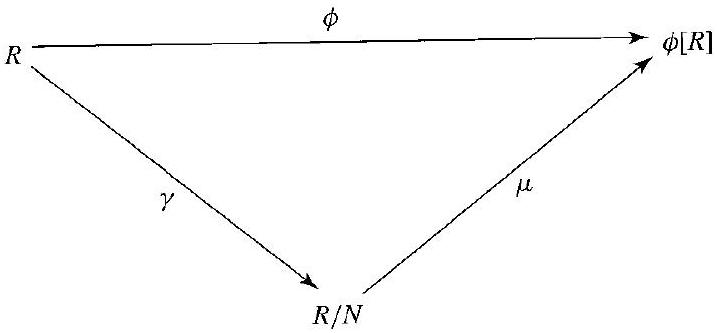

# Editorial records — Section26 Homomorphisms and Factor Rings

Printed237–245/PDF242–250 visually reviewed. Native review pending.

## Remove a misplaced PartV table-of-contents footnote marker and rejoin the page-broken sentence, pp.237–238.

Before:

```text


[^0]for
```

After:

```text
 for
```

## Restore the printed group brackets, p.238.

Before:

```text
of ( $\left.R,+\right\rangle$
```

After:

```text
of $\langle R,+\rangle$
```

## Restore the codomain prime in Definition26.4, p.238.

Before:

```text
Let a map $\phi: R \rightarrow R$ be
```

After:

```text
Let a map $\phi: R \rightarrow R^{\prime}$ be
```

## Correct H to R: a+H is a coset of the subgroup H in the ambient additive group R; the printed theorem has H, p.239.

Before:

```text
the commutative additive group $\langle H,+\rangle$
```

After:

```text
the commutative additive group $\langle R,+\rangle$
```

## Correct the printed theorem reference: mu is defined in26.7, not Definition26.4, p.239.

Before:

```text
statement of Theorem 26.4
```

After:

```text
statement of Theorem 26.7
```

## Remove the stray comma before membership, p.239.

Before:

```text
$h_{1}, h_{2}, \in H$
```

After:

```text
$h_{1}, h_{2}\in H$
```

## Correct the printed misspelling, p.241.

Before:

```text
An addive subgroup
```

After:

```text
An additive subgroup
```

## Rejoin split math, p.240.

Before:

```text
$\left(a+h_{1}\right)\left(b+h_{2}\right) \in$ $a b+H$
```

After:

```text
$\left(a+h_{1}\right)\left(b+h_{2}\right)\in a b+H$
```

## Rejoin split math, p.241.

Before:

```text
$s(n m)=$ $(n m) s=n(m s) \in n \mathbb{Z}$
```

After:

```text
$s(n m)=(n m) s=n(m s)\in n\mathbb{Z}$
```

## Restore missing prose spacing, p.241.

Before:

```text
\mathbb{Z}^{+}$if
```

After:

```text
\mathbb{Z}^{+}$ if
```

## Keep the map and domain in one math expression, p.242.

Before:

```text
Let $\phi$ : $R \rightarrow R^{\prime}$
```

After:

```text
Let $\phi:R\rightarrow R^{\prime}$
```

## Restore the damaged quotient-ring notation, p.243.

Before:

```text
the factor ring $=n z$
```

After:

```text
the factor ring $\mathbb Z/n\mathbb Z$
```

## Restore the damaged quotient codomain from the source, p.243.

Before:

```text
homomorphism mapping $R$ into $R$.
```

After:

```text
homomorphism mapping $R$ into $R/N$.
```

## Rejoin the split matrix formula, p.244.

Before:

```text
$\phi(a+b \sqrt{2})=$ $\left[
```

After:

```text
$\phi(a+b \sqrt{2})=\left[
```

## Restore matching printed group brackets, p.245.

Before:

```text
$\operatorname{End}((R,+\rangle)$
```

After:

```text
$\operatorname{End}(\langle R,+\rangle)$
```

## Separate display closure from proof-ending marker.

Before:

```text
$$ $\square$
```

After:

```text
$$

$\square$
```

## Wrap the complete definition; retain its source number outside the callout.

Before:

```text
26.1 Definition A map $\phi$ of a ring $R$ into a ring $R^{\prime}$ is a homomorphism if

$$
\phi(a+b)=\phi(a)+\phi(b)
$$

and

$$
\phi(a b)=\phi(a) \phi(b)
$$

for all elements $a$ and $b$ in $R$. $\square$
```

After:

```text
Definition 26.1

> [!definition] Ring Homomorphism
> A map $\phi$ of a ring $R$ into a ring $R^{\prime}$ is a homomorphism if
>
> $$
> \phi(a+b)=\phi(a)+\phi(b)
> $$
>
> and
>
> $$
> \phi(a b)=\phi(a) \phi(b)
> $$
>
> for all elements $a$ and $b$ in $R$.
```

## Wrap the complete definition; retain its source number outside the callout.

Before:

```text
26.4 Definition Let a map $\phi: R \rightarrow R^{\prime}$ be a homomorphism of rings. The subring

$$
\phi^{-1}\left[0^{\prime}\right]=\left\{r \in R \mid \phi(r)=0^{\prime}\right\}
$$

is the kernel of $\phi$, denoted by $\operatorname{Ker}(\phi)$. $\square$
```

After:

```text
Definition 26.4

> [!definition] Kernel of a Ring Homomorphism
> Let a map $\phi: R \rightarrow R^{\prime}$ be a homomorphism of rings. The subring
>
> $$
> \phi^{-1}\left[0^{\prime}\right]=\left\{r \in R \mid \phi(r)=0^{\prime}\right\}
> $$
>
> is the kernel of $\phi$, denoted by $\operatorname{Ker}(\phi)$.
```

## Wrap the complete definition; retain its source number outside the callout.

Before:

```text
26.10 Definition An additive subgroup $N$ of a ring $R$ satisfying the properties

$$
a N \subseteq N \quad \text { and } \quad N b \subseteq N \quad \text { for all } a, b \in R
$$

is an ideal. $\square$
```

After:

```text
Definition 26.10

> [!definition] Ideal of a Ring
> An additive subgroup $N$ of a ring $R$ satisfying the properties
>
> $$
> a N \subseteq N \quad \text { and } \quad N b \subseteq N \quad \text { for all } a, b \in R
> $$
>
> is an ideal.
```

## Restore only the missing ring, ideal and operation context from the preceding source corollary, replacing the chapter-relative reference, p.242.

Before:

```text
The ring $R / N$ in the preceding corollary is the factor ring (or quotient ring) of $R$ by $N$.
```

After:

```text
Let $N$ be an ideal of a ring $R$. The additive cosets of $N$ form a ring $R/N$ with the binary operations defined by

$$
(a+N)+(b+N)=(a+b)+N
$$

and

$$
(a+N)(b+N)=ab+N.
$$

The ring $R/N$ is the factor ring (or quotient ring) of $R$ by $N$.
```

## Wrap the complete definition; retain its source number outside the callout.

Before:

```text
26.15 Definition The ring $R / N$ in the preceding corollary is the factor ring (or quotient ring) of $R$ by $N$. $\square$
```

After:

```text
Definition 26.15

> [!definition] Factor Ring (Quotient Ring)
> Let $N$ be an ideal of a ring $R$. The additive cosets of $N$ form a ring $R/N$ with the binary operations defined by
>
> $$
> (a+N)+(b+N)=(a+b)+N
> $$
>
> and
>
> $$
> (a+N)(b+N)=ab+N.
> $$
>
> The ring $R/N$ is the factor ring (or quotient ring) of $R$ by $N$.
```

## Wrap the complete source statement; move textbook numbering and analogue references outside the callout.

Before:

```text
26.3 Theorem (Analogue of Theorem 13.12) Let $\phi$ be a homomorphism of a ring $R$ into a ring $R^{\prime}$. If 0 is the additive identity in $R$, then $\phi(0)=0^{\prime}$ is the additive identity in $R^{\prime}$, and if $a \in R$, then $\phi(-a)=-\phi(a)$. If $S$ is a subring of $R$, then $\phi[S]$ is a subring of $R^{\prime}$. Going the other way, if $S^{\prime}$ is a subring of $R^{\prime}$, then $\phi^{-1}\left[S^{\prime}\right]$ is a subring of $R$. Finally, if $R$ has unity 1 , then $\phi(1)$ is unity for $\phi[R]$. Loosely speaking, subrings correspond to subrings, and rings with unity correspond to rings with unity under a ring homomorphism.

```

After:

```text
Theorem 26.3 (Analogue of Theorem 13.12)

> [!theorem] Ring Homomorphisms Preserve Zero, Negatives, Subrings, and Unity
> Let $\phi$ be a homomorphism of a ring $R$ into a ring $R^{\prime}$. If 0 is the additive identity in $R$, then $\phi(0)=0^{\prime}$ is the additive identity in $R^{\prime}$, and if $a \in R$, then $\phi(-a)=-\phi(a)$. If $S$ is a subring of $R$, then $\phi[S]$ is a subring of $R^{\prime}$. Going the other way, if $S^{\prime}$ is a subring of $R^{\prime}$, then $\phi^{-1}\left[S^{\prime}\right]$ is a subring of $R$. Finally, if $R$ has unity 1 , then $\phi(1)$ is unity for $\phi[R]$. Loosely speaking, subrings correspond to subrings, and rings with unity correspond to rings with unity under a ring homomorphism.
```

## Wrap the complete source statement; move textbook numbering and analogue references outside the callout.

Before:

```text
26.5 Theorem (Analogue of Theorem 13.15) Let $\phi: R \rightarrow R^{\prime}$ be a ring homomorphism, and let $H=\operatorname{Ker}(\phi)$. Let $a \in R$. Then $\phi^{-1}[\phi(a)]=a+H=H+a$, where $a+H=H+a$ is the coset containing $a$ of the commutative additive group $\langle R,+\rangle$.
```

After:

```text
Theorem 26.5 (Analogue of Theorem 13.15)

> [!theorem] Fibers of a Ring Homomorphism
> Let $\phi: R \rightarrow R^{\prime}$ be a ring homomorphism, and let $H=\operatorname{Ker}(\phi)$. Let $a \in R$. Then $\phi^{-1}[\phi(a)]=a+H=H+a$, where $a+H=H+a$ is the coset containing $a$ of the commutative additive group $\langle R,+\rangle$.
```

## Wrap the complete source statement; move textbook numbering and analogue references outside the callout.

Before:

```text
26.6 Corollary (Analogue of Corollary 13.18) A ring homomorphism $\phi: R \rightarrow R^{\prime}$ is a one-to-one map if and only if $\operatorname{Ker}(\phi)=\{0\}$.

```

After:

```text
Corollary 26.6 (Analogue of Corollary 13.18)

> [!corollary] Injective Ring Homomorphisms and Trivial Kernels
> A ring homomorphism $\phi: R \rightarrow R^{\prime}$ is a one-to-one map if and only if $\operatorname{Ker}(\phi)=\{0\}$.
```

## Wrap the complete source statement; move textbook numbering and analogue references outside the callout.

Before:

```text
26.7 Theorem (Analogue of Theorem 14.1) Let $\phi: R \rightarrow R^{\prime}$ be a ring homomorphism with kernel $H$. Then the additive cosets of $H$ form a ring $R / H$ whose binary operations are defined by choosing representatives. That is, the sum of two cosets is defined by

$$
(a+H)+(b+H)=(a+b)+H,
$$

and the product of the cosets is defined by

$$
(a+H)(b+H)=(a b)+H .
$$

Also, the map $\mu: R / H \rightarrow \phi[R]$ defined by $\mu(a+H)=\phi(a)$ is an isomorphism.
```

After:

```text
Theorem 26.7 (Analogue of Theorem 14.1)

> [!theorem] Quotient by the Kernel of a Ring Homomorphism
> Let $\phi: R \rightarrow R^{\prime}$ be a ring homomorphism with kernel $H$. Then the additive cosets of $H$ form a ring $R / H$ whose binary operations are defined by choosing representatives. That is, the sum of two cosets is defined by
>
> $$
> (a+H)+(b+H)=(a+b)+H,
> $$
>
> and the product of the cosets is defined by
>
> $$
> (a+H)(b+H)=(a b)+H .
> $$
>
> Also, the map $\mu: R / H \rightarrow \phi[R]$ defined by $\mu(a+H)=\phi(a)$ is an isomorphism.
```

## Wrap the complete source statement; move textbook numbering and analogue references outside the callout.

Before:

```text
26.9 Theorem (Analogue of Theorem 14.4) Let $H$ be a subring of the ring $R$. Multiplication of additive cosets of $H$ is well defined by the equation

$$
(a+H)(b+H)=a b+H
$$

if and only if $a h \in H$ and $h b \in H$ for all $a, b \in R$ and $h \in H$.
```

After:

```text
Theorem 26.9 (Analogue of Theorem 14.4)

> [!theorem] Well-Defined Multiplication of Additive Cosets
> Let $H$ be a subring of the ring $R$. Multiplication of additive cosets of $H$ is well defined by the equation
>
> $$
> (a+H)(b+H)=a b+H
> $$
>
> if and only if $a h \in H$ and $h b \in H$ for all $a, b \in R$ and $h \in H$.
```

## Wrap the complete source statement; move textbook numbering and analogue references outside the callout.

Before:

```text
26.14 Corollary (Analogue of Corollary 14.5) Let $N$ be an ideal of a ring $R$. Then the additive cosets of $N$ form a ring $R / N$ with the binary operations defined by

$$
(a+N)+(b+N)=(a+b)+N
$$

and

$$
(a+N)(b+N)=a b+N .
$$

```

After:

```text
Corollary 26.14 (Analogue of Corollary 14.5)

> [!corollary] Quotient Ring Operations
> Let $N$ be an ideal of a ring $R$. Then the additive cosets of $N$ form a ring $R / N$ with the binary operations defined by
>
> $$
> (a+N)+(b+N)=(a+b)+N
> $$
>
> and
>
> $$
> (a+N)(b+N)=a b+N .
> $$
```

## Wrap the complete source statement; move textbook numbering and analogue references outside the callout.

Before:

```text
26.16 Theorem (Analogue of Theorem 14.9) Let $N$ be an ideal of a ring $R$. Then $\gamma: R \rightarrow R / N$ given by $\gamma(x)=x+N$ is a ring homomorphism with kernel $N$.
```

After:

```text
Theorem 26.16 (Analogue of Theorem 14.9)

> [!theorem] Canonical Homomorphism to a Quotient Ring
> Let $N$ be an ideal of a ring $R$. Then $\gamma: R \rightarrow R / N$ given by $\gamma(x)=x+N$ is a ring homomorphism with kernel $N$.
```

## Wrap the complete source statement; move textbook numbering and analogue references outside the callout.

Before:

```text
26.17 Theorem (Fundamental Homomorphism Theorem; Analogue of Theorem 14.11) Let $\phi:R\rightarrow R^{\prime}$ be a ring homomorphism with kernel $N$. Then $\phi[R]$ is a ring, and the map $\mu: R / N \rightarrow \phi[R]$ given by $\mu(x+N)=\phi(x)$ is an isomorphism. If $\gamma: R \rightarrow R / N$ is the homomorphism given by $\gamma(x)=x+N$, then for each $x \in R$, we have $\phi(x)=\mu \gamma(x)$.
```

After:

```text
Theorem 26.17 (Fundamental Homomorphism Theorem; Analogue of Theorem 14.11)

> [!theorem] Fundamental Homomorphism Theorem
> Let $\phi:R\rightarrow R^{\prime}$ be a ring homomorphism with kernel $N$. Then $\phi[R]$ is a ring, and the map $\mu: R / N \rightarrow \phi[R]$ given by $\mu(x+N)=\phi(x)$ is an isomorphism. If $\gamma: R \rightarrow R / N$ is the homomorphism given by $\gamma(x)=x+N$, then for each $x \in R$, we have $\phi(x)=\mu \gamma(x)$.
```

## Wrap only the existing question; keep all source solution text outside.

Before:

```text
26.12 Example Let $F$ be the ring of all functions mapping $\mathbb{R}$ into $\mathbb{R}$, and let $C$ be the subring of $F$ consisting of all the constant functions in $F$. Is $C$ an ideal in $F$ ? Why?

Solution 
```

After:

```text
> [!example] Example 26.12
> Let $F$ be the ring of all functions mapping $\mathbb{R}$ into $\mathbb{R}$, and let $C$ be the subring of $F$ consisting of all the constant functions in $F$. Is $C$ an ideal in $F$ ? Why?

##### solution


```

## Wrap only the existing question; keep all source solution text outside.

Before:

```text
26.13 Example Let $F$ be as in the preceding example, and let $N$ be the subring of all functions $f$ such that $f(2)=0$. Is $N$ an ideal in $F$ ? Why or why not?

Solution 
```

After:

```text
> [!example] Example 26.13
> Let $F$ be as in the preceding example, and let $N$ be the subring of all functions $f$ such that $f(2)=0$. Is $N$ an ideal in $F$ ? Why or why not?

##### solution


```

## Supply only the missing prompt for the existing demonstrated task; retain all original working outside.

Before:

```text
26.2 Example (Projection Homomorphisms) 
```

After:

```text
> [!example] Example 26.2: Projection Homomorphisms
> Let $R_1,R_2,\ldots,R_n$ be rings. Show that projection onto the $i$th component, $\pi_i:R_1\times\cdots\times R_n\to R_i$ defined by $\pi_i(r_1,\ldots,r_n)=r_i$, is a homomorphism.

##### solution


```

## Supply only the missing prompt for the existing demonstrated task; retain all original working outside.

Before:

```text
26.8 Example 
```

After:

```text
> [!example] Example 26.8
> Use the homomorphism $\phi:\mathbb Z\to\mathbb Z_n$, where $\phi(m)$ is the remainder of $m$ when divided by $n$, to describe the ring $\mathbb Z/n\mathbb Z$ and its relationship to $\mathbb Z_n$.

##### solution


```

## Supply only the missing prompt for the existing demonstrated task; retain all original working outside.

Before:

```text
26.11 Example 
```

After:

```text
> [!example] Example 26.11
> Show that $n\mathbb Z$ is an ideal in the ring $\mathbb Z$.

##### solution


```

## Supply only the missing prompt for the existing demonstrated task; retain all original working outside.

Before:

```text
26.19 Example 
```

After:

```text
> [!example] Example 26.19
> Show that the map $\mu:\mathbb Z/n\mathbb Z\to\mathbb Z_n$, where $\mu(m+n\mathbb Z)$ is the remainder of $m$ modulo $n$, is well defined and is an isomorphism.

##### solution


```

## Wrap the author’s historical aside without changing its wording.

Before:

```text
## Historical Note

It was Ernst Eduard Kummer (1810-1893) who introduced the concept of an "ideal complex number" in 1847 in order to preserve the notion of unique factorization in certain rings of algebraic integers. In particular, Kummer wanted to be able to factor into primes numbers of the form $a_{0}+a_{1} \alpha+a_{2} \alpha^{2}+\cdots+a_{p-1} \alpha^{p-1}$, where $\alpha$ is a complex root of $x^{p}=1$ ( $p$ prime) and the $a_{i}$ are ordinary integers. Kummer had noticed that the naive definition of primes as "unfactorable numbers" does not lead to the expected results; the product of two such "unfactorable" numbers may well be divisible by other "unfactorable" numbers. Kummer defined "ideal prime factors" and "ideal numbers" in terms of certain congruence relationships; these "ideal factors" were then used as the divisors necessary to preserve unique factorization. By use of these, Kummer was in fact able to prove certain cases of Fermat's Last Theorem, which states that $x^{n}+y^{n}=z^{n}$ has no solutions $x, y, z \in \mathbb{Z}^{+}$ if $n>2$.

It turned out that an "ideal number," which was in general not a "number" at all, was uniquely determined by the set of integers it "divided." Richard Dedekind took advantage of this fact to identify the ideal factor with this set; he therefore called the set itself an ideal, and proceeded to show that it satisfied the definition given in the text. Dedekind was then able to define the notions of prime ideal and product of two ideals and show that any ideal in the ring of integers of any algebraic number field could be written uniquely as a product of prime ideals.
```

After:

```text
> [!aside] Historical Note
> It was Ernst Eduard Kummer (1810-1893) who introduced the concept of an "ideal complex number" in 1847 in order to preserve the notion of unique factorization in certain rings of algebraic integers. In particular, Kummer wanted to be able to factor into primes numbers of the form $a_{0}+a_{1} \alpha+a_{2} \alpha^{2}+\cdots+a_{p-1} \alpha^{p-1}$, where $\alpha$ is a complex root of $x^{p}=1$ ( $p$ prime) and the $a_{i}$ are ordinary integers. Kummer had noticed that the naive definition of primes as "unfactorable numbers" does not lead to the expected results; the product of two such "unfactorable" numbers may well be divisible by other "unfactorable" numbers. Kummer defined "ideal prime factors" and "ideal numbers" in terms of certain congruence relationships; these "ideal factors" were then used as the divisors necessary to preserve unique factorization. By use of these, Kummer was in fact able to prove certain cases of Fermat's Last Theorem, which states that $x^{n}+y^{n}=z^{n}$ has no solutions $x, y, z \in \mathbb{Z}^{+}$ if $n>2$.
>
> It turned out that an "ideal number," which was in general not a "number" at all, was uniquely determined by the set of integers it "divided." Richard Dedekind took advantage of this fact to identify the ideal factor with this set; he therefore called the set itself an ideal, and proceeded to show that it satisfied the definition given in the text. Dedekind was then able to define the notions of prime ideal and product of two ideals and show that any ideal in the ring of integers of any algebraic number field could be written uniquely as a product of prime ideals.
```

## Wrap the author’s complete addendum as a property; leave chapter references and proof request outside.

Before:

```text
Let $\phi: R \rightarrow R^{\prime}$ be a homomorphism, and let $N$ be an ideal of $R$. Then $\phi[N]$ is an ideal of $\phi[R]$, although it need not be an ideal of $R^{\prime}$. Also, if $N^{\prime}$ is an ideal of either $\phi[R]$ or of $R^{\prime}$, then $\phi^{-1}\left[N^{\prime}\right]$ is an ideal of $R$.
```

After:

```text


> [!property] Images and Inverse Images of Ideals under Ring Homomorphisms
> Let $\phi: R \rightarrow R^{\prime}$ be a homomorphism, and let $N$ be an ideal of $R$. Then $\phi[N]$ is an ideal of $\phi[R]$, although it need not be an ideal of $R^{\prime}$. Also, if $N^{\prime}$ is an ideal of either $\phi[R]$ or of $R^{\prime}$, then $\phi^{-1}\left[N^{\prime}\right]$ is an ideal of $R$.


```

## Formatting only

Source-order, all explanations and proof steps retained; four definitions, six theorems, two corollaries, one property, six examples and38 exercises. No Index admissions.

## Earlier staging record

# Editorial records — Section 26 - Homomorphisms and Factor Rings

Status: staged original OCR; content/callout/source review pending.

## Heading formatting

Before: `## section 26 Homomorphisms and Factor Rings`

After: `# 26 Homomorphisms and Factor Rings`

Section heading separated and normalized to level one; body wording unchanged. Original chapter OCR archive retained in conversion records.


## Figure 26.18

Formatting only: preserved image and printed caption in scientific figure component.

Before:

```text

26.18 Figure
```

After:

```text
```scientific-figure
id: 05ca6475-b109-4006-9497-7100c78f3cbd
numbered: false
title: ""
caption: Figure 26.18
captionVisible: true
captionPosition: below
columns: 1
panels:
  - path: images/79994eef-e03b-48d9-a122-1b368076d1c6-06_333_717_1742_838.jpg
    caption: ""
```
```
