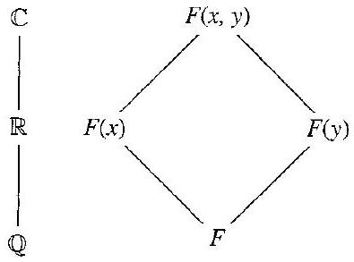

# Editorial records — Section29 Introduction to Extension Fields

Printed265–274/PDF270–279 visually reviewed. Native display checks pending.

## Restore the source subsection heading.

Before:

```text

Our Basic Goal Achieved

```

After:

```text

## Our Basic Goal Achieved

```

## Restore the faded real-field symbol, p.265.

Before:

```text
extension field of both and $\mathbb{Q}$
```

After:

```text
extension field of both $\mathbb R$ and $\mathbb Q$
```

## Remove the misplaced part-level footnote marker from the next page’s opening; its Section32 note belongs to the part contents, p.265.

Before:

```text
[^0]Now
```

After:

```text
Now
```

## Remove scan debris, p.266.

Before:

```text
" Let us set
```

After:

```text
Let us set
```

## Rejoin the dropped-capital name, p.266.

Before:

```text
L eopold
```

After:

```text
Leopold
```

## Restore the ideal brackets, p.267.

Before:

```text
Then ( $x^{2}+1$ ) is
```

After:

```text
Then $\langle x^{2}+1\rangle$ is
```

## Rejoin line-broken math, p.268.

Before:

```text
$f(x) \in$ $F[x]$
```

After:

```text
$f(x)\in F[x]$
```

## Correct punctuation breaking the conditional, p.269.

Before:

```text
$f(x) \neq 0$. then
```

After:

```text
$f(x)\neq0$, then
```

## Restore math delimiters around the source product, p.269.

Before:

```text
of the form (a) $p(x)$
```

After:

```text
of the form $(a)p(x)$
```

## Restore the source’s ordinary scalar alpha, p.269.

Before:

```text
\operatorname{irr}(\boldsymbol{\alpha}, F)
```

After:

```text
\operatorname{irr}(\alpha,F)
```

## Rejoin line-broken math, p.269.

Before:

```text
$\alpha=$ $\sqrt{1+\sqrt{3}}$
```

After:

```text
$\alpha=\sqrt{1+\sqrt3}$
```

## Separate display closure and proof marker.

Before:

```text
$$ $\square$
```

After:

```text
$$

$\square$
```

## Correct a grammatical typo in Exercise19 without answering its mathematical correction task, p.272.

Before:

```text
$F$ if algebraic over
```

After:

```text
$F$ is algebraic over
```

## Repair math boundaries in Exercise23(f), p.273.

Before:

```text
(degree $f(x)) \geq n$
```

After:

```text
$(\text{degree }f(x))\geq n$
```

## Repair math boundaries in Exercise23(g), p.273; preserve the true/false assertion.

Before:

```text
(degree $f(x)$ ) $\geq n$
```

After:

```text
$(\text{degree }f(x))\geq n$
```

## Restore the printed multiplication dot in Exercise36, p.274.

Before:

```text
$\left\langle F^{*},\right\rangle$
```

After:

```text
$\left\langle F^{*},\cdot\right\rangle$
```

## Separate the historical sidebar from the continued proof, pp.266–267; retain it verbatim immediately after that proof.

Before:

```text
## Historical Note

Leopold Kronecker is known for his insistence on constructibility of mathematical objects. As he noted, "God made the integers; all else is the work of man." Thus, he wanted to be able to construct new "domains of rationality" (fields) by using only the existence of integers and indeterminates. He did not believe in starting with the real or complex numbers, because as far as he was concerned, those fields could not be determined in a constructive way. Hence in an 1881 paper, Kronecker created an extension field by simply adjoining to a given field a root $\alpha$ of an irreducible $n$th degree polynomial $p(x)$; that is, his new field consisted of expressions rational in the original field elements and his new root $\alpha$ with the condition that $p(\alpha)=0$. The proof of the theorem presented in the text (Theorem 29.3) dates from the twentieth century.

Kronecker completed his dissertation in 1845 at the University of Berlin. For many years thereafter, he managed the family business, ultimately becoming financially independent. He then returned to Berlin, where he was elected to the Academy of Sciences and thus permitted to lecture at the university. On the retirement of Kummer, he became a professor at Berlin, and with Karl Weierstrass (1815-1897) directed the influential mathematics seminar.
```

After:

```text

```

## Place the complete source historical sidebar after the proof it interrupted in OCR.

Before:

```text
We illustrate the construction involved in the proof of Theorem 29.3 by two examples.
```

After:

```text
> [!aside] Historical Note
> Leopold Kronecker is known for his insistence on constructibility of mathematical objects. As he noted, "God made the integers; all else is the work of man." Thus, he wanted to be able to construct new "domains of rationality" (fields) by using only the existence of integers and indeterminates. He did not believe in starting with the real or complex numbers, because as far as he was concerned, those fields could not be determined in a constructive way. Hence in an 1881 paper, Kronecker created an extension field by simply adjoining to a given field a root $\alpha$ of an irreducible $n$th degree polynomial $p(x)$; that is, his new field consisted of expressions rational in the original field elements and his new root $\alpha$ with the condition that $p(\alpha)=0$. The proof of the theorem presented in the text (Theorem 29.3) dates from the twentieth century.
>
> Kronecker completed his dissertation in 1845 at the University of Berlin. For many years thereafter, he managed the family business, ultimately becoming financially independent. He then returned to Berlin, where he was elected to the Academy of Sciences and thus permitted to lecture at the university. On the retirement of Kummer, he became a professor at Berlin, and with Karl Weierstrass (1815-1897) directed the influential mathematics seminar.

We illustrate the construction involved in the proof of Theorem 29.3 by two examples.
```

## Wrap the original definition; source number remains outside.

Before:

```text
29.1 Definition A field $E$ is an extension field of a field $F$ if $F \leq E$. $\square$
```

After:

```text
Definition 29.1

> [!definition] Extension Field
> A field $E$ is an extension field of a field $F$ if $F \leq E$.
```

## Wrap the original definition; source number remains outside.

Before:

```text
29.6 Definition An element $\alpha$ of an extension field $E$ of a field $F$ is algebraic over $F$ if $f(\alpha)=0$ for some nonzero $f(x) \in F[x]$. If $\alpha$ is not algebraic over $F$, then $\alpha$ is transcendental over $F$. $\square$
```

After:

```text
Definition 29.6

> [!definition] Algebraic and Transcendental Elements
> An element $\alpha$ of an extension field $E$ of a field $F$ is algebraic over $F$ if $f(\alpha)=0$ for some nonzero $f(x) \in F[x]$. If $\alpha$ is not algebraic over $F$, then $\alpha$ is transcendental over $F$.
```

## Wrap the original definition; source number remains outside.

Before:

```text
29.11 Definition An element of $\mathbb{C}$ that is algebraic over $\mathbb{Q}$ is an algebraic number. A transcendental number is an element of $\mathbb{C}$ that is transcendental over $\mathbb{Q}$. $\square$
```

After:

```text
Definition 29.11

> [!definition] Algebraic and Transcendental Numbers
> An element of $\mathbb{C}$ that is algebraic over $\mathbb{Q}$ is an algebraic number. A transcendental number is an element of $\mathbb{C}$ that is transcendental over $\mathbb{Q}$.
```

## Restore the property from Theorem29.13 in place of its book-specific reference.

Before:

```text
having the property described in Theorem 29.13
```

After:

```text
in $F[x]$ of minimal degree $\geq1$ having $\alpha$ as a zero
```

## Wrap the original definition; source number remains outside.

Before:

```text
29.14 Definition Let $E$ be an extension field of a field $F$, and let $\alpha \in E$ be algebraic over $F$. The unique monic polynomial $p(x)$ having the property described in Theorem 29.13 is the irreducible polynomial for $\alpha$ over $F$ and will be denoted by $\operatorname{irr}(\alpha, F)$. The degree of $\operatorname{irr}(\alpha,F)$ is the degree of $\alpha$ over $F$, denoted by $\operatorname{deg}(\alpha, F)$. $\square$
```

After:

```text
Definition 29.14

> [!definition] Irreducible Polynomial and Degree of an Algebraic Element
> Let $E$ be an extension field of a field $F$, and let $\alpha \in E$ be algebraic over $F$. The unique monic polynomial $p(x)$ in $F[x]$ of minimal degree $\geq1$ having $\alpha$ as a zero is the irreducible polynomial for $\alpha$ over $F$ and will be denoted by $\operatorname{irr}(\alpha, F)$. The degree of $\operatorname{irr}(\alpha,F)$ is the degree of $\alpha$ over $F$, denoted by $\operatorname{deg}(\alpha, F)$.
```

## Restore only the meaning of F(alpha) from the source CaseI/II immediately preceding the definition.

Before:

```text

```

After:

```text
$F(\alpha)$ is the smallest subfield of $E$ containing $F$ and $\alpha$.
```

## Wrap the original definition; source number remains outside.

Before:

```text
29.17 Definition An extension field $E$ of a field $F$ is a simple extension of $F$ if $E=F(\alpha)$ for some $\alpha \in E$. $\square$
```

After:

```text
Definition 29.17

> [!definition] Simple Extension
> An extension field $E$ of a field $F$ is a simple extension of $F$ if $E=F(\alpha)$ for some $\alpha \in E$. Here $F(\alpha)$ is the smallest subfield of $E$ containing $F$ and $\alpha$.
```

## Wrap the full source theorem; keep proof and book-specific label outside.

Before:

```text
29.3 Theorem (Kronecker's Theorem) (Basic Goal) Let $F$ be a field and let $f(x)$ be a nonconstant polynomial in $F[x]$. Then there exists an extension field $E$ of $F$ and an $\alpha \in E$ such that $f(\alpha)=0$.
```

After:

```text
Theorem 29.3 — Basic Goal

> [!theorem] Kronecker's Theorem
> Let $F$ be a field and let $f(x)$ be a nonconstant polynomial in $F[x]$. Then there exists an extension field $E$ of $F$ and an $\alpha \in E$ such that $f(\alpha)=0$.
```

## Wrap the full source theorem; keep proof and book-specific label outside.

Before:

```text
29.12 Theorem Let $E$ be an extension field of a field $F$ and let $\alpha \in E$. Let $\phi_{\alpha}: F[x] \rightarrow E$ be the evaluation homomorphism of $F[x]$ into $E$ such that $\phi_{\alpha}(a)=a$ for $a \in F$ and $\phi_{\alpha}(x)=\alpha$. Then $\alpha$ is transcendental over $F$ if and only if $\phi_{\alpha}$ gives an isomorphism of $F[x]$ with a subdomain of $E$, that is, if and only if $\phi_{\alpha}$ is a one-to-one map.
```

After:

```text
Theorem 29.12

> [!theorem] Transcendental Elements and Injective Evaluation Homomorphisms
> Let $E$ be an extension field of a field $F$ and let $\alpha \in E$. Let $\phi_{\alpha}: F[x] \rightarrow E$ be the evaluation homomorphism of $F[x]$ into $E$ such that $\phi_{\alpha}(a)=a$ for $a \in F$ and $\phi_{\alpha}(x)=\alpha$. Then $\alpha$ is transcendental over $F$ if and only if $\phi_{\alpha}$ gives an isomorphism of $F[x]$ with a subdomain of $E$, that is, if and only if $\phi_{\alpha}$ is a one-to-one map.
```

## Wrap the full source theorem; keep proof and book-specific label outside.

Before:

```text
29.13 Theorem Let $E$ be an extension field of $F$, and let $\alpha \in E$, where $\alpha$ is algebraic over $F$. Then there is an irreducible polynomial $p(x) \in F[x]$ such that $p(\alpha)=0$. This irreducible polynomial $p(x)$ is uniquely determined up to a constant factor in $F$ and is a polynomial of minimal degree $\geq 1$ in $F[x]$ having $\alpha$ as a zero. If $f(\alpha)=0$ for $f(x) \in F[x]$, with $f(x)\neq0$, then $p(x)$ divides $f(x)$.

```

After:

```text
Theorem 29.13

> [!theorem] Existence and Uniqueness of the Irreducible Polynomial of an Algebraic Element
> Let $E$ be an extension field of $F$, and let $\alpha \in E$, where $\alpha$ is algebraic over $F$. Then there is an irreducible polynomial $p(x) \in F[x]$ such that $p(\alpha)=0$. This irreducible polynomial $p(x)$ is uniquely determined up to a constant factor in $F$ and is a polynomial of minimal degree $\geq 1$ in $F[x]$ having $\alpha$ as a zero. If $f(\alpha)=0$ for $f(x) \in F[x]$, with $f(x)\neq0$, then $p(x)$ divides $f(x)$.
```

## Restore only the irreducible-polynomial notation defined by29.13–29.14 so the statement is reusable.

Before:

```text

```

After:

```text
$\operatorname{irr}(\alpha,F)$ denotes the unique monic polynomial in $F[x]$ of minimal degree $\geq1$ having $\alpha$ as a zero.
```

## Wrap the full source theorem; keep proof and book-specific label outside.

Before:

```text
29.18 Theorem Let $E$ be a simple extension $F(\alpha)$ of a field $F$, and let $\alpha$ be algebraic over $F$. Let the degree of $\operatorname{irr}(\alpha, F)$ be $n \geq 1$. Then every element $\beta$ of $E=F(\alpha)$ can be uniquely expressed in the form

$$
\beta=b_{0}+b_{1} \alpha+\cdots+b_{n-1} \alpha^{n-1},
$$

where the $b_{i}$ are in $F$.
```

After:

```text
Theorem 29.18

> [!theorem] Unique Representation in a Simple Algebraic Extension
> Let $E$ be a simple extension $F(\alpha)$ of a field $F$, and let $\alpha$ be algebraic over $F$. Let the degree of $\operatorname{irr}(\alpha, F)$ be $n \geq 1$. Then every element $\beta$ of $E=F(\alpha)$ can be uniquely expressed in the form
>
> $$
> \beta=b_{0}+b_{1} \alpha+\cdots+b_{n-1} \alpha^{n-1},
> $$
>
> where the $b_{i}$ are in $F$. Here $\operatorname{irr}(\alpha,F)$ denotes the unique monic polynomial in $F[x]$ of minimal degree $\geq1$ having $\alpha$ as a zero.
```

## Wrap the source’s unnumbered definition without changing its wording.

Before:

```text
Such a polynomial having 1 as the coefficient of the highest power of $x$ appearing is a monic polynomial.
```

After:

```text


> [!definition] Monic Polynomial
> Such a polynomial having 1 as the coefficient of the highest power of $x$ appearing is a monic polynomial.
```

## Supply a prompt for the exact demonstrated task; retain all author explanation and working outside.

Before:

```text
29.4 Example 
```

After:

```text
> [!example] Example 29.4
> Let $F=\mathbb R$ and $f(x)=x^2+1$. Construct an extension field of $\mathbb R$ containing a zero of $f(x)$.

##### solution


```

## Supply a prompt for the exact demonstrated task; retain all author explanation and working outside.

Before:

```text
29.5 Example 
```

After:

```text
> [!example] Example 29.5
> Let $F=\mathbb Q$ and $f(x)=x^4-5x^2+6$. Describe how to construct an extension field of $\mathbb Q$ containing a zero of $f(x)$.

##### solution


```

## Supply a prompt for the exact demonstrated task; retain all author explanation and working outside.

Before:

```text
29.7 Example 
```

After:

```text
> [!example] Example 29.7
> Show that $\sqrt2$ and $i$ in $\mathbb C$ are algebraic over $\mathbb Q$.

##### solution


```

## Supply a prompt for the exact demonstrated task; retain all author explanation and working outside.

Before:

```text
29.8 Example 
```

After:

```text
> [!example] Example 29.8
> Classify $\pi$ and $e$, the base of the natural logarithms, as algebraic or transcendental over $\mathbb Q$.

##### solution


```

## Supply a prompt for the exact demonstrated task; retain all author explanation and working outside.

Before:

```text
29.9 Example 
```

After:

```text
> [!example] Example 29.9
> Compare whether $\pi$ is algebraic or transcendental over $\mathbb Q$ and over $\mathbb R$.

##### solution


```

## Supply a prompt for the exact demonstrated task; retain all author explanation and working outside.

Before:

```text
29.10 Example 
```

After:

```text
> [!example] Example 29.10
> Show that $\sqrt{1+\sqrt3}$ is algebraic over $\mathbb Q$.

##### solution


```

## Supply a prompt for the exact demonstrated task; retain all author explanation and working outside.

Before:

```text
29.15 Example 
```

After:

```text
> [!example] Example 29.15
> Find $\operatorname{irr}(\sqrt{1+\sqrt3},\mathbb Q)$ and the degree of $\sqrt{1+\sqrt3}$ over $\mathbb Q$.

##### solution


```

## Supply a prompt for the exact demonstrated task; retain all author explanation and working outside.

Before:

```text
29.16 Example 
```

After:

```text
> [!example] Example 29.16
> Describe the field $\mathbb Q(\pi)$ up to isomorphism.

##### solution


```

## Supply a prompt for the exact demonstrated task; retain all author explanation and working outside.

Before:

```text
29.19 Example 
```

After:

```text
> [!example] Example 29.19
> Let $p(x)=x^2+x+1$ in $\mathbb Z_2[x]$. Construct an extension field containing a zero $\alpha$ of $p(x)$, describe the elements of $\mathbb Z_2(\alpha)$, and compute its addition and multiplication tables.

##### solution


```

## Formatting only

6 definitions,4 theorems,9 examples and37 exercises. Source proofs preserved. Historical sidebar retained. Tables and figure converted separately; no admissions.

## Earlier staging record

# Editorial records — Section 29 - Introduction to Extension Fields

Status: staged original OCR; content/callout/source review pending.

## Heading formatting

Before: `## section 29 Introduction to Extension Fields`

After: `# 29 Introduction to Extension Fields`

Section heading separated and normalized to level one; body wording unchanged. Original chapter OCR archive retained in conversion records.


## Table 29.20

Formatting only: editable scientific table, source cells and printed caption preserved; single-letter mathematical entries receive math delimiters.

Before:

```text
29.20 Table
| + | 0 | 1 | $\alpha$ | $1+\alpha$ |
| :--- | :--- | :--- | :--- | :--- |
| 0 | 0 | 1 | $\alpha$ | $1+\alpha$ |
| 1 | 1 | 0 | $1+\alpha$ | $\alpha$ |
| $\alpha$ | $\alpha$ | $1+\alpha$ | 0 | 1 |
| $1+\alpha$ | $1+\alpha$ | $\alpha$ | 1 | 0 |

```

After:

```text
```scientific-table
id: 515bd536-3dda-4076-b1c6-1bb45984d1e8
numbered: false
title: ""
caption: Table 29.20
captionVisible: true
captionPosition: below
rows:
  - - text: $+$
      align: center
    - text: "0"
      align: center
    - text: "1"
      align: center
    - text: $\alpha$
      align: center
    - text: $1+\alpha$
      align: center
  - - text: "0"
      align: center
    - text: "0"
      align: center
    - text: "1"
      align: center
    - text: $\alpha$
      align: center
    - text: $1+\alpha$
      align: center
  - - text: "1"
      align: center
    - text: "1"
      align: center
    - text: "0"
      align: center
    - text: $1+\alpha$
      align: center
    - text: $\alpha$
      align: center
  - - text: $\alpha$
      align: center
    - text: $\alpha$
      align: center
    - text: $1+\alpha$
      align: center
    - text: "0"
      align: center
    - text: "1"
      align: center
  - - text: $1+\alpha$
      align: center
    - text: $1+\alpha$
      align: center
    - text: $\alpha$
      align: center
    - text: "1"
      align: center
    - text: "0"
      align: center
headerRows: 1
rowHeaders: true
style: scientific
```

```

## Table 29.21

Formatting only: editable scientific table, source cells and printed caption preserved; single-letter mathematical entries receive math delimiters.

Before:

```text
29.21 Table
|  | 0 | 1 | $\alpha$ | $1+\alpha$ |
| :--- | :--- | :--- | :--- | :--- |
| 0 | 0 | 0 | 0 | 0 |
| 1 | 0 | 1 | $\alpha$ | $1+\alpha$ |
| $\alpha$ | 0 | $\alpha$ | $1+\alpha$ | 1 |
| $1+\alpha$ | 0 | $1+\alpha$ | 1 | $\alpha$ |

```

After:

```text
```scientific-table
id: 52f33d04-2a7d-4737-b965-050a29e4ad6d
numbered: false
title: ""
caption: Table 29.21
captionVisible: true
captionPosition: below
rows:
  - - text: ""
      align: center
    - text: "0"
      align: center
    - text: "1"
      align: center
    - text: $\alpha$
      align: center
    - text: $1+\alpha$
      align: center
  - - text: "0"
      align: center
    - text: "0"
      align: center
    - text: "0"
      align: center
    - text: "0"
      align: center
    - text: "0"
      align: center
  - - text: "1"
      align: center
    - text: "0"
      align: center
    - text: "1"
      align: center
    - text: $\alpha$
      align: center
    - text: $1+\alpha$
      align: center
  - - text: $\alpha$
      align: center
    - text: "0"
      align: center
    - text: $\alpha$
      align: center
    - text: $1+\alpha$
      align: center
    - text: "1"
      align: center
  - - text: $1+\alpha$
      align: center
    - text: "0"
      align: center
    - text: $1+\alpha$
      align: center
    - text: "1"
      align: center
    - text: $\alpha$
      align: center
headerRows: 1
rowHeaders: true
style: scientific
```

```

## Figure 29.2

Formatting only: preserved image and printed caption in scientific figure component.

Before:

```text

29.2 Figure
```

After:

```text
```scientific-figure
id: 0d84c2d2-34bc-4140-bcfb-a4e328776323
numbered: false
title: ""
caption: Figure 29.2
captionVisible: true
captionPosition: below
columns: 1
panels:
  - path: images/bb98bca5-3813-47c6-967e-f67460c66c5b-01_293_395_1456_916.jpg
    caption: ""
```
```

## Native spot check

Native reading view: Extension Field definition, figure29.2, exercises29.1–5, finite-field tables29.20/29.21 and captions render.

## Final callout-boundary check

Inserted an unquoted blank line before 1 adjacent callout headers. Author text and IDs unchanged. Before: quoted final line immediately followed by another callout header. After: same lines separated by a blank line.
