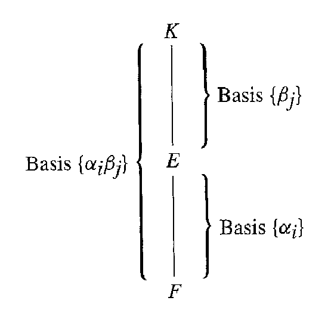

# Editorial records — Section31 Algebraic Extensions

Printed283–293/PDF288–298 visually reviewed. Native review pending.

## Restore the missing article in the source sentence, p.283.

Before:

```text
is finite field
```

After:

```text
is a finite field
```

## Restore math delimiters, p.283.

Before:

```text
\{1\} can
```

After:

```text
$\{1\}$ can
```

## Repair punctuation in the proof, p.283.

Before:

```text
$F[x]$. and
```

After:

```text
$F[x]$, and
```

## Restore summation operators from p.284.

Before:

```text
\Sigma
```

After:

```text
\sum
```

## Rejoin split math, p.285.

Before:

```text
$F \leq$ $F(\beta) \leq F(\alpha)$
```

After:

```text
$F \leq F(\beta) \leq F(\alpha)$
```

## Remove the theorem number from math, p.285.

Before:

```text
Theorem $31.4[F(\beta): F]$
```

After:

```text
Theorem 31.4 $[F(\beta): F]$
```

## Rejoin a page-broken sentence, pp.285–286.

Before:

```text
with
$p=2$
```

After:

```text
with $p=2$
```

## Correct the first index of the field-generator sequence to1, p.286.

Before:

```text
F\left(\alpha_{i}, \cdots, \alpha_{j-1}\right)
```

After:

```text
F\left(\alpha_{1}, \cdots, \alpha_{j-1}\right)
```

## Separate display closure and end marker.

Before:

```text
$$ $\square$
```

After:

```text
$$

$\square$
```

## Remove scan debris before the field sequence,p.286.

Before:

```text
finite extensions
3

```

After:

```text
finite extensions

```

## Rejoin a page-broken sentence, pp.286–287.

Before:

```text
Thus
$\bar{F}_{E}$
```

After:

```text
Thus $\bar{F}_{E}$
```

## Restore missing sentence punctuation, p.287.

Before:

```text
$F[x]$ Then
```

After:

```text
$F[x]$. Then
```

## Rejoin split formulas, p.287.

Before:

```text
$f(x)=$ $(
```

After:

```text
$f(x)=(
```

## Rejoin split formula, p.287.

Before:

```text
$\operatorname{irr}(\alpha, F)=$ $x-\alpha$
```

After:

```text
$\operatorname{irr}(\alpha, F)=x-\alpha$
```

## Remove a duplicated article, p.287.

Before:

```text
has a no zero
```

After:

```text
has no zero
```

## Rejoin a page-broken sentence, pp.287–288.

Before:

```text
and that
we cannot
```

After:

```text
and that we cannot
```

## Rejoin the split limit, p.288.

Before:

```text
$\lim _{|z| \rightarrow \infty}$ $|1 / f(z)|=0$
```

After:

```text
$\lim _{|z| \rightarrow \infty}|1 / f(z)|=0$
```

## Restore mathematical typography, p.288.

Before:

```text
elements of S such
```

After:

```text
elements of $S$ such
```

## Restore missing word spacing, p.288.

Before:

```text
\mathbb{Q}^{+}$nor
```

After:

```text
\mathbb{Q}^{+}$ nor
```

## Restore mathematical typography, p.289.

Before:

```text
order-relation < such
```

After:

```text
order-relation $<$ such
```

## Restore mathematical typography, p.289.

Before:

```text
with respect to <.
```

After:

```text
with respect to $<$.
```

## Correct the source’s missing nonempty qualification in the choice-function statement: an element cannot be selected from the empty set, p.289.

Before:

```text
the set $S$ of all subsets of $M$
```

After:

```text
the set $S$ of all nonempty subsets of $M$
```

## Restore the letter l in the printed title, p.289.

Before:

```text
de I'Analyse
```

After:

```text
de l’Analyse
```

## Exclude the zero polynomial, whose degree is undefined, in the source indexing set, p.290.

Before:

```text
f \in F[x] ; i=0
```

After:

```text
0\ne f \in F[x] ; i=0
```

## Keep the immediately following description consistent with the corrected indexing set, p.290.

Before:

```text
every possible zero of any $f(x) \in F[x]$
```

After:

```text
every possible zero of any nonzero $f(x) \in F[x]$
```

## Correct singular/plural agreement, p.290.

Before:

```text
are algebraic extension of
```

After:

```text
are algebraic extensions of
```

## Restore missing of, p.290.

Before:

```text
is a zero $f(x)
```

After:

```text
is a zero of $f(x)
```

## Correct subject–verb agreement, p.290.

Before:

```text
preceding paragraphs shows
```

After:

```text
preceding paragraphs show
```

## Remove scan debris before the paragraph, p.290.

Before:

```text
${ }^{3}$ Let $T=
```

After:

```text
Let $T=
```

## Correct the inconsistent field subscript in the identity check, p.290.

Before:

```text
$E_{j_{i}}$
```

After:

```text
$E_{j_{1}}$
```

## Rejoin a page-broken sentence, pp.290–291.

Before:

```text
has, we
can take
```

After:

```text
has, we can take
```

## Restore a missing article, Exercise25,p.292.

Before:

```text
then square root of
```

After:

```text
then a square root of
```

## Restore punctuation, Exercise35,p.293.

Before:

```text
$x^{2}-a$. for some
```

After:

```text
$x^{2}-a$, for some
```

## Supply the missing range for successive extensions; the source names only F1 through Fr, p.285.

Before:

```text
$F_{i+1}$ is a finite extension of $F_{i}$, then
```

After:

```text
$F_{i+1}$ is a finite extension of $F_{i}$ for $i=1,\ldots,r-1$, then
```

## Recover Figure31.5 directly from the PDF,p.284; all diagram labels preserved.

Before:

```text
$$
\text { Basis }\left\{\alpha_{i} \beta_{j}\right\}\left\{\begin{array}{l}
\left.\left.\right|_{E} ^{K}\right\} \text { Basis }\left\{\beta_{j}\right\} \\
\left.\left.\right|_{F}\right\} \text { Basis }\left\{\alpha_{i}\right\}
\end{array}\right.
$$
31.5 Figure
```

After:

```text

31.5 Figure
```

## Wrap the original definition; keep its number outside.

Before:

```text
31.1 Definition An extension field $E$ of a field $F$ is an algebraic extension of $F$ if every element in $E$ is algebraic over $F$. $\square$
```

After:

```text
Definition 31.1

> [!definition] Algebraic Extension
> An extension field $E$ of a field $F$ is an algebraic extension of $F$ if every element in $E$ is algebraic over $F$.
```

## Wrap the original definition; keep its number outside.

Before:

```text
31.2 Definition If an extension field $E$ of a field $F$ is of finite dimension $n$ as a vector space over $F$, then $E$ is a finite extension of degree $\boldsymbol{n}$ over $F$. We shall let $[E: F]$ be the degree $n$ of $E$ over $F$. $\square$
```

After:

```text
Definition 31.2

> [!definition] Finite Extension and Extension Degree
> If an extension field $E$ of a field $F$ is of finite dimension $n$ as a vector space over $F$, then $E$ is a finite extension of degree $\boldsymbol{n}$ over $F$. We shall let $[E: F]$ be the degree $n$ of $E$ over $F$.
```

## Wrap the original definition; keep its number outside.

Before:

```text
31.14 Definition A field $F$ is algebraically closed if every nonconstant polynomial in $F[x]$ has a zero in $F$. $\square$
```

After:

```text
Definition 31.14

> [!definition] Algebraically Closed Field
> A field $F$ is algebraically closed if every nonconstant polynomial in $F[x]$ has a zero in $F$.
```

## Wrap the complete three-condition definition, p.288.

Before:

```text
31.19 Definition A partial ordering of a set $S$ is given by a relation $\leq$ defined for certain ordered pairs of elements of $S$ such that the following conditions are satisfied:

1. $a \leq a$ for all $a \in S$ (reflexive law).
2. If $a \leq b$ and $b \leq a$, then $a=b$ (antisymmetric law).
3. If $a \leq b$ and $b \leq c$, then $a \leq c$ (transitive law).
```

After:

```text
Definition 31.19

> [!definition] Partial Ordering
> A partial ordering of a set $S$ is given by a relation $\leq$ defined for certain ordered pairs of elements of $S$ such that the following conditions are satisfied:
>
> 1. $a \leq a$ for all $a \in S$ (reflexive law).
> 2. If $a \leq b$ and $b \leq a$, then $a=b$ (antisymmetric law).
> 3. If $a \leq b$ and $b \leq c$, then $a \leq c$ (transitive law).
```

## Wrap the source’s explicit additional definitions without rewriting them, p.288.

Before:

```text
A subset $T$ of a partially ordered set $S$ is a chain if every two elements $a$ and $b$ in $T$ are comparable, that is, either $a \leq b$ or $b \leq a$ (or both). An element $u \in S$ is an upper bound for a subset $A$ of partially ordered set $S$ if $a \leq u$ for all $a \in A$. Finally, an element $m$ of a partially ordered set $S$ is maximal if there is no $s \in S$ such that $m<s$.
```

After:

```text
> [!definition] Chains, Upper Bounds, and Maximal Elements
> A subset $T$ of a partially ordered set $S$ is a chain if every two elements $a$ and $b$ in $T$ are comparable, that is, either $a \leq b$ or $b \leq a$ (or both). An element $u \in S$ is an upper bound for a subset $A$ of partially ordered set $S$ if $a \leq u$ for all $a \in A$. Finally, an element $m$ of a partially ordered set $S$ is maximal if there is no $s \in S$ such that $m<s$.
```

## Wrap the source statement; keep proofs, figure, and numbering outside.

Before:

```text
31.3 Theorem A finite extension field $E$ of a field $F$ is an algebraic extension of $F$.

```

After:

```text
Theorem 31.3

> [!theorem] Finite Extensions Are Algebraic
> A finite extension field $E$ of a field $F$ is an algebraic extension of $F$.

```

## Wrap the source statement; keep proofs, figure, and numbering outside.

Before:

```text
31.4 Theorem If $E$ is a finite extension field of a field $F$, and $K$ is a finite extension field of $E$, then $K$ is a finite extension of $F$, and

$$
[K: F]=[K: E][E: F] .
$$

```

After:

```text
Theorem 31.4

> [!theorem] Tower Law for Field Extension Degrees
> If $E$ is a finite extension field of a field $F$, and $K$ is a finite extension field of $E$, then $K$ is a finite extension of $F$, and
>
> $$
> [K: F]=[K: E][E: F] .
> $$

```

## Wrap the source statement; keep proofs, figure, and numbering outside.

Before:

```text
31.6 Corollary If $F_{i}$ is a field for $i=1, \cdots, r$ and $F_{i+1}$ is a finite extension of $F_{i}$ for $i=1,\ldots,r-1$, then $F_{r}$ is a finite extension of $F_{1}$, and

$$
\left[F_{r}: F_{1}\right]=\left[F_{r}: F_{r-1}\right]\left[F_{r-1}: F_{r-2}\right] \cdots\left[F_{2}: F_{1}\right] .
$$

```

After:

```text
Corollary 31.6

> [!corollary] Degree of a Finite Tower of Field Extensions
> If $F_{i}$ is a field for $i=1, \cdots, r$ and $F_{i+1}$ is a finite extension of $F_{i}$ for $i=1,\ldots,r-1$, then $F_{r}$ is a finite extension of $F_{1}$, and
>
> $$
> \left[F_{r}: F_{1}\right]=\left[F_{r}: F_{r-1}\right]\left[F_{r-1}: F_{r-2}\right] \cdots\left[F_{2}: F_{1}\right] .
> $$

```

## Wrap the source statement; keep proofs, figure, and numbering outside.

Before:

```text
31.7 Corollary If $E$ is an extension field of $F, \alpha \in E$ is algebraic over $F$, and $\beta \in F(\alpha)$, then $\operatorname{deg}(\beta, F)$ divides $\operatorname{deg}(\alpha, F)$.

```

After:

```text
Corollary 31.7

> [!corollary] Divisibility of Degrees in a Simple Algebraic Extension
> If $E$ is an extension field of $F, \alpha \in E$ is algebraic over $F$, and $\beta \in F(\alpha)$, then $\operatorname{deg}(\beta, F)$ divides $\operatorname{deg}(\alpha, F)$.

```

## Wrap the source statement; keep proofs, figure, and numbering outside.

Before:

```text
31.11 Theorem Let $E$ be an algebraic extension of a field $F$. Then there exist a finite number of elements $\alpha_{1}, \cdots, \alpha_{n}$ in $E$ such that $E=F\left(\alpha_{1}, \cdots, \alpha_{n}\right)$ if and only if $E$ is a finite-dimensional vector space over $F$, that is, if and only if $E$ is a finite extension of $F$.

```

After:

```text
Theorem 31.11

> [!theorem] Finite and Finitely Generated Algebraic Extensions
> Let $E$ be an algebraic extension of a field $F$. Then there exist a finite number of elements $\alpha_{1}, \cdots, \alpha_{n}$ in $E$ such that $E=F\left(\alpha_{1}, \cdots, \alpha_{n}\right)$ if and only if $E$ is a finite-dimensional vector space over $F$, that is, if and only if $E$ is a finite extension of $F$.

```

## Wrap the source statement; keep proofs, figure, and numbering outside.

Before:

```text
31.12 Theorem Let $E$ be an extension field of $F$. Then

$$
\bar{F}_{E}=\{\alpha \in E \mid \alpha \text { is algebraic over } F\}
$$

is a subfield of $E$, the algebraic closure of $F$ in $E$.
```

After:

```text
Theorem 31.12

> [!theorem] Algebraic Closure of a Field in an Extension
> Let $E$ be an extension field of $F$. Then
>
> $$
> \bar{F}_{E}=\{\alpha \in E \mid \alpha \text { is algebraic over } F\}
> $$
>
> is a subfield of $E$, the algebraic closure of $F$ in $E$.

```

## Wrap the source statement; keep proofs, figure, and numbering outside.

Before:

```text
31.13 Corollary The set of all algebraic numbers forms a field.

```

After:

```text
Corollary 31.13

> [!corollary] The Algebraic Numbers Form a Field
> The set of all algebraic numbers forms a field.

```

## Wrap the source statement; keep proofs, figure, and numbering outside.

Before:

```text
31.15 Theorem A field $F$ is algebraically closed if and only if every nonconstant polynomial in $F[x]$ factors in $F[x]$ into linear factors.

```

After:

```text
Theorem 31.15

> [!theorem] Linear Factorization over Algebraically Closed Fields
> A field $F$ is algebraically closed if and only if every nonconstant polynomial in $F[x]$ factors in $F[x]$ into linear factors.

```

## Wrap the source statement; keep proofs, figure, and numbering outside.

Before:

```text
31.16 Corollary An algebraically closed field $F$ has no proper algebraic extensions, that is, no algebraic extensions $E$ with $F<E$.

```

After:

```text
Corollary 31.16

> [!corollary] Algebraically Closed Fields Have No Proper Algebraic Extensions
> An algebraically closed field $F$ has no proper algebraic extensions, that is, no algebraic extensions $E$ with $F<E$.

```

## Wrap the source statement; keep proofs, figure, and numbering outside.

Before:

```text
31.18 Theorem (Fundamental Theorem of Algebra) The field $\mathbb{C}$ of complex numbers is an algebraically closed field.

```

After:

```text
Theorem 31.18

> [!theorem] Fundamental Theorem of Algebra
> The field $\mathbb{C}$ of complex numbers is an algebraically closed field.

```

## Wrap the source existence theorem.

Before:

```text
31.17 Theorem Every field $F$ has an algebraic closure, that is, an algebraic extension $\bar{F}$ that is algebraically closed.
```

After:

```text
Theorem 31.17

> [!theorem] Existence of an Algebraic Closure
> Every field $F$ has an algebraic closure, that is, an algebraic extension $\bar{F}$ that is algebraically closed.
```

## Use the author’s lemma designation; no axiom callout type introduced.

Before:

```text
31.21 Zorn's Lemma If $S$ is a partially ordered set such that every chain in $S$ has an upper bound in $S$, then $S$ has at least one maximal element.
```

After:

```text
Lemma 31.21

> [!lemma] Zorn’s Lemma
> If $S$ is a partially ordered set such that every chain in $S$ has an upper bound in $S$, then $S$ has at least one maximal element.
```

## Preserve the author’s explicitly duplicated statement and proof; the reusable statement is31.17.

Before:

```text
31.22 Restated Theorem 31.17 Every field
```

After:

```text
### 31.22 Restated Theorem 31.17

Every field
```

## Preserve the historical sidebar as an aside; not an Index candidate.

Before:

```text
## Historical Note

The Axiom of Choice, although used implicitly in the 1870s and 1880s, was first stated explicitly by Ernst Zermelo in 1904 in connection with his proof of the well-ordering theorem, the result that for any set $A$, there exists an order-relation $<$ such that every nonempty subset $B$ of $A$ contains a least element with respect to $<$. Zermelo's Axiom of Choice asserted that, given any set $M$ and the set $S$ of all nonempty subsets of $M$, there always exists a "choice" function, a function $f: S \rightarrow M$ such that $f\left(M^{\prime}\right) \in M^{\prime}$ for every $M^{\prime}$ in $S$. Zermelo noted, in fact, that "this logical principal cannot . . . be reduced to a still simpler one, but it is applied without hesitation everywhere in mathematical deduction." A few years later he included this axiom in his collection of axioms for set theory, a collection which was slightly modified in 1930 into what is now called Zermelo-Fraenkel set theory, the axiom system generally used today as a basis of that theory.

Zorn's lemma was introduced by Max Zorn (1906-1993) in 1935. Although he realized that it was equivalent to the well-ordering theorem (itself equivalent to the Axiom of Choice), he claimed that his lemma was more natural to use in algebra because the well-ordering theorem was somehow a "transcendental" principal. Other mathematicians soon agreed with his reasoning. The lemma appeared in 1939 in the first volume of Nicolas Bourbaki's Eléments de Mathématique: Les Structures Fondamentales de l’Analyse. It was used consistently in that work and quickly became an essential part of the mathematician's toolbox.
```

After:

```text
> [!aside] Historical Note
> The Axiom of Choice, although used implicitly in the 1870s and 1880s, was first stated explicitly by Ernst Zermelo in 1904 in connection with his proof of the well-ordering theorem, the result that for any set $A$, there exists an order-relation $<$ such that every nonempty subset $B$ of $A$ contains a least element with respect to $<$. Zermelo's Axiom of Choice asserted that, given any set $M$ and the set $S$ of all nonempty subsets of $M$, there always exists a "choice" function, a function $f: S \rightarrow M$ such that $f\left(M^{\prime}\right) \in M^{\prime}$ for every $M^{\prime}$ in $S$. Zermelo noted, in fact, that "this logical principal cannot . . . be reduced to a still simpler one, but it is applied without hesitation everywhere in mathematical deduction." A few years later he included this axiom in his collection of axioms for set theory, a collection which was slightly modified in 1930 into what is now called Zermelo-Fraenkel set theory, the axiom system generally used today as a basis of that theory.
>
> Zorn's lemma was introduced by Max Zorn (1906-1993) in 1935. Although he realized that it was equivalent to the well-ordering theorem (itself equivalent to the Axiom of Choice), he claimed that his lemma was more natural to use in algebra because the well-ordering theorem was somehow a "transcendental" principal. Other mathematicians soon agreed with his reasoning. The lemma appeared in 1939 in the first volume of Nicolas Bourbaki's Eléments de Mathématique: Les Structures Fondamentales de l’Analyse. It was used consistently in that work and quickly became an essential part of the mathematician's toolbox.
```

## Supply the missing task prompt; retain the complete original explanation and working outside the callout.

Before:

```text
31.8 Example 
```

After:

```text
> [!example] Example 31.8
> Determine whether $x^3-2$ has a zero in $\mathbb Q(\sqrt2)$.

##### solution


```

## Supply the missing task prompt; retain the complete original explanation and working outside the callout.

Before:

```text
31.9 Example 
```

After:

```text
> [!example] Example 31.9
> Find a basis for $\mathbb Q(\sqrt2,\sqrt3)$ over $\mathbb Q$.

##### solution


```

## Supply the missing task prompt; retain the complete original explanation and working outside the callout.

Before:

```text
31.10 Example 
```

After:

```text
> [!example] Example 31.10
> Let $2^{1/3}$ be the real cube root of2 and $2^{1/2}$ the positive square root of2. Find a basis for $\mathbb Q(2^{1/2},2^{1/3})$ over $\mathbb Q$, and show that this field equals $\mathbb Q(2^{1/6})$.

##### solution


```

## Supply the missing task prompt; retain the complete original explanation and working outside the callout.

Before:

```text
31.20 Example 
```

After:

```text
> [!example] Example 31.20
> Consider the collection of all subsets of a set, ordered by inclusion. Is it partially ordered? If the set is $\mathbb R$, compare $\mathbb Z$ with $\mathbb Q$ and with $\mathbb Q^+$.

##### solution


```

## Formatting only

5 definitions,7 theorems,4 corollaries,1 lemma,4 examples,38 exercises,1 aside,1 source figure. Source31.22 repeats31.17 and remains outside reusable callouts. No admissions.

## Earlier staging record

# Editorial records — Section 31 - Algebraic Extensions

Status: staged original OCR; content/callout/source review pending.

## Heading formatting

Before: `## section 31 Algebraic Extensions`

After: `# 31 Algebraic Extensions`

Section heading separated and normalized to level one; body wording unchanged. Original chapter OCR archive retained in conversion records.


## Figure 31.5

Formatting only: preserved image and printed caption in scientific figure component.

Before:

```text

31.5 Figure
```

After:

```text
```scientific-figure
id: a758d129-afcc-47bc-99a0-5439b61a8f8a
numbered: false
title: ""
caption: Figure 31.5
captionVisible: true
captionPosition: below
columns: 1
panels:
  - path: images/figure-31-5-source.png
    caption: ""
```
```

## Native rendered check

Native Obsidian: tower-law callout, full Figure31.5 including all three basis labels, corollary31.7, and Example31.8 prompt/solution boundary render correctly.

## Formatting follow-up

Corrected missing space in the added Example31.10 task prompt: of2 → of 2.
