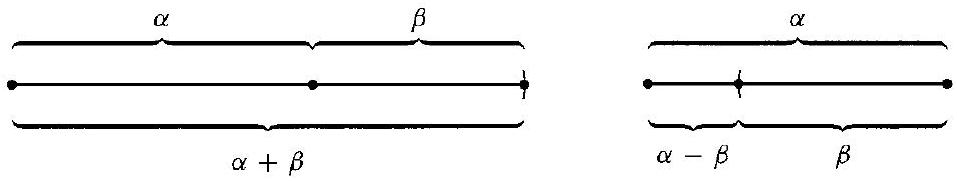
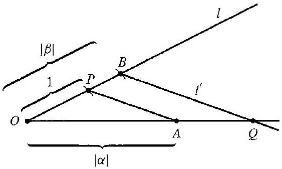
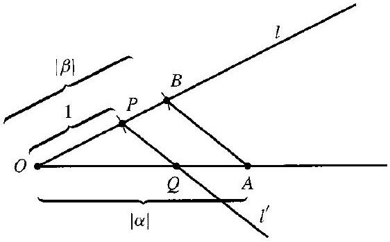
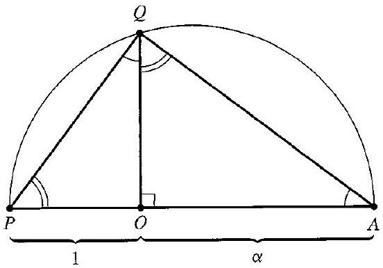
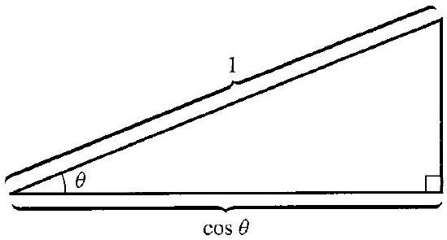
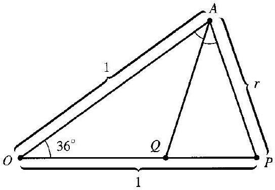

# Editorial records — Section32 Geometric Constructions

Printed293–300/PDF298–305 visually reviewed, including all six extracted figure assets. Native review pending.

## Remove erroneous LaTeX-list wrapper and restore the page-broken sentence, pp.293–294.

Before:

```text


[^1]\begin{itemize}
\item[] on the line
```

After:

```text
 on the line
```

## Restore the printed theorem label outside the spurious list.

Before:

```text
\item[32.1] Theorem
```

After:

```text
32.1 Theorem
```

## Restore the proof heading outside the spurious list.

Before:

```text
\item[] Proof
```

After:

```text
Proof
```

## Remove the spurious list closure.

Before:

```text
\end{itemize}
```

After:

```text

```

## Restore the title footnote marker from p.293.

Before:

```text
# 32 Geometric Constructions
```

After:

```text
# 32 Geometric Constructions[^32-section]
```

## Restore coordinate math delimiters,p.293.

Before:

```text
through $(0,0)$ and (1, 0).
```

After:

```text
through $(0,0)$ and $(1,0)$.
```

## Restore coordinate math delimiters,p.293.

Before:

```text
points (3, 0), (4, 0), (-1, 0), (-2, 0),
```

After:

```text
points $(3,0)$, $(4,0)$, $(-1,0)$, $(-2,0)$,
```

## Correct the source’s transposed coordinates: (2,0) has been constructed, while (0,2) has not yet been located; restore math delimiters,p.293.

Before:

```text
from $(0,0)$ to (0, 2), put the point at (1, 0),
```

After:

```text
from $(0,0)$ to $(2,0)$, put the point at $(1,0)$,
```

## Restore plural agreement,p.293.

Before:

```text
these circle intersect
```

After:

```text
these circles intersect
```

## Restore coordinate math delimiters,p.293.

Before:

```text
point (0, 0).
```

After:

```text
point $(0,0)$.
```

## Restore coordinate math delimiters,p.294.

Before:

```text
and (4, 2).)
```

After:

```text
and $(4,2)$.)
```

## Correct spelling,p.294.

Before:

```text
similiarly
```

After:

```text
similarly
```

## Restore both endpoints and the line of the source unit-segment diagram,p.295.

Before:

```text
$$
0 \ldots
$$
```

After:

```text
$$
0\;\rule{2em}{0.4pt}\;1
$$
```

## Correct the source condition: a compass radius between rational-coordinate points need not be rational, but its square is rational, p.295.

Before:

```text
whose radius is rational
```

After:

```text
whose squared radius is rational
```

## Apply the same necessary correction to the two-circle case,p.295.

Before:

```text
whose radii are rational
```

After:

```text
whose squared radii are rational
```

## Correct the printed reference to the tower law;32.4 is a figure,p.297.

Before:

```text
by Theorem 32.4,
```

After:

```text
by Theorem 31.4,
```

## Rejoin split math,p.298.

Before:

```text
$4 \cos ^{3} \theta-$ $3 \cos \theta=\cos 3 \theta$
```

After:

```text
$4 \cos ^{3} \theta-3 \cos \theta=\cos 3 \theta$
```

## Restore mathematical typography,p.298.

Before:

```text
and ±1 is
```

After:

```text
and $\pm1$ is
```

## Remove OCR scan debris,p.298.

Before:

```text
Thus
3

```

After:

```text
Thus

```

## Correct the source’s omitted absolute value: for n=3 the cosine is negative and cannot itself be a segment length,p.299.

Before:

```text
length $\cos (2 \pi / n)$
```

After:

```text
length $|\cos (2 \pi / n)|$
```

## Restore the source title footnote,p.293.

Before:

```text

```

After:

```text
[^32-section]: This chapter is not used in the remainder of the text.
```

## Wrap the original explicit definition including its unit-length premise.

Before:

```text
Let us imagine that we are given only a single line segment that we shall define to be one unit in length. A real number $\alpha$ is constructible if we can construct a line segment of length $|\alpha|$ in a finite number of steps from this given segment of unit length by using a straightedge and a compass.
```

After:

```text
> [!definition] Constructible Real Number
> Let us imagine that we are given only a single line segment that we shall define to be one unit in length. A real number $\alpha$ is constructible if we can construct a line segment of length $|\alpha|$ in a finite number of steps from this given segment of unit length by using a straightedge and a compass.
```

## Wrap the full source result with the printed number outside; retain proofs unchanged apart from recorded corrections.

Before:

```text
32.1 Theorem If $\alpha$ and $\beta$ are constructible real numbers, then so are $\alpha+\beta, \alpha-\beta, \alpha \beta$, and $\alpha / \beta$, if $\beta \neq 0$.
```

After:

```text
Theorem 32.1

> [!theorem] Field Operations on Constructible Real Numbers
> If $\alpha$ and $\beta$ are constructible real numbers, then so are $\alpha+\beta, \alpha-\beta, \alpha \beta$, and $\alpha / \beta$, if $\beta \neq 0$.

```

## Wrap the full source result with the printed number outside; retain proofs unchanged apart from recorded corrections.

Before:

```text
32.5 Corollary The set of all constructible real numbers forms a subfield $F$ of the field of real numbers.

```

After:

```text
Corollary 32.5

> [!corollary] Constructible Real Numbers Form a Field
> The set of all constructible real numbers forms a subfield $F$ of the field of real numbers.

```

## Wrap the full source result with the printed number outside; retain proofs unchanged apart from recorded corrections.

Before:

```text
32.6 Theorem The field $F$ of constructible real numbers consists precisely of all real numbers that we can obtain from $\mathbb{Q}$ by taking square roots of positive numbers a finite number of times and applying a finite number of field operations.

```

After:

```text
Theorem 32.6

> [!theorem] Constructible Numbers and Successive Square Roots
> The field $F$ of constructible real numbers consists precisely of all real numbers that we can obtain from $\mathbb{Q}$ by taking square roots of positive numbers a finite number of times and applying a finite number of field operations.

```

## Wrap the full source result with the printed number outside; retain proofs unchanged apart from recorded corrections.

Before:

```text
32.8 Corollary If $\gamma$ is constructible and $\gamma \notin \mathbb{Q}$, then there is a finite sequence of real numbers $\alpha_{1}, \cdots, \alpha_{n}=\gamma$ such that $\mathbb{Q}\left(\alpha_{1}, \cdots, \alpha_{i}\right)$ is an extension of $\mathbb{Q}\left(\alpha_{1}, \cdots, \alpha_{i-1}\right)$ of degree 2. In particular, $[\mathbb{Q}(\gamma): \mathbb{Q}]=2^{r}$ for some integer $r \geq 0$.

```

After:

```text
Corollary 32.8

> [!corollary] Degrees of Constructible Real Numbers
> If $\gamma$ is constructible and $\gamma \notin \mathbb{Q}$, then there is a finite sequence of real numbers $\alpha_{1}, \cdots, \alpha_{n}=\gamma$ such that $\mathbb{Q}\left(\alpha_{1}, \cdots, \alpha_{i}\right)$ is an extension of $\mathbb{Q}\left(\alpha_{1}, \cdots, \alpha_{i-1}\right)$ of degree 2. In particular, $[\mathbb{Q}(\gamma): \mathbb{Q}]=2^{r}$ for some integer $r \geq 0$.

```

## Wrap the full source result with the printed number outside; retain proofs unchanged apart from recorded corrections.

Before:

```text
32.9 Theorem Doubling the cube is impossible, that is, given a side of a cube, it is not always possible to construct with a straightedge and a compass the side of a cube that has double the volume of the original cube.

```

After:

```text
Theorem 32.9

> [!theorem] Impossibility of Doubling the Cube
> Doubling the cube is impossible, that is, given a side of a cube, it is not always possible to construct with a straightedge and a compass the side of a cube that has double the volume of the original cube.

```

## Wrap the full source result with the printed number outside; retain proofs unchanged apart from recorded corrections.

Before:

```text
32.10 Theorem Squaring the circle is impossible; that is, given a circle, it is not always possible to construct with a straightedge and a compass a square having area equal to the area of the given circle.

```

After:

```text
Theorem 32.10

> [!theorem] Impossibility of Squaring the Circle
> Squaring the circle is impossible; that is, given a circle, it is not always possible to construct with a straightedge and a compass a square having area equal to the area of the given circle.

```

## Wrap the full source result with the printed number outside; retain proofs unchanged apart from recorded corrections.

Before:

```text
32.11 Theorem Trisecting the angle is impossible; that is, there exists an angle that cannot be trisected with a straightedge and a compass.

```

After:

```text
Theorem 32.11

> [!theorem] Impossibility of General Angle Trisection
> Trisecting the angle is impossible; that is, there exists an angle that cannot be trisected with a straightedge and a compass.

```

## Preserve the historical sidebar as an aside.

Before:

```text
## ■ Historical Note

Greek mathematicians as far back as the fourth century B.C. had tried without success to find geometric constructions using straightedge and compass to trisect the angle, double the cube, and square the circle. Although they were never able to prove that such constructions were impossible, they did manage to construct the solutions to these problems using other tools, including the conic sections.

It was Carl Gauss in the early nineteenth century who made a detailed study of constructibility in connection with his solution of cyclotomic equations, the equations of the form $x^{p}-1=0$ with $p$ prime whose roots form the vertices of a regular $p$-gon. He showed that although all such equations are solvable using radicals, if $p-1$ is not a power of 2, then the solutions must involve roots higher than the second. In fact, Gauss asserted that anyone who attempted to find a geometric construction for a $p$-gon where $p-1$ is not a power of 2 would "spend his time uselessly." Interestingly, Gauss did not prove the assertion that such constructions were impossible. That was accomplished in 1837 by Pierre Wantzel (1814-1848), who in fact proved Corollary 32.8 and also demonstrated Theorems 32.9 and 32.11. The proof of Theorem 32.10, on the other hand, requires a proof that $\pi$ is transcendental, a result finally achieved in 1882 by Ferdinand Lindemann (1852-1939).
```

After:

```text
> [!aside] Historical Note
> Greek mathematicians as far back as the fourth century B.C. had tried without success to find geometric constructions using straightedge and compass to trisect the angle, double the cube, and square the circle. Although they were never able to prove that such constructions were impossible, they did manage to construct the solutions to these problems using other tools, including the conic sections.
>
> It was Carl Gauss in the early nineteenth century who made a detailed study of constructibility in connection with his solution of cyclotomic equations, the equations of the form $x^{p}-1=0$ with $p$ prime whose roots form the vertices of a regular $p$-gon. He showed that although all such equations are solvable using radicals, if $p-1$ is not a power of 2, then the solutions must involve roots higher than the second. In fact, Gauss asserted that anyone who attempted to find a geometric construction for a $p$-gon where $p-1$ is not a power of 2 would "spend his time uselessly." Interestingly, Gauss did not prove the assertion that such constructions were impossible. That was accomplished in 1837 by Pierre Wantzel (1814-1848), who in fact proved Corollary 32.8 and also demonstrated Theorems 32.9 and 32.11. The proof of Theorem 32.10, on the other hand, requires a proof that $\pi$ is transcendental, a result finally achieved in 1882 by Ferdinand Lindemann (1852-1939).
```

## Formatting only

1 definition,5 theorems,2 corollaries,10 exercises,1 aside,6 source figures. Exercise true/false layout restored. No admissions.

## Earlier staging record

# Editorial records — Section 32 - Geometric Constructions

Status: staged original OCR; content/callout/source review pending.

## Heading formatting

Before: `## SECTION $32{ }^{\dagger}$ Geometric Constructions`

After: `# 32 Geometric Constructions`

Section heading separated and normalized to level one; body wording unchanged. Original chapter OCR archive retained in conversion records.


## Figure 32.2

Formatting only: preserved image and printed caption in scientific figure component.

Before:

```text

32.2 Figure
```

After:

```text
```scientific-figure
id: 1b948594-2dde-4bd6-8dd1-9f90c29098e2
numbered: false
title: ""
caption: Figure 32.2
captionVisible: true
captionPosition: below
columns: 1
panels:
  - path: images/bb98bca5-3813-47c6-967e-f67460c66c5b-30_181_957_1494_679.jpg
    caption: ""
```
```

## Figure 32.3

Formatting only: preserved image and printed caption in scientific figure component.

Before:

```text

32.3 Figure
```

After:

```text
```scientific-figure
id: 4dc2af58-87d8-4e04-b033-0950e2539792
numbered: false
title: ""
caption: Figure 32.3
captionVisible: true
captionPosition: below
columns: 1
panels:
  - path: images/bb98bca5-3813-47c6-967e-f67460c66c5b-30_337_563_1763_878.jpg
    caption: ""
```
```

## Figure 32.4

Formatting only: preserved image and printed caption in scientific figure component.

Before:

```text

32.4 Figure
```

After:

```text
```scientific-figure
id: e87306b2-5d40-476f-a918-aaed2d323cf4
numbered: false
title: ""
caption: Figure 32.4
captionVisible: true
captionPosition: below
columns: 1
panels:
  - path: images/bb98bca5-3813-47c6-967e-f67460c66c5b-31_349_562_228_816.jpg
    caption: ""
```
```

## Figure 32.7

Formatting only: preserved image and printed caption in scientific figure component.

Before:

```text

32.7 Figure
```

After:

```text
```scientific-figure
id: acfd2141-e5af-4cea-9391-ed8bac643a84
numbered: false
title: ""
caption: Figure 32.7
captionVisible: true
captionPosition: below
columns: 1
panels:
  - path: images/bb98bca5-3813-47c6-967e-f67460c66c5b-32_386_552_1676_879.jpg
    caption: ""
```
```

## Figure 32.12

Formatting only: preserved image and printed caption in scientific figure component.

Before:

```text

32.12 Figure
```

After:

```text
```scientific-figure
id: 6575864c-c5f5-4df4-a2cf-3461ef2d771c
numbered: false
title: ""
caption: Figure 32.12
captionVisible: true
captionPosition: below
columns: 1
panels:
  - path: images/bb98bca5-3813-47c6-967e-f67460c66c5b-34_295_549_226_881.jpg
    caption: ""
```
```

## Figure 32.13

Formatting only: preserved image and printed caption in scientific figure component.

Before:

```text
> 
> 32.13 Figure
```

After:

```text
> ```scientific-figure
> id: b055ce24-fbb1-4600-a36b-8a4043ccdcfc
> numbered: false
> title: ""
> caption: Figure 32.13
> captionVisible: true
> captionPosition: below
> columns: 1
> panels:
>   - path: images/bb98bca5-3813-47c6-967e-f67460c66c5b-35_376_544_1649_1158.jpg
>     caption: ""
> ```
```

## Native rendered check

Native Obsidian: Figures32.2–32.3, corollary32.5 and unit segment rendered. Unit rule had insufficient dark-theme contrast and was replaced with an underline; final contrast check pending.

## Unit-segment contrast repair

Before: `0\;\rule{2em}{0.4pt}\;1`

After: `0\;\underline{\qquad}\;1`

Use the math foreground line instead of a black rule in the dark theme; same source endpoints and segment.

## Native rendered check

Confirmed the 0–1 unit segment now renders with a visible light line on the dark native theme.
