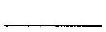
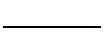
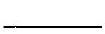
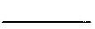
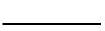
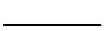

# Editorial records — Section33 Finite Fields

Printed300–305/PDF305–310 visually reviewed. Native review pending.

## Restore the printed C,p.301.

Before:

```text
Gorollary
```

After:

```text
Corollary
```

## Separate theorem number from group notation,p.301.

Before:

```text
Theorem $33.5\left\langle
```

After:

```text
Theorem 33.5 $\left\langle
```

## Restore the finite-field symbol,p.301.

Before:

```text
$Z_{11}{ }^{*}$
```

After:

```text
$\mathbb{Z}_{11}^{*}$
```

## Rejoin split congruence,p.302.

Before:

```text
$F(x) \equiv 0$ $(\bmod p)$
```

After:

```text
$F(x) \equiv 0\pmod p$
```

## Rejoin split polynomial,p.302.

Before:

```text
+\cdots+$ $a_{n-1}
```

After:

```text
+\cdots+a_{n-1}
```

## Rejoin the page-broken proof,pp.302–303.

Before:

```text
find

that
```

After:

```text
find that
```

## Restore the exponent and math delimiters in the proof,p.303.

Before:

```text
$(-\alpha) p^{p^{n}}=$ $(-1)^{p^{n}} \alpha^{p^{n}}=(-1)^{p^{n}} \alpha$
```

After:

```text
$(-\alpha)^{p^{n}}=(-1)^{p^{n}}\alpha^{p^{n}}=(-1)^{p^{n}}\alpha$
```

## Rejoin the page-broken proof,pp.303–304.

Before:

```text
precisely of the
zeros
```

After:

```text
precisely of the zeros
```

## Restore mathematical typography,Exercise5,p.304.

Before:

```text
in GF(19).
```

After:

```text
in $\mathrm{GF}(19)$.
```

## Move the full historical sidebar out of the page-broken example.

Before:

```text
## ■ Historical Note

Although Carl F. Gauss had shown that the set of residues modulo a prime $p$ satisfied the field properties, it was Evariste Galois (1811-1832) who first dealt with what he called "incommensurable solutions" to the congruence $F(x) \equiv 0(\bmod p)$, where $F(x)$ is an $n$th degree irreducible polynomial modulo $p$. He noted in a paper written in 1830 that one should consider the roots of this congruence as "a variety of imaginary symbols" that one can use in calculations just as one uses $\sqrt{-1}$. Galois then showed that if $\alpha$ is any solution of $F(x) \equiv 0\pmod p$, the expression $a_{0}+a_{1} \alpha+a_{2} \alpha^{2}+\cdots+a_{n-1} \alpha^{n-1}$ takes on precisely $p^{n}$ different values. Finally, he proved results equivalent to Theorems 33.3 and 33.5 of the text.

Galois' life was brief and tragic. He showed brilliance in mathematics early on, publishing several papers before he was 20 and essentially established the basic ideas of Galois theory. He was, however, active in French revolutionary politics following the July revolution of 1830. In May 1831, he was arrested for threatening the life of King Louis-Philippe. Though he was acquitted, he was rearrested for participating, heavily armed, in a republican demonstration on Bastille Day of that year. Two months after his release from prison the following March, he was killed in a duel, "the victim of an infamous coquette and her two dupes"; the previous night he had written a letter to a friend clarifying some of his work in the theory of equations and requesting that it be studied by other mathematicians. Not until 1846, however, were his major papers published; it is from that date that his work became influential.

```

After:

```text

```

## Keep the source sidebar immediately after the complete Example33.7.

Before:

```text
## The Existence of
```

After:

```text
> [!aside] Historical Note
> Although Carl F. Gauss had shown that the set of residues modulo a prime $p$ satisfied the field properties, it was Evariste Galois (1811-1832) who first dealt with what he called "incommensurable solutions" to the congruence $F(x) \equiv 0(\bmod p)$, where $F(x)$ is an $n$th degree irreducible polynomial modulo $p$. He noted in a paper written in 1830 that one should consider the roots of this congruence as "a variety of imaginary symbols" that one can use in calculations just as one uses $\sqrt{-1}$. Galois then showed that if $\alpha$ is any solution of $F(x) \equiv 0\pmod p$, the expression $a_{0}+a_{1} \alpha+a_{2} \alpha^{2}+\cdots+a_{n-1} \alpha^{n-1}$ takes on precisely $p^{n}$ different values. Finally, he proved results equivalent to Theorems 33.3 and 33.5 of the text.
>
> Galois' life was brief and tragic. He showed brilliance in mathematics early on, publishing several papers before he was 20 and essentially established the basic ideas of Galois theory. He was, however, active in French revolutionary politics following the July revolution of 1830. In May 1831, he was arrested for threatening the life of King Louis-Philippe. Though he was acquitted, he was rearrested for participating, heavily armed, in a republican demonstration on Bastille Day of that year. Two months after his release from prison the following March, he was killed in a duel, "the victim of an infamous coquette and her two dupes"; the previous night he had written a letter to a friend clarifying some of his work in the theory of equations and requesting that it be studied by other mathematicians. Not until 1846, however, were his major papers published; it is from that date that his work became influential.

## The Existence of
```

## Replace only the context-dependent This with its immediately preceding source antecedent and wrap the explicit naming definition,p.300.

Before:

```text
This field $\mathrm{GF}\left(p^{n}\right)$ is usually referred to as the Galois field of order $p^{n}$.
```

After:

```text


> [!definition] Galois Field
> The field $\mathrm{GF}\left(p^{n}\right)$ of order $p^n$, where $p$ is prime and $n$ is a positive integer, is usually referred to as the Galois field of order $p^{n}$.


```

## Wrap the complete definition and state the positive-integer domain of n required for independent reuse,p.301.

Before:

```text
33.4 Definition An element $\alpha$ of a field is an $\boldsymbol{n}$ th root of unity if $\alpha^{n}=1$. It is a primitive $\boldsymbol{n}$ th root of unity if $\alpha^{n}=1$ and $\alpha^{m} \neq 1$ for $0<m<n$. $\square$
```

After:

```text
Definition 33.4

> [!definition] Roots of Unity and Primitive Roots of Unity
> Let $n$ be a positive integer. An element $\alpha$ of a field is an $\boldsymbol{n}$ th root of unity if $\alpha^{n}=1$. It is a primitive $\boldsymbol{n}$ th root of unity if $\alpha^{n}=1$ and $\alpha^{m} \neq 1$ for $0<m<n$.
```

## Wrap the source result; retain printed numbers and proofs outside.

Before:

```text
33.1 Theorem Let $E$ be a finite extension of degree $n$ over a finite field $F$. If $F$ has $q$ elements, then $E$ has $q^{n}$ elements.

```

After:

```text
Theorem 33.1

> [!theorem] Size of a Finite Field Extension
> Let $E$ be a finite extension of degree $n$ over a finite field $F$. If $F$ has $q$ elements, then $E$ has $q^{n}$ elements.

```

## Wrap the source result; retain printed numbers and proofs outside.

Before:

```text
33.2 Corollary If $E$ is a finite field of characteristic $p$, then $E$ contains exactly $p^{n}$ elements for some positive integer $n$.

```

After:

```text
Corollary 33.2

> [!corollary] Prime-Power Order of a Finite Field
> If $E$ is a finite field of characteristic $p$, then $E$ contains exactly $p^{n}$ elements for some positive integer $n$.

```

## Restore the prime/positive-integer premise from the section introduction.

Before:

```text

```

After:

```text
Let $p$ be prime and $n$ a positive integer.
```

## Wrap the source result; retain printed numbers and proofs outside.

Before:

```text
33.3 Theorem Let $E$ be a field of $p^{n}$ elements contained in an algebraic closure $\overline{\mathbb{Z}}_{p}$ of $\mathbb{Z}_{p}$. The elements of $E$ are precisely the zeros in $\overline{\mathbb{Z}}_{p}$ of the polynomial $x^{p^{n}}-x$ in $\mathbb{Z}_{p}[x]$.

```

After:

```text
Theorem 33.3

> [!theorem] Finite Fields as Zeros of a Frobenius Polynomial
> Let $p$ be prime and $n$ a positive integer. Let $E$ be a field of $p^{n}$ elements contained in an algebraic closure $\overline{\mathbb{Z}}_{p}$ of $\mathbb{Z}_{p}$. The elements of $E$ are precisely the zeros in $\overline{\mathbb{Z}}_{p}$ of the polynomial $x^{p^{n}}-x$ in $\mathbb{Z}_{p}[x]$.

```

## Wrap the source result; retain printed numbers and proofs outside.

Before:

```text
33.5 Theorem The multiplicative group $\left\langle F^{*}, \cdot\right\rangle$ of nonzero elements of a finite field $F$ is cyclic.

```

After:

```text
Theorem 33.5

> [!theorem] The Multiplicative Group of a Finite Field Is Cyclic
> The multiplicative group $\left\langle F^{*}, \cdot\right\rangle$ of nonzero elements of a finite field $F$ is cyclic.

```

## Wrap the source result; retain printed numbers and proofs outside.

Before:

```text
33.6 Corollary A finite extension $E$ of a finite field $F$ is a simple extension of $F$.

```

After:

```text
Corollary 33.6

> [!corollary] Finite Extensions of Finite Fields Are Simple
> A finite extension $E$ of a finite field $F$ is a simple extension of $F$.

```

## Restore the positive-integer exponent premise from the preceding source paragraph.

Before:

```text

```

After:

```text
Let $n$ be a positive integer.
```

## Wrap the source result; retain printed numbers and proofs outside.

Before:

```text
33.8 Lemma If $F$ is a field of prime characteristic $p$ with algebraic closure $\bar{F}$, then $x^{p^{n}}-x$ has $p^{n}$ distinct zeros in $\bar{F}$. $\square$

```

After:

```text
Lemma 33.8

> [!lemma] Distinct Roots of the Finite-Field Polynomial
> Let $n$ be a positive integer. If $F$ is a field of prime characteristic $p$ with algebraic closure $\bar{F}$, then $x^{p^{n}}-x$ has $p^{n}$ distinct zeros in $\bar{F}$.

```

## Wrap the source result; retain printed numbers and proofs outside.

Before:

```text
33.9 Lemma If $F$ is a field of prime characteristic $p$, then $(\alpha+\beta)^{p^{n}}=\alpha^{p^{n}}+\beta^{p^{n}}$ for all $\alpha, \beta \in F$ and all positive integers $n$. $\square$

```

After:

```text
Lemma 33.9

> [!lemma] Frobenius Powers Preserve Addition
> If $F$ is a field of prime characteristic $p$, then $(\alpha+\beta)^{p^{n}}=\alpha^{p^{n}}+\beta^{p^{n}}$ for all $\alpha, \beta \in F$ and all positive integers $n$.

```

## Wrap the source result; retain printed numbers and proofs outside.

Before:

```text
33.10 Theorem A finite field $\operatorname{GF}\left(p^{n}\right)$ of $p^{n}$ elements exists for every prime power $p^{n}$.

```

After:

```text
Theorem 33.10

> [!theorem] Existence of Finite Fields of Prime-Power Order
> A finite field $\operatorname{GF}\left(p^{n}\right)$ of $p^{n}$ elements exists for every prime power $p^{n}$.

```

## Wrap the source result; retain printed numbers and proofs outside.

Before:

```text
33.11 Corollary If $F$ is any finite field, then for every positive integer $n$, there is an irreducible polynomial in $F[x]$ of degree $n$.

```

After:

```text
Corollary 33.11

> [!corollary] Irreducible Polynomials of Every Degree over Finite Fields
> If $F$ is any finite field, then for every positive integer $n$, there is an irreducible polynomial in $F[x]$ of degree $n$.

```

## Wrap the source result; retain printed numbers and proofs outside.

Before:

```text
33.12 Theorem Let $p$ be a prime and let $n \in \mathbb{Z}^{+}$. If $E$ and $E^{\prime}$ are fields of order $p^{n}$, then $E \simeq E^{\prime}$.

```

After:

```text
Theorem 33.12

> [!theorem] Uniqueness of a Finite Field of Given Order
> Let $p$ be a prime and let $n \in \mathbb{Z}^{+}$. If $E$ and $E^{\prime}$ are fields of order $p^{n}$, then $E \simeq E^{\prime}$.

```

## Supply only the missing task prompt and retain all original working outside.

Before:

```text
33.7 Example 
```

After:

```text
> [!example] Example 33.7
> Find a generator of the multiplicative group $\mathbb Z_{11}^{*}$, and find the primitive tenth, fifth, and second roots of unity in $\mathbb Z_{11}$.

##### solution


```

## Remove duplicated preceding-section footnotes from the reading copy; originals preserved.

Before:

```text

[^0]:    ${ }^{\dagger}$ Section 32 is not required for the remainder of the text.

[^1]:    ${ }^{\dagger}$ This chapter is not used in the remainder of the text.


```

After:

```text

```

## Replace six OCR images of answer blanks with text blanks; preserve all true/false statements,p.304.

Before:

```text
Mark each of the following true or false.
    
a. The nonzero elements of every finite field form a cyclic group under multiplication.
    
b. The elements of every finite field form a cyclic group under addition.
    
c. The zeros in $\mathbb{C}$ of $\left(x^{28}-1\right) \in \mathbb{Q}[x]$ form a cyclic group under multiplication.
    
d. There exists a finite field of 60 elements.
    
e. There exists a finite field of 125 elements.
    
f. There exists a finite field of 36 elements.

\_\_\_\_ g. The complex number $i$ is a primitive 4th root of unity.
\_\_\_\_ h. There exists an irreducible polynomial of degree 58 in $\mathbb{Z}_{2}[x]$.
\_\_\_\_ i. The nonzero elements of $\mathbb{Q}$ form a cyclic group $\mathbb{Q}^{*}$ under field multiplication.
\_\_\_\_ j. If $F$ is a finite field, then every isomorphism mapping $F$ onto a subfield of an algebraic closure $\bar{F}$ of $F$ is an automorphism of $F$.

```

After:

```text
Mark each of the following true or false.

a. \_\_\_\_ The nonzero elements of every finite field form a cyclic group under multiplication.

b. \_\_\_\_ The elements of every finite field form a cyclic group under addition.

c. \_\_\_\_ The zeros in $\mathbb{C}$ of $\left(x^{28}-1\right) \in \mathbb{Q}[x]$ form a cyclic group under multiplication.

d. \_\_\_\_ There exists a finite field of 60 elements.

e. \_\_\_\_ There exists a finite field of 125 elements.

f. \_\_\_\_ There exists a finite field of 36 elements.


g. \_\_\_\_ The complex number $i$ is a primitive 4th root of unity.

h. \_\_\_\_ There exists an irreducible polynomial of degree 58 in $\mathbb{Z}_{2}[x]$.

i. \_\_\_\_ The nonzero elements of $\mathbb{Q}$ form a cyclic group $\mathbb{Q}^{*}$ under field multiplication.

j. \_\_\_\_ If $F$ is a finite field, then every isomorphism mapping $F$ onto a subfield of an algebraic closure $\bar{F}$ of $F$ is an automorphism of $F$.

```

## Formatting only

2 definitions,5 theorems,3 corollaries,2 lemmas,1 example,14 exercises,1 aside. Source33.5 explicitly restates23.6; both retained in place, with no admissions.

## Earlier staging record

# Editorial records — Section 33 - Finite Fields

Status: staged original OCR; content/callout/source review pending.

## Heading formatting

Before: `section 33 Finite Fields`

After: `# 33 Finite Fields`

Section heading separated and normalized to level one; body wording unchanged. Original chapter OCR archive retained in conversion records.


## Native rendered check

Native Obsidian: corollary33.2, theorem33.3 and its proof, and Exercise33.8 true/false layout render correctly.
