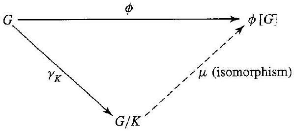
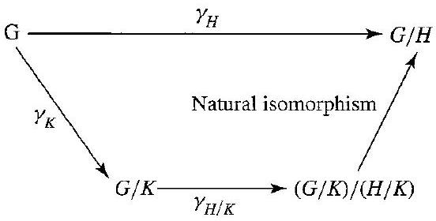
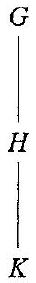

# Editorial records — Section34 Isomorphism Theorems

Printed307–311/PDF311–315 visually reviewed, including all three extracted diagram assets. Native review pending.

## Rejoin split math,p.308.

Before:

```text
$\phi(L)=$ $\gamma[L]$
```

After:

```text
$\phi(L)=\gamma[L]$
```

## Rejoin split math,p.308.

Before:

```text
$H \vee N=H N=$ $N H$
```

After:

```text
$H \vee N=H N=N H$
```

## Correct the source’s missing coset N: mu1 maps into gamma[H], so its inverse takes hN, not h,p.309.

Before:

```text
\mu_{1}^{-1}(h)=
```

After:

```text
\mu_{1}^{-1}(hN)=
```

## Separate display closure and end marker.

Before:

```text
$$ $\square$
```

After:

```text
$$

$\square$
```

## Rejoin split math,p.309.

Before:

```text
$H N=$ $\mathbb{Z}
```

After:

```text
$H N=\mathbb{Z}
```

## Rejoin split math,p.309.

Before:

```text
$G / H \simeq$ $(G / K) /(H / K)$
```

After:

```text
$G / H\simeq(G / K)/(H / K)$
```

## Restore missing space,p.309.

Before:

```text
Anice way
```

After:

```text
A nice way
```

## Rejoin split math,p.310.

Before:

```text
$G / K$ $=\mathbb{Z} / 6 \mathbb{Z}$
```

After:

```text
$G / K=\mathbb{Z} / 6 \mathbb{Z}$
```

## Restore OCR-lost mathematical notation,p.310.

Before:

```text
and 2Z/6Z corresponds
```

After:

```text
and $2\mathbb Z/6\mathbb Z$ corresponds
```

## Restore subgroup-generator brackets,p.310.

Before:

```text
cyclic subgroup (2) of
```

After:

```text
cyclic subgroup $\langle2\rangle$ of
```

## Preserve the author’s theorem name and complete statement; printed number stays outside.

Before:

```text
34.2 Theorem (First Isomorphism Theorem) Let $\phi: G \rightarrow G^{\prime}$ be a homomorphism with kernel $K$, and let $\gamma_{K}: G \rightarrow G / K$ be the canonical homomorphism. There is a unique isomorphism $\mu: G / K \rightarrow \phi[G]$ such that $\phi(x)=\mu\left(\gamma_{K}(x)\right)$ for each $x \in G$.
```

After:

```text
Theorem 34.2

> [!theorem] First Isomorphism Theorem
> Let $\phi: G \rightarrow G^{\prime}$ be a homomorphism with kernel $K$, and let $\gamma_{K}: G \rightarrow G / K$ be the canonical homomorphism. There is a unique isomorphism $\mu: G / K \rightarrow \phi[G]$ such that $\phi(x)=\mu\left(\gamma_{K}(x)\right)$ for each $x \in G$.
```

## Preserve the author’s theorem name and complete statement; printed number stays outside.

Before:

```text
34.5 Theorem (Second Isomorphism Theorem) Let $H$ be a subgroup of $G$ and let $N$ be a normal subgroup of $G$. Then $(H N) / N \simeq H /(H \cap N)$.
```

After:

```text
Theorem 34.5

> [!theorem] Second Isomorphism Theorem
> Let $H$ be a subgroup of $G$ and let $N$ be a normal subgroup of $G$. Then $(H N) / N \simeq H /(H \cap N)$.
```

## Preserve the author’s theorem name and complete statement; printed number stays outside.

Before:

```text
34.7 Theorem (Third Isomorphism Theorem) Let $H$ and $K$ be normal subgroups of a group $G$ with $K \leq H$. Then $G / H \simeq(G / K) /(H / K)$.
```

After:

```text
Theorem 34.7

> [!theorem] Third Isomorphism Theorem
> Let $H$ and $K$ be normal subgroups of a group $G$ with $K \leq H$. Then $G / H \simeq(G / K) /(H / K)$.
```

## Wrap the source lemma with its printed number outside.

Before:

```text
34.3 Lemma Let $N$ be a normal subgroup of a group $G$ and let $\gamma: G \rightarrow G / N$ be the canonical homomorphism. Then the map $\phi$ from the set of normal subgroups of $G$ containing $N$ to the set of normal subgroups of $G / N$ given by $\phi(L)=\gamma[L]$ is one to one and onto.

```

After:

```text
Lemma 34.3

> [!lemma] Normal-Subgroup Correspondence under a Quotient Map
> Let $N$ be a normal subgroup of a group $G$ and let $\gamma: G \rightarrow G / N$ be the canonical homomorphism. Then the map $\phi$ from the set of normal subgroups of $G$ containing $N$ to the set of normal subgroups of $G / N$ given by $\phi(L)=\gamma[L]$ is one to one and onto.

```

## Restore only the product/join notation defined immediately before the lemma,p.308.

Before:

```text

```

After:

```text
Here $HN=\{hn\mid h\in H,n\in N\}$, $NH=\{nh\mid n\in N,h\in H\}$, and $H\vee N$ is the smallest subgroup of $G$ containing both $H$ and $N$.
```

## Wrap the source lemma with its printed number outside.

Before:

```text
34.4 Lemma If $N$ is a normal subgroup of $G$, and if $H$ is any subgroup of $G$, then $H \vee N=H N=N H$. Furthermore, if $H$ is also normal in $G$, then $H N$ is normal in $G$.

```

After:

```text
Lemma 34.4

> [!lemma] Product and Join of Subgroups with a Normal Factor
> If $N$ is a normal subgroup of $G$, and if $H$ is any subgroup of $G$, then $H \vee N=H N=N H$. Furthermore, if $H$ is also normal in $G$, then $H N$ is normal in $G$.
>
> Here $HN=\{hn\mid h\in H,n\in N\}$, $NH=\{nh\mid n\in N,h\in H\}$, and $H\vee N$ is the smallest subgroup of $G$ containing both $H$ and $N$.

```

## Wrap the author’s explicit join definition with its original product notation and premises.

Before:

```text
If $H$ and $N$ are subgroups of a group $G$, then we let

$$
H N=\{h n \mid h \in H, n \in N\} .
$$

We define the join $H \vee N$ of $H$ and $N$ as the intersection of all subgroups of $G$ that contain $H N$; thus $H \vee N$ is the smallest subgroup of $G$ containing $H N$. Of course $H \vee N$ is also the smallest subgroup of $G$ containing both $H$ and $N$, since any such subgroup must contain $H N$.
```

After:

```text
> [!definition] Join of Subgroups
> If $H$ and $N$ are subgroups of a group $G$, then we let
>
> $$
> H N=\{h n \mid h \in H, n \in N\} .
> $$
>
> We define the join $H \vee N$ of $H$ and $N$ as the intersection of all subgroups of $G$ that contain $H N$; thus $H \vee N$ is the smallest subgroup of $G$ containing $H N$. Of course $H \vee N$ is also the smallest subgroup of $G$ containing both $H$ and $N$, since any such subgroup must contain $H N$.


```

## Supply only the missing task prompt; preserve the complete source working outside.

Before:

```text
34.6 Example 
```

After:

```text
> [!example] Example 34.6
> Let $G=\mathbb Z\times\mathbb Z\times\mathbb Z$, $H=\mathbb Z\times\mathbb Z\times\{0\}$, and $N=\{0\}\times\mathbb Z\times\mathbb Z$. Find $HN$, $H\cap N$, and the isomorphism types of $(HN)/N$ and $H/(H\cap N)$.

##### solution


```

## Supply only the missing task prompt; preserve the complete source working outside.

Before:

```text
34.10 Example 
```

After:

```text
> [!example] Example 34.10
> Consider $K=6\mathbb Z<H=2\mathbb Z<G=\mathbb Z$. Compare $G/H$ and $(G/K)/(H/K)$.

##### solution


```

## Formatting only

1 definition,3 theorems,2 lemmas,2 examples,9 exercises,3 figures. Source34.2 restates14.11; both retained in place. No admissions.

## Earlier staging record

# Editorial records — Section 34 - Isomorphism Theorems

Status: staged original OCR; content/callout/source review pending.

## Heading formatting

Before: `## section 34 Isomorphism Theorems`

After: `# 34 Isomorphism Theorems`

Section heading separated and normalized to level one; body wording unchanged. Original chapter OCR archive retained in conversion records.


## Figure 34.1

Formatting only: preserved image and printed caption in scientific figure component.

Before:

```text

34.1 Figure
```

After:

```text
```scientific-figure
id: 4e4ac29f-a6d7-4845-8d62-7205a4dfaa14
numbered: false
title: ""
caption: Figure 34.1
captionVisible: true
captionPosition: below
columns: 1
panels:
  - path: images/183553e9-238e-41a5-9e0e-74c559bd35b3-01_267_598_1303_803.jpg
    caption: ""
```
```

## Figure 34.8

Formatting only: preserved image and printed caption in scientific figure component.

Before:

```text

34.8 Figure
```

After:

```text
```scientific-figure
id: 6b468998-33f5-4202-801c-a55cb28e936b
numbered: false
title: ""
caption: Figure 34.8
captionVisible: true
captionPosition: below
columns: 1
panels:
  - path: images/183553e9-238e-41a5-9e0e-74c559bd35b3-03_280_552_1796_720.jpg
    caption: ""
```
```

## Figure 34.9

Formatting only: preserved image and printed caption in scientific figure component.

Before:

```text

34.9 Figure
```

After:

```text
```scientific-figure
id: a8bc2834-c677-4b7d-a9b7-115ecc635fa1
numbered: false
title: ""
caption: Figure 34.9
captionVisible: true
captionPosition: below
columns: 1
panels:
  - path: images/183553e9-238e-41a5-9e0e-74c559bd35b3-03_283_36_1788_1402.jpg
    caption: ""
```
```

## Figure34.9 source extraction repair

Before: Mathpix’s 36-pixel-wide extraction expanded the vertical G–H–K diagram to many screen heights. After: replaced its active component path with a fresh PDF313 crop retaining surrounding source whitespace; same G–H–K diagram and caption, same component ID. Original extraction retained. No mathematical content changed.

## Native rendered check

Confirmed corrected Figure34.9 displays all G,H,K labels together at readable scale, with source caption in its component. Example34.10 and its separate solution and Exercises34.6–9 render correctly.
