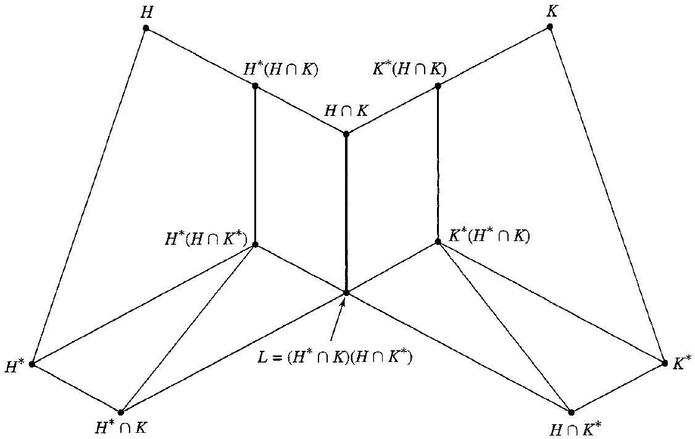

# Editorial records — Section35 Series of Groups

Printed311–321/PDF315–325 visually reviewed. Native review pending.

## Join split math,p.311.

Before:

```text
$H_{0}=$ $\{e\}$
```

After:

```text
$H_{0}=\{e\}$
```

## Separate math closure and end marker.

Before:

```text
$$ $\square$
```

After:

```text
$$

$\square$
```

## Restore generator brackets,p.312.

Before:

```text
\mathbb{Z}_{15} /(5\rangle
```

After:

```text
\mathbb{Z}_{15} /\langle5\rangle
```

## Restore generator brackets,p.312.

Before:

```text
\mathbb{Z}_{15} /(3)
```

After:

```text
\mathbb{Z}_{15} /\langle3\rangle
```

## Remove OCR speck after Example35.7.

Before:

```text

s

```

After:

```text


```

## Join split math,p.314.

Before:

```text
$x \in$ $H \cap K$
```

After:

```text
$x\in H\cap K$
```

## Join split math,p.314.

Before:

```text
$h_{1}, h_{2} \in$ $H^{*}$
```

After:

```text
$h_{1},h_{2}\in H^{*}$
```

## Join split math,p.314.

Before:

```text
K)=$ $H^{*}
```

After:

```text
K)=H^{*}
```

## Correct source Hx to hx: phi takes the element hx; join split math,p.314.

Before:

```text
$\phi(H x)=$ $x L=L$
```

After:

```text
$\phi(h x)=x L=L$
```

## Join split math,p.314.

Before:

```text
K^{*}\right)=$ $H^{*}
```

After:

```text
K^{*}\right)=H^{*}
```

## Join split math,p.315.

Before:

```text
$0 \leq$ $i \leq n$
```

After:

```text
$0\leq i\leq n$
```

## Restore source hyphen,p.317.

Before:

```text
JordanHölder
```

After:

```text
Jordan-Hölder
```

## Restore generator brackets in Exercise4,p.319.

Before:

```text
\{24\rangle<(12)
```

After:

```text
\langle24\rangle<\langle12\rangle
```

## Restore generator bracket in Exercise21,p.320.

Before:

```text
\{12\rangle
```

After:

```text
\langle12\rangle
```

## Correct source image-of-subgroup brackets in Exercise28,p.321; gamma applies to elements while brackets denote subset image.

Before:

```text
\gamma\left(H_{i}\right)
```

After:

```text
\gamma\left[H_{i}\right]
```

## Join p.313–314 paragraph around the butterfly diagram.

Before:

```text
It will then follow at once from Theorem 34.2 that $H^{*}\left(H \cap K^{*}\right)$ is normal


35.9 Figure

in $H^{*}(H \cap K)$, and that $H^{*}(H \cap K) / H^{*}\left(H \cap K^{*}\right) \simeq(H \cap K) / L$. A similar result for the groups on the right-hand heavy line in Fig. 35.9 then follows by symmetry.
```

After:

```text
It will then follow at once from Theorem 34.2 that $H^{*}\left(H \cap K^{*}\right)$ is normal in $H^{*}(H \cap K)$, and that $H^{*}(H \cap K) / H^{*}\left(H \cap K^{*}\right) \simeq(H \cap K) / L$. A similar result for the groups on the right-hand heavy line in Fig. 35.9 then follows by symmetry.


35.9 Figure
```

## Correct omitted trivial-subgroup case in the proof of35.16; its strict chain otherwise requires nontrivial N,p.317.

Before:

```text
Proof The series

$$
\{e\}<N<G
```

After:

```text
Proof If $N=\{e\}$, every composition (principal) series contains $N$. Assume $N\ne\{e\}$. The series

$$
\{e\}<N<G
```

## Wrap the original definition; retain the source’s terminology and scope. Printed number outside.

Before:

```text
35.1 Definition A subnormal (or subinvariant) series of a group $G$ is a finite sequence $H_{0}, H_{1}, \cdots, H_{n}$ of subgroups of $G$ such that $H_{i}<H_{i+1}$ and $H_{i}$ is a normal subgroup of $H_{i+1}$ with $H_{0}=\{e\}$ and $H_{n}=G$. A normal (or invariant) series of $G$ is a finite sequence $H_{0}, H_{1}, \cdots, H_{n}$ of normal subgroups of $G$ such that $H_{i}<H_{i+1}, H_{0}=\{e\}$, and $H_{n}=G$. $\square$
```

After:

```text
Definition 35.1

> [!definition] Subnormal and Normal Series of a Group
> A subnormal (or subinvariant) series of a group $G$ is a finite sequence $H_{0}, H_{1}, \cdots, H_{n}$ of subgroups of $G$ such that $H_{i}<H_{i+1}$ and $H_{i}$ is a normal subgroup of $H_{i+1}$ with $H_{0}=\{e\}$ and $H_{n}=G$. A normal (or invariant) series of $G$ is a finite sequence $H_{0}, H_{1}, \cdots, H_{n}$ of normal subgroups of $G$ such that $H_{i}<H_{i+1}, H_{0}=\{e\}$, and $H_{n}=G$. $\square$
```

## Wrap the original definition; retain the source’s terminology and scope. Printed number outside.

Before:

```text
35.4 Definition A subnormal (normal) series $\left\{K_{j}\right\}$ is a refinement of a subnormal (normal) series $\left\{H_{i}\right\}$ of a group $G$ if $\left\{H_{i}\right\} \subseteq\left\{K_{j}\right\}$, that is, if each $H_{i}$ is one of the $K_{j}$. $\square$
35.5 Example The series
```

After:

```text
Definition 35.4

> [!definition] Refinement of a Group Series
> A subnormal (normal) series $\left\{K_{j}\right\}$ is a refinement of a subnormal (normal) series $\left\{H_{i}\right\}$ of a group $G$ if $\left\{H_{i}\right\} \subseteq\left\{K_{j}\right\}$, that is, if each $H_{i}$ is one of the $K_{j}$. $\square$
> 35.5 Example The series
```

## Wrap the original definition; retain the source’s terminology and scope. Printed number outside.

Before:

```text
35.6 Definition Two subnormal (normal) series $\left\{H_{i}\right\}$ and $\left\{K_{j}\right\}$ of the same group $G$ are isomorphic if there is a one-to-one correspondence between the collections of factor groups $\left\{H_{i+1} / H_{i}\right\}$ and $\left\{K_{j+1} / K_{j}\right\}$ such that corresponding factor groups are isomorphic. $\square$
```

After:

```text
Definition 35.6

> [!definition] Isomorphic Group Series
> Two subnormal (normal) series $\left\{H_{i}\right\}$ and $\left\{K_{j}\right\}$ of the same group $G$ are isomorphic if there is a one-to-one correspondence between the collections of factor groups $\left\{H_{i+1} / H_{i}\right\}$ and $\left\{K_{j+1} / K_{j}\right\}$ such that corresponding factor groups are isomorphic. $\square$
```

## Wrap the original definition; retain the source’s terminology and scope. Printed number outside.

Before:

```text
35.12 Definition A subnormal series $\left\{H_{i}\right\}$ of a group $G$ is a composition series if all the factor groups $H_{i+1} / H_{i}$ are simple. A normal series $\left\{H_{i}\right\}$ of $G$ is a principal or chief series if all the factor groups $H_{i+1} / H_{i}$ are simple. $\square$
```

After:

```text
Definition 35.12

> [!definition] Composition and Principal Series
> A subnormal series $\left\{H_{i}\right\}$ of a group $G$ is a composition series if all the factor groups $H_{i+1} / H_{i}$ are simple. A normal series $\left\{H_{i}\right\}$ of $G$ is a principal or chief series if all the factor groups $H_{i+1} / H_{i}$ are simple. $\square$
```

## Wrap the original definition; retain the source’s terminology and scope. Printed number outside.

Before:

```text
35.18 Definition A group $G$ is solvable if it has a composition series $\left\{H_{i}\right\}$ such that all factor groups $H_{i+1} / H_{i}$ are abelian. $\square$
```

After:

```text
Definition 35.18

> [!definition] Solvable Group
> A group $G$ is solvable if it has a composition series $\left\{H_{i}\right\}$ such that all factor groups $H_{i+1} / H_{i}$ are abelian. $\square$
```

## Wrap complete theorem; retain author’s existing named title, supply a title only to35.16.

Before:

```text
35.11 Theorem (Schreier Theorem) Two subnormal (normal) series of a group $G$ have isomorphic refinements.
```

After:

```text
Theorem 35.11

> [!theorem] Schreier Theorem
> Two subnormal (normal) series of a group $G$ have isomorphic refinements.
```

## Wrap complete theorem; retain author’s existing named title, supply a title only to35.16.

Before:

```text
35.15 Theorem (Jordan-Hölder Theorem) Any two composition (principal) series of a group $G$ are isomorphic.
```

After:

```text
Theorem 35.15

> [!theorem] Jordan-Hölder Theorem
> Any two composition (principal) series of a group $G$ are isomorphic.
```

## Wrap complete theorem; retain author’s existing named title, supply a title only to35.16.

Before:

```text
35.16 Theorem If $G$ has a composition (principal) series, and if $N$ is a proper normal subgroup of $G$, then there exists a composition (principal) series containing $N$.
```

After:

```text
Theorem 35.16

> [!theorem] Composition Series Containing a Normal Subgroup
> If $G$ has a composition (principal) series, and if $N$ is a proper normal subgroup of $G$, then there exists a composition (principal) series containing $N$.
```

## Keep all three source assertions together; indent the list’s display math.

Before:

```text
35.10 Lemma (Zassenhaus Lemma) Let $H$ and $K$ be subgroups of a group $G$ and let $H^{*}$ and $K^{*}$ be normal subgroups of $H$ and $K$, respectively. Then

1. $H^{*}\left(H \cap K^{*}\right)$ is a normal subgroup of $H^{*}(H \cap K)$.
2. $K^{*}\left(H^{*} \cap K\right)$ is a normal subgroup of $K^{*}(H \cap K)$.
3. $$
\begin{aligned}
H^{*}(H \cap K) / H^{*}\left(H \cap K^{*}\right) & \simeq K^{*}(H \cap K) / K^{*}\left(H^{*} \cap K\right) \\
& \simeq(H \cap K) /\left[\left(H^{*} \cap K\right)\left(H \cap K^{*}\right)\right] .
\end{aligned}
$$


```

After:

```text
Lemma 35.10

> [!lemma] Zassenhaus Lemma
> Let $H$ and $K$ be subgroups of a group $G$ and let $H^{*}$ and $K^{*}$ be normal subgroups of $H$ and $K$, respectively. Then
>
> 1. $H^{*}\left(H \cap K^{*}\right)$ is a normal subgroup of $H^{*}(H \cap K)$.
> 2. $K^{*}\left(H^{*} \cap K\right)$ is a normal subgroup of $K^{*}(H \cap K)$.
> 3.
>
>    $$
>    \begin{aligned}
>    H^{*}(H \cap K) / H^{*}\left(H \cap K^{*}\right) & \simeq K^{*}(H \cap K) / K^{*}\left(H^{*} \cap K\right) \\
>    & \simeq(H \cap K) /\left[\left(H^{*} \cap K\right)\left(H \cap K^{*}\right)\right] .
>    \end{aligned}
>    $$


```

## Include the author’s immediately preceding construction in the definition; remove only external textbook references.

Before:

```text
Now let $G$ be a group, and let $Z(G)$ be the center of $G$. Since $Z(G)$ is normal in $G$, we can form the factor group $G / Z(G)$ and find the center $Z(G / Z(G))$ of this factor group. Since $Z(G / Z(G))$ is normal in $G / Z(G)$, if $\gamma: G \rightarrow G / Z(G)$ is the canonical map, then by Theorem 15.16, $\gamma^{-1}[Z(G / Z(G))]$ is a normal subgroup $Z_{1}(G)$ of $G$. We can then form the factor group $G / Z_{1}(G)$ and find its center, take $\left(\gamma_{1}\right)^{-1}$ of it to get $Z_{2}(G)$, and so on.
35.20 Definition The series

$$
\{e\} \leq Z(G) \leq Z_{1}(G) \leq Z_{2}(G) \leq \cdots
$$

described in the preceding discussion is the ascending central series of the group $G$. $\square$

```

After:

```text
Definition 35.20

> [!definition] Ascending Central Series
> Now let $G$ be a group, and let $Z(G)$ be the center of $G$. Since $Z(G)$ is normal in $G$, we can form the factor group $G / Z(G)$ and find the center $Z(G / Z(G))$ of this factor group. Since $Z(G / Z(G))$ is normal in $G / Z(G)$, if $\gamma: G \rightarrow G / Z(G)$ is the canonical map, then $\gamma^{-1}[Z(G / Z(G))]$ is a normal subgroup $Z_{1}(G)$ of $G$. We can then form the factor group $G / Z_{1}(G)$ and find its center, take $\left(\gamma_{1}\right)^{-1}$ of it to get $Z_{2}(G)$, and so on.
> The series
>
> $$
> \{e\} \leq Z(G) \leq Z_{1}(G) \leq Z_{2}(G) \leq \cdots
> $$
>
> is the ascending central series of the group $G$. $\square$


```

## Mark the author’s proof before the Zassenhaus statement without reordering it.

Before:

```text
Let $H$ and $K$ be subgroups of a group $G$, and let $H^{*}$
```

After:

```text
##### proof

Let $H$ and $K$ be subgroups of a group $G$, and let $H^{*}$
```

## Supply a task-only prompt; retain the full source working verbatim except recorded corrections.

Before:

```text
35.2 Example 
```

After:

```text
> [!example] Example 35.2
> Give two examples of normal series of $\mathbb Z$ under addition.

##### solution


```

## Supply a task-only prompt; retain the full source working verbatim except recorded corrections.

Before:

```text
35.3 Example 
```

After:

```text
> [!example] Example 35.3
> For the group $D_4$ of symmetries of the square in Example8.10, determine whether $\{\rho_0\}<\{\rho_0,\mu_1\}<\{\rho_0,\rho_2,\mu_1,\mu_2\}<D_4$ is a subnormal series or a normal series.

##### solution


```

## Supply a task-only prompt; retain the full source working verbatim except recorded corrections.

Before:

```text
35.5 Example 
```

After:

```text
> [!example] Example 35.5
> Give a refinement of $\{0\}<72\mathbb Z<8\mathbb Z<\mathbb Z$ by inserting $4\mathbb Z$ and $24\mathbb Z$.

##### solution


```

## Supply a task-only prompt; retain the full source working verbatim except recorded corrections.

Before:

```text
35.7 Example 
```

After:

```text
> [!example] Example 35.7
> Show that the series $\{0\}<\langle5\rangle<\mathbb Z_{15}$ and $\{0\}<\langle3\rangle<\mathbb Z_{15}$ are isomorphic.

##### solution


```

## Supply a task-only prompt; retain the full source working verbatim except recorded corrections.

Before:

```text
35.8 Example 
```

After:

```text
> [!example] Example 35.8
> Find isomorphic refinements of $\{0\}<8\mathbb Z<4\mathbb Z<\mathbb Z$ and $\{0\}<9\mathbb Z<\mathbb Z$.

##### solution


```

## Supply a task-only prompt; retain the full source working verbatim except recorded corrections.

Before:

```text
35.13 Example 
```

After:

```text
> [!example] Example 35.13
> Determine whether $\mathbb Z$ has a composition series or a principal series.

##### solution


```

## Supply a task-only prompt; retain the full source working verbatim except recorded corrections.

Before:

```text
35.14 Example 
```

After:

```text
> [!example] Example 35.14
> Find a composition series and a principal series of $S_n$ for $n\ge5$.

##### solution


```

## Supply a task-only prompt; retain the full source working verbatim except recorded corrections.

Before:

```text
35.17 Example 
```

After:

```text
> [!example] Example 35.17
> Find a composition series and a principal series of $\mathbb Z_4\times\mathbb Z_9$ containing $\langle(0,1)\rangle$.

##### solution


```

## Supply a task-only prompt; retain the full source working verbatim except recorded corrections.

Before:

```text
35.19 Example 
```

After:

```text
> [!example] Example 35.19
> Determine whether $S_3$ and $S_5$ are solvable.

##### solution


```

## Supply a task-only prompt; retain the full source working verbatim except recorded corrections.

Before:

```text
35.21 Example 
```

After:

```text
> [!example] Example 35.21
> Find the ascending central series of $S_3$ and of the group $D_4$ of symmetries of the square.

##### solution


```

## Format historical sidebar as an aside; not eligible for Index.

Before:

```text
## ■ Historical Note

This first appearance of what became the Jordan-Hölder theorem occurred in 1869 in a commentary on the work of Galois by the brilliant French algebraist Camille Jordan (1838-1922). The context of its appearance is the study of permutation groups associated with the roots of polynomial equations. Jordan asserted that even though the sequence of normal subgroups $G, I, J, \cdots$ of the group of the equation is not necessarily unique, nevertheless the sequence of indices of this composition series is unique. Jordan gave a proof in his monumental 1870 Treatise on Substitutions and Algebraic Equations. This latter work, though restricted to what we now call permutation groups, remained the standard treatise on group theory for many years.

The Hölder part of the theorem, that the sequence of factor groups in a composition series is unique up to order, was due to Otto Hölder (1859-1937), who played a very important role in the development of group theory once the completely abstract definition of a group had been given. Among his other contributions, he gave the first abstract definition of a "factor group" and determined the structure of all finite groups of square-free order.

```

After:

```text
> [!aside] Historical Note
> This first appearance of what became the Jordan-Hölder theorem occurred in 1869 in a commentary on the work of Galois by the brilliant French algebraist Camille Jordan (1838-1922). The context of its appearance is the study of permutation groups associated with the roots of polynomial equations. Jordan asserted that even though the sequence of normal subgroups $G, I, J, \cdots$ of the group of the equation is not necessarily unique, nevertheless the sequence of indices of this composition series is unique. Jordan gave a proof in his monumental 1870 Treatise on Substitutions and Algebraic Equations. This latter work, though restricted to what we now call permutation groups, remained the standard treatise on group theory for many years.
>
> The Hölder part of the theorem, that the sequence of factor groups in a composition series is unique up to order, was due to Otto Hölder (1859-1937), who played a very important role in the development of group theory once the completely abstract definition of a group had been given. Among his other contributions, he gave the first abstract definition of a "factor group" and determined the structure of all finite groups of square-free order.


```

## Formatting and source scope

6 definitions,3 theorems,1 lemma,10 examples,29 exercises,1 aside and1 figure. Definitions of principal/chief series and solvability retain the author’s exact formulation; do not silently replace these with a broader formulation. All five numbered proof equations remain outside reusable callouts. No admissions.

## Earlier staging record

# Editorial records — Section 35 - Series of Groups

Status: staged original OCR; content/callout/source review pending.

## Heading formatting

Before: `## section 35 Series of Groups`

After: `# 35 Series of Groups`

Section heading separated and normalized to level one; body wording unchanged. Original chapter OCR archive retained in conversion records.


## Figure 35.9

Formatting only: preserved image and printed caption in scientific figure component.

Before:

```text

35.9 Figure
```

After:

```text
```scientific-figure
id: b1c0bbf2-7453-4c5a-8782-80ab4f4b346f
numbered: false
title: ""
caption: Figure 35.9
captionVisible: true
captionPosition: below
columns: 1
panels:
  - path: images/183553e9-238e-41a5-9e0e-74c559bd35b3-07_712_1126_1304_545.jpg
    caption: ""
```
```

## Formatting follow-up

Corrected an extra quote prefix before Example35.5 that nested its header in Definition35.4; no statement text changed. Restored missing space in the added Example35.3 prompt.

## Native rendered check

Confirmed Zassenhaus Lemma has all three numbered assertions, including its aligned isomorphisms; Schreier Theorem and proof equations(1),(2),(4),(5) render. Butterfly diagram lower labels and proof formula visible. This was a spot check, not a claim that every viewport was inspected.
