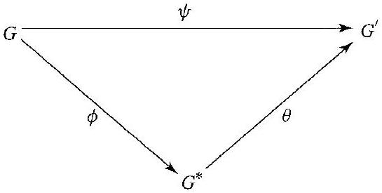
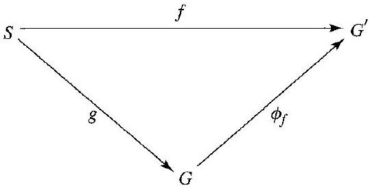

# Editorial records — Section39 Free Groups

Printed341–346/PDF345–350 visually reviewed. Two image assets visually inspected; native review pending.

## Join split equality,p.343.

Before:

```text
$\psi(x y)=$ $\psi(x) \psi(y)$
```

After:

```text
$\psi(xy)=\psi(x)\psi(y)$
```

## Restore italic variable,p.343.

Before:

```text
\mathrm{a}_{i_{j}}
```

After:

```text
a_{i_j}
```

## Restore source punctuation,p.345.

Before:

```text
needed. so
```

After:

```text
needed, so
```

## Restore set delimiters,p.345.

Before:

```text
\{2, 3\}
```

After:

```text
$\{2,3\}$
```

## Restore set delimiters,p.345.

Before:

```text
\{1\}
```

After:

```text
$\{1\}$
```

## Restore mathematical group symbol,p.345.

Before:

```text
of the group G.)
```

After:

```text
of the group $G$.)
```

## Restore inequality math,p.345.

Before:

```text
of rank >1
```

After:

```text
of rank $>1$
```

## Wrap explicit unnumbered source definitions without rewriting.

Before:

```text
Let $A$ be any (not necessarily finite) set of elements $a_{i}$ for $i \in I$. We think of $A$ as an alphabet and of the $a_{i}$ as letters in the alphabet. Any symbol of the form $a_{i}{ }^{n}$ with $n \in \mathbb{Z}$ is a syllable and a finite string $w$ of syllables written in juxtaposition is a word. We also introduce the empty word 1, which has no syllables.
```

After:

```text
> [!definition] Alphabet, Syllable, and Word in Group Theory
> Let $A$ be any (not necessarily finite) set of elements $a_{i}$ for $i \in I$. We think of $A$ as an alphabet and of the $a_{i}$ as letters in the alphabet. Any symbol of the form $a_{i}{ }^{n}$ with $n \in \mathbb{Z}$ is a syllable and a finite string $w$ of syllables written in juxtaposition is a word. We also introduce the empty word 1, which has no syllables.
```

## Wrap explicit unnumbered source definitions with the alphabet premise restored.

Before:

```text
There are two natural types of modifications of certain words, the elementary contractions. The first type consists of replacing an occurrence of $a_{i}{ }^{m} a_{i}{ }^{n}$ in a word by $a_{i}{ }^{m+n}$. The second type consists of replacing an occurrence of $a_{i}{ }^{0}$ in a word by 1 , that is, dropping it out of the word. By means of a finite number of elementary contractions, every word can be changed to a reduced word, one for which no more elementary contractions are possible. Note that these elementary contractions formally amount to the usual manipulations of integer exponents.
```

After:

```text
> [!definition] Elementary Contractions and Reduced Words
> Let $A=\{a_i\mid i\in I\}$ be an alphabet. There are two natural types of modifications of certain words, the elementary contractions. The first type consists of replacing an occurrence of $a_{i}{ }^{m} a_{i}{ }^{n}$ in a word by $a_{i}{ }^{m+n}$. The second type consists of replacing an occurrence of $a_{i}{ }^{0}$ in a word by 1 , that is, dropping it out of the word. By means of a finite number of elementary contractions, every word can be changed to a reduced word, one for which no more elementary contractions are possible. Note that these elementary contractions formally amount to the usual manipulations of integer exponents.
```

## Replace “just described” with the source reduced-word construction/operation, removing only its chapter-dependent phrasing.

Before:

```text
39.4 Definition The group $F[A]$ just described is the free group generated by $A$. $\square$
```

After:

```text
Definition 39.4

> [!definition] Free Group Generated by an Alphabet
> Let the set of all reduced words formed from an alphabet $A$ be $F[A]$. For $w_1$ and $w_2$ in $F[A]$, define $w_1\cdot w_2$ to be the reduced form of the word obtained by the juxtaposition $w_1w_2$ of the two words.
>
> The group $F[A]$ is the free group generated by $A$.
```

## Wrap complete statement,number outside; supply missing title and required F[A] meaning for39.5.

Before:

```text
39.5 Definition If $G$ is a group with a set $A=\left\{a_{i}\right\}$ of generators, and if $G$ is isomorphic to $F[A]$ under a map $\phi: G \rightarrow F[A]$ such that $\phi\left(a_{i}\right)=a_{i}$, then $G$ is free on $A$, and the $a_{i}$ are free generators of $G$. A group is free if it is free on some nonempty set $A$. $\square$
```

After:

```text
Definition 39.5

> [!definition] Free Generators and Free Groups
> If $G$ is a group with a set $A=\left\{a_{i}\right\}$ of generators, and if $G$ is isomorphic to $F[A]$ under a map $\phi: G \rightarrow F[A]$ such that $\phi\left(a_{i}\right)=a_{i}$, then $G$ is free on $A$, and the $a_{i}$ are free generators of $G$. A group is free if it is free on some nonempty set $A$. $\square$
>
> Here $F[A]$ is the free group generated by $A$.
```

## Wrap complete statement,number outside; supply missing title and required F[A] meaning for39.5.

Before:

```text
39.8 Definition If $G$ is free on $A$, the number of elements in $A$ is the rank of the free group $G$. $\square$
```

After:

```text
Definition 39.8

> [!definition] Rank of a Free Group
> If $G$ is free on $A$, the number of elements in $A$ is the rank of the free group $G$. $\square$
```

## Wrap complete statement,number outside; supply missing title and required F[A] meaning for39.5.

Before:

```text
39.7 Theorem If a group $G$ is free on $A$ and also on $B$, then the sets $A$ and $B$ have the same number of elements; that is, any two sets of free generators of a free group have the same cardinality.
```

After:

```text
Theorem 39.7

> [!theorem] Invariance of the Number of Free Generators
> If a group $G$ is free on $A$ and also on $B$, then the sets $A$ and $B$ have the same number of elements; that is, any two sets of free generators of a free group have the same cardinality.
```

## Wrap complete statement,number outside; supply missing title and required F[A] meaning for39.5.

Before:

```text
39.9 Theorem Two free groups are isomorphic if and only if they have the same rank.
```

After:

```text
Theorem 39.9

> [!theorem] Classification of Free Groups by Rank
> Two free groups are isomorphic if and only if they have the same rank.
```

## Wrap complete statement,number outside; supply missing title and required F[A] meaning for39.5.

Before:

```text
39.10 Theorem A nontrivial proper subgroup of a free group is free.
```

After:

```text
Theorem 39.10

> [!theorem] Nontrivial Subgroups of Free Groups Are Free
> A nontrivial proper subgroup of a free group is free.
```

## Wrap complete statement,number outside; supply missing title and required F[A] meaning for39.5.

Before:

```text
39.12 Theorem Let $G$ be generated by $A=\left\{a_{i} \mid i \in I\right\}$ and let $G^{\prime}$ be any group. If $a_{i}{ }^{\prime}$ for $i \in I$ are any elements in $G^{\prime}$, not necessarily distinct, then there is at most one homomorphism $\phi: G \rightarrow G^{\prime}$ such that $\phi\left(a_{i}\right)=a_{i}{ }^{\prime}$. If $G$ is free on $A$, then there is exactly one such homomorphism.
```

After:

```text
Theorem 39.12

> [!theorem] Homomorphisms Determined by Generators
> Let $G$ be generated by $A=\left\{a_{i} \mid i \in I\right\}$ and let $G^{\prime}$ be any group. If $a_{i}{ }^{\prime}$ for $i \in I$ are any elements in $G^{\prime}$, not necessarily distinct, then there is at most one homomorphism $\phi: G \rightarrow G^{\prime}$ such that $\phi\left(a_{i}\right)=a_{i}{ }^{\prime}$. If $G$ is free on $A$, then there is exactly one such homomorphism.
```

## Wrap complete statement,number outside; supply missing title and required F[A] meaning for39.5.

Before:

```text
39.13 Theorem Every group $G^{\prime}$ is a homomorphic image of a free group $G$.
```

After:

```text
Theorem 39.13

> [!theorem] Every Group Is a Homomorphic Image of a Free Group
> Every group $G^{\prime}$ is a homomorphic image of a free group $G$.
```

## Supply task-only prompt; preserve author’s full example outside as solution.

Before:

```text
39.1 Example 
```

After:

```text
> [!example] Example 39.1
> Give examples of words over $A=\{a_1,a_2,a_3\}$.

##### solution


```

## Supply task-only prompt; preserve author’s full example outside as solution.

Before:

```text
39.2 Example 
```

After:

```text
> [!example] Example 39.2
> Find the reduced form of $a_2^3a_2^{-1}a_3a_1^2a_1^{-7}$.

##### solution


```

## Supply task-only prompt; preserve author’s full example outside as solution.

Before:

```text
39.3 Example 
```

After:

```text
> [!example] Example 39.3
> Compute $w_1\cdot w_2$ for $w_1=a_2^3a_1^{-5}a_3^2$ and $w_2=a_3^{-2}a_1^2a_3a_2^{-2}$.

##### solution


```

## Supply task-only prompt; preserve author’s full example outside as solution.

Before:

```text
39.6 Example 
```

After:

```text
> [!example] Example 39.6
> Give an example of a free group on one generator.

##### solution


```

## Supply task-only prompt; preserve author’s full example outside as solution.

Before:

```text
39.11 Example 
```

After:

```text
> [!example] Example 39.11
> In $F[\{x,y\}]$, consider $y_k=x^kyx^{-k}$ for $k\geq0$. Compare the rank of the subgroup generated by the $y_k$ with the rank of the whole group.

##### solution


```

## Formatting only

5 definitions,5 theorems,5 examples,14 exercises,2 figures. Author’s “It would seem obvious” discussion retained. Source convention excludes the trivial free group; do not broaden39.10 or alter intentionally false true/false items. Pedagogical interlude outside exercise11; diagrams39.14/39.15 paired with exercises12/13. No admissions.

## Earlier staging record

# Editorial records — Section 39 - Free Groups

Status: staged original OCR; content/callout/source review pending.

## Heading formatting

Before: `## section 39 Free Groups`

After: `# 39 Free Groups`

Section heading separated and normalized to level one; body wording unchanged. Original chapter OCR archive retained in conversion records.


## Figure 39.14

Formatting only: preserved image and printed caption in scientific figure component.

Before:

```text

39.14 Figure
```

After:

```text
```scientific-figure
id: 84de714f-d373-4a57-8fd7-da970277ec21
numbered: false
title: ""
caption: Figure 39.14
captionVisible: true
captionPosition: below
columns: 1
panels:
  - path: images/183553e9-238e-41a5-9e0e-74c559bd35b3-40_275_545_622_475.jpg
    caption: ""
```
```

## Figure 39.15

Formatting only: preserved image and printed caption in scientific figure component.

Before:

```text

39.15 Figure
```

After:

```text
```scientific-figure
id: bed9eac6-b092-4da0-9bb9-24f84bd6a621
numbered: false
title: ""
caption: Figure 39.15
captionVisible: true
captionPosition: below
columns: 1
panels:
  - path: images/183553e9-238e-41a5-9e0e-74c559bd35b3-40_275_539_621_1050.jpg
    caption: ""
```
```

## Native rendering verification

Native Obsidian: free-group diagrams and exercise math render; figure captions visible.
