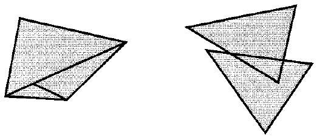
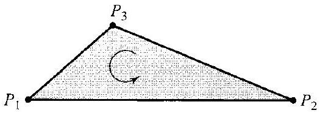
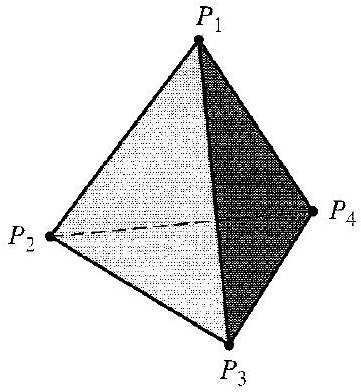

# Editorial records — Section41 Simplicial Complexes and Homology Groups

Printed355–363/PDF359–367 visually reviewed. Three image assets visually inspected. Native review pending.

## Restore punctuation,p.355.

Before:

```text
conditions. other
```

After:

```text
conditions, other
```

## Join interrupted prose and remove misplaced part-footnote marker,p.355–356; restore footnote separately.

Before:

```text
groups

[^0]of
```

After:

```text
groups of
```

## Restore math delimiters,p.356.

Before:

```text
$n=$ 0, 1, 2, and 3
```

After:

```text
$n=0,1,2,$ and $3$
```

## Remove line-break hyphen,p.356.

Before:

```text
pre-scribed
```

After:

```text
prescribed
```

## Restore integers,p.358.

Before:

```text
$m_{i} \in Z$
```

After:

```text
$m_i\in\mathbb Z$
```

## Restore blackboard integer symbol,p.358.

Before:

```text
\boldsymbol{Z}
```

After:

```text
\mathbb Z
```

## Restore italic chain-group symbol,p.358.

Before:

```text
\mathrm{C}_{n}
```

After:

```text
C_n
```

## Join split equality,p.358.

Before:

```text
$C_{-1}(X)=$ $\{0\}$
```

After:

```text
$C_{-1}(X)=\{0\}$
```

## Separate display close and end marker.

Before:

```text
$$ $\square$
```

After:

```text
$$

$\square$
```

## Remove stray source speck,p.359.

Before:

```text

"
Note that
```

After:

```text


Note that
```

## Restore paired delimiters,p.360.

Before:

```text
\left(P_{3}-\right.$ $\left.P_{1}\right)
```

After:

```text
\left(P_3-P_1\right)
```

## Restore dropped numeral and comma,p.361.

Before:

```text
dimension greater than $B_{3}(X)=0$
```

After:

```text
dimension greater than 3, $B_3(X)=0$
```

## Repair left/right delimiters split across alignment cells; preserve all source terms,p.358.

Before:

```text
\begin{aligned}
\left(3 P_{2} P_{3} P_{4}-5 P_{1} P_{2} P_{3}\right)+\left(6 P_{2} P_{3} P_{4}\right. & \left.-4 P_{1} P_{3} P_{4}\right) \\
& =9 P_{2} P_{3} P_{4}-4 P_{1} P_{3} P_{4}-5 P_{1} P_{2} P_{3} .
\end{aligned}
```

After:

```text
\begin{aligned}
&\left(3P_2P_3P_4-5P_1P_2P_3\right)+\left(6P_2P_3P_4-4P_1P_3P_4\right)\\
&\qquad=9P_2P_3P_4-4P_1P_3P_4-5P_1P_2P_3.
\end{aligned}
```

## Wrap original introductory definition verbatim; following teaching comment stays outside.

Before:

```text
Topology concerns sets for which we have enough of an idea of when two points are close together to be able to define a continuous function. Two such sets, or topological spaces, are structurally the same if there is a one-to-one function mapping one onto the other such that both this function and its inverse are continuous. Naively, this means that one space can be stretched, twisted, and otherwise deformed, without being torn or cut, to look just like the other. Thus a big sphere is topologically the same structure as a small sphere, the boundary of a circle the same structure as the boundary of a square, and so on. Two spaces that are structurally the same in this sense are homeomorphic.
```

After:

```text
> [!definition] Homeomorphic Topological Spaces
> Topology concerns sets for which we have enough of an idea of when two points are close together to be able to define a continuous function. Two such sets, or topological spaces, are structurally the same if there is a one-to-one function mapping one onto the other such that both this function and its inverse are continuous. Naively, this means that one space can be stretched, twisted, and otherwise deformed, without being torn or cut, to look just like the other. Thus a big sphere is topologically the same structure as a small sphere, the boundary of a circle the same structure as the boundary of a square, and so on. Two spaces that are structurally the same in this sense are homeomorphic.


```

## Wrap original dimensional simplex definition unchanged,p.356.

Before:

```text
An oriented 0-simplex is just a point $P$.
```

After:

```text


> [!definition] Oriented 0-Simplex
> An oriented 0-simplex is just a point $P$.


```

## Wrap original dimensional simplex definition unchanged,p.356.

Before:

```text
An oriented 1-simplex is a directed line segment $P_{1} P_{2}$ joining the points $P_{1}$ and $P_{2}$ and viewed as traveled in the direction from $P_{1}$ to $P_{2}$.
```

After:

```text


> [!definition] Oriented 1-Simplex
> An oriented 1-simplex is a directed line segment $P_{1} P_{2}$ joining the points $P_{1}$ and $P_{2}$ and viewed as traveled in the direction from $P_{1}$ to $P_{2}$.


```

## Wrap original definition; move diagram-specific reference outside,p.356.

Before:

```text
An oriented 2-simplex is a triangular region $P_{1} P_{2} P_{3}$, as in Fig. 41.1, together with a prescribed order of movement around the triangle, e.g., indicated by the arrow in Fig. 41.1 as the order $P_{1} P_{2} P_{3}$.
```

After:

```text


> [!definition] Oriented 2-Simplex
> An oriented 2-simplex is a triangular region $P_{1} P_{2} P_{3}$, together with a prescribed order of movement around the triangle.

Figure 41.1 indicates the order $P_1P_2P_3$.


```

## Wrap source definition; diagram number remains on the adjacent figure,p.356.

Before:

```text
An oriented 3-simplex is given by an ordered sequence $P_{1} P_{2} P_{3} P_{4}$ of four vertices of a solid tetrahedron, as in Fig. 41.2.
```

After:

```text


> [!definition] Oriented 3-Simplex
> An oriented 3-simplex is given by an ordered sequence $P_{1} P_{2} P_{3} P_{4}$ of four vertices of a solid tetrahedron.


```

## Wrap source boundary definition with its complete formula; remove connective lead-in only,p.357.

Before:

```text
We define the boundary of a $\mathbf{0}$-simplex $P$ to be the empty simplex, which we denote this time by "0." The notation is

$$
" \partial_{0}(P)=0 . "
$$
```

After:

```text


> [!definition] Boundary of a 0-Simplex
> We define the boundary of a $\mathbf{0}$-simplex $P$ to be the empty simplex, which we denote this time by "0." The notation is
>
> $$
> " \partial_{0}(P)=0 . "
> $$


```

## Wrap source boundary definition with its complete formula; remove connective lead-in only,p.357.

Before:

```text
The boundary of a 1 -simplex $P_{1} P_{2}$ is defined by

$$
\partial_{1}\left(P_{1} P_{2}\right)=P_{2}-P_{1},
$$

that is, the formal difference of the end point and the beginning point.
```

After:

```text


> [!definition] Boundary of a 1-Simplex
> The boundary of a 1 -simplex $P_{1} P_{2}$ is defined by
>
> $$
> \partial_{1}\left(P_{1} P_{2}\right)=P_{2}-P_{1},
> $$
>
> that is, the formal difference of the end point and the beginning point.


```

## Wrap source boundary definition with its complete formula; remove connective lead-in only,p.357.

Before:

```text
Likewise, the boundary of a $\mathbf{2}$-simplex is defined by

$$
\partial_{2}\left(P_{1} P_{2} P_{3}\right)=P_{2} P_{3}-P_{1} P_{3}+P_{1} P_{2},
$$
```

After:

```text


> [!definition] Boundary of a 2-Simplex
> The boundary of a $\mathbf{2}$-simplex is defined by
>
> $$
> \partial_{2}\left(P_{1} P_{2} P_{3}\right)=P_{2} P_{3}-P_{1} P_{3}+P_{1} P_{2},
> $$


```

## Wrap source boundary definition with its complete formula; remove connective lead-in only,p.357.

Before:

```text
Thus we are led to the following definition of the boundary of a 3-simplex:

$$
\partial_{3}\left(P_{1} P_{2} P_{3} P_{4}\right)=P_{2} P_{3} P_{4}-P_{1} P_{3} P_{4}+P_{1} P_{2} P_{4}-P_{1} P_{2} P_{3} .
$$
```

After:

```text


> [!definition] Boundary of a 3-Simplex
> The boundary of a 3-simplex is defined by:
>
> $$
> \partial_{3}\left(P_{1} P_{2} P_{3} P_{4}\right)=P_{2} P_{3} P_{4}-P_{1} P_{3} P_{4}+P_{1} P_{2} P_{4}-P_{1} P_{2} P_{3} .
> $$


```

## Wrap explicit source definition; retain author’s oriented-face convention,p.357.

Before:

```text
Each individual summand of the boundary of a simplex is a face of the simplex.
```

After:

```text


> [!definition] Face of an Oriented Simplex
> Each individual summand of the boundary of a simplex is a face of the simplex.


```

## Keep all3 source conditions together; move intervening figure outside,p.357–358.

Before:

```text
In general, for a space to be divided up "nicely" into simplexes, we require that the following be true:

1. Each point of the space belongs to at least one simplex.
2. Each point of the space belongs to only a finite number of simplexes.


3. Two different (up to orientation) simplexes either have no points in common or one is (except possibly for orientation) a face of the other or a face of a face of the other, etc., or the set of points in common is (except possibly for orientation) a face, or a face of a face, etc., of each simplex.

Condition (3) excludes configurations like those shown in Fig. 41.3. A space divided up into simplexes according to these requirements is a simplicial complex.
```

After:

```text
> [!definition] Simplicial Complex
> In general, for a space to be divided up "nicely" into simplexes, we require that the following be true:
>
> 1. Each point of the space belongs to at least one simplex.
> 2. Each point of the space belongs to only a finite number of simplexes.
>
>
>
> 3. Two different (up to orientation) simplexes either have no points in common or one is (except possibly for orientation) a face of the other or a face of a face of the other, etc., or the set of points in common is (except possibly for orientation) a face, or a face of a face, etc., of each simplex.
>
> A space divided up into simplexes according to these requirements is a simplicial complex.

Condition (3) excludes configurations like those shown in Fig. 41.3.


41.3 Figure
```

## Wrap original chain-group definition; restore X premise,p.358.

Before:

```text
The group $C_{n}(X)$ of (oriented) $\boldsymbol{n}$-chains of $\boldsymbol{X}$ is the free abelian group generated by the (oriented) $n$-simplexes of $X$. Thus every element of $C_{n}(X)$ is a finite sum of the form $\sum_{i} m_{i} \sigma_{i}$, where the $\sigma_{i}$ are $n$-simplexes of $X$ and $m_i\in\mathbb Z$. We accomplish addition of chains by taking the algebraic sum of the coefficients of each occurrence in the chains of a fixed simplex.
```

After:

```text


> [!definition] Group of Oriented n-Chains
> Let $X$ be a simplicial complex. The group $C_{n}(X)$ of (oriented) $\boldsymbol{n}$-chains of $\boldsymbol{X}$ is the free abelian group generated by the (oriented) $n$-simplexes of $X$. Thus every element of $C_{n}(X)$ is a finite sum of the form $\sum_{i} m_{i} \sigma_{i}$, where the $\sigma_{i}$ are $n$-simplexes of $X$ and $m_i\in\mathbb Z$. We accomplish addition of chains by taking the algebraic sum of the coefficients of each occurrence in the chains of a fixed simplex.


```

## Wrap source boundary-homomorphism construction,including C_-1,with X premise,p.358.

Before:

```text
Now if $\sigma$ is an $n$-simplex, $\partial_{n}(\sigma) \in C_{n-1}(X)$ for $n=1,2,3$. Let us define $C_{-1}(X)=\{0\}$, the trivial group of one element, and then we will also have $\partial_{0}(\sigma) \in C_{-1}(X)$. Since $C_n(X)$ is free abelian, and since we can specify a homomorphism of such a group by giving its values on generators, we see that $\partial_{n}$ gives a unique boundary homomorphism, which we denote again by " $\partial_{n}$ " mapping $C_{n}(X)$ into $C_{n-1}(X)$ for $n=0,1,2,3$.
```

After:

```text
> [!definition] Boundary Homomorphism on Simplicial Chains
> Let $X$ be a simplicial complex. If $\sigma$ is an $n$-simplex, $\partial_{n}(\sigma) \in C_{n-1}(X)$ for $n=1,2,3$. Let us define $C_{-1}(X)=\{0\}$, the trivial group of one element, and then we will also have $\partial_{0}(\sigma) \in C_{-1}(X)$. Since $C_n(X)$ is free abelian, and since we can specify a homomorphism of such a group by giving its values on generators, we see that $\partial_{n}$ gives a unique boundary homomorphism, which we denote again by " $\partial_{n}$ " mapping $C_{n}(X)$ into $C_{n-1}(X)$ for $n=0,1,2,3$.
```

## Wrap source cycles definition with required domain/notation,p.359.

Before:

```text
The kernel of $\partial_{n}$ consists of those $n$-chains with boundary 0. The elements of the kernel are $\boldsymbol{n}$-cycles. The usual notation for the kernel of $\partial_{n}$, that is, the group of $\boldsymbol{n}$-cycles, is " $Z_{n}(X)$."
```

After:

```text


> [!definition] Simplicial n-Cycles and Cycle Group
> Let $X$ be a simplicial complex and let $\partial_n:C_n(X)\to C_{n-1}(X)$ be the boundary homomorphism. The kernel of $\partial_{n}$ consists of those $n$-chains with boundary 0. The elements of the kernel are $\boldsymbol{n}$-cycles. The usual notation for the kernel of $\partial_{n}$, that is, the group of $\boldsymbol{n}$-cycles, is " $Z_{n}(X)$."


```

## Wrap source boundaries definition with required domain/notation,p.359.

Before:

```text
The image under $\partial_{n}$, the group of $(\boldsymbol{n}-\mathbf{1})$-boundaries, consists exactly of those $(n-1)$-chains that are boundaries of $n$-chains. This group is denoted by " $B_{n-1}(X)$."
```

After:

```text
> [!definition] Simplicial Boundaries and Boundary Group
> Let $X$ be a simplicial complex and let $\partial_n:C_n(X)\to C_{n-1}(X)$ be the boundary homomorphism. The image under $\partial_{n}$, the group of $(\boldsymbol{n}-\mathbf{1})$-boundaries, consists exactly of those $(n-1)$-chains that are boundaries of $n$-chains. This group is denoted by " $B_{n-1}(X)$."


```

## Wrap full numbered statement; restore required symbols/premises only.

Before:

```text
41.9 Theorem Let $X$ be a simplicial complex, and let $C_{n}(X)$ be the $n$-chains of $X$ for $n=0,1,2,3$. Then the composite homomorphism $\partial_{n-1} \partial_{n}$ mapping $C_{n}(X)$ into $C_{n-2}(X)$ maps everything into 0 for $n=1,2,3$. That is, for each $c \in C_{n}(X)$ we have $\partial_{n-1}\left(\partial_{n}(c)\right)=0$. We use the notation " $\partial_{n-1} \partial_{n}=0$," or, more briefly, " $\partial^{2}=0$."
```

After:

```text
Theorem 41.9

> [!theorem] The Boundary of a Boundary Is Zero
> Let $X$ be a simplicial complex, and let $C_{n}(X)$ be the $n$-chains of $X$ for $n=0,1,2,3$. Then the composite homomorphism $\partial_{n-1} \partial_{n}$ mapping $C_{n}(X)$ into $C_{n-2}(X)$ maps everything into 0 for $n=1,2,3$. That is, for each $c \in C_{n}(X)$ we have $\partial_{n-1}\left(\partial_{n}(c)\right)=0$. We use the notation " $\partial_{n-1} \partial_{n}=0$," or, more briefly, " $\partial^{2}=0$."
>
> Here $\partial_n$ is the boundary homomorphism and $C_{-1}(X)=\{0\}$.

```

## Wrap full numbered statement; restore required symbols/premises only.

Before:

```text
41.10 Corollary For $n=0,1,2$, and 3, $B_{n}(X)$ is a subgroup of $Z_{n}(X)$.
```

After:

```text
Corollary 41.10

> [!corollary] Simplicial Boundaries Are Cycles
> Let $X$ be a simplicial complex, let $Z_n(X)$ be its group of $n$-cycles, and let $B_n(X)$ be its group of $n$-boundaries. For $n=0,1,2$, and 3, $B_{n}(X)$ is a subgroup of $Z_{n}(X)$.

```

## Wrap full numbered statement; restore required symbols/premises only.

Before:

```text
41.11 Definition The factor group $H_{n}(X)=Z_{n}(X) / B_{n}(X)$ is the $\boldsymbol{n}$-dimensional homology group of $\boldsymbol{X}$.
```

After:

```text
Definition 41.11

> [!definition] Simplicial Homology Group
> Let $X$ be a simplicial complex, let $Z_n(X)$ be its group of $n$-cycles, and let $B_n(X)$ be its group of $n$-boundaries. The factor group $H_{n}(X)=Z_{n}(X) / B_{n}(X)$ is the $\boldsymbol{n}$-dimensional homology group of $\boldsymbol{X}$.

```

## Add task-only example prompt; preserve complete author working outside.

Before:

```text
41.4 Example 
```

After:

```text
> [!example] Example 41.4
> Describe $C_2(S)$, $C_1(S)$, and $C_0(S)$ for the surface $S$ of the tetrahedron in Fig. 41.2, and illustrate addition of chains.

##### solution


```

## Add task-only example prompt; preserve complete author working outside.

Before:

```text
41.5 Example 
```

After:

```text
> [!example] Example 41.5
> Compute $\partial_1(3P_1P_2-4P_1P_3+5P_2P_4)$.

##### solution


```

## Add task-only example prompt; preserve complete author working outside.

Before:

```text
41.6 Example 
```

After:

```text
> [!example] Example 41.6
> Determine whether $z=P_1P_2+P_2P_3+P_3P_1$ and $c=P_1P_2+2P_2P_3+P_3P_1$ are 1-cycles.

##### solution


```

## Add task-only example prompt; preserve complete author working outside.

Before:

```text
41.7 Example 
```

After:

```text
> [!example] Example 41.7
> Find a 0-boundary arising from the 1-chain $P_1P_2+2P_2P_3+P_3P_1$.

##### solution


```

## Add task-only example prompt; preserve complete author working outside.

Before:

```text
41.8 Example 
```

After:

```text
> [!example] Example 41.8
> Compute $Z_n(S)$ and $B_n(S)$ for $n=0,1,2$, where $S$ is the surface of the tetrahedron in Fig. 41.2.

##### solution


```

## Add task-only example prompt; preserve complete author working outside.

Before:

```text
41.12 Example 
```

After:

```text
> [!example] Example 41.12
> Calculate $H_n(S)$ for $n=0,1,2,3$, where $S$ is the surface of the tetrahedron in Fig. 41.2.

##### solution


```

## Formatting only

Explicit source definitions wrapped; theorem,corollary,6 examples,13 exercises,3 figures. No notation-only convention callouts. PartVIII footnote restored verbatim from p.355 at opening. Deliberately false exercise statements unchanged. No admissions.

## Earlier staging record

# Editorial records — Section 41 - Simplicial Complexes and Homology Groups

Status: staged original OCR; content/callout/source review pending.

## Heading formatting

Before: `## section 41 Simplicial Complexes and Homology Groups`

After: `# 41 Simplicial Complexes and Homology Groups`

Section heading separated and normalized to level one; body wording unchanged. Original chapter OCR archive retained in conversion records.

## Stray-star source review

Remove scan speck before let, PDF364 / printed360.

Before:

```text
*let us work
```

After:

```text
let us work
```

Convert leaked OCR LaTeX heading to Markdown heading, PDF365 / printed361.

Before:

```text
\section*{$\boldsymbol{\partial}^{\mathbf{2}}=\mathbf{0}$ and Homology Groups}
```

After:

```text
## $\boldsymbol{\partial}^{\mathbf{2}}=\mathbf{0}$ and Homology Groups
```


## Figure 41.1

Formatting only: preserved image and printed caption in scientific figure component.

Before:

```text

41.1 Figure
```

After:

```text
```scientific-figure
id: 3c4bab85-1b1f-45b4-bc61-9384c827ece6
numbered: false
title: ""
caption: Figure 41.1
captionVisible: true
captionPosition: below
columns: 1
panels:
  - path: images/9bc328ef-75ec-4676-b906-0b95a03870f4-02_186_525_1872_901.jpg
    caption: ""
```
```

## Figure 41.2

Formatting only: preserved image and printed caption in scientific figure component.

Before:

```text

41.2 Figure
```

After:

```text
```scientific-figure
id: 55f4f137-27d5-4d93-be4a-1368e527463d
numbered: false
title: ""
caption: Figure 41.2
captionVisible: true
captionPosition: below
columns: 1
panels:
  - path: images/9bc328ef-75ec-4676-b906-0b95a03870f4-03_392_361_231_926.jpg
    caption: ""
```
```

## Figure 41.3

Formatting only: preserved image and printed caption in scientific figure component.

Before:

```text

41.3 Figure
```

After:

```text
```scientific-figure
id: 90b7da9a-50b0-482f-9aa8-630b91939b3f
numbered: false
title: ""
caption: Figure 41.3
captionVisible: true
captionPosition: below
columns: 1
panels:
  - path: images/9bc328ef-75ec-4676-b906-0b95a03870f4-04_228_522_224_904.jpg
    caption: ""
```
```

## Saved-text boundary check

Put the Simplicial Complex callout header on its own line after the preceding paragraph; removed excess blank lines and paragraph-leading spaces introduced during wrapping. Sixteen definition callouts, not fifteen. Author wording unchanged.

## Native rendering verification

Native Obsidian: simplicial-complex definition with all three conditions, Figure 41.3, and restored two-line chain sum render.
