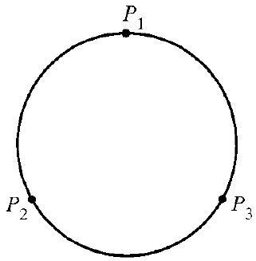
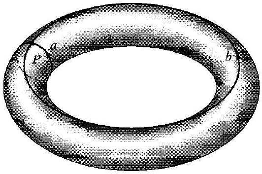
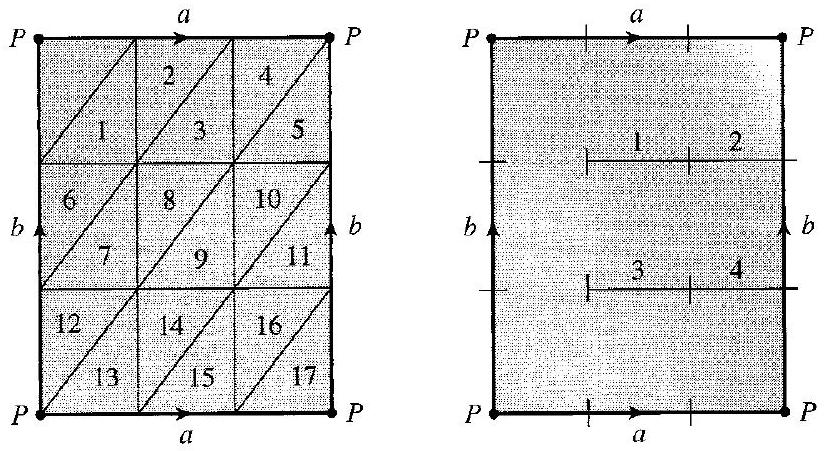
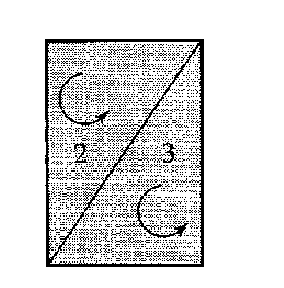
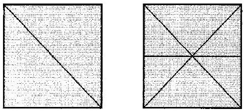
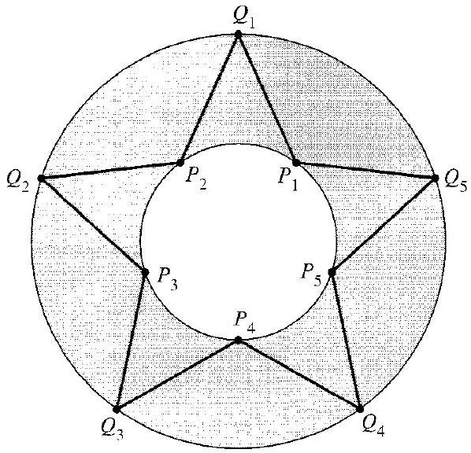
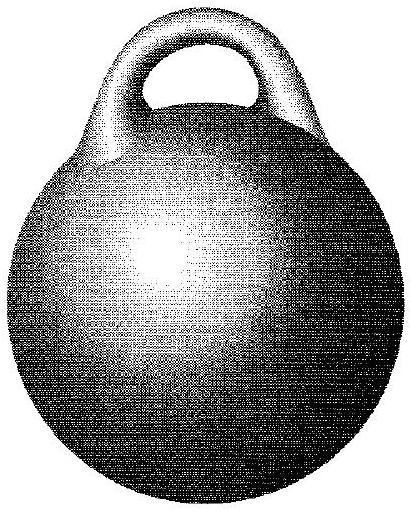
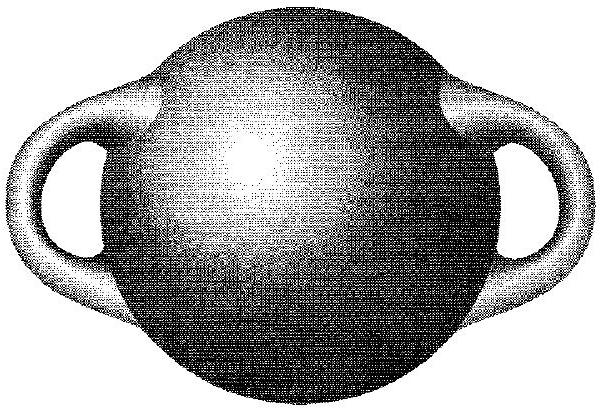

# Editorial records — Section42 Computations of Homology Groups

Printed363–371/PDF367–375 visually reviewed. Native review pending.

## Join page-break paragraph,p.363–364.

Before:

```text
bending,
twisting
```

After:

```text
bending, twisting
```

## Correct printed topological term twice,p.366; spaces are homeomorphic, not homomorphic.

Before:

```text
homomorphic
```

After:

```text
homeomorphic
```

## Remove page-line hyphen,p.369.

Before:

```text
coun-terclockwise
```

After:

```text
counterclockwise
```

## Remove OCR speck,p.366.

Before:

```text

: We have seen
```

After:

```text

We have seen
```

## Restore header spacing,p.367.

Before:

```text
42.10Example
```

After:

```text
42.10 Example
```

## Separate display close and end marker.

Before:

```text
$$ $\square$
```

After:

```text
$$

$\square$
```

## Restore missing closing parenthesis,p.371.

Before:

```text
generalizing Exercises 6 and 11.
```

After:

```text
generalizing Exercises 6 and 11).
```

## Correct printed proof error,p.365: with two components the class of P+Q cannot be represented by a multiple of either selected vertex alone.

Before:

```text
each coset of $H_{0}(X)$ contains exactly one representative that is an integral multiple of one of the selected vertices
```

After:

```text
each coset in $H_{0}(X)$ contains exactly one representative that is an integral linear combination of the selected vertices
```

## Move Figure42.9 immediately after its introducing sentence; join interrupted sentence,p.366–367.

Before:

```text
A triangulation of $S^{1}$ is given in Fig. 42.9.
```

After:

```text
A triangulation of $S^{1}$ is given in Fig. 42.9.


42.9 Figure


```

## Place the torus and combined42.14/42.15 image after construction instructions, not mid-sentence.

Before:

```text
Then bend the cylinder around and join the circles $a$, again keeping the arrows going the same way around the circles.
```

After:

```text
Then bend the cylinder around and join the circles $a$, again keeping the arrows going the same way around the circles.


42.13 Figure


42.14 Figure
```

## Restore omitted Figure42.16 directly from printed369/PDF373; original assets retained.

Before:

```text
These orientations are illustrated in Fig. 42.16.
```

After:

```text
These orientations are illustrated in Fig. 42.16.


42.16 Figure


```

## Wrap explicit source statement; retain wording except required context.

Before:

```text
If a space is divided up into pieces in such a way that near each point the space can be deformed to look like a part of some Euclidean space $\mathbb{R}^{n}$ and the pieces into which the space was divided appear after this deformation as part of a simplicial complex, then the original division of the space is a triangulation of the space.
```

After:

```text


> [!definition] Triangulation of a Space
> If a space is divided up into pieces in such a way that near each point the space can be deformed to look like a part of some Euclidean space $\mathbb{R}^{n}$ and the pieces into which the space was divided appear after this deformation as part of a simplicial complex, then the original division of the space is a triangulation of the space.


```

## Wrap first stated invariance property,p.364.

Before:

```text
First, the homology groups of a space are defined in terms of a triangulation, but actually they are the same (i.e., isomorphic) groups no matter how the space is triangulated.
```

After:

```text


> [!property] Homology Is Independent of Triangulation
> The homology groups of a space are defined in terms of a triangulation, but actually they are the same (i.e., isomorphic) groups no matter how the space is triangulated.


```

## Wrap second source invariance property,p.364.

Before:

```text
For the second invariance property, if one triangulated space is homeomorphic to another (e.g., can be deformed into the other without being torn or cut), the homology groups of the two spaces are the same (i.e., isomorphic) in each dimension $n$.
```

After:

```text
> [!property] Homeomorphism Invariance of Homology Groups
> If one triangulated space is homeomorphic to another (e.g., can be deformed into the other without being torn or cut), the homology groups of the two spaces are the same (i.e., isomorphic) in each dimension $n$.


```

## Wrap explicit source statement; retain wording except required context.

Before:

```text
The $\boldsymbol{n}$-sphere $S^{n}$ is the set of all points a distance of 1 unit from the origin in ( $n+1$ )-dimensional Euclidean space $\mathbb{R}^{n+1}$.
```

After:

```text


> [!definition] n-Sphere
> The $\boldsymbol{n}$-sphere $S^{n}$ is the set of all points a distance of 1 unit from the origin in ( $n+1$ )-dimensional Euclidean space $\mathbb{R}^{n+1}$.


```

## Wrap explicit source statement; retain wording except required context.

Before:

```text
The $\boldsymbol{n}$-cell or $\boldsymbol{n}$-ball $E^{n}$ is the set of all points in $\mathbb{R}^{n}$ a distance $\leq 1$ from the origin.
```

After:

```text


> [!definition] n-Cell or n-Ball
> The $\boldsymbol{n}$-cell or $\boldsymbol{n}$-ball $E^{n}$ is the set of all points in $\mathbb{R}^{n}$ a distance $\leq 1$ from the origin.


```

## Wrap explicit source statement; retain wording except required context.

Before:

```text
A space is connected if any two points in it can be joined by a path (a concept that we will not define) lying totally in the space. If a space is not connected, then it is split up into a number of pieces, each of which is connected but no two of which can be joined by a path in the space. These pieces are the connected components of the space.
```

After:

```text


> [!definition] Connected Space and Connected Components
> For a triangulated space: A space is connected if any two points in it can be joined by a path (a concept that we will not define) lying totally in the space. If a space is not connected, then it is split up into a number of pieces, each of which is connected but no two of which can be joined by a path in the space. These pieces are the connected components of the space.


```

## Wrap explicit source statement; retain wording except required context.

Before:

```text
A space is contractible if it can be compressed to a point without being torn or cut, but always kept within the space it originally occupied.
```

After:

```text


> [!definition] Contractible Space
> A space is contractible if it can be compressed to a point without being torn or cut, but always kept within the space it originally occupied.


```

## Wrap complete source theorem; number outside.

Before:

```text
42.4 Theorem If a space $X$ is triangulated into a finite number of simplexes, then $H_{0}(X)$ is isomorphic to $\mathbb{Z} \times \mathbb{Z} \times \cdots \times \mathbb{Z}$, and the Betti number $m$ of factors $\mathbb{Z}$ is the number of connected components of $X$.
```

After:

```text
Theorem 42.4

> [!theorem] Zeroth Homology and Connected Components
> If a space $X$ is triangulated into a finite number of simplexes, then $H_{0}(X)$ is isomorphic to $\mathbb{Z} \times \mathbb{Z} \times \cdots \times \mathbb{Z}$, and the Betti number $m$ of factors $\mathbb{Z}$ is the number of connected components of $X$.


```

## Wrap complete source theorem; number outside.

Before:

```text
42.6 Theorem If $X$ is a contractible space triangulated into a finite number of simplexes, then $H_{n}(X)=0$ for $n \geq 1$.
```

After:

```text
Theorem 42.6

> [!theorem] Positive-Dimensional Homology of a Contractible Space
> If $X$ is a contractible space triangulated into a finite number of simplexes, then $H_{n}(X)=0$ for $n \geq 1$.


```

## Wrap source general sphere-homology result; restore sphere notation meaning,p.367.

Before:

```text
It can be proved that for $n>0, H_{n}\left(S^{n}\right)$ and $H_{0}\left(S^{n}\right)$ are isomorphic to $\mathbb{Z}$, while $H_{i}\left(S^{n}\right)=0$ for $0<i<n$.
```

After:

```text
> [!property] Homology Groups of n-Spheres
> It can be proved that for $n>0, H_{n}\left(S^{n}\right)$ and $H_{0}\left(S^{n}\right)$ are isomorphic to $\mathbb{Z}$, while $H_{i}\left(S^{n}\right)=0$ for $0<i<n$. Here $S^n$ is the unit $n$-sphere in $\mathbb R^{n+1}$.


```

## Wrap source definition with required symbols only,p.367.

Before:

```text
To conform to topological terminology, we shall call an element of $H_{n}(X)$, that is, a coset of $B_{n}(X)$ in $Z_{n}(X)$, a "homology class." Cycles in the same homology class are homologous.
```

After:

```text
> [!definition] Homology Class and Homologous Cycles
> We shall call an element of $H_{n}(X)$, that is, a coset of $B_{n}(X)$ in $Z_{n}(X)$, a "homology class." Cycles in the same homology class are homologous. Here $Z_n(X)$ is the group of $n$-cycles and $B_n(X)$ the group of $n$-boundaries of a triangulated space $X$.


```

## Add task-only prompt; retain all author explanation and working outside.

Before:

```text
42.2 Example 
```

After:

```text
> [!example] Example 42.2
> Compare the homology groups of the surface of a sphere with those of the surface of a tetrahedron.

##### solution


```

## Add task-only prompt; retain all author explanation and working outside.

Before:

```text
42.3 Example 
```

After:

```text
> [!example] Example 42.3
> Find $H_2(S^2)$, $H_1(S^2)$, and $H_0(S^2)$.

##### solution


```

## Add task-only prompt; retain all author explanation and working outside.

Before:

```text
42.5 Example 
```

After:

```text
> [!example] Example 42.5
> Find $H_0(S^n)$ for $n>0$, $H_0(S^0)$, and $H_0(E^n)$ for $n\geq1$.

##### solution


```

## Add task-only prompt; retain all author explanation and working outside.

Before:

```text
42.7 Example 
```

After:

```text
> [!example] Example 42.7
> Compare $H_2(S^2)$ and $H_2(E^3)$ in relation to contractibility.

##### solution


```

## Add task-only prompt; retain all author explanation and working outside.

Before:

```text
42.8 Example 
```

After:

```text
> [!example] Example 42.8
> Compute $H_1(S^1)$.

##### solution


```

## Add task-only prompt; retain all author explanation and working outside.

Before:

```text
42.10 Example 
```

After:

```text
> [!example] Example 42.10
> Compute the homology groups of a plane annular region $X$ between two concentric circles.

##### solution


```

## Add task-only prompt; retain all author explanation and working outside.

Before:

```text
42.12 Example 
```

After:

```text
> [!example] Example 42.12
> Compute the homology groups of the torus surface $X$.

##### solution


```

## Formatting only

Source definitions/results wrapped; seven example prompts with original working outside; twelve exercises. Original OCR/PDFs unchanged. Deliberately false statements unchanged. Eight figure components include combined42.14/42.15 and restored42.16. No admission.

## Earlier staging record

# Editorial records — Section 42 - Computations of Homology Groups

Status: staged original OCR; content/callout/source review pending.

## Heading formatting

Before: `## section 42 Computations of Homology Groups`

After: `# 42 Computations of Homology Groups`

Section heading separated and normalized to level one; body wording unchanged. Original chapter OCR archive retained in conversion records.

## Stray-star source review

Convert leaked OCR LaTeX heading to Markdown heading, PDF370 / printed366.

Before:

```text
\section*{Further Computations}
```

After:

```text
## Further Computations
```

Remove scan speck between us and compute, PDF371 / printed367.

Before:

```text
Let us*compute
```

After:

```text
Let us compute
```


## Figure 42.1

Formatting only: preserved image and printed caption in scientific figure component.

Before:

```text

42.1 Figure
```

After:

```text
```scientific-figure
id: d54e45bb-a9d5-48db-a454-b65ee78fabf5
numbered: false
title: ""
caption: Figure 42.1
captionVisible: true
captionPosition: below
columns: 1
panels:
  - path: images/9bc328ef-75ec-4676-b906-0b95a03870f4-10_220_484_1119_941.jpg
    caption: ""
```
```

## Figure 42.9

Formatting only: preserved image and printed caption in scientific figure component.

Before:

```text

42.9 Figure
```

After:

```text
```scientific-figure
id: 5fe18390-bdcc-45b8-8fe3-e6b738073211
numbered: false
title: ""
caption: Figure 42.9
captionVisible: true
captionPosition: below
columns: 1
panels:
  - path: images/9bc328ef-75ec-4676-b906-0b95a03870f4-13_327_321_240_920.jpg
    caption: ""
```
```

## Figure 42.11

Formatting only: preserved image and printed caption in scientific figure component.

Before:

```text

42.11 Figure
```

After:

```text
```scientific-figure
id: 3a8808e0-1d3f-4f04-8db6-f792d680c924
numbered: false
title: ""
caption: Figure 42.11
captionVisible: true
captionPosition: below
columns: 1
panels:
  - path: images/9bc328ef-75ec-4676-b906-0b95a03870f4-13_576_598_1497_783.jpg
    caption: ""
```
```

## Figure 42.13

Formatting only: preserved image and printed caption in scientific figure component.

Before:

```text

42.13 Figure
```

After:

```text
```scientific-figure
id: 2dda86e0-efd3-427e-9a35-863d6b7bc7ae
numbered: false
title: ""
caption: Figure 42.13
captionVisible: true
captionPosition: below
columns: 1
panels:
  - path: images/9bc328ef-75ec-4676-b906-0b95a03870f4-14_353_532_1657_900.jpg
    caption: ""
```
```

## Figure 42.14

Formatting only: preserved image and printed caption in scientific figure component.

Before:

```text

42.14 Figure
```

After:

```text
```scientific-figure
id: dbc33fb7-e15d-41b8-8f02-8f296dc20442
numbered: false
title: ""
caption: Figure 42.14
captionVisible: true
captionPosition: below
columns: 1
panels:
  - path: images/9bc328ef-75ec-4676-b906-0b95a03870f4-15_451_824_237_694.jpg
    caption: ""
```
```

## Figure 42.16

Formatting only: preserved image and printed caption in scientific figure component.

Before:

```text

42.16 Figure
```

After:

```text
```scientific-figure
id: 5458a0d5-8c3c-42e8-a51b-65e267f5090f
numbered: false
title: ""
caption: Figure 42.16
captionVisible: true
captionPosition: below
columns: 1
panels:
  - path: images/figure-42-16-source.png
    caption: ""
```
```

## Figure 42.17

Formatting only: preserved image and printed caption in scientific figure component.

Before:

```text

42.17 Figure
```

After:

```text
```scientific-figure
id: b99fd719-9757-4af0-906d-bcaa1625c84e
numbered: false
title: ""
caption: Figure 42.17
captionVisible: true
captionPosition: below
columns: 1
panels:
  - path: images/9bc328ef-75ec-4676-b906-0b95a03870f4-16_511_411_1507_614.jpg
    caption: ""
```
```

## Figure 42.18

Formatting only: preserved image and printed caption in scientific figure component.

Before:

```text

42.18 Figure
```

After:

```text
```scientific-figure
id: 9392864b-2e06-47ce-8081-856d5363cd8b
numbered: false
title: ""
caption: Figure 42.18
captionVisible: true
captionPosition: below
columns: 1
panels:
  - path: images/9bc328ef-75ec-4676-b906-0b95a03870f4-16_410_600_1608_1118.jpg
    caption: ""
```
```

## Native rendering verification

Native Obsidian: torus illustration and combined Figures42.14/42.15 render with readable labels and full caption; adjacent equations render.
