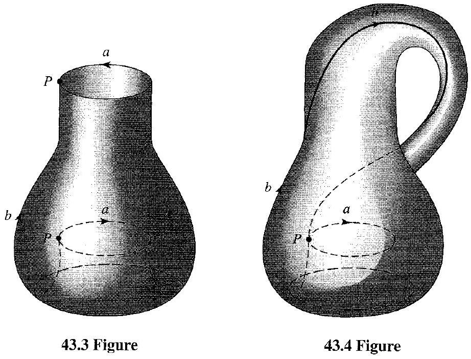
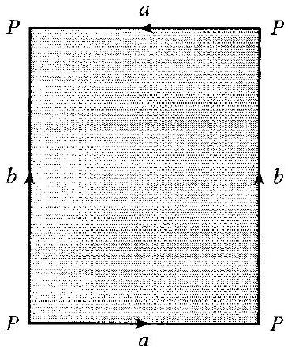
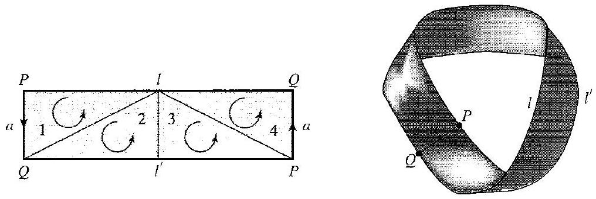
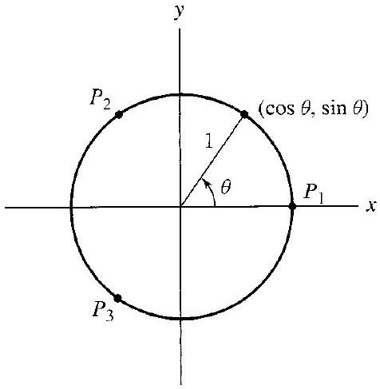
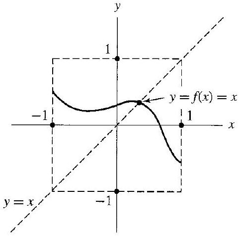
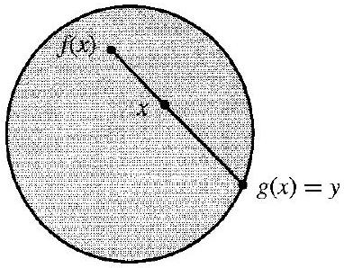
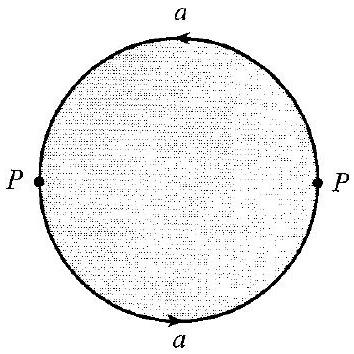
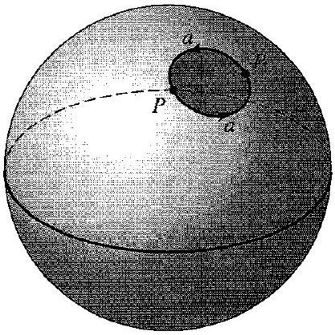
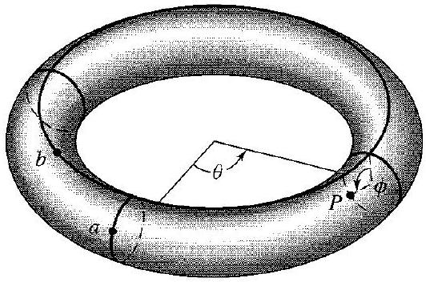

# Editorial records — Section43 More Homology Computations and Applications

Printed371–379/PDF375–383 visually reviewed. Native review pending.

## Restore math symbol,p.371.

Before:

```text
circles a must
```

After:

```text
circles $a$ must
```

## Restore header spacing,p.373.

Before:

```text
43.5Example
```

After:

```text
43.5 Example
```

## Correct printed topological typo,p.373.

Before:

```text
homomorphic to a circle
```

After:

```text
homeomorphic to a circle
```

## Correct OCR,p.375.

Before:

```text
Obvieusly
```

After:

```text
Obviously
```

## Remove OCR speck,p.374.

Before:

```text
Thus - $\beta
```

After:

```text
Thus $\beta
```

## Join page-break paragraph,p.373–374.

Before:

```text
number

of 3-simplexes
```

After:

```text
number of 3-simplexes
```

## Restore cycle-group symbol,p.375.

Before:

```text
\mathbb{Z}_{n}(X)
```

After:

```text
Z_n(X)
```

## Join split cycle formula,p.375.

Before:

```text
$z=P_{1} P_{2}+$ $P_{2} P_{3}+P_{3} P_{1}$
```

After:

```text
$z=P_1P_2+P_2P_3+P_3P_1$
```

## Join split map formula,Exercise11,p.379.

Before:

```text
$f_{* n}: H_{n}(X) \rightarrow$ $H_{n}(b)$
```

After:

```text
$f_{*n}:H_n(X)\rightarrow H_n(b)$
```

## Separate display close and end marker.

Before:

```text
$$ $\square$
```

After:

```text
$$

$\square$
```

## Correct printed dimension mismatch,p.373: subtract boundaries (1-chains) from a1-cycle, not2-chains.

Before:

```text
multiples of the triangles numbered 2, 3, and 4
```

After:

```text
multiples of the boundaries of the triangles numbered 2, 3, and 4
```

## Correct claim excluding zero cycle,p.372.

Before:

```text
there are no 2-cycles this time
```

After:

```text
there are no nonzero 2-cycles this time
```

## Correct omitted nonzero hypothesis in contradiction with r(2a+l+l-prime) nonzero,p.373.

Before:

```text
If $z^{\prime \prime}$ were a 2-cycle
```

After:

```text
If $z^{\prime \prime}$ were a nonzero 2-cycle
```

## Restore geometric edge-direction symbols,p.373.

Before:

```text
edges/of triangle 2, | of triangle 3, and \of triangle 4
```

After:

```text
edges $/$ of triangle 2, $\vert$ of triangle 3, and $\backslash$ of triangle 4
```

## Restore dropped combined-figure caption,p.372.

Before:

```text

```

After:

```text

43.3 Figure
```

## Move page-break figures after their complete introducing paragraph; preserve source order.

Before:

```text
There is no concept of an inside of a Klein bottle.
```

After:

```text
There is no concept of an inside of a Klein bottle.


43.2 Figure


43.3 Figure
```

## Wrap complete source Euler-characteristic definition with simplex counts,p.373–374.

Before:

```text
Let $X$ be a finite simplicial complex (or triangulated space) consisting of simplexes of dimension 3 and less. Let $n_{0}$ be the total number of vertices in the triangulation, $n_{1}$ the number of edges, $n_{2}$ the number of 2-simplexes, and $n_{3}$ the number of 3-simplexes. The number

$$
n_{0}-n_{1}+n_{2}-n_{3}=\sum_{i=0}^{3}(-1)^{i} n_{i}
$$

can be shown to be the same no matter how the space $X$ is triangulated. This number is the Euler characteristic $\chi(X)$ of the space.
```

After:

```text


> [!definition] Euler Characteristic
> Let $X$ be a finite simplicial complex (or triangulated space) consisting of simplexes of dimension 3 and less. Let $n_{0}$ be the total number of vertices in the triangulation, $n_{1}$ the number of edges, $n_{2}$ the number of 2-simplexes, and $n_{3}$ the number of 3-simplexes. The number
>
> $$
> n_{0}-n_{1}+n_{2}-n_{3}=\sum_{i=0}^{3}(-1)^{i} n_{i}
> $$
>
> can be shown to be the same no matter how the space $X$ is triangulated. This number is the Euler characteristic $\chi(X)$ of the space.


```

## Wrap full theorem and formula; preserve dimension restriction,number outside,p.374.

Before:

```text
43.7 Theorem Let $X$ be a finite simplicial complex (or triangulated space) of dimension $\leq 3$. Let $\chi(X)$ be the Euler characteristic of the space $X$, and let $\beta_{j}$ be the Betti number of $H_{j}(X)$. Then

$$
\chi(X)=\sum_{j=0}^{3}(-1)^{j} \beta_{j} .
$$

This theorem holds
```

After:

```text
Theorem 43.7

> [!theorem] Euler Characteristic and Betti Numbers
> Let $X$ be a finite simplicial complex (or triangulated space) of dimension $\leq 3$. Let $\chi(X)$ be the Euler characteristic of the space $X$, and let $\beta_{j}$ be the Betti number of $H_{j}(X)$. Then
>
> $$
> \chi(X)=\sum_{j=0}^{3}(-1)^{j} \beta_{j} .
> $$


```

## Wrap original general induced-homomorphism statement,p.375; subsequent pedagogical computation stays outside.

Before:

```text
A continuous function $f$ mapping a space $X$ into a space $Y$ gives rise to a homomorphism $f_{* n}$ mapping $H_{n}(X)$ into $H_{n}(Y)$ for $n \geq 0$.
```

After:

```text
> [!property] Homology Homomorphisms Induced by Continuous Maps
> A continuous function $f$ mapping a space $X$ into a space $Y$ gives rise to a homomorphism $f_{* n}$ mapping $H_{n}(X)$ into $H_{n}(Y)$ for $n \geq 0$.


```

## Preserve source theorem/title; supply n-cell and fixed-point meanings for standalone use,p.376.

Before:

```text
43.12 Theorem (Brouwer Fixed-Point Theorem). A continuous map $f$ of $E^{n}$ into itself has a fixed point for $n \geq 1$.
```

After:

```text
Theorem 43.12

> [!theorem] Brouwer Fixed-Point Theorem
> A continuous map $f$ of $E^{n}$ into itself has a fixed point for $n \geq 1$. Here $E^n=\{x\in\mathbb R^n:\|x\|\leq1\}$, and a fixed point is an $x$ with $f(x)=x$.


```

## Add task-only prompt; retain complete author working outside.

Before:

```text
43.1 Example 
```

After:

```text
> [!example] Example 43.1
> Calculate the homology groups of the Klein bottle $X$.

##### solution


```

## Add task-only prompt; retain complete author working outside.

Before:

```text
43.5 Example 
```

After:

```text
> [!example] Example 43.5
> Calculate the homology groups of the Möbius strip $X$.

##### solution


```

## Add task-only prompt; retain complete author working outside.

Before:

```text
43.8 Example 
```

After:

```text
> [!example] Example 43.8
> Compute the Euler characteristics of a solid tetrahedron, its surface, and a circle, and compare them with the alternating sums of their Betti numbers.

##### solution


```

## Add task-only prompt; retain complete author working outside.

Before:

```text
43.9 Example 
```

After:

```text
> [!example] Example 43.9
> Find the homomorphism induced on $H_1(S^1)$ by $f((\cos\theta,\sin\theta))=(\cos3\theta,\sin3\theta)$.

##### solution


```

## Wrap original genus definition with its source classification/context; outside Exercise9,p.379.

Before:

```text
Comment: It can be shown that every sufficiently nice closed surface, namely a closed 2-manifold, is homeomorphic to a 2-sphere with some number $h \geq 0$ of handles if the surface is two sided, and is homeomorphic to a 2-sphere with $q>0$ cross caps if it is one sided. The number $h$ or $q$, as the case may be, is the genus of the surface.
```

After:

```text
> [!definition] Genus of a Closed Surface
> It can be shown that every sufficiently nice closed surface, namely a closed 2-manifold, is homeomorphic to a 2-sphere with some number $h \geq 0$ of handles if the surface is two sided, and is homeomorphic to a 2-sphere with $q>0$ cross caps if it is one sided. The number $h$ or $q$, as the case may be, is the genus of the surface.


```

## Formatting only

Two definitions,two theorems,one property,four examples,thirteen exercises. All author explanations/proofs retained outside reusable statements. Combined43.3/43.4 caption restored. Original OCR/PDFs unchanged. No admission.

## Earlier staging record

# Editorial records — Section 43 - More Homology Computations and Applications

Status: staged original OCR; content/callout/source review pending.

## Heading formatting

Before: `## section 43 More Homology Computations and Applications`

After: `# 43 More Homology Computations and Applications`

Section heading separated and normalized to level one; body wording unchanged. Original chapter OCR archive retained in conversion records.


## Figure 43.2

Formatting only: preserved image and printed caption in scientific figure component.

Before:

```text

43.2 Figure
```

After:

```text
```scientific-figure
id: 1bdf871c-b481-4825-a315-371e58520921
numbered: false
title: ""
caption: Figure 43.2
captionVisible: true
captionPosition: below
columns: 1
panels:
  - path: images/9bc328ef-75ec-4676-b906-0b95a03870f4-17_445_365_1569_887.jpg
    caption: ""
```
```

## Figure 43.3

Formatting only: preserved image and printed caption in scientific figure component.

Before:

```text

43.3 Figure
```

After:

```text
```scientific-figure
id: cfdb45b4-0031-4dec-a8f5-16c25713667d
numbered: false
title: ""
caption: Figure 43.3
captionVisible: true
captionPosition: below
columns: 1
panels:
  - path: images/9bc328ef-75ec-4676-b906-0b95a03870f4-18_702_922_224_735.jpg
    caption: ""
```
```

## Figure 43.6

Formatting only: preserved image and printed caption in scientific figure component.

Before:

```text

43.6 Figure
```

After:

```text
```scientific-figure
id: 49d44aa3-d3b0-4adf-a6c6-d9a59b039990
numbered: false
title: ""
caption: Figure 43.6
captionVisible: true
captionPosition: below
columns: 1
panels:
  - path: images/9bc328ef-75ec-4676-b906-0b95a03870f4-19_341_1016_1462_582.jpg
    caption: ""
```
```

## Figure 43.10

Formatting only: preserved image and printed caption in scientific figure component.

Before:

```text

43.10 Figure
```

After:

```text
```scientific-figure
id: e64fda0b-62e2-44d4-b8cf-b93bff9a4817
numbered: false
title: ""
caption: Figure 43.10
captionVisible: true
captionPosition: below
columns: 1
panels:
  - path: images/9bc328ef-75ec-4676-b906-0b95a03870f4-21_487_476_1619_856.jpg
    caption: ""
```
```

## Figure 43.11

Formatting only: preserved image and printed caption in scientific figure component.

Before:

```text

43.11 Figure
```

After:

```text
```scientific-figure
id: 64ab1bda-0671-4331-b880-ac6a30d37770
numbered: false
title: ""
caption: Figure 43.11
captionVisible: true
captionPosition: below
columns: 1
panels:
  - path: images/9bc328ef-75ec-4676-b906-0b95a03870f4-22_476_483_1061_914.jpg
    caption: ""
```
```

## Figure 43.13

Formatting only: preserved image and printed caption in scientific figure component.

Before:

```text

43.13 Figure
```

After:

```text
```scientific-figure
id: 927d6b0f-47e8-47dd-b374-1fac1da9f813
numbered: false
title: ""
caption: Figure 43.13
captionVisible: true
captionPosition: below
columns: 1
panels:
  - path: images/9bc328ef-75ec-4676-b906-0b95a03870f4-23_298_382_237_895.jpg
    caption: ""
```
```

## Figure 43.14

Formatting only: preserved image and printed caption in scientific figure component.

Before:

```text

43.14 Figure
```

After:

```text
```scientific-figure
id: 28c6791b-b7c9-4614-8ac4-360802cbec89
numbered: false
title: ""
caption: Figure 43.14
captionVisible: true
captionPosition: below
columns: 1
panels:
  - path: images/9bc328ef-75ec-4676-b906-0b95a03870f4-24_354_354_1736_627.jpg
    caption: ""
```
```

## Figure 43.15

Formatting only: preserved image and printed caption in scientific figure component.

Before:

```text

43.15 Figure
```

After:

```text
```scientific-figure
id: da40ca24-bb4c-4803-af63-70383a9c3b9c
numbered: false
title: ""
caption: Figure 43.15
captionVisible: true
captionPosition: below
columns: 1
panels:
  - path: images/9bc328ef-75ec-4676-b906-0b95a03870f4-24_418_417_1674_1040.jpg
    caption: ""
```
```

## Figure 43.16

Formatting only: preserved image and printed caption in scientific figure component.

Before:

```text

43.16 Figure
```

After:

```text
```scientific-figure
id: b6b5e514-a447-41d6-bf87-1607df296eb6
numbered: false
title: ""
caption: Figure 43.16
captionVisible: true
captionPosition: below
columns: 1
panels:
  - path: images/9bc328ef-75ec-4676-b906-0b95a03870f4-25_352_532_226_837.jpg
    caption: ""
```
```

## Native rendering verification

Native Obsidian: Brouwer Fixed-Point Theorem renders with unit-ball premise, source label outside, and separate proof; circle-map diagram checked.
