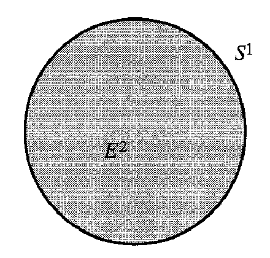
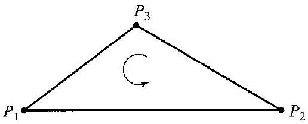
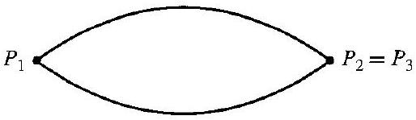

# Editorial records — Section44 Homological Algebra

Printed379–388/PDF383–392 visually reviewed. Native review pending.

## Restore heading,p.379.

Before:

```text

Chain Complexes and Mappings

```

After:

```text

## Chain Complexes and Mappings


```

## Remove OCR speck,p.380.

Before:

```text

" $\square$
```

After:

```text

$\square$
```

## Remove OCR speck,p.384.

Before:

```text

"
we see
```

After:

```text

we see
```

## Separate display close/end marker.

Before:

```text
$$ $\square$
```

After:

```text
$$

$\square$
```

## Join split formula,p.380.

Before:

```text
$H_{k}(A)=$ $Z_{k}(A) / B_{k}(A)$
```

After:

```text
$H_k(A)=Z_k(A)/B_k(A)$
```

## Join split formula,p.385.

Before:

```text
$h=$ $z+B_{k}\left(A / A^{\prime}\right)$
```

After:

```text
$h=z+B_k\left(A/A^{\prime}\right)$
```

## Restore prose outside math,p.384.

Before:

```text
$\operatorname{But}\left
```

After:

```text
But $\left
```

## Restore incoming connecting-map index,p.385.

Before:

```text
\xrightarrow{\partial_{* k-1}} H_{k}\left(A^{\prime}\right)
```

After:

```text
\xrightarrow{\partial_{* k+1}} H_{k}\left(A^{\prime}\right)
```

## Restore connecting-map index,p.386.

Before:

```text
\xrightarrow{\partial_{* k-1}} \underbrace{H_{k}
```

After:

```text
\xrightarrow{\partial_{* k+1}} \underbrace{H_{k}
```

## Restore induced-map asterisk,p.386.

Before:

```text
\xrightarrow{i_{k n+1}}
```

After:

```text
\xrightarrow{i_{* n+1}}
```

## Restore OCR star variants to source induced-map notation.

Before:

```text
\star
```

After:

```text
*
```

## Recover dropped author prose/formula verbatim from printed384/PDF388, plus omittedFigure44.13.

Before:

```text
by putting a drawstring
```

After:

```text
by putting a drawstring around the edge of a circular piece of cloth and then drawing the string so that the rim of the circle comes in to one point. The resulting space is then a closed bag or $S^2$. Thus, while $H_2(E^2)=0$, since $E^2$ is a contractible space, we would expect

$$
H_2(E^2,S^1)\simeq\mathbb Z.
$$


44.13 Figure

For purposes of computation, we can regard $E^2$ topologically as the triangular region of Fig. 44.10 and $S^1$ as the rim of the triangle. Then $C_2(E^2,S^1)$ is generated by $P_1P_2P_3+C_2(S^1)$, and
```

## Restore vertical alignment of the three source homomorphisms,p.380.

Before:

```text
\begin{aligned}
& \cdots \xrightarrow{\partial_{k+2}} A_{k+1} \xrightarrow{\partial_{k+1}} A_{k} \xrightarrow{\partial_{k}} A_{k-1} \xrightarrow{\partial_{k-1}} \cdots \\
& \downarrow f_{k+1} \quad \downarrow f_{k} \quad \downarrow f_{k-1} \\
& \cdots \xrightarrow{\partial_{k+2}^{\prime}} A_{k+1}^{\prime} \xrightarrow{\partial_{k+1}^{\prime}} A_{k}^{\prime} \xrightarrow{\partial_{k}^{\prime}} A_{k-1}^{\prime} \xrightarrow{\partial_{k-1}^{\prime}} \cdots .
\end{aligned}
```

After:

```text
\begin{array}{ccccccccc}
\cdots&\xrightarrow{\partial_{k+2}}&A_{k+1}&\xrightarrow{\partial_{k+1}}&A_k&\xrightarrow{\partial_k}&A_{k-1}&\xrightarrow{\partial_{k-1}}&\cdots\\
&&\downarrow f_{k+1}&&\downarrow f_k&&\downarrow f_{k-1}&&\\
\cdots&\xrightarrow{\partial'_{k+2}}&A'_{k+1}&\xrightarrow{\partial'_{k+1}}&A'_k&\xrightarrow{\partial'_k}&A'_{k-1}&\xrightarrow{\partial'_{k-1}}&\cdots
\end{array}
```

## Repair split math delimiters in source relation,p.386/388; no mathematical change.

Before:

```text
(image $\left.\partial_{* k+1}\right)=0$
```

After:

```text
$\bigl(\operatorname{image}\partial_{*k+1}\bigr)=0$
```

## Repair split math delimiters in source relation,p.386/388; no mathematical change.

Before:

```text
(kernel $\left.i_{* k}\right)=$ (image $\partial_{* k+1}$ )
```

After:

```text
$\bigl(\operatorname{kernel}i_{*k}\bigr)=\bigl(\operatorname{image}\partial_{*k+1}\bigr)$
```

## Repair split math delimiters in source relation,p.386/388; no mathematical change.

Before:

```text
(image $\left.j_{* n+1}\right)=0$
```

After:

```text
$\bigl(\operatorname{image}j_{*n+1}\bigr)=0$
```

## Repair split math delimiters in source relation,p.386/388; no mathematical change.

Before:

```text
(kernel $\left.\partial_{* n+1}\right)=$ (image $j_{* n+1}$ ) $=0$
```

After:

```text
$\bigl(\operatorname{kernel}\partial_{*n+1}\bigr)=\bigl(\operatorname{image}j_{*n+1}\bigr)=0$
```

## Repair split math delimiters in source relation,p.386/388; no mathematical change.

Before:

```text
(image $\left.\partial_{* n+1}\right) \simeq \mathbb{Z}$
```

After:

```text
$\bigl(\operatorname{image}\partial_{*n+1}\bigr)\simeq\mathbb Z$
```

## Repair split math delimiters in source relation,p.386/388; no mathematical change.

Before:

```text
(kernel $\left.i_{* n}\right)=H_{n}\left(S^{n}\right)$
```

After:

```text
$\bigl(\operatorname{kernel}i_{*n}\bigr)=H_n(S^n)$
```

## Repair split math delimiters in source relation,p.386/388; no mathematical change.

Before:

```text
(image $\partial_{* n+1}$ ) =(kernel $i_{* n}$ )
```

After:

```text
$\bigl(\operatorname{image}\partial_{*n+1}\bigr)=\bigl(\operatorname{kernel}i_{*n}\bigr)$
```

## Repair split math delimiters in source relation,p.386/388; no mathematical change.

Before:

```text
(image $i_{* k}$ ) $\subseteq\left(\right.$ kernel $\left.j_{* k}\right)$
```

After:

```text
$\bigl(\operatorname{image}i_{*k}\bigr)\subseteq\bigl(\operatorname{kernel}j_{*k}\bigr)$
```

## Repair split math delimiters in source relation,p.386/388; no mathematical change.

Before:

```text
(kernel $j_{* k}$ ) $\subseteq$ (image $i_{* k}$ )
```

After:

```text
$\bigl(\operatorname{kernel}j_{*k}\bigr)\subseteq\bigl(\operatorname{image}i_{*k}\bigr)$
```

## Repair split math delimiters in source relation,p.386/388; no mathematical change.

Before:

```text
(image $\left.j_{* k}\right) \subseteq\left(\right.$ kernel $\left.\partial_{* k}\right)$
```

After:

```text
$\bigl(\operatorname{image}j_{*k}\bigr)\subseteq\bigl(\operatorname{kernel}\partial_{*k}\bigr)$
```

## Repair split math delimiters in source relation,p.386/388; no mathematical change.

Before:

```text
(kernel $\partial_{* k}$ ) $\subseteq$ (image $j_{* k}$ )
```

After:

```text
$\bigl(\operatorname{kernel}\partial_{*k}\bigr)\subseteq\bigl(\operatorname{image}j_{*k}\bigr)$
```

## Repair split math delimiters in source relation,p.386/388; no mathematical change.

Before:

```text
(image $\partial_{* k}$ ) $\subseteq$ (kernel $i_{* k-1}$ )
```

After:

```text
$\bigl(\operatorname{image}\partial_{*k}\bigr)\subseteq\bigl(\operatorname{kernel}i_{*k-1}\bigr)$
```

## Repair split math delimiters in source relation,p.386/388; no mathematical change.

Before:

```text
(kernel $\left.i_{* k-1}\right) \subseteq\left(\right.$ image $\left.\partial_{* k}\right)$
```

After:

```text
$\bigl(\operatorname{kernel}i_{*k-1}\bigr)\subseteq\bigl(\operatorname{image}\partial_{*k}\bigr)$
```

## Wrap original definition/construction; subsequent author explanation stays outside,p.385.

Before:

```text
Let $A^{\prime}$ be a subcomplex of the chain complex $A$. Let $h \in H_{k}\left(A / A^{\prime}\right)$. Then $h=z+B_k\left(A/A^{\prime}\right)$ for $z \in Z_{k}\left(A / A^{\prime}\right)$, and in turn $z=c+A_{k}^{\prime}$ for some $c \in A_{k}$. (Note that we arrive at $c$ from $h$ by two successive choices of representatives.) Now $\bar{\partial}_{k}(z)=0$, which implies that $\partial_{k}(c) \in A_{k-1}^{\prime}$. This, together with $\partial_{k-1} \partial_{k}=0$, gives us $\partial_{k}(c) \in Z_{k-1}\left(A^{\prime}\right)$. Define

$$
\partial_{* k}: H_{k}\left(A / A^{\prime}\right) \rightarrow H_{k-1}\left(A^{\prime}\right)
$$

by

$$
\partial_{* k}(h)=\partial_{k}(c)+B_{k-1}\left(A^{\prime}\right) .
$$
```

After:

```text
> [!definition] Connecting Homomorphism in Relative Homology
> Let $A^{\prime}$ be a subcomplex of the chain complex $A$. Let $h \in H_{k}\left(A / A^{\prime}\right)$. Then $h=z+B_k\left(A/A^{\prime}\right)$ for $z \in Z_{k}\left(A / A^{\prime}\right)$, and in turn $z=c+A_{k}^{\prime}$ for some $c \in A_{k}$. (Note that we arrive at $c$ from $h$ by two successive choices of representatives.) Now $\bar{\partial}_{k}(z)=0$, which implies that $\partial_{k}(c) \in A_{k-1}^{\prime}$. This, together with $\partial_{k-1} \partial_{k}=0$, gives us $\partial_{k}(c) \in Z_{k-1}\left(A^{\prime}\right)$. Define
>
> $$
> \partial_{* k}: H_{k}\left(A / A^{\prime}\right) \rightarrow H_{k-1}\left(A^{\prime}\right)
> $$
>
> by
>
> $$
> \partial_{* k}(h)=\partial_{k}(c)+B_{k-1}\left(A^{\prime}\right) .
> $$


```

## Wrap complete source statement; replace dependent references with their required premises/formulas only.

Before:

```text
44.1 Definition A chain complex $\langle A, \partial\rangle$ is a doubly infinite sequence

$$
A=\left\{\cdots, A_{2}, A_{1}, A_{0}, A_{-1}, A_{-2}, \cdots\right\}
$$

of abelian groups $A_{k}$, together with a collection $\partial=\left\{\partial_{k} \mid k \in \mathbb{Z}\right\}$ of homomorphisms such that $\partial_{k}: A_{k} \rightarrow A_{k-1}$ and $\partial_{k-1} \partial_{k}=0$. $\square$
```

After:

```text
Definition 44.1

> [!definition] Chain Complex
> A chain complex $\langle A, \partial\rangle$ is a doubly infinite sequence
>
> $$
> A=\left\{\cdots, A_{2}, A_{1}, A_{0}, A_{-1}, A_{-2}, \cdots\right\}
> $$
>
> of abelian groups $A_{k}$, together with a collection $\partial=\left\{\partial_{k} \mid k \in \mathbb{Z}\right\}$ of homomorphisms such that $\partial_{k}: A_{k} \rightarrow A_{k-1}$ and $\partial_{k-1} \partial_{k}=0$. $\square$


```

## Wrap complete source statement; replace dependent references with their required premises/formulas only.

Before:

```text
44.2 Theorem If $A$ is a chain complex, then the image under $\partial_{k}$ is a subgroup of the kernel of $\partial_{k-1}$.
```

After:

```text
Theorem 44.2

> [!theorem] Boundaries Lie in the Kernel of the Next Boundary Map
> If $\langle A,\partial\rangle$ is a chain complex, then the image under $\partial_{k}$ is a subgroup of the kernel of $\partial_{k-1}$.


```

## Wrap complete source statement; replace dependent references with their required premises/formulas only.

Before:

```text
44.3 Definition If $A$ is a chain complex, then the kernel $Z_{k}(A)$ of $\partial_{k}$ is the group of $\boldsymbol{k}$-cycles, and the image $B_{k}(A)=\partial_{k+1}\left[A_{k+1}\right]$ is the group of $\boldsymbol{k}$-boundaries. The factor group $H_k(A)=Z_k(A)/B_k(A)$ is the $\boldsymbol{k}$ th homology group of $A$. $\square$
```

After:

```text
Definition 44.3

> [!definition] Cycles, Boundaries, and Homology of a Chain Complex
> If $\langle A,\partial\rangle$ is a chain complex, then the kernel $Z_{k}(A)$ of $\partial_{k}$ is the group of $\boldsymbol{k}$-cycles, and the image $B_{k}(A)=\partial_{k+1}\left[A_{k+1}\right]$ is the group of $\boldsymbol{k}$-boundaries. The factor group $H_k(A)=Z_k(A)/B_k(A)$ is the $\boldsymbol{k}$ th homology group of $A$. $\square$


```

## Wrap complete source statement; replace dependent references with their required premises/formulas only.

Before:

```text
44.4 Theorem (Fundamental Lemma) Let $A$ and $A^{\prime}$ with collections $\partial$ and $\partial^{\prime}$ of homomorphisms be chain complexes, and suppose that there is a collection $f$ of homomorphisms $f_{k}$ : $A_{k} \rightarrow A_{k}^{\prime}$ as indicated in the diagram

$$
\begin{array}{ccccccccc}
\cdots&\xrightarrow{\partial_{k+2}}&A_{k+1}&\xrightarrow{\partial_{k+1}}&A_k&\xrightarrow{\partial_k}&A_{k-1}&\xrightarrow{\partial_{k-1}}&\cdots\\
&&\downarrow f_{k+1}&&\downarrow f_k&&\downarrow f_{k-1}&&\\
\cdots&\xrightarrow{\partial'_{k+2}}&A'_{k+1}&\xrightarrow{\partial'_{k+1}}&A'_k&\xrightarrow{\partial'_k}&A'_{k-1}&\xrightarrow{\partial'_{k-1}}&\cdots
\end{array}
$$

Suppose, furthermore, that every square is commutative, that is,

$$
f_{k-1} \partial_{k}=\partial_{k}^{\prime} f_{k}
$$

for all $k$. Then $f_{k}$ induces a natural homomorphism $f_{* k}: H_{k}(A) \rightarrow H_{k}\left(A^{\prime}\right)$.
```

After:

```text
Theorem 44.4

> [!theorem] Fundamental Lemma of Homological Algebra
> Let $A$ and $A^{\prime}$ with collections $\partial$ and $\partial^{\prime}$ of homomorphisms be chain complexes, and suppose that there is a collection $f$ of homomorphisms $f_{k}$ : $A_{k} \rightarrow A_{k}^{\prime}$ as indicated in the diagram
>
> $$
> \begin{array}{ccccccccc}
> \cdots&\xrightarrow{\partial_{k+2}}&A_{k+1}&\xrightarrow{\partial_{k+1}}&A_k&\xrightarrow{\partial_k}&A_{k-1}&\xrightarrow{\partial_{k-1}}&\cdots\\
> &&\downarrow f_{k+1}&&\downarrow f_k&&\downarrow f_{k-1}&&\\
> \cdots&\xrightarrow{\partial'_{k+2}}&A'_{k+1}&\xrightarrow{\partial'_{k+1}}&A'_k&\xrightarrow{\partial'_k}&A'_{k-1}&\xrightarrow{\partial'_{k-1}}&\cdots
> \end{array}
> $$
>
> Suppose, furthermore, that every square is commutative, that is,
>
> $$
> f_{k-1} \partial_{k}=\partial_{k}^{\prime} f_{k}
> $$
>
> for all $k$. Then $f_{k}$ induces a natural homomorphism $f_{* k}: H_{k}(A) \rightarrow H_{k}\left(A^{\prime}\right)$.


```

## Wrap complete source statement; replace dependent references with their required premises/formulas only.

Before:

```text
44.5 Definition A chain complex $\left\langle A^{\prime}, \partial^{\prime}\right\rangle$ is a subcomplex of a chain complex $\langle A, \partial\rangle$, if, for all $k, A_{k}^{\prime}$ is a subgroup of $A_{k}$ and $\partial_{k}^{\prime}(c)=\partial_{k}(c)$ for every $c \in A_{k}^{\prime}$, that is, $\partial_{k}^{\prime}$ and $\partial_{k}$ have the same effect on elements of the subgroup $A_{k}^{\prime}$ of $A_{k}$. $\square$
```

After:

```text
Definition 44.5

> [!definition] Subcomplex of a Chain Complex
> A chain complex $\left\langle A^{\prime}, \partial^{\prime}\right\rangle$ is a subcomplex of a chain complex $\langle A, \partial\rangle$, if, for all $k, A_{k}^{\prime}$ is a subgroup of $A_{k}$ and $\partial_{k}^{\prime}(c)=\partial_{k}(c)$ for every $c \in A_{k}^{\prime}$, that is, $\partial_{k}^{\prime}$ and $\partial_{k}$ have the same effect on elements of the subgroup $A_{k}^{\prime}$ of $A_{k}$. $\square$


```

## Wrap complete source statement; replace dependent references with their required premises/formulas only.

Before:

```text
44.7 Theorem If $A^{\prime}$ is a subcomplex of the chain complex $A$, then the collection $A / A^{\prime}$ of factor groups $A_{k} / A_{k}^{\prime}$, together with the collection $\bar{\partial}$ of homomorphisms $\bar{\partial}_{k}$ defined by
$$
\bar{\partial}_{k}\left(c+A_{k}^{\prime}\right)=\partial_{k}(c)+A_{k-1}^{\prime}
$$
for $c \in A_{k}$, is a chain complex.
```

After:

```text
Theorem 44.7

> [!theorem] Quotient Chain Complex
> If $A^{\prime}$ is a subcomplex of the chain complex $A$, then the collection $A / A^{\prime}$ of factor groups $A_{k} / A_{k}^{\prime}$, together with the collection $\bar{\partial}$ of homomorphisms $\bar{\partial}_{k}$ defined by
> $$
> \bar{\partial}_{k}\left(c+A_{k}^{\prime}\right)=\partial_{k}(c)+A_{k-1}^{\prime}
> $$
> for $c \in A_{k}$, is a chain complex.


```

## Wrap complete source statement; replace dependent references with their required premises/formulas only.

Before:

```text
44.8 Definition The homology group $H_{k}\left(A / A^{\prime}\right)$ is the $\boldsymbol{k}$ th relative homology group of $\boldsymbol{A}$ modulo $\boldsymbol{A}^{\prime}$. $\square$
```

After:

```text
Definition 44.8

> [!definition] Relative Homology Group
> Let $A^{\prime}$ be a subcomplex of a chain complex $A$, and let $A/A^{\prime}$ be the quotient chain complex. The homology group $H_{k}\left(A / A^{\prime}\right)$ is the $\boldsymbol{k}$ th relative homology group of $\boldsymbol{A}$ modulo $\boldsymbol{A}^{\prime}$. $\square$


```

## Wrap complete source statement; replace dependent references with their required premises/formulas only.

Before:

```text
44.14 Lemma Let $A^{\prime}$ be a subcomplex of a chain complex $A$. Let $j$ be the collection of natural homomorphisms $j_{k}: A_{k} \rightarrow\left(A_{k} / A_{k}^{\prime}\right)$. Then

$$
j_{k-1} \partial_{k}=\bar{\partial}_{k} j_{k},
$$

that is, $j$ commutes with $\partial$.
```

After:

```text
Lemma 44.14

> [!lemma] Quotient Projection Commutes with Boundary Maps
> Let $A^{\prime}$ be a subcomplex of a chain complex $A$. Let $j$ be the collection of natural homomorphisms $j_{k}: A_{k} \rightarrow\left(A_{k} / A_{k}^{\prime}\right)$. Then
>
> $$
> j_{k-1} \partial_{k}=\bar{\partial}_{k} j_{k},
> $$
>
> that is, $j$ commutes with $\partial$. Here $\bar\partial_k(c+A_k^{\prime})=\partial_k(c)+A_{k-1}^{\prime}$ is the boundary map of the quotient chain complex.


```

## Wrap complete source statement; replace dependent references with their required premises/formulas only.

Before:

```text
44.15 Theorem The map $j_{k}$ of Lemma 44.14 induces a natural homomorphism

$$
j_{* k}: H_{k}(A) \rightarrow H_{k}\left(A / A^{\prime}\right) .
$$
```

After:

```text
Theorem 44.15

> [!theorem] Homology Map Induced by a Quotient Projection
> If $A^{\prime}$ is a subcomplex of a chain complex $A$, the natural quotient map $j_k:A_k\to A_k/A_k^{\prime}$ induces a natural homomorphism
>
> $$
> j_{* k}: H_{k}(A) \rightarrow H_{k}\left(A / A^{\prime}\right) .
> $$


```

## Wrap complete source statement; replace dependent references with their required premises/formulas only.

Before:

```text
44.16 Lemma The map $\partial_{* k}: H_{k}\left(A / A^{\prime}\right) \rightarrow H_{k-1}\left(A^{\prime}\right)$, which we have just defined, is well defined, and is a homomorphism of $H_{k}\left(A / A^{\prime}\right)$ into $H_{k-1}\left(A^{\prime}\right)$.
```

After:

```text
Lemma 44.16

> [!lemma] The Connecting Map Is a Well-Defined Homomorphism
> Let $A^{\prime}$ be a subcomplex of a chain complex $A$, with $c+A_k^{\prime}\in Z_k(A/A^{\prime})$. The map $\partial_{* k}: H_{k}\left(A / A^{\prime}\right) \rightarrow H_{k-1}\left(A^{\prime}\right)$, defined by
>
> $$\partial_{*k}\bigl((c+A_k^{\prime})+B_k(A/A^{\prime})\bigr)=\partial_k(c)+B_{k-1}(A^{\prime}),$$
>
>  is well defined, and is a homomorphism of $H_{k}\left(A / A^{\prime}\right)$ into $H_{k-1}\left(A^{\prime}\right)$.


```

## Wrap complete source statement; replace dependent references with their required premises/formulas only.

Before:

```text
44.18 Definition A sequence of groups $A_{k}$ and homomorphisms $\partial_{k}$ forming a chain complex is an exact sequence if all the homology groups of the chain complex are 0 , that is, if for all $k$ we have that the image under $\partial_{k}$ is equal to the kernel of $\partial_{k-1}$.
```

After:

```text
Definition 44.18

> [!definition] Exact Sequence of Abelian Groups
> A sequence of groups $A_{k}$ and homomorphisms $\partial_{k}$ forming a chain complex is an exact sequence if all the homology groups of the chain complex are 0 , that is, if for all $k$ we have that the image under $\partial_{k}$ is equal to the kernel of $\partial_{k-1}$.


```

## Include actual sequence and map definitions in place of book-specific diagram reference; retain source assertion.

Before:

```text
44.17 Lemma The groups in diagram (1), together with the given maps, form a chain complex.
```

After:

```text
Lemma 44.17

> [!lemma] The Homology Sequence of a Pair Is a Chain Complex
> Let $A^{\prime}$ be a subcomplex of a chain complex $A$. The maps $i_{*k}$ and $j_{*k}$ are induced by the inclusion $A^{\prime}\hookrightarrow A$ and the quotient projection $A\to A/A^{\prime}$, respectively. The connecting map is defined by
>
> $$
> \partial_{*k}\bigl((c+A_k^{\prime})+B_k(A/A^{\prime})\bigr)=\partial_k(c)+B_{k-1}(A^{\prime})
> $$
>
> for $c+A_k^{\prime}\in Z_k(A/A^{\prime})$.
>
> The groups below, together with the given maps, form a chain complex.
>
> $$
> \begin{aligned}
> & \ldots \xrightarrow{\partial_{* k+1}} H_{k}\left(A^{\prime}\right) \quad \xrightarrow{i_{* k}} \quad H_{k}(A) \quad \xrightarrow{j_{* k}} \quad H_{k}\left(A / A^{\prime}\right) \\
> & \xrightarrow{\partial_{* k}} H_{k-1}\left(A^{\prime}\right) \xrightarrow{i_{* k-1}} H_{k-1}(A) \xrightarrow{j_{* k-1}} H_{k-1}\left(A / A^{\prime}\right) \xrightarrow{\partial_{* k-1}} \ldots 
> \end{aligned}
> $$


```

## Include actual sequence and map definitions in place of book-specific diagram reference; retain source assertion.

Before:

```text
44.19 Theorem The groups and maps of the chain complex in diagram (1) form an exact sequence.
```

After:

```text
Theorem 44.19

> [!theorem] Exactness of the Homology Sequence of a Pair
> Let $A^{\prime}$ be a subcomplex of a chain complex $A$. The maps $i_{*k}$ and $j_{*k}$ are induced by the inclusion $A^{\prime}\hookrightarrow A$ and the quotient projection $A\to A/A^{\prime}$, respectively. The connecting map is defined by
>
> $$
> \partial_{*k}\bigl((c+A_k^{\prime})+B_k(A/A^{\prime})\bigr)=\partial_k(c)+B_{k-1}(A^{\prime})
> $$
>
> for $c+A_k^{\prime}\in Z_k(A/A^{\prime})$.
>
> The groups and maps of the chain complex below form an exact sequence.
>
> $$
> \begin{aligned}
> & \ldots \xrightarrow{\partial_{* k+1}} H_{k}\left(A^{\prime}\right) \quad \xrightarrow{i_{* k}} \quad H_{k}(A) \quad \xrightarrow{j_{* k}} \quad H_{k}\left(A / A^{\prime}\right) \\
> & \xrightarrow{\partial_{* k}} H_{k-1}\left(A^{\prime}\right) \xrightarrow{i_{* k-1}} H_{k-1}(A) \xrightarrow{j_{* k-1}} H_{k-1}\left(A / A^{\prime}\right) \xrightarrow{\partial_{* k-1}} \ldots 
> \end{aligned}
> $$


```

## Include actual sequence and map definitions in place of book-specific diagram reference; retain source assertion.

Before:

```text
44.20 Definition The exact sequence in diagram (1) is the exact homology sequence of the pair $\left(A, A^{\prime}\right)$. $\square$
```

After:

```text
Definition 44.20

> [!definition] Exact Homology Sequence of a Pair
> Let $A^{\prime}$ be a subcomplex of a chain complex $A$. The maps $i_{*k}$ and $j_{*k}$ are induced by the inclusion $A^{\prime}\hookrightarrow A$ and the quotient projection $A\to A/A^{\prime}$, respectively. The connecting map is defined by
>
> $$
> \partial_{*k}\bigl((c+A_k^{\prime})+B_k(A/A^{\prime})\bigr)=\partial_k(c)+B_{k-1}(A^{\prime})
> $$
>
> for $c+A_k^{\prime}\in Z_k(A/A^{\prime})$.
>
> The exact sequence below is the exact homology sequence of the pair $\left(A, A^{\prime}\right)$. $\square$
>
> $$
> \begin{aligned}
> & \ldots \xrightarrow{\partial_{* k+1}} H_{k}\left(A^{\prime}\right) \quad \xrightarrow{i_{* k}} \quad H_{k}(A) \quad \xrightarrow{j_{* k}} \quad H_{k}\left(A / A^{\prime}\right) \\
> & \xrightarrow{\partial_{* k}} H_{k-1}\left(A^{\prime}\right) \xrightarrow{i_{* k-1}} H_{k-1}(A) \xrightarrow{j_{* k-1}} H_{k-1}\left(A / A^{\prime}\right) \xrightarrow{\partial_{* k-1}} \ldots 
> \end{aligned}
> $$


```

## Add task-only prompt; preserve all original working outside.

Before:

```text
44.6 Example 
```

After:

```text
> [!example] Example 44.6
> For a subcomplex $A^{\prime}$ of a chain complex $A$, determine whether the homology map induced by inclusion must be injective.

##### solution


```

## Add task-only prompt; preserve all original working outside.

Before:

```text
44.9 Example 
```

After:

```text
> [!example] Example 44.9
> Compute $H_1(X,Y)$ and $H_0(X,Y)$ for the boundary $X$ of the triangle in Fig. 44.10 and its edge subcomplex $Y=P_2P_3$.

##### solution


```

## Add task-only prompt; preserve all original working outside.

Before:

```text
44.12 Example 
```

After:

```text
> [!example] Example 44.12
> Compute $H_2(E^2,S^1)$, where $S^1$ is the boundary of the disk $E^2$.

##### solution


```

## Add task-only prompt; preserve all original working outside.

Before:

```text
44.21 Example 
```

After:

```text
> [!example] Example 44.21
> Use the exact homology sequence of $(E^{n+1},S^n)$ to derive the homology groups of $S^n$ for $n\geq1$, assuming the homology groups of $E^{n+1}$ are known.

##### solution


```

## Restore necessary positive-dimension restriction in Example44.21; n=0 has H0(S0)=Z×Z,notZ.

Before:

```text
We have stated without proof that $H_{n}
```

After:

```text
For $n\geq1$, we have stated without proof that $H_{n}
```

## Remove misplaced repeated conversion footnote; source footnote retained in Section41 opening.

Before:

```text
[^0]:    ${ }^{\dagger}$ Part VIII is not required for the remainder of the text.
```

After:

```text

```

## Formatting only

Numbered statements retained separately with full dependencies; original proofs/derivations outside. Four examples,16exercises. Three figure components; Figure44.13 and missingExample44.12 material restored directly from PDF. No admission.

## Earlier staging record

# Editorial records — Section 44 - Homological Algebra

Status: staged original OCR; content/callout/source review pending.

## Heading formatting

Before: `## section 44 Homological Algebra`

After: `# 44 Homological Algebra`

Section heading separated and normalized to level one; body wording unchanged. Original chapter OCR archive retained in conversion records.


## Figure 44.10

Formatting only: preserved image and printed caption in scientific figure component.

Before:

```text

44.10 Figure
```

After:

```text
```scientific-figure
id: 0dec8692-ccd1-433d-bedf-292e533c12b3
numbered: false
title: ""
caption: Figure 44.10
captionVisible: true
captionPosition: below
columns: 1
panels:
  - path: images/9bc328ef-75ec-4676-b906-0b95a03870f4-29_209_516_1874_545.jpg
    caption: ""
```
```

## Figure 44.11

Formatting only: preserved image and printed caption in scientific figure component.

Before:

```text

44.11 Figure
```

After:

```text
```scientific-figure
id: 1befab51-92de-42cd-a310-0ea1ed0e610d
numbered: false
title: ""
caption: Figure 44.11
captionVisible: true
captionPosition: below
columns: 1
panels:
  - path: images/9bc328ef-75ec-4676-b906-0b95a03870f4-29_149_514_1916_1143.jpg
    caption: ""
```
```

## Figure 44.13

Formatting only: preserved image and printed caption in scientific figure component.

Before:

```text

44.13 Figure
```

After:

```text
```scientific-figure
id: 2164462c-ffab-4cc8-a9cd-7a519619f10d
numbered: false
title: ""
caption: Figure 44.13
captionVisible: true
captionPosition: below
columns: 1
panels:
  - path: images/figure-44-13-source.png
    caption: ""
```
```

## Native rendering verification

Native Obsidian: Fundamental Lemma commutative diagram has correctly aligned vertical arrows; exact-homology theorem, connecting map, and two-row sequence render inside complete callout.
