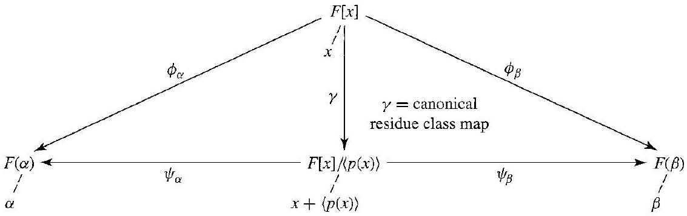

# Editorial records — Section48 Automorphisms of Fields

Printed415–424/PDF418–427 visually reviewed. Native reviewpending.

## Restore orphaned PartXsourcefootnote,p.415.

Before:

```text
[^0]
```

After:

```text
Section 52 is not required for the remainder of the text.
```

## Restore coefficientsubscript,Theorem48.3,p.416.

Before:

```text
c_{0}+c_{i} \alpha
```

After:

```text
c_{0}+c_{1} \alpha
```

## Correct omitted mapping requirement in degree1case,Theorem48.3,p.416: alpha0,beta1giveidentityonFbutarenotconjugate. Requirement isexplicitintheauthorintro.

Before:

```text
is an isomorphism of $F(\alpha)$ onto $F(\beta)$ if and only if
```

After:

```text
is an isomorphism of $F(\alpha)$ onto $F(\beta)$ mapping $\alpha$ onto $\beta$ if and only if
```

## Carry corrected mapping requirement into proof,p.416.

Before:

```text
as defined in the statement of the theorem is an isomorphism.
```

After:

```text
as defined in the statement of the theorem is an isomorphism mapping $\alpha$ onto $\beta$.
```

## Join split minimalpolynomial equality,p.416.

Before:

```text
$\operatorname{irr}(\alpha, F)=$ $\operatorname{irr}(\beta, F)$
```

After:

```text
$\operatorname{irr}(\alpha,F)=\operatorname{irr}(\beta,F)$
```

## Restore complete equation delimiters,p.417.

Before:

```text
$f(a-b i)=$ 0 also
```

After:

```text
$f(a-bi)=0$ also
```

## Join split map,p.418.

Before:

```text
\rightarrow$ $\mathbb{Q}(\sqrt{2})$
```

After:

```text
\rightarrow\mathbb{Q}(\sqrt{2})$
```

## Remove OCRsubscript from fieldE,Theorem48.11,p.419.

Before:

```text
all $a \in E_{i}$ left fixed
```

After:

```text
all $a\in E$ left fixed
```

## Restore sentencepunctuation,p.419.

Before:

```text
$0,1 \in E_{\left\{\sigma_{i}\right\}}$ Thus
```

After:

```text
$0,1\in E_{\{\sigma_i\}}$. Thus
```

## Restore automorphismgroup letter,p.421.

Before:

```text
\mathbb{G}(
```

After:

```text
G(
```

## Join Frobenius formula,p.421.

Before:

```text
$\sigma_{p}(a)=$ $a^{p}$
```

After:

```text
$\sigma_p(a)=a^p$
```

## Restore primefield symbol,p.422.

Before:

```text
\mathrm{Z}_{p}
```

After:

```text
\mathbb Z_p
```

## Separate displayclose/endmarker,p.422.

Before:

```text
$$ $\square$
```

After:

```text
$$

$\square$
```

## Join split formula,p.422; retainsauthorintentionalerroneousclaimdiscussion.

Before:

```text
$(a+b)^{n}=$ $a^{n}+b^{n}$
```

After:

```text
$(a+b)^n=a^n+b^n$
```

## Restore sigma1,Exercise15(a),p.422.

Before:

```text
E_{\left\{\alpha_{1}, \sigma_{3}\right\}}
```

After:

```text
E_{\{\sigma_1,\sigma_3\}}
```

## Restore missing closing hintbracket,Exercise36,p.424.

Before:

```text
elements of $G(\mathbb{Q}(\zeta) / \mathbb{Q})$.
```

After:

```text
elements of $G(\mathbb{Q}(\zeta) / \mathbb{Q})$.]
```

## Move Figure48.4 after complete proof calculation; join interrupted aligned display,p.416–417.

Before:

```text
Thus $\psi_{\alpha, \beta}$ is the map defined in the statement of the theorem. $\square$
```

After:

```text
Thus $\psi_{\alpha, \beta}$ is the map defined in the statement of the theorem. $\square$


48.4 Figure
```

## Restore identityautomorphism iota in every tablecell,p.421.

Before:

```text
48.18 Table

|  | $i$ | $\sigma_{1}$ | $\sigma_{2}$ | $\sigma_{3}$ |
| :--- | :--- | :--- | :--- | :--- |
| $i$ | $l$ | $\sigma_{1}$ | $\sigma_{2}$ | $\sigma_{3}$ |
| $\sigma_{1}$ | $\sigma_{1}$ | $i$ | $\sigma_{3}$ | $\sigma_{2}$ |
| $\sigma_{2}$ | $\sigma_{2}$ | $\sigma_{3}$ | $l$ | $\sigma_{1}$ |
| $\sigma_{3}$ | $\sigma_{3}$ | $\sigma_{2}$ | $\sigma_{1}$ | $\boldsymbol{l}$ |

```

After:

```text
48.18 Table

|  | $\iota$ | $\sigma_{1}$ | $\sigma_{2}$ | $\sigma_{3}$ |
| :--- | :--- | :--- | :--- | :--- |
| $\iota$ | $\iota$ | $\sigma_{1}$ | $\sigma_{2}$ | $\sigma_{3}$ |
| $\sigma_{1}$ | $\sigma_{1}$ | $\iota$ | $\sigma_{3}$ | $\sigma_{2}$ |
| $\sigma_{2}$ | $\sigma_{2}$ | $\sigma_{3}$ | $\iota$ | $\sigma_{1}$ |
| $\sigma_{3}$ | $\sigma_{3}$ | $\sigma_{2}$ | $\sigma_{1}$ | $\iota$ |

```

## Restore fixedfield definition premisesfromTheorem48.11,notbookreference.

Before:

```text
The field $E_{\left\{\sigma_{i}\right\}}$ of Theorem 48.11
```

After:

```text
Let $\{\sigma_i\mid i\in I\}$ be a collection of automorphisms of a field $E$. The field $E_{\{\sigma_i\}}$ of all $a\in E$ left fixed by every $\sigma_i$
```

## Restore precise source automorphismgroup membership,Definition48.16,p.420; remove precedingtheorem dependence.

Before:

```text
The group $G(E / F)$ of the preceding theorem
```

After:

```text
Let $E$ be a field and $F$ a subfield of $E$. The group $G(E/F)=\{\sigma\in\operatorname{Aut}(E)\mid\sigma(a)=a\text{ for every }a\in F\}$, where $\operatorname{Aut}(E)$ is the group of all automorphisms of $E$,
```

## Wrap complete mathematicaldefinition; retain teachingcomments outside; source number outside.

Before:

```text
48.1 Definition Let $E$ be an algebraic extension of a field $F$. Two elements $\alpha, \beta \in E$ are conjugate over $F$ if $\operatorname{irr}(\alpha, F)=\operatorname{irr}(\beta, F)$, that is, if $\alpha$ and $\beta$ are zeros of the same irreducible polynomial over $F$. $\square$
```

After:

```text
Definition 48.1

> [!definition] Conjugate Algebraic Elements
> Let $E$ be an algebraic extension of a field $F$. Two elements $\alpha, \beta \in E$ are conjugate over $F$ if $\operatorname{irr}(\alpha, F)=\operatorname{irr}(\beta, F)$, that is, if $\alpha$ and $\beta$ are zeros of the same irreducible polynomial over $F$. $\square$


```

## Wrap complete mathematicaldefinition; retain teachingcomments outside; source number outside.

Before:

```text
48.8 Definition An isomorphism of a field onto itself is an automorphism of the field. $\square$
```

After:

```text
Definition 48.8

> [!definition] Field Automorphism
> An isomorphism of a field onto itself is an automorphism of the field. $\square$


```

## Wrap complete mathematicaldefinition; retain teachingcomments outside; source number outside.

Before:

```text
48.9 Definition If $\sigma$ is an isomorphism of a field $E$ onto some field, then an element $a$ of $E$ is left fixed by $\sigma$ if $\sigma(a)=a$. A collection $S$ of isomorphisms of $E$ leaves a subfield $F$ of $E$ fixed if each $a \in F$ is left fixed by every $\sigma \in S$. If $\{\sigma\}$ leaves $F$ fixed, then $\sigma$ leaves $F$ fixed. $\square$
```

After:

```text
Definition 48.9

> [!definition] Elements and Subfields Fixed by Field Isomorphisms
> If $\sigma$ is an isomorphism of a field $E$ onto some field, then an element $a$ of $E$ is left fixed by $\sigma$ if $\sigma(a)=a$. A collection $S$ of isomorphisms of $E$ leaves a subfield $F$ of $E$ fixed if each $a \in F$ is left fixed by every $\sigma \in S$. If $\{\sigma\}$ leaves $F$ fixed, then $\sigma$ leaves $F$ fixed. $\square$


```

## Wrap complete mathematicaldefinition; retain teachingcomments outside; source number outside.

Before:

```text
48.12 Definition Let $\{\sigma_i\mid i\in I\}$ be a collection of automorphisms of a field $E$. The field $E_{\{\sigma_i\}}$ of all $a\in E$ left fixed by every $\sigma_i$ is the fixed field of $\left\{\sigma_{i} \mid i \in I\right\}$. For a single automorphism $\sigma$, we shall refer to $E_{\{\sigma\}}$ as the fixed field of $\sigma$. $\square$
```

After:

```text
Definition 48.12

> [!definition] Fixed Field of Field Automorphisms
> Let $\{\sigma_i\mid i\in I\}$ be a collection of automorphisms of a field $E$. The field $E_{\{\sigma_i\}}$ of all $a\in E$ left fixed by every $\sigma_i$ is the fixed field of $\left\{\sigma_{i} \mid i \in I\right\}$. For a single automorphism $\sigma$, we shall refer to $E_{\{\sigma\}}$ as the fixed field of $\sigma$. $\square$


```

## Wrap complete mathematicaldefinition; retain teachingcomments outside; source number outside.

Before:

```text
48.16 Definition Let $E$ be a field and $F$ a subfield of $E$. The group $G(E/F)=\{\sigma\in\operatorname{Aut}(E)\mid\sigma(a)=a\text{ for every }a\in F\}$, where $\operatorname{Aut}(E)$ is the group of all automorphisms of $E$, is the group of automorphisms of $E$ leaving $F$ fixed, or, more briefly, the group of $E$ over $F$.
```

After:

```text
Definition 48.16

> [!definition] Group of Automorphisms of a Field Extension
> Let $E$ be a field and $F$ a subfield of $E$. The group $G(E/F)=\{\sigma\in\operatorname{Aut}(E)\mid\sigma(a)=a\text{ for every }a\in F\}$, where $\operatorname{Aut}(E)$ is the group of all automorphisms of $E$, is the group of automorphisms of $E$ leaving $F$ fixed, or, more briefly, the group of $E$ over $F$.


```

## Wrap full formal result and necessary source notation; proofs outside.

Before:

```text
48.3 Theorem (The Conjugation Isomorphisms) Let $F$ be a field, and let $\alpha$ and $\beta$ be algebraic over $F$ with $\operatorname{deg}(\alpha, F)=n$. The map $\psi_{\alpha, \beta}: F(\alpha) \rightarrow F(\beta)$ defined by
$$
\psi_{\alpha, \beta}\left(c_{0}+c_{1} \alpha+\cdots+c_{n-1} \alpha^{n-1}\right)=c_{0}+c_{1} \beta+\cdots+c_{n-1} \beta^{n-1}
$$
for $c_{i} \in F$ is an isomorphism of $F(\alpha)$ onto $F(\beta)$ mapping $\alpha$ onto $\beta$ if and only if $\alpha$ and $\beta$ are conjugate over $F$.
```

After:

```text
Theorem 48.3

> [!theorem] The Conjugation Isomorphisms
> Let $F$ be a field, and let $\alpha$ and $\beta$ be algebraic over $F$ with $\operatorname{deg}(\alpha, F)=n$. The map $\psi_{\alpha, \beta}: F(\alpha) \rightarrow F(\beta)$ defined by
> $$
> \psi_{\alpha, \beta}\left(c_{0}+c_{1} \alpha+\cdots+c_{n-1} \alpha^{n-1}\right)=c_{0}+c_{1} \beta+\cdots+c_{n-1} \beta^{n-1}
> $$
> for $c_{i} \in F$ is an isomorphism of $F(\alpha)$ onto $F(\beta)$ mapping $\alpha$ onto $\beta$ if and only if $\alpha$ and $\beta$ are conjugate over $F$. Here $\operatorname{deg}(\alpha,F)$ is the degree of the minimal polynomial of $\alpha$ over $F$.


```

## Wrap full formal result and necessary source notation; proofs outside.

Before:

```text
48.5 Corollary Let $\alpha$ be algebraic over a field $F$. Every isomorphism $\psi$ mapping $F(\alpha)$ onto a subfield of $\bar{F}$ such that $\psi(a)=a$ for $a \in F$ maps $\alpha$ onto a conjugate $\beta$ of $\alpha$ over $F$. Conversely, for each conjugate $\beta$ of $\alpha$ over $F$, there exists exactly one isomorphism $\psi_{\alpha, \beta}$ of $F(\alpha)$ onto a subfield of $\bar{F}$ mapping $\alpha$ onto $\beta$ and mapping each $a \in F$ onto itself.
```

After:

```text
Corollary 48.5

> [!corollary] Embeddings of a Simple Algebraic Extension and Conjugate Elements
> Let $\alpha$ be algebraic over a field $F$. Let $\bar F$ be an algebraic closure of $F$ containing $\alpha$. Every isomorphism $\psi$ mapping $F(\alpha)$ onto a subfield of $\bar{F}$ such that $\psi(a)=a$ for $a \in F$ maps $\alpha$ onto a conjugate $\beta$ of $\alpha$ over $F$. Conversely, for each conjugate $\beta$ of $\alpha$ over $F$, there exists exactly one isomorphism $\psi_{\alpha, \beta}$ of $F(\alpha)$ onto a subfield of $\bar{F}$ mapping $\alpha$ onto $\beta$ and mapping each $a \in F$ onto itself.


```

## Wrap full formal result and necessary source notation; proofs outside.

Before:

```text
48.6 Corollary Let $f(x) \in \mathbb{R}[x]$. If $f(a+b i)=0$ for $(a+b i) \in \mathbb{C}$, where $a, b \in \mathbb{R}$, then $f(a-bi)=0$ also. Loosely, complex zeros of polynomials with real coefficients occur in conjugate pairs.
```

After:

```text
Corollary 48.6

> [!corollary] Conjugate Pairs of Complex Zeros of Real Polynomials
> Let $f(x) \in \mathbb{R}[x]$. If $f(a+b i)=0$ for $(a+b i) \in \mathbb{C}$, where $a, b \in \mathbb{R}$, then $f(a-bi)=0$ also. Loosely, complex zeros of polynomials with real coefficients occur in conjugate pairs.


```

## Wrap full formal result and necessary source notation; proofs outside.

Before:

```text
48.11 Theorem Let $\left\{\sigma_{i} \mid i \in I\right\}$ be a collection of automorphisms of a field $E$. Then the set $E_{\left\{\sigma_{i}\right\}}$ of all $a\in E$ left fixed by every $\sigma_{i}$ for $i \in I$ forms a subfield of $E$.
```

After:

```text
Theorem 48.11

> [!theorem] Common Fixed Elements of Field Automorphisms Form a Subfield
> Let $\left\{\sigma_{i} \mid i \in I\right\}$ be a collection of automorphisms of a field $E$. Then the set $E_{\left\{\sigma_{i}\right\}}$ of all $a\in E$ left fixed by every $\sigma_{i}$ for $i \in I$ forms a subfield of $E$.


```

## Wrap full formal result and necessary source notation; proofs outside.

Before:

```text
48.14 Theorem The set of all automorphisms of a field $E$ is a group under function composition.
```

After:

```text
Theorem 48.14

> [!theorem] Automorphisms of a Field Form a Group
> The set of all automorphisms of a field $E$ is a group under function composition.


```

## Wrap full formal result and necessary source notation; proofs outside.

Before:

```text
48.15 Theorem Let $E$ be a field, and let $F$ be a subfield of $E$. Then the set $G(E / F)$ of all automorphisms of $E$ leaving $F$ fixed forms a subgroup of the group of all automorphisms of $E$. Furthermore, $F \leq E_{G(E / F)}$.
```

After:

```text
Theorem 48.15

> [!theorem] Automorphisms Fixing a Subfield Form a Subgroup
> Let $E$ be a field, and let $F$ be a subfield of $E$. Then the set $G(E / F)$ of all automorphisms of $E$ leaving $F$ fixed forms a subgroup of the group of all automorphisms of $E$. Furthermore, $F \leq E_{G(E / F)}$. Here $E_{G(E/F)}=\{a\in E\mid\sigma(a)=a\text{ for every }\sigma\in G(E/F)\}$.


```

## Wrap full formal result and necessary source notation; proofs outside.

Before:

```text
48.19 Theorem Let $F$ be a finite field of characteristic $p$. Then the map $\sigma_{p}: F \rightarrow F$ defined by $\sigma_p(a)=a^p$ for $a \in F$ is an automorphism, the Frobenius automorphism, of $F$. Also, $F_{\left\{\sigma_{p}\right\}} \simeq \mathbb{Z}_{p}$.
```

After:

```text
Theorem 48.19

> [!theorem] Frobenius Automorphism of a Finite Field
> Let $F$ be a finite field of characteristic $p$. Then the map $\sigma_{p}: F \rightarrow F$ defined by $\sigma_p(a)=a^p$ for $a \in F$ is an automorphism, the Frobenius automorphism, of $F$. Also, $F_{\left\{\sigma_{p}\right\}} \simeq \mathbb{Z}_{p}$. Here $F_{\{\sigma_p\}}=\{a\in F\mid\sigma_p(a)=a\}$ is the fixed field.


```

## Add task-only exampleprompt; keepalloriginalworking outside.

Before:

```text
48.2 Example 
```

After:

```text
> [!example] Example 48.2
> Show that for $a,b\in\mathbb R$ with $b\ne0$, the complex numbers $a+bi$ and $a-bi$ are conjugate over $\mathbb R$.

##### solution


```

## Add task-only exampleprompt; keepalloriginalworking outside.

Before:

```text
48.7 Example 
```

After:

```text
> [!example] Example 48.7
> Describe the conjugation isomorphism of $\mathbb Q(\sqrt2)$ that sends $\sqrt2$ to $-\sqrt2$.

##### solution


```

## Add task-only exampleprompt; keepalloriginalworking outside.

Before:

```text
48.10 Example 
```

After:

```text
> [!example] Example 48.10
> Let $E=\mathbb Q(\sqrt2,\sqrt3)$. Show that the map $\sigma(a+b\sqrt2+c\sqrt3+d\sqrt6)=a+b\sqrt2-c\sqrt3-d\sqrt6$, for $a,b,c,d\in\mathbb Q$, is an automorphism of $E$ and determine whether it leaves $\mathbb Q(\sqrt2)$ fixed.

##### solution


```

## Add task-only exampleprompt; keepalloriginalworking outside.

Before:

```text
48.13 Example 
```

After:

```text
> [!example] Example 48.13
> Find the fixed field of $\psi(a+b\sqrt2)=a-b\sqrt2$ on $\mathbb Q(\sqrt2)$, where $a,b\in\mathbb Q$.

##### solution


```

## Add task-only exampleprompt; keepalloriginalworking outside.

Before:

```text
48.17 Example 
```

After:

```text
> [!example] Example 48.17
> Find the automorphism group of $\mathbb Q(\sqrt2,\sqrt3)$ over $\mathbb Q$, give its group table, and find its fixed field.

##### solution


```

## Format sourceboxedpedagogicalgoal as note,not reusable theorem,p.418.

Before:

```text
Final Goal (to be more precisely stated later): To show that not all zeros of every quintic (degree 5) polynomial $f(x)$ can be expressed in terms of radicals starting with elements in the field containing the coefficients of $f(x)$.
```

After:

```text
> [!note] Final Goal
> (to be more precisely stated later): To show that not all zeros of every quintic (degree 5) polynomial $f(x)$ can be expressed in terms of radicals starting with elements in the field containing the coefficients of $f(x)$.


```

## Formatting only

Five definitions,five theorems,two corollaries,fiveexamples,39exercises,one note. Figure48.4andTable48.18customcomponents. Original OCR/PDFs unchanged. No admission.

## Earlier staging record

# Editorial records — Section 48 - Automorphisms of Fields

Status: staged original OCR; content/callout/source review pending.

## Heading formatting

Before: `## section 48 Automorphisms of Fields`

After: `# 48 Automorphisms of Fields`

Section heading separated and normalized to level one; body wording unchanged. Original chapter OCR archive retained in conversion records.


## Figure 48.4

Formatting only: preserved image and printed caption in scientific figure component.

Before:

```text

48.4 Figure
```

After:

```text
```scientific-figure
id: 22ba63f9-ef3b-46a2-9141-d35d638e6e1a
numbered: false
title: ""
caption: Figure 48.4
captionVisible: true
captionPosition: below
columns: 1
panels:
  - path: images/cb284014-e64d-4e41-8e5b-470023b9bbf3-02_357_1133_1747_589.jpg
    caption: ""
```
```

## Table 48.18

Formatting only: editable scientific table, source cells and printed caption preserved; single-letter mathematical entries receive math delimiters.

Before:

```text
48.18 Table

|  | $\iota$ | $\sigma_{1}$ | $\sigma_{2}$ | $\sigma_{3}$ |
| :--- | :--- | :--- | :--- | :--- |
| $\iota$ | $\iota$ | $\sigma_{1}$ | $\sigma_{2}$ | $\sigma_{3}$ |
| $\sigma_{1}$ | $\sigma_{1}$ | $\iota$ | $\sigma_{3}$ | $\sigma_{2}$ |
| $\sigma_{2}$ | $\sigma_{2}$ | $\sigma_{3}$ | $\iota$ | $\sigma_{1}$ |
| $\sigma_{3}$ | $\sigma_{3}$ | $\sigma_{2}$ | $\sigma_{1}$ | $\iota$ |

```

After:

```text
```scientific-table
id: d71adc0a-6865-4e18-ab8c-7e8bd0e1ad3a
numbered: false
title: ""
caption: Table 48.18
captionVisible: true
captionPosition: below
rows:
  - - text: ""
      align: center
    - text: $\iota$
      align: center
    - text: $\sigma_{1}$
      align: center
    - text: $\sigma_{2}$
      align: center
    - text: $\sigma_{3}$
      align: center
  - - text: $\iota$
      align: center
    - text: $\iota$
      align: center
    - text: $\sigma_{1}$
      align: center
    - text: $\sigma_{2}$
      align: center
    - text: $\sigma_{3}$
      align: center
  - - text: $\sigma_{1}$
      align: center
    - text: $\sigma_{1}$
      align: center
    - text: $\iota$
      align: center
    - text: $\sigma_{3}$
      align: center
    - text: $\sigma_{2}$
      align: center
  - - text: $\sigma_{2}$
      align: center
    - text: $\sigma_{2}$
      align: center
    - text: $\sigma_{3}$
      align: center
    - text: $\iota$
      align: center
    - text: $\sigma_{1}$
      align: center
  - - text: $\sigma_{3}$
      align: center
    - text: $\sigma_{3}$
      align: center
    - text: $\sigma_{2}$
      align: center
    - text: $\sigma_{1}$
      align: center
    - text: $\iota$
      align: center
headerRows: 1
rowHeaders: true
style: scientific
```

```
