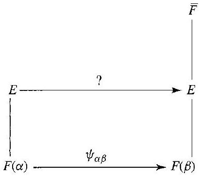
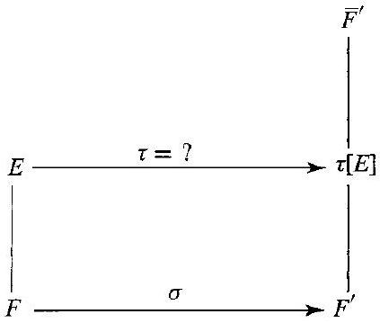
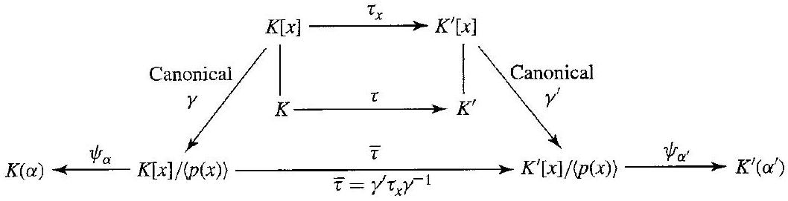
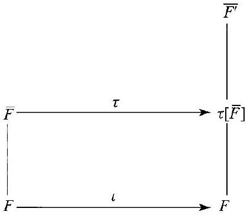
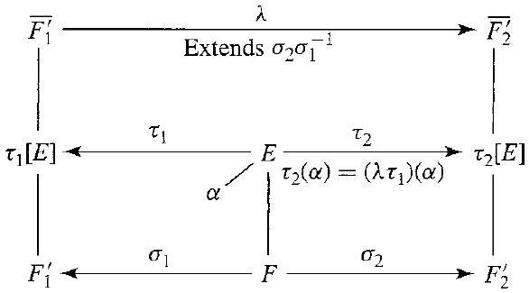

# Editorial records — Section49 The Isomorphism Extension Theorem

Printed424–431/PDF427–434 visually reviewed. Nativepending.

## Fix plural,p.425.

Before:

```text
all algebraic extension of
```

After:

```text
all algebraic extensions of
```

## Join pagebroken theorem,p.425–426.

Before:

```text
Then $\sigma$

can
```

After:

```text
Then $\sigma$ can
```

## Restore inversemap domain,theimageofwholealgebraicclosure,Cor49.5proof,p.426.

Before:

```text
\tau^{-1}: \tau[F] \rightarrow \bar{F}
```

After:

```text
\tau^{-1}:\tau[\bar F]\rightarrow\bar F
```

## Restore sourceheading,p.426.

Before:

```text
The Index of a Field Extension

```

After:

```text
## The Index of a Field Extension

```

## Correct sentencepunctuation,p.426.

Before:

```text
such an isomorphism. a count
```

After:

```text
such an isomorphism, a count
```

## Join pagebroken prose,p.426–427.

Before:

```text
The next theorem

takes
```

After:

```text
The next theorem takes
```

## Correctspellingandmissingclosurebaronimagefield,p.428.

Before:

```text
candiates for the images $\tau\left(\alpha_{i}\right)$ in $F^{\prime}$
```

After:

```text
candidates for the images $\tau(\alpha_i)$ in $\overline{F^{\prime}}$
```

## Separate endmarkerfromdisplayclose,p.428.

Before:

```text
$$ $\square$
```

After:

```text
$$

$\square$
```

## Join split equation,Cor49.10,p.428.

Before:

```text
$\{K: F\}=$ $\{K: E\}\{E: F\}$
```

After:

```text
$\{K:F\}=\{K:E\}\{E:F\}$
```

## Fix singular,p.428.

Before:

```text
of characteristics $p
```

After:

```text
of characteristic $p
```

## Restore sentenceend,p.428.

Before:

```text
This illustrates Corollary 49.10 $
```

After:

```text
This illustrates Corollary 49.10. $
```

## Join pagebreak,p.428–429.

Before:

```text
The set $S$ of such
pairs
```

After:

```text
The set $S$ of such pairs
```

## Remove stray comma,p.429.

Before:

```text
$a, b, \in H_{2}$
```

After:

```text
$a,b\in H_2$
```

## Restore algebraicclosurebar,proof,p.429.

Before:

```text
Since $K^{\prime} \leq F^{\prime}$
```

After:

```text
Since $K^{\prime}\leq\overline{F^{\prime}}$
```

## Restore algebraicclosurebar,cubicrootsnotinQ,p.430.

Before:

```text
zeros of $x^{3}-2$ in $\mathbb{Q}$
```

After:

```text
zeros of $x^3-2$ in $\overline{\mathbb Q}$
```

## Place figures49.1–2 after complete opening paragraph,p.424–425.

Before:

```text
which is a mapping of all of $E$.
```

After:

```text
which is a mapping of all of $E$.


49.1 Figure


49.2 Figure
```

## Move Figure49.12 outside split sentence,p.429–430.

Before:

```text
(See Fig. 49.12.) Then the composition of maps
```

After:

```text
(See Fig. 49.12.)


49.12 Figure

Then the composition of maps
```

## Wrap full formal statement; necessary source notation restored; number outside,proof separate.

Before:

```text
49.3 Theorem (Isomorphism Extension Theorem) Let $E$ be an algebraic extension of a field $F$. Let $\sigma$ be an isomorphism of $F$ onto a field $F^{\prime}$. Let $\overline{F^{\prime}}$ be an algebraic closure of $F^{\prime}$. Then $\sigma$ can be extended to an isomorphism $\tau$ of $E$ onto a subfield of $\overline{F^{\prime}}$ such that $\tau(a)=\sigma(a)$ for all $a \in F$.

```

After:

```text
Theorem 49.3

> [!theorem] Isomorphism Extension Theorem
> Let $E$ be an algebraic extension of a field $F$. Let $\sigma$ be an isomorphism of $F$ onto a field $F^{\prime}$. Let $\overline{F^{\prime}}$ be an algebraic closure of $F^{\prime}$. Then $\sigma$ can be extended to an isomorphism $\tau$ of $E$ onto a subfield of $\overline{F^{\prime}}$ such that $\tau(a)=\sigma(a)$ for all $a \in F$.


```

## Wrap full formal statement; necessary source notation restored; number outside,proof separate.

Before:

```text
49.4 Corollary If $E \leq \bar{F}$ is an algebraic extension of $F$ and $\alpha, \beta \in E$ are conjugate over $F$, then the conjugation isomorphism $\psi_{\alpha, \beta}: F(\alpha) \rightarrow F(\beta)$, given by Theorem 48.3, can be extended to an isomorphism of $E$ onto a subfield of $\bar{F}$.

```

After:

```text
Corollary 49.4

> [!corollary] Extension of Conjugation Isomorphisms
> Let $\bar F$ be an algebraic closure of $F$. If $E \leq \bar{F}$ is an algebraic extension of $F$ and $\alpha, \beta \in E$ are conjugate over $F$, then the conjugation isomorphism $\psi_{\alpha, \beta}: F(\alpha) \rightarrow F(\beta)$, leaving $F$ fixed and mapping $\alpha$ onto $\beta$, can be extended to an isomorphism of $E$ onto a subfield of $\bar{F}$.


```

## Wrap full formal statement; necessary source notation restored; number outside,proof separate.

Before:

```text
49.5 Corollary Let $\bar{F}$ and $\overline{F^{\prime}}$ be two algebraic closures of $F$. Then $\bar{F}$ is isomorphic to $\overline{F^{\prime}}$ under an isomorphism leaving each element of $F$ fixed.

```

After:

```text
Corollary 49.5

> [!corollary] Uniqueness of Algebraic Closures
> Let $\bar{F}$ and $\overline{F^{\prime}}$ be two algebraic closures of $F$. Then $\bar{F}$ is isomorphic to $\overline{F^{\prime}}$ under an isomorphism leaving each element of $F$ fixed.


```

## Wrap full formal statement; necessary source notation restored; number outside,proof separate.

Before:

```text
49.7 Theorem Let $E$ be a finite extension of a field $F$. Let $\sigma$ be an isomorphism of $F$ onto a field $F^{\prime}$, and let $\overline{F^{\prime}}$ be an algebraic closure of $F^{\prime}$. Then the number of extensions of $\sigma$ to an isomorphism $\tau$ of $E$ onto a subfield of $\overline{F^{\prime}}$ is finite, and independent of $F^{\prime}, \overline{F^{\prime}}$, and $\sigma$. That is, the number of extensions is completely determined by the two fields $E$ and $F$; it is intrinsic to them.

```

After:

```text
Theorem 49.7

> [!theorem] Number of Extensions of a Field Isomorphism
> Let $E$ be a finite extension of a field $F$. Let $\sigma$ be an isomorphism of $F$ onto a field $F^{\prime}$, and let $\overline{F^{\prime}}$ be an algebraic closure of $F^{\prime}$. Then the number of extensions of $\sigma$ to an isomorphism $\tau$ of $E$ onto a subfield of $\overline{F^{\prime}}$ is finite, and independent of $F^{\prime}, \overline{F^{\prime}}$, and $\sigma$. That is, the number of extensions is completely determined by the two fields $E$ and $F$; it is intrinsic to them.


```

## Wrap full formal statement; necessary source notation restored; number outside,proof separate.

Before:

```text
49.9 Definition Let $E$ be a finite extension of a field $F$. The number of isomorphisms of $E$ onto a subfield of $\bar{F}$ leaving $F$ fixed is the index $\{E: F\}$ of $E$ over $F$. $\square$

```

After:

```text
Definition 49.9

> [!definition] Index of a Finite Field Extension
> Let $E$ be a finite extension of a field $F$. Let $\bar F$ be an algebraic closure of $F$. The number of isomorphisms of $E$ onto a subfield of $\bar{F}$ leaving $F$ fixed is the index $\{E: F\}$ of $E$ over $F$. $\square$


```

## Wrap full formal statement; necessary source notation restored; number outside,proof separate.

Before:

```text
49.10 Corollary If $F \leq E \leq K$, where $K$ is a finite extension field of the field $F$, then $\{K:F\}=\{K:E\}\{E:F\}$.


```

After:

```text
Corollary 49.10

> [!corollary] Multiplicativity of the Index of Field Extensions
> If $F \leq E \leq K$, where $K$ is a finite extension field of the field $F$, then $\{K:F\}=\{K:E\}\{E:F\}$. Here $\{L:M\}$ is the number of isomorphisms of $L$ onto a subfield of an algebraic closure of $M$ leaving $M$ fixed.


```

## Add task-only prompt; originalworkedexample remainsoutside.

Before:

```text
49.11 Example 
```

After:

```text
> [!example] Example 49.11
> For $E=\mathbb Q(\sqrt2,\sqrt3)$, calculate $\{E:\mathbb Q\}$, $\{E:\mathbb Q(\sqrt2)\}$, and $\{\mathbb Q(\sqrt2):\mathbb Q\}$, and verify multiplicativity of the index.

##### solution


```

## Formatting only

Two theorems,threecorollaries,onedefinition,oneexample,13exercises,fivefigures. Repeatedtheoremretainedasprose. OriginalOCR/PDFunchanged,noadmission.

## Earlier stagingrecord

# Editorial records — Section 49 - The Isomorphism Extension Theorem

Status: staged original OCR; content/callout/source review pending.

## Heading formatting

Before: `## section 49 The Isomorphism Extension Theorem`

After: `# 49 The Isomorphism Extension Theorem`

Section heading separated and normalized to level one; body wording unchanged. Original chapter OCR archive retained in conversion records.

## Stray-star source review

Remove isolated scan speck beside heading, PDF433 / printed430.

Before:

```text
Computations *
```

After:

```text
Computations
```


## Figure 49.1

Formatting only: preserved image and printed caption in scientific figure component.

Before:

```text

49.1 Figure
```

After:

```text
```scientific-figure
id: 2948f57f-ce19-4b9b-9ff8-19567ef6056e
numbered: false
title: ""
caption: Figure 49.1
captionVisible: true
captionPosition: below
columns: 1
panels:
  - path: images/cb284014-e64d-4e41-8e5b-470023b9bbf3-11_362_410_226_628.jpg
    caption: ""
```
```

## Figure 49.2

Formatting only: preserved image and printed caption in scientific figure component.

Before:

```text

49.2 Figure
```

After:

```text
```scientific-figure
id: 33fac114-1c1d-4d69-acce-619fc7ffffde
numbered: false
title: ""
caption: Figure 49.2
captionVisible: true
captionPosition: below
columns: 1
panels:
  - path: images/cb284014-e64d-4e41-8e5b-470023b9bbf3-11_359_423_231_1105.jpg
    caption: ""
```
```

## Figure 49.6

Formatting only: preserved image and printed caption in scientific figure component.

Before:

```text

49.6 Figure
```

After:

```text
```scientific-figure
id: 0d358a99-e1f3-44c9-b09c-80db2b2fad94
numbered: false
title: ""
caption: Figure 49.6
captionVisible: true
captionPosition: below
columns: 1
panels:
  - path: images/cb284014-e64d-4e41-8e5b-470023b9bbf3-12_365_419_1268_941.jpg
    caption: ""
```
```

## Figure 49.8

Formatting only: preserved image and printed caption in scientific figure component.

Before:

```text

49.8 Figure
```

After:

```text
```scientific-figure
id: 402b13eb-6cf8-4657-992c-92d2415f1291
numbered: false
title: ""
caption: Figure 49.8
captionVisible: true
captionPosition: below
columns: 1
panels:
  - path: images/cb284014-e64d-4e41-8e5b-470023b9bbf3-13_325_586_1752_799.jpg
    caption: ""
```
```

## Figure 49.12

Formatting only: preserved image and printed caption in scientific figure component.

Before:

```text

49.12 Figure
```

After:

```text
```scientific-figure
id: f1df5512-c6ef-4ed6-9609-78a7a6507408
numbered: false
title: ""
caption: Figure 49.12
captionVisible: true
captionPosition: below
columns: 1
panels:
  - path: images/cb284014-e64d-4e41-8e5b-470023b9bbf3-16_271_1058_245_605.jpg
    caption: ""
```
```
