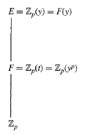

# Editorial records — Section51 Separable Extensions

Printed436–444/PDF439–447 visually reviewed. Nativepending.

## Restore multiplicitynu throughoutmatchingdefinition,p.437–444.

Before:

```text
^{v}
```

After:

```text
^{\nu}
```

## Restore multiplicitynu subscripti,p.438.

Before:

```text
v_{i}
```

After:

```text
\nu_i
```

## Correct factorizationring in Cor51.3,p.437.

Before:

```text
then $f(x)$ has a factorization in $F[x]$
```

After:

```text
then $f(x)$ has a factorization in $\bar F[x]$
```

## Remove scan speckmisreadasasterisk,p.438.

Before:

```text
${ }^{*}$ To make things
```

After:

```text
To make things
```

## Join split formula,p.438.

Before:

```text
$[K: E]=$ $\{K: E\}$
```

After:

```text
$[K:E]=\{K:E\}$
```

## Separate displayclose/endmarker,p.439.

Before:

```text
$$ $\square$
```

After:

```text
$$

$\square$
```

## Join split membership,Lemma51.11,p.439.

Before:

```text
$f(x) \in$ $F[x]$
```

After:

```text
$f(x)\in F[x]$
```

## Correct two printedwronglemmareferences,p.440–441.

Before:

```text
Lemma 54.11
```

After:

```text
Lemma 51.11
```

## Correct rootindex inproduct,p.441.

Before:

```text
\alpha_{t}^{p^{t}}
```

After:

```text
\alpha_i^{p^t}
```

## Restore commonexponentt in finitefieldproof,p.441.

Before:

```text
p^{i}
```

After:

```text
p^{t}
```

## Restore commonexponentt in finitefieldproof,p.441.

Before:

```text
p^{l}
```

After:

```text
p^{t}
```

## Correct extensionfield inPrimitiveElementTheorem,p.441.

Before:

```text
such that $F=F(\alpha)$
```

After:

```text
such that $E=F(\alpha)$
```

## Correct spelling,p.441.

Before:

```text
cylic group
```

After:

```text
cyclic group
```

## Join split equation,p.442.

Before:

```text
$E=$ $F(\beta, \gamma)$
```

After:

```text
$E=F(\beta,\gamma)$
```

## Join split rootlist,p.442.

Before:

```text
$\gamma=$ $\gamma_{1}, \cdots, \gamma_{m}$
```

After:

```text
$\gamma=\gamma_1,\cdots,\gamma_m$
```

## Restore wordspace,Exercise5,p.442.

Before:

```text
\mathbb{Z}^{+}$if
```

After:

```text
\mathbb{Z}^{+}$ if
```

## Restore wordspace,Exercise15,p.443.

Before:

```text
\mathbb{Z}^{+}$and
```

After:

```text
\mathbb{Z}^{+}$ and
```

## Correct verb,Exercise16,p.444.

Before:

```text
Exercise 15, shows that:
```

After:

```text
Exercise 15, show that:
```

## Correct rootvariabletomatchrestofExercise17,p.444.

Before:

```text
and let $a \in \bar{F}$ be a zero
```

After:

```text
and let $\alpha\in\bar F$ be a zero
```

## Restore fieldtowerasfigureatfirstsourcecontext,p.437.

Before:

```text
$$
\begin{aligned}
& E=\mathbb{Z}_{p}(y)=F(y) \\
& \left\lvert\, \begin{array}{l}
F=\mathbb{Z}_{p}(t)=\mathbb{Z}_{p}\left(y^{p}\right) \\
\mathbb{Z}_{p}
\end{array}\right.
\end{aligned}
$$

51.5 Figure
```

After:

```text
PrintedFigure51.5cropafterExample51.4
```

## Wrap original definition; restore necessarysource notation; source numberoutside.

Before:

```text
51.1 Definition Let $f(x) \in F[x]$. An element $\alpha$ of $\bar{F}$ such that $f(\alpha)=0$ is a zero of $f(x)$ of multiplicity $\nu$ if $\nu$ is the greatest integer such that $(x-\alpha)^{\nu}$ is a factor of $f(x)$ in $\bar{F}[x]$. $\square$
```

After:

```text
Definition 51.1

> [!definition] Multiplicity of a Polynomial Zero
> Let $F$ be a field with algebraic closure $\bar F$. Let $f(x) \in F[x]$. An element $\alpha$ of $\bar{F}$ such that $f(\alpha)=0$ is a zero of $f(x)$ of multiplicity $\nu$ if $\nu$ is the greatest integer such that $(x-\alpha)^{\nu}$ is a factor of $f(x)$ in $\bar{F}[x]$. $\square$


```

## Wrap original definition; restore necessarysource notation; source numberoutside.

Before:

```text
51.7 Definition A finite extension $E$ of $F$ is a separable extension of $F$ if $\{E: F\}=[E: F]$. An element $\alpha$ of $\bar{F}$ is separable over $F$ if $F(\alpha)$ is a separable extension of $F$. An irreducible polynomial $f(x) \in F[x]$ is separable over $F$ if every zero of $f(x)$ in $\bar{F}$ is separable over $F$. $\square$
```

After:

```text
Definition 51.7

> [!definition] Separable Field Extension, Element, and Irreducible Polynomial
> Let $F$ be a field with algebraic closure $\bar F$. A finite extension $E$ of $F$ is a separable extension of $F$ if $\{E: F\}=[E: F]$. An element $\alpha$ of $\bar{F}$ is separable over $F$ if $F(\alpha)$ is a separable extension of $F$. An irreducible polynomial $f(x) \in F[x]$ is separable over $F$ if every zero of $f(x)$ in $\bar{F}$ is separable over $F$. $\square$ Here $\{E:F\}$ is the number of isomorphisms of $E$ onto a subfield of $\bar F$ leaving $F$ fixed, and $[E:F]$ is the degree of the extension.


```

## Wrap original definition; restore necessarysource notation; source numberoutside.

Before:

```text
51.12 Definition A field is perfect if every finite extension is a separable extension. $\square$
```

After:

```text
Definition 51.12

> [!definition] Perfect Field
> A field is perfect if every finite extension is a separable extension. $\square$


```

## Wrap completeformalresult; restore source notation; proofoutside. Lemma51.11positiveintegerexponentmadeexplicit.

Before:

```text
51.2 Theorem Let $f(x)$ be irreducible in $F[x]$. Then all zeros of $f(x)$ in $\bar{F}$ have the same multiplicity.


```

After:

```text
Theorem 51.2

> [!theorem] Equal Multiplicities of Zeros of an Irreducible Polynomial
> Let $F$ be a field with algebraic closure $\bar F$. Let $f(x)$ be irreducible in $F[x]$. Then all zeros of $f(x)$ in $\bar{F}$ have the same multiplicity.


```

## Wrap completeformalresult; restore source notation; proofoutside. Lemma51.11positiveintegerexponentmadeexplicit.

Before:

```text
51.3 Corollary If $f(x)$ is irreducible in $F[x]$, then $f(x)$ has a factorization in $\bar F[x]$ of the form

$$
a \prod_{i}\left(x-\alpha_{i}\right)^{\nu},
$$

where the $\alpha_{i}$ are the distinct zeros of $f(x)$ in $\bar{F}$ and $a \in F$.

```

After:

```text
Corollary 51.3

> [!corollary] Factorization of an Irreducible Polynomial over an Algebraic Closure
> Let $F$ be a field with algebraic closure $\bar F$. If $f(x)$ is irreducible in $F[x]$, then $f(x)$ has a factorization in $\bar F[x]$ of the form
>
> $$
> a \prod_{i}\left(x-\alpha_{i}\right)^{\nu},
> $$
>
> where the $\alpha_{i}$ are the distinct zeros of $f(x)$ in $\bar{F}$ and $a \in F$.


```

## Wrap completeformalresult; restore source notation; proofoutside. Lemma51.11positiveintegerexponentmadeexplicit.

Before:

```text
51.6 Theorem If $E$ is a finite extension of $F$, then $\{E: F\}$ divides $[E: F]$.


```

After:

```text
Theorem 51.6

> [!theorem] Index Divides the Degree of a Finite Field Extension
> If $E$ is a finite extension of $F$, then $\{E: F\}$ divides $[E: F]$. Here $\{E:F\}$ is the number of isomorphisms of $E$ onto a subfield of an algebraic closure of $F$ leaving $F$ fixed, and $[E:F]$ is the degree of the extension.


```

## Wrap completeformalresult; restore source notation; proofoutside. Lemma51.11positiveintegerexponentmadeexplicit.

Before:

```text
51.9 Theorem If $K$ is a finite extension of $E$ and $E$ is a finite extension of $F$, that is, $F \leq E \leq K$, then $K$ is separable over $F$ if and only if $K$ is separable over $E$ and $E$ is separable over $F$.


```

After:

```text
Theorem 51.9

> [!theorem] Separability in a Tower of Finite Field Extensions
> If $K$ is a finite extension of $E$ and $E$ is a finite extension of $F$, that is, $F \leq E \leq K$, then $K$ is separable over $F$ if and only if $K$ is separable over $E$ and $E$ is separable over $F$.


```

## Wrap completeformalresult; restore source notation; proofoutside. Lemma51.11positiveintegerexponentmadeexplicit.

Before:

```text
51.10 Corollary If $E$ is a finite extension of $F$, then $E$ is separable over $F$ if and only if each $\alpha$ in $E$ is separable over $F$.


```

After:

```text
Corollary 51.10

> [!corollary] Separability of a Finite Extension and Its Elements
> If $E$ is a finite extension of $F$, then $E$ is separable over $F$ if and only if each $\alpha$ in $E$ is separable over $F$.


```

## Wrap completeformalresult; restore source notation; proofoutside. Lemma51.11positiveintegerexponentmadeexplicit.

Before:

```text
51.11 Lemma Let $\bar{F}$ be an algebraic closure of $F$, and let

$$
f(x)=x^{n}+a_{n-1} x^{n-1}+\cdots+a_{1} x+a_{0}
$$

be any monic polynomial in $\bar{F}[x]$. If $(f(x))^{m} \in F[x]$ and $m \cdot 1 \neq 0$ in $F$, then $f(x)\in F[x]$, that is, all $a_{i} \in F$.


```

After:

```text
Lemma 51.11

> [!lemma] Monic Polynomial Whose Power Has Coefficients in a Subfield
> Let $\bar{F}$ be an algebraic closure of $F$, and let
>
> $$
> f(x)=x^{n}+a_{n-1} x^{n-1}+\cdots+a_{1} x+a_{0}
> $$
>
> be any monic polynomial in $\bar{F}[x]$. If $m\in\mathbb Z^+$, $(f(x))^{m} \in F[x]$ and $m \cdot 1 \neq 0$ in $F$, then $f(x)\in F[x]$, that is, all $a_{i} \in F$.


```

## Wrap completeformalresult; restore source notation; proofoutside. Lemma51.11positiveintegerexponentmadeexplicit.

Before:

```text
51.13 Theorem Every field of characteristic zero is perfect.


```

After:

```text
Theorem 51.13

> [!theorem] Fields of Characteristic Zero Are Perfect
> Every field of characteristic zero is perfect.


```

## Wrap completeformalresult; restore source notation; proofoutside. Lemma51.11positiveintegerexponentmadeexplicit.

Before:

```text
51.14 Theorem Every finite field is perfect.


```

After:

```text
Theorem 51.14

> [!theorem] Finite Fields Are Perfect
> Every finite field is perfect.


```

## Wrap completeformalresult; restore source notation; proofoutside. Lemma51.11positiveintegerexponentmadeexplicit.

Before:

```text
51.15 Theorem (Primitive Element Theorem) Let $E$ be a finite separable extension of a field $F$. Then there exists $\alpha \in E$ such that $E=F(\alpha)$. (Such an element $\alpha$ is a primitive element.) That is, a finite separable extension of a field is a simple extension.


```

After:

```text
Theorem 51.15

> [!theorem] Primitive Element Theorem
> Let $E$ be a finite separable extension of a field $F$. Then there exists $\alpha \in E$ such that $E=F(\alpha)$. (Such an element $\alpha$ is a primitive element.) That is, a finite separable extension of a field is a simple extension.


```

## Wrap completeformalresult; restore source notation; proofoutside. Lemma51.11positiveintegerexponentmadeexplicit.

Before:

```text
51.16 Corollary A finite extension of a field of characteristic zero is a simple extension.


```

After:

```text
Corollary 51.16

> [!corollary] Finite Extensions in Characteristic Zero Are Simple
> A finite extension of a field of characteristic zero is a simple extension.


```

## Add taskonlyprompt; originalworkedtextretainedoutside.

Before:

```text
51.4 Example 
```

After:

```text
> [!example] Example 51.4
> Let $p$ be prime, $y$ an indeterminate, $t=y^p$, $E=\mathbb Z_p(y)$, and $F=\mathbb Z_p(t)$. Show that the minimal polynomial of $y$ over $F$ has a zero of multiplicity greater than $1$.

##### solution


```

## Add taskonlyprompt; originalworkedtextretainedoutside.

Before:

```text
51.8 Example 
```

After:

```text
> [!example] Example 51.8
> Show that $\mathbb Q[\sqrt2,\sqrt3]$ is separable over $\mathbb Q$.

##### solution


```

## Formatting only

Three definitions,six theorems,threecorollaries,onelemma,twoexamples,22exercises,one sourcefigure. Exercise5intentionaldefinitionerrorretained. OriginalOCR/PDFunchanged,noadmission.

## Earlier stagingrecord

# Editorial records — Section 51 - Separable Extensions

Status: staged original OCR; content/callout/source review pending.

## Heading formatting

Before: `## section 51 Separable Extensions`

After: `# 51 Separable Extensions`

Section heading separated and normalized to level one; body wording unchanged. Original chapter OCR archive retained in conversion records.


## Figure 51.5

Formatting only: preserved image and printed caption in scientific figure component.

Before:

```text

51.5 Figure
```

After:

```text
```scientific-figure
id: 215db8ff-f732-4f68-af47-1b61f155a1f2
numbered: false
title: ""
caption: Figure 51.5
captionVisible: true
captionPosition: below
columns: 1
panels:
  - path: images/figure-51-5-source.png
    caption: ""
```
```
