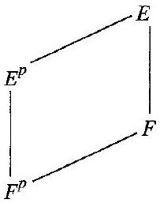

# Editorial records — Section52 Totally Inseparable Extensions

Printed444–447/PDF447–450 visuallyreviewed. Nativepending.

## Join split definitionequation,p.444.

Before:

```text
$\{E: F\}=1<$ $[E: F]$
```

After:

```text
$\{E:F\}=1<[E:F]$
```

## Remove orphanfootnotemarkerfromproof; restore footnotetextatsectionstart,p.444.

Before:

```text
[^1]Proof
```

After:

```text
Proof
```

## Correct nonmembershipsymbol,Cor52.4,p.445.

Before:

```text
\alpha \neq F
```

After:

```text
\alpha\notin F
```

## Join split tower,p.445.

Before:

```text
If $F<$ $F(\alpha)<E$
```

After:

```text
If $F<F(\alpha)<E$
```

## Restore exponentt,p.446.

Before:

```text
x^{p^{i}}-\alpha^{p^{i}}
```

After:

```text
x^{p^t}-\alpha^{p^t}
```

## Restore exponentt,p.446.

Before:

```text
(x-\alpha)^{p^{f}}
```

After:

```text
(x-\alpha)^{p^t}
```

## Restore indexedexponentti,p.446.

Before:

```text
\alpha_{i j}^{p^{p_{i}}}
```

After:

```text
\alpha_{ij}^{p^{t_i}}
```

## Restore indexedexponentti,p.446.

Before:

```text
\alpha_{i}^{p^{i}}=\beta_{i 1}
```

After:

```text
\alpha_i^{p^{t_i}}=\beta_{i1}
```

## Restore mathdelimiters,p.446.

Before:

```text
is of multiplicity >1
```

After:

```text
is of multiplicity $>1$
```

## Restore variablev,Exercises3–4,p.447.

Before:

```text
\mathbb{Z}_{3}(u, \nu)
```

After:

```text
\mathbb Z_3(u,v)
```

## Restore printedsectionfootnotetext,p.444.

Before:

```text
# 52 Totally Inseparable Extensions

```

After:

```text
# 52 Totally Inseparable Extensions

This section is not used in the remainder of the text.


```

## Correct Frobeniusambientfieldtoalgebraicclosure,p.446; conjugaterootsalphaijneednotallbeinE.

Before:

```text
Now since raising to the power $p$ is an isomorphism $\sigma_{p}$ of $E$ onto a subfield of $E$, raising to the power of $p^{t}$ is the isomorphic mapping $\left(\sigma_{p}\right)^{t}$ of $E$ onto a subfield of $E$. 
```

After:

```text
Now since raising to the power $p$ is an isomorphism $\sigma_{p}$ of $\bar F$ onto a subfield of $\bar F$, raising to the power of $p^{t}$ is the isomorphic mapping $\left(\sigma_{p}\right)^{t}$ of $\bar F$ onto a subfield of $\bar F$. 
```

## Correct omittedproperextensionhypothesis,Cor52.4,p.445: underauthorstrictdefinition E=F failsleftsidebutrightsidevacuous.

Before:

```text
(Counterpart of the Corollary of Theorem 51.10) If $E$ is a finite extension of $F$
```

After:

```text
(Counterpart of the Corollary of Theorem 51.10) If $E$ is a proper finite extension of $F$
```

## Replace Theorem52.5referencewithitsdefinitionpremisesandexactKdescriptionfromprecedingproof,p.446.

Before:

```text
The unique field $K$ of Theorem 52.5 is the separable closure of $F$ in $E$. $\square$
```

After:

```text
Let $E$ be a finite extension of a field $F$ of characteristic $p\ne0$. The field $K$ consisting of all elements of $E$ that are separable over $F$ is the separable closure of $F$ in $E$. $\square$
```

## Wrap originaldefinition,necessarysource notationinside; numberingoutside. Strictnontrivialscopepreserved.

Before:

```text
52.1 Definition A finite extension $E$ of a field $F$ is a totally inseparable extension of $F$ if $\{E:F\}=1<[E:F]$. An element $\alpha$ of $\bar{F}$ is totally inseparable over $F$ if $F(\alpha)$ is totally inseparable over $F$. $\square$
```

After:

```text
Definition 52.1

> [!definition] Totally Inseparable Field Extension and Element
> A finite extension $E$ of a field $F$ is a totally inseparable extension of $F$ if $\{E:F\}=1<[E:F]$. An element $\alpha$ of $\bar{F}$ is totally inseparable over $F$ if $F(\alpha)$ is totally inseparable over $F$. $\square$ Here $\bar F$ is an algebraic closure of $F$, $\{E:F\}$ is the number of isomorphisms of $E$ onto a subfield of $\bar F$ leaving $F$ fixed, and $[E:F]$ is the degree of the extension.


```

## Wrap originaldefinition,necessarysource notationinside; numberingoutside. Strictnontrivialscopepreserved.

Before:

```text
52.6 Definition Let $E$ be a finite extension of a field $F$ of characteristic $p\ne0$. The field $K$ consisting of all elements of $E$ that are separable over $F$ is the separable closure of $F$ in $E$. $\square$
```

After:

```text
Definition 52.6

> [!definition] Separable Closure in a Field Extension
> Let $E$ be a finite extension of a field $F$ of characteristic $p\ne0$. The field $K$ consisting of all elements of $E$ that are separable over $F$ is the separable closure of $F$ in $E$. $\square$


```

## Wrap completeformalresult; replacebookdependentheadingwithmathematicaltitle;proofoutside.

Before:

```text
52.3 Theorem (Counterpart of Theorem 51.9) If $K$ is a finite extension of $E, E$ is a finite extension of $F$, and $F<E<K$, then $K$ is totally inseparable over $F$ if and only if $K$ is totally inseparable over $E$ and $E$ is totally inseparable over $F$.

```

After:

```text
Theorem 52.3

> [!theorem] Total Inseparability in a Tower of Finite Field Extensions
> If $K$ is a finite extension of $E, E$ is a finite extension of $F$, and $F<E<K$, then $K$ is totally inseparable over $F$ if and only if $K$ is totally inseparable over $E$ and $E$ is totally inseparable over $F$.


```

## Wrap completeformalresult; replacebookdependentheadingwithmathematicaltitle;proofoutside.

Before:

```text
52.4 Corollary (Counterpart of the Corollary of Theorem 51.10) If $E$ is a proper finite extension of $F$, then $E$ is totally inseparable over $F$ if and only if each $\alpha$ in $E, \alpha\notin F$, is totally inseparable over $F$.


```

After:

```text
Corollary 52.4

> [!corollary] Total Inseparability of a Finite Extension and Its Elements
> If $E$ is a proper finite extension of $F$, then $E$ is totally inseparable over $F$ if and only if each $\alpha$ in $E, \alpha\notin F$, is totally inseparable over $F$.


```

## Wrap completeformalresult; replacebookdependentheadingwithmathematicaltitle;proofoutside.

Before:

```text
52.5 Theorem Let $F$ have characteristic $p \neq 0$, and let $E$ be a finite extension of $F$. Then $\alpha \in E, \alpha \notin F$, is totally inseparable over $F$ if and only if there is some integer $t \geq 1$ such that $\alpha^{p^{t}} \in F$.

Furthermore, there is a unique extension $K$ of $F$, with $F \leq K \leq E$, such that $K$ is separable over $F$, and either $E=K$ or $E$ is totally inseparable over $K$.


```

After:

```text
Theorem 52.5

> [!theorem] Totally Inseparable Elements and Separable Closure of a Finite Extension
> Let $F$ have characteristic $p \neq 0$, and let $E$ be a finite extension of $F$. Then $\alpha \in E, \alpha \notin F$, is totally inseparable over $F$ if and only if there is some integer $t \geq 1$ such that $\alpha^{p^{t}} \in F$.
>
> Furthermore, there is a unique extension $K$ of $F$, with $F \leq K \leq E$, such that $K$ is separable over $F$, and either $E=K$ or $E$ is totally inseparable over $K$.


```

## Add task-onlyprompt; original workedstatementoutside.

Before:

```text
52.2 Example 
```

After:

```text
> [!example] Example 52.2
> Let $p$ be prime and $y$ an indeterminate. Show that $\mathbb Z_p(y)$ is totally inseparable over $\mathbb Z_p(y^p)$.

##### solution


```

## Formatting only

Two definitions,twotheorems,onecorollary,oneexample,eightexercises,onefigure. OriginalOCR/PDFunchanged,noadmission.

## Earlier stagingrecord

# Editorial records — Section 52 - Totally Inseparable Extensions

Status: staged original OCR; content/callout/source review pending.

## Heading formatting

Before: `section 52 Totally Inseparable Extensions`

After: `# 52 Totally Inseparable Extensions`

Section heading separated and normalized to level one; body wording unchanged. Original chapter OCR archive retained in conversion records.

## Stray scan mark

Source verified at PDF page 448: remove scan speck, not mathematical notation.

Before:

```text
* 

```

After:

```text

```


## Figure 52.7

Formatting only: preserved image and printed caption in scientific figure component.

Before:

```text

52.7 Figure
```

After:

```text
```scientific-figure
id: ce27c45e-96d8-4f07-bf7e-d81e6d508865
numbered: false
title: ""
caption: Figure 52.7
captionVisible: true
captionPosition: below
columns: 1
panels:
  - path: images/cb284014-e64d-4e41-8e5b-470023b9bbf3-33_257_203_1803_990.jpg
    caption: ""
```
```
