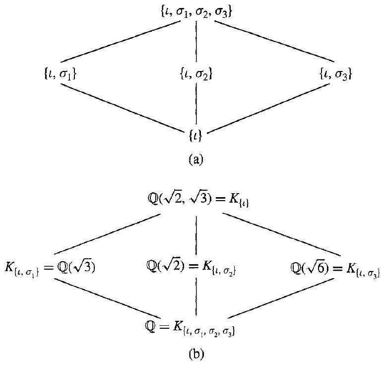
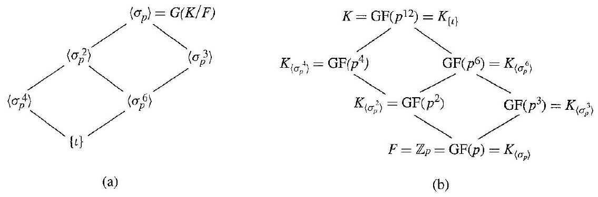
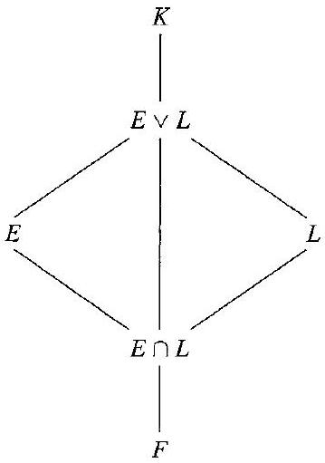

# Editorial records — Section53 Galois Theory

Printed448–456/PDF451–459 visuallyreviewed. Nativepending.

## Remove spuriouslistbreak,summaryitem5,p.448.

Before:

```text
if and
- only if
```

After:

```text
if and only if
```

## Join splittower,p.448.

Before:

```text
$F \leq E \leq$ $K \leq \bar{F}$
```

After:

```text
$F\leq E\leq K\leq\bar F$
```

## Join pagebroken theorem,p.448–449.

Before:

```text
precisely the subgroup
of
```

After:

```text
precisely the subgroup of
```

## Restore identityiota in subgroupdiagram,p.450.

Before:

```text
\left\{l,
```

After:

```text
\left\{\iota,
```

## Restore identityiota,p.450.

Before:

```text
\{l\}
```

After:

```text
\{\iota\}
```

## Join pagebreak,p.450–451.

Before:

```text
example for us

to use
```

After:

```text
example for us to use
```

## Correct fixedfield ambientK,MainTheoremproperty3,p.451.

Before:

```text
\lambda\left(E_{H}\right)=H
```

After:

```text
\lambda\left(K_H\right)=H
```

## Join Frobeniusformula,p.452.

Before:

```text
\sigma_{p^{r}}(\alpha)=$ $\alpha^{p^{r}}$
```

After:

```text
\sigma_{p^r}(\alpha)=\alpha^{p^r}$
```

## Restore exponentr,Theorem53.7,p.452.

Before:

```text
\alpha^{p^{\prime}}
```

After:

```text
\alpha^{p^r}
```

## Restore missingarticle,p.452.

Before:

```text
given in next Section 54
```

After:

```text
given in the next Section 54
```

## Separate endmarker/displayclose,p.453.

Before:

```text
$$ $\square$
```

After:

```text
$$

$\square$
```

## Join split coefficientsum,p.453.

Before:

```text
$-\sigma_{1}(\alpha)-$ $\sigma_{2}(\alpha)-\cdots-\sigma_{|H|}(\alpha)$
```

After:

```text
$-\sigma_1(\alpha)-\sigma_2(\alpha)-\cdots-\sigma_{|H|}(\alpha)$
```

## Correct subgroupnamedinproof,p.454.

Before:

```text
condition that $G(K / F)$ be a normal subgroup of $G(K / F)$
```

After:

```text
condition that $G(K/E)$ be a normal subgroup of $G(K/F)$
```

## Join split quotientisomorphism,p.454.

Before:

```text
$F, G(E / F) \simeq$ $G(K / F) / G(K / E)$
```

After:

```text
$F$, $G(E/F)\simeq G(K/F)/G(K/E)$
```

## Correct restrictionhomomorphismcodomain,p.454.

Before:

```text
\phi: G(K / F) \rightarrow G(K / F)
```

After:

```text
\phi:G(K/F)\rightarrow G(E/F)
```

## Join splitfield,Exercise11,p.454.

Before:

```text
$K=$ $\mathbb{Q}(\sqrt[3]{2}, i \sqrt{3})$
```

After:

```text
$K=\mathbb Q(\sqrt[3]2,i\sqrt3)$
```

## Correct exerciseinstruction,p.455.

Before:

```text
true of false
```

After:

```text
true or false
```

## Join split degree,Exercise15(d),p.455.

Before:

```text
$[E:$ $F]=[L: F]$
```

After:

```text
$[E:F]=[L:F]$
```

## Restore traceoperator,Exercise18(e),p.455.

Before:

```text
T r_{K / \mathbb{Q}}
```

After:

```text
\operatorname{Tr}_{K/\mathbb Q}
```

## Restore rationalfieldfont,Exercise18(h),p.455.

Before:

```text
\operatorname{Tr}_{K / Q}
```

After:

```text
\operatorname{Tr}_{K/\mathbb Q}
```

## Correct duplicatedprintedfigurelabeltomatchExercise25,p.456.

Before:

```text
53.9 Figure (finalfielddiagram)
```

After:

```text
53.10 Figure
```

## Preserve complete sentence,p.452–453.

Before:

```text
Figure53.9insidepagebrokensentence
```

After:

```text
Figure53.9aftercompleteExample53.8
```

## Wrap originaldefinition; sourceGmeaningrestored. Authorfinite-normal/separable-splitting-fieldscopepreserved.

Before:

```text
53.1 Definition A finite extension $K$ of $F$ is a finite normal extension of $F$ if $K$ is a separable splitting field over $F$. $\square$
```

After:

```text
Definition 53.1

> [!definition] Finite Normal Extension
> A finite extension $K$ of $F$ is a finite normal extension of $F$ if $K$ is a separable splitting field over $F$. $\square$


```

## Wrap originaldefinition; sourceGmeaningrestored. Authorfinite-normal/separable-splitting-fieldscopepreserved.

Before:

```text
53.5 Definition If $K$ is a finite normal extension of a field $F$, then $G(K / F)$ is the Galois group of $K$ over $F$. $\square$
```

After:

```text
Definition 53.5

> [!definition] Galois Group of a Finite Normal Extension
> If $K$ is a finite normal extension of a field $F$, then the group $G(K/F)$ of all automorphisms of $K$ leaving $F$ fixed is the Galois group of $K$ over $F$. $\square$


```

## Wrap complete formalresult includingallnumberedproperties; necessarysourcenotationrestored; authorproofseparate.

Before:

```text
53.2 Theorem Let $K$ be a finite normal extension of $F$, and let $E$ be an extension of $F$, where $F\leq E\leq K\leq\bar F$. Then $K$ is a finite normal extension of $E$, and $G(K / E)$ is precisely the subgroup of $G(K / F)$ consisting of all those automorphisms that leave $E$ fixed. Moreover, two automorphisms $\sigma$ and $\tau$ in $G(K / F)$ induce the same isomorphism of $E$ onto a subfield of $\bar{F}$ if and only if they are in the same left coset of $G(K / E)$ in $G(K / F)$.


```

After:

```text
Theorem 53.2

> [!theorem] Automorphisms over an Intermediate Field and Their Cosets
> Let $K$ be a finite normal extension of $F$, and let $E$ be an extension of $F$, where $F\leq E\leq K\leq\bar F$. Then $K$ is a finite normal extension of $E$, and $G(K / E)$ is precisely the subgroup of $G(K / F)$ consisting of all those automorphisms that leave $E$ fixed. Moreover, two automorphisms $\sigma$ and $\tau$ in $G(K / F)$ induce the same isomorphism of $E$ onto a subfield of $\bar{F}$ if and only if they are in the same left coset of $G(K / E)$ in $G(K / F)$. Here $\bar F$ is an algebraic closure of $F$, and $G(K/L)$ is the group of all automorphisms of $K$ leaving $L$ fixed.


```

## Wrap complete formalresult includingallnumberedproperties; necessarysourcenotationrestored; authorproofseparate.

Before:

```text
53.6 Theorem (Main Theorem of Galois Theory) Let $K$ be a finite normal extension of a field $F$, with Galois group $G(K / F)$. For a field $E$, where $F \leq E \leq K$, let $\lambda(E)$ be the subgroup of $G(K / F)$ leaving $E$ fixed. Then $\lambda$ is a one-to-one map of the set of all such intermediate fields $E$ onto the set of all subgroups of $G(K / F)$. The following properties hold for $\lambda$ :
    1. $\lambda(E)=G(K / E)$.
    2. $E=K_{G(K / E)}=K_{\lambda(E)}$.
    3. For $H \leq G(K / F), \lambda\left(K_H\right)=H$.
    4. $[K: E]=|\lambda(E)|$ and $[E: F]=(G(K / F): \lambda(E))$, the number of left cosets of $\lambda(E)$ in $G(K / F)$.
    5. $E$ is a normal extension of $F$ if and only if $\lambda(E)$ is a normal subgroup of $G(K / F)$. When $\lambda(E)$ is a normal subgroup of $G(K / F)$, then
$$
G(E / F) \simeq G(K / F) / G(K / E) .
$$
    6. The diagram of subgroups of $G(K / F)$ is the inverted diagram of intermediate fields of $K$ over $F$.


```

After:

```text
Theorem 53.6

> [!theorem] Main Theorem of Galois Theory
> Let $K$ be a finite normal extension of a field $F$, with Galois group $G(K / F)$. For a field $E$, where $F \leq E \leq K$, let $\lambda(E)$ be the subgroup of $G(K / F)$ leaving $E$ fixed. Then $\lambda$ is a one-to-one map of the set of all such intermediate fields $E$ onto the set of all subgroups of $G(K / F)$. For a subgroup $H$, let $K_H=\{a\in K\mid\sigma(a)=a\text{ for every }\sigma\in H\}$ be its fixed field. The following properties hold for $\lambda$ :
>
> 1. $\lambda(E)=G(K / E)$.
>
> 2. $E=K_{G(K / E)}=K_{\lambda(E)}$.
>
> 3. For $H \leq G(K / F), \lambda\left(K_H\right)=H$.
>
> 4. $[K: E]=|\lambda(E)|$ and $[E: F]=(G(K / F): \lambda(E))$, the number of left cosets of $\lambda(E)$ in $G(K / F)$.
>
> 5. $E$ is a normal extension of $F$ if and only if $\lambda(E)$ is a normal subgroup of $G(K / F)$. When $\lambda(E)$ is a normal subgroup of $G(K / F)$, then
> $$
> G(E / F) \simeq G(K / F) / G(K / E) .
> $$
>
> 6. The diagram of subgroups of $G(K / F)$ is the inverted diagram of intermediate fields of $K$ over $F$.


```

## Wrap complete formalresult includingallnumberedproperties; necessarysourcenotationrestored; authorproofseparate.

Before:

```text
53.7 Theorem Let $K$ be a finite extension of degree $n$ of a finite field $F$ of $p^{r}$ elements. Then $G(K / F)$ is cyclic of order $n$, and is generated by $\sigma_{p^{r}}$, where for $\alpha \in K, \sigma_{p^{r}}(\alpha)=\alpha^{p^r}$.


```

After:

```text
Theorem 53.7

> [!theorem] Galois Group of a Finite Field Extension
> Let $K$ be a finite extension of degree $n$ of a finite field $F$ of $p^{r}$ elements. Then $G(K / F)$ is cyclic of order $n$, and is generated by $\sigma_{p^{r}}$, where for $\alpha \in K, \sigma_{p^{r}}(\alpha)=\alpha^{p^r}$. Here $G(K/F)$ is the group of all automorphisms of $K$ leaving $F$ fixed.


```

## Addtaskonlyprompt; original workedtext/diagrams outside.

Before:

```text
53.3 Example 
```

After:

```text
> [!example] Example 53.3
> For $K=\mathbb Q(\sqrt2,\sqrt3)$, describe the automorphisms leaving $\mathbb Q$ fixed, the subgroups of $G(K/\mathbb Q)$, and their corresponding fixed fields.

##### solution


```

## Addtaskonlyprompt; original workedtext/diagrams outside.

Before:

```text
53.8 Example 
```

After:

```text
> [!example] Example 53.8
> Let $F=\mathbb Z_p$ and $K=\mathrm{GF}(p^{12})$. Describe $G(K/F)$ and the correspondence between its subgroups and the intermediate fields.

##### solution


```

## Formatting only

Two definitions,threetheorems,twoexamples,26exercises,threefigures. Openingresume retainedasordinaryprose/list,notIndexcandidate. OriginalOCR/PDFunchanged,noadmission.

## Earlier stagingrecord

# Editorial records — Section 53 - Galois Theory

Status: staged original OCR; content/callout/source review pending.

## Heading formatting

Before: `## section 53 Galois Theory`

After: `# 53 Galois Theory`

Section heading separated and normalized to level one; body wording unchanged. Original chapter OCR archive retained in conversion records.


## Figure 53.4

Formatting only: preserved image and printed caption in scientific figure component.

Before:

```text

53.4 Figure (a) Group diagram. (b) Field diagram.
```

After:

```text
```scientific-figure
id: 7a9b57ba-fa73-4a8c-8276-2887b5d01267
numbered: false
title: ""
caption: Figure 53.4 — (a) Group diagram. (b) Field diagram.
captionVisible: true
captionPosition: below
columns: 1
panels:
  - path: images/cb284014-e64d-4e41-8e5b-470023b9bbf3-36_737_774_232_722.jpg
    caption: ""
```
```

## Figure 53.9

Formatting only: preserved image and printed caption in scientific figure component.

Before:

```text

53.9 Figure (a) Group diagram. (b) Field diagram.
```

After:

```text
```scientific-figure
id: 7026f07d-afcb-46b0-9e1e-38483f82fb94
numbered: false
title: ""
caption: Figure 53.9 — (a) Group diagram. (b) Field diagram.
captionVisible: true
captionPosition: below
columns: 1
panels:
  - path: images/cb284014-e64d-4e41-8e5b-470023b9bbf3-38_375_1135_1756_554.jpg
    caption: ""
```
```

## Figure 53.10

Formatting only: preserved image and printed caption in scientific figure component.

Before:

```text

53.10 Figure
```

After:

```text
```scientific-figure
id: 675fdbfb-6a68-4bb6-b55b-94d70105cb25
numbered: false
title: ""
caption: Figure 53.10
captionVisible: true
captionPosition: below
columns: 1
panels:
  - path: images/cb284014-e64d-4e41-8e5b-470023b9bbf3-42_511_359_1547_943.jpg
    caption: ""
```
```
