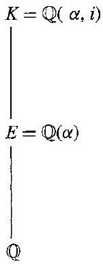
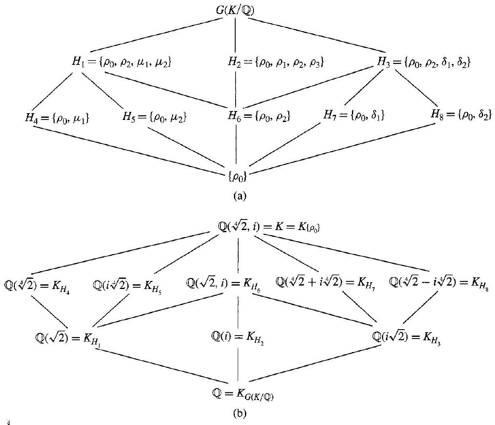
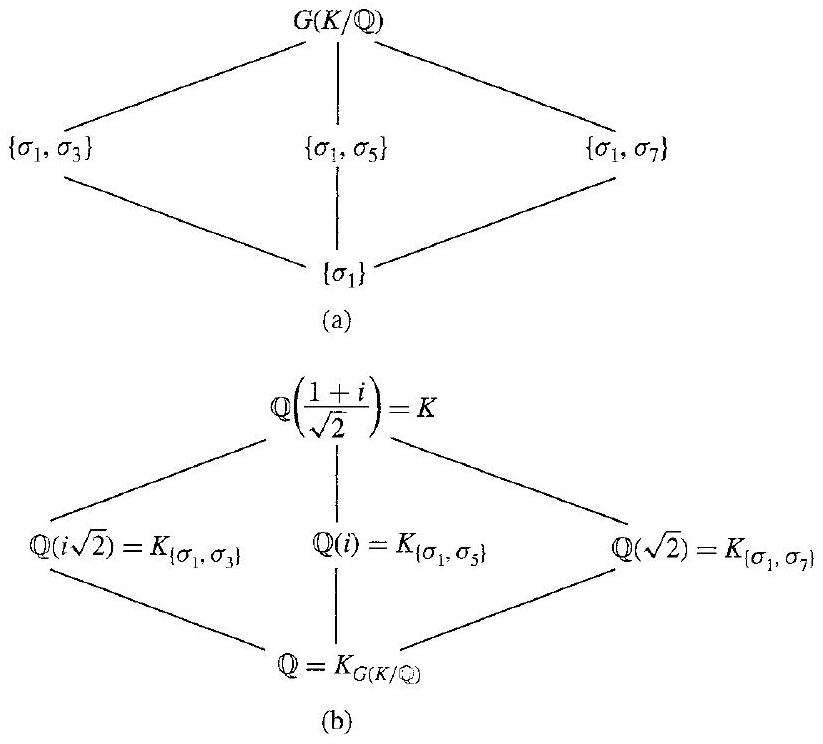

# Editorial records — Section 54 Illustrations of Galois Theory

Printed457–463/PDF460–466 visually reviewed. Native pending.

## Restore missing equals sign p.457.

Before:

```text
f(x) \prod
```

After:

```text
f(x)=\prod
```

## Join page break p.457–458.

Before:

```text
normal extension
of
```

After:

```text
normal extension of
```

## Remove isolated scan mark p.458.

Before:

```text

:
54.2
```

After:

```text

54.2
```

## Join split basis p.459.

Before:

```text
\left\{1, \alpha, \alpha^{2}, \alpha^{3}, i, i \alpha, i \alpha^{2}\right.$, $i \alpha^{3}$ \}
```

After:

```text
\left\{1,\alpha,\alpha^2,\alpha^3,i,i\alpha,i\alpha^2,i\alpha^3\right\}$
```

## Restore variable subscript i p.459.

Before:

```text
fixed fields $K_{H_{1}}$
```

After:

```text
fixed fields $K_{H_i}$
```

## Separate display and end marker.

Before:

```text
$$ $\square$
```

After:

```text
$$

$\square$
```

## Correct missing plural p.461.

Before:

```text
complex number in
```

After:

```text
complex numbers in
```

## Remove stray punctuation p.461.

Before:

```text
Theorem. 20.6
```

After:

```text
Theorem 20.6
```

## Correct fixed-field ambient notation p.462.

Before:

```text
finding $E_{\left\{\sigma_{1}, \sigma_{5}\right\}}$
```

After:

```text
finding $K_{\left\{\sigma_{1},\sigma_{5}\right\}}$
```

## Restore missing closing parenthesis Exercise3 p.462.

Before:

```text
(see Theorem 51.15 and
```

After:

```text
(see Theorem 51.15) and
```

## Correct OCR Exercise6 p.463.

Before:

```text
Repcat
```

After:

```text
Repeat
```

## Correct transposition Exercise10 p.463.

Before:

```text
zeors
```

After:

```text
zeros
```

## Correct missing hypotheses Exercise12(c): repeated roots do not form an n-element set; in characteristic2 discriminant membership cannot detect odd permutations. E.g. x^2+x+1 over F2 has Delta=1 but G=S2.

Before:

```text
c. $G(K / F)$ may be viewed
```

After:

```text
c. Assume in this part that $f(x)$ has distinct zeros and that $\operatorname{char}F\ne2$. $G(K / F)$ may be viewed
```

## Restore continuous prose around page-top figure.

Before:

```text
54.4 figure interrupting sentence
```

After:

```text
54.4 figure at paragraph boundary
```

## Restore continuous prose around page-top figure.

Before:

```text
54.6 figure interrupting sentence
```

After:

```text
54.6 figure at paragraph boundary
```

## Restore continuous prose around page-top figure.

Before:

```text
54.9 figure interrupting sentence
```

After:

```text
54.9 figure at paragraph boundary
```

## Restore paragraph continuity.

Before:

```text
54.5 table inside sentence
```

After:

```text
54.5 table after complete preceding paragraph
```

## Restore paragraph continuity.

Before:

```text
54.8 table inside sentence
```

After:

```text
54.8 table after complete preceding paragraph
```

## Wrap original definition; restore source field/indeterminates; remove contextual pointer.

Before:

```text
54.1 Definition An element of the field $F\left(y_{1}, \cdots, y_{n}\right)$ is a symmetric function in $y_{1}, \cdots, y_{n}$ over $F$, if it is left fixed by all permutations of $y_{1}, \cdots, y_{n}$, in the sense just explained. $\square$
```

After:

```text
Definition 54.1

> [!definition] Symmetric Function
> Let $F$ be a field and $y_1,\ldots,y_n$ indeterminates. An element of the field $F\left(y_{1}, \cdots, y_{n}\right)$ is a symmetric function in $y_{1}, \cdots, y_{n}$ over $F$, if it is left fixed by all permutations of $y_{1}, \cdots, y_{n}$. $\square$


```

## Wrap original theorem and restore source field premise. Original preceding derivation preserved.

Before:

```text
54.2 Theorem Let $s_{1}, \cdots, s_{n}$ be the elementary symmetric functions in the indeterminates $y_{1}, \cdots, y_{n}$. Then every symmetric function of $y_{1}, \cdots, y_{n}$ over $F$ is a rational function of the elementary symmetric functions. Also, $F\left(y_{1}, \cdots, y_{n}\right)$ is a finite normal extension of degree $n!$ of $F\left(s_{1}, \cdots, s_{n}\right)$, and the Galois group of this extension is naturally isomorphic to $S_{n}$.


```

After:

```text
Theorem 54.2

> [!theorem] Symmetric Functions and Their Galois Group
> Let $F$ be a field. Let $s_{1}, \cdots, s_{n}$ be the elementary symmetric functions in the indeterminates $y_{1}, \cdots, y_{n}$. Then every symmetric function of $y_{1}, \cdots, y_{n}$ over $F$ is a rational function of the elementary symmetric functions. Also, $F\left(y_{1}, \cdots, y_{n}\right)$ is a finite normal extension of degree $n!$ of $F\left(s_{1}, \cdots, s_{n}\right)$, and the Galois group of this extension is naturally isomorphic to $S_{n}$.


```

## Add task-only prompt matching original worked example; preserve all author work outside.

Before:

```text
54.3 Example 
```

After:

```text
> [!example] Example 54.3
> Find the splitting field in $\mathbb C$ of $x^4-2$ over $\mathbb Q$, its Galois group, and the correspondence between subgroups and intermediate fields. Find $\operatorname{irr}(\sqrt[4]2+i\sqrt[4]2,\mathbb Q)$.

##### solution


```

## Add task-only prompt matching original worked example; preserve all author work outside.

Before:

```text
54.7 Example 
```

After:

```text
> [!example] Example 54.7
> Find the splitting field of $x^4+1$ over $\mathbb Q$, its Galois group, and the corresponding group and field diagrams.

##### solution


```

## Formatting only

One definition, one theorem, two examples, 13 exercises, three figures and two tables. Original OCR/PDF unchanged; no admission.

## Earlier staging record

# Editorial records — Section 54 - Illustrations of Galois Theory

Status: staged original OCR; content/callout/source review pending.

## Heading formatting

Before: `## section 54 Illustrations of Galois Theory`

After: `# 54 Illustrations of Galois Theory`

Section heading separated and normalized to level one; body wording unchanged. Original chapter OCR archive retained in conversion records.

## Stray scan mark

Source verified at PDF page 464: remove scan speck, not mathematical notation.

Before:

```text
Since*
```

After:

```text
Since
```


## Figure 54.4

Formatting only: preserved image and printed caption in scientific figure component.

Before:

```text

54.4 Figure
```

After:

```text
```scientific-figure
id: 5ea9cc0f-2543-49ab-8f2c-b92be11dad20
numbered: false
title: ""
caption: Figure 54.4
captionVisible: true
captionPosition: below
columns: 1
panels:
  - path: images/cb284014-e64d-4e41-8e5b-470023b9bbf3-45_386_151_237_248.jpg
    caption: ""
```
```

## Figure 54.6

Formatting only: preserved image and printed caption in scientific figure component.

Before:

```text

54.6 Figure (a) Group diagram. (b) Field diagram.
```

After:

```text
```scientific-figure
id: 8966840f-adc1-49c2-8759-f4127bf9b41b
numbered: false
title: ""
caption: Figure 54.6 — (a) Group diagram. (b) Field diagram.
captionVisible: true
captionPosition: below
columns: 1
panels:
  - path: images/cb284014-e64d-4e41-8e5b-470023b9bbf3-46_1003_1166_233_548.jpg
    caption: ""
```
```

## Figure 54.9

Formatting only: preserved image and printed caption in scientific figure component.

Before:

```text

54.9 Figure (a) Group diagram. (b) Field diagram.
```

After:

```text
```scientific-figure
id: e6e5a2e5-805f-4bec-805a-c1f597b4cc81
numbered: false
title: ""
caption: Figure 54.9 — (a) Group diagram. (b) Field diagram.
captionVisible: true
captionPosition: below
columns: 1
panels:
  - path: images/cb284014-e64d-4e41-8e5b-470023b9bbf3-48_744_823_230_714.jpg
    caption: ""
```
```

## Table 54.5

Formatting only: editable scientific table, source cells and printed caption preserved; single-letter mathematical entries receive math delimiters.

Before:

```text
### 54.5 Table

|  | $\rho_{0}$ | $\rho_{1}$ | $\rho_{2}$ | $\rho_{3}$ | $\mu_{1}$ | $\delta_{1}$ | $\mu_{2}$ | $\delta_{2}$ |
| :--- | :--- | :--- | :--- | :--- | :--- | :--- | :--- | :--- |
| $\alpha \rightarrow$ | $\alpha$ | $i \alpha$ | $-\alpha$ | $-i \alpha$ | $\alpha$ | $i \alpha$ | $-\alpha$ | $-i \alpha$ |
| $i \rightarrow$ | $i$ | $i$ | $i$ | $i$ | $-i$ | $-i$ | $-i$ | $-i$ |

```

After:

```text
```scientific-table
id: d26a95bb-6edc-4b0b-8ed0-018dcd97a742
numbered: false
title: ""
caption: Table 54.5
captionVisible: true
captionPosition: below
rows:
  - - text: ""
      align: center
    - text: $\rho_{0}$
      align: center
    - text: $\rho_{1}$
      align: center
    - text: $\rho_{2}$
      align: center
    - text: $\rho_{3}$
      align: center
    - text: $\mu_{1}$
      align: center
    - text: $\delta_{1}$
      align: center
    - text: $\mu_{2}$
      align: center
    - text: $\delta_{2}$
      align: center
  - - text: $\alpha \rightarrow$
      align: center
    - text: $\alpha$
      align: center
    - text: $i \alpha$
      align: center
    - text: $-\alpha$
      align: center
    - text: $-i \alpha$
      align: center
    - text: $\alpha$
      align: center
    - text: $i \alpha$
      align: center
    - text: $-\alpha$
      align: center
    - text: $-i \alpha$
      align: center
  - - text: $i \rightarrow$
      align: center
    - text: $i$
      align: center
    - text: $i$
      align: center
    - text: $i$
      align: center
    - text: $i$
      align: center
    - text: $-i$
      align: center
    - text: $-i$
      align: center
    - text: $-i$
      align: center
    - text: $-i$
      align: center
headerRows: 1
rowHeaders: true
style: scientific
```

```

## Table 54.8

Formatting only: editable scientific table, source cells and printed caption preserved; single-letter mathematical entries receive math delimiters.

Before:

```text
54.8 Table

|  | $\sigma_{1}$ | $\sigma_{3}$ | $\sigma_{5}$ | $\sigma_{7}$ |
| :--- | :--- | :--- | :--- | :--- |
| $\alpha \rightarrow$ | $\alpha$ | $\alpha^{3}$ | $\alpha^{5}$ | $\alpha^{7}$ |

```

After:

```text
```scientific-table
id: d0ef7608-c84d-4dad-9e63-9f08f5c6a916
numbered: false
title: ""
caption: Table 54.8
captionVisible: true
captionPosition: below
rows:
  - - text: ""
      align: center
    - text: $\sigma_{1}$
      align: center
    - text: $\sigma_{3}$
      align: center
    - text: $\sigma_{5}$
      align: center
    - text: $\sigma_{7}$
      align: center
  - - text: $\alpha \rightarrow$
      align: center
    - text: $\alpha$
      align: center
    - text: $\alpha^{3}$
      align: center
    - text: $\alpha^{5}$
      align: center
    - text: $\alpha^{7}$
      align: center
headerRows: 1
rowHeaders: true
style: scientific
```

```

## Placement verification
Table54.8 moved to its own example, before the paragraph beginning To find the fixed field of sigma1,sigma3; conversion verified two editable tables.


## Final native verification

Native table 54.8 headers, alpha powers, caption and placement within Example 54.7 verified.
