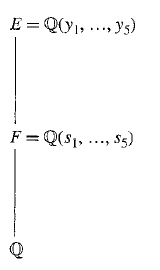

# Editorial records — Section 56 Insolvability of the Quintic

Printed470–475/PDF473–478 visually reviewed. Native pending.

## Restore heading p.470.

Before:

```text

The Problem

```

After:

```text

## The Problem

```

## Restore heading p.470.

Before:

```text

Extensions by Radicals

```

After:

```text

## Extensions by Radicals

```

## Correct polynomial-ring notation p.470.

Before:

```text
A polynomial $f(x) \in F(x)$
```

After:

```text
A polynomial $f(x)\in F[x]$
```

## Fix omitted zero case before division by beta in Lemma56.3proof p.472.

Before:

```text
Proof Suppose first
```

After:

```text
Proof If $a=0$, then $K=F$ and the Galois group is trivial. Assume $a\ne0$. Suppose first
```

## Join page-broken sentence p.472–473.

Before:

```text
\right)$
where
```

After:

```text
\right)$ where
```

## Correct malformed delimiters and automorphism argument: alpha2 may not lie in L1; alpha2^n2 does p.473.

Before:

```text
f_{2}(x)=\prod_{\sigma \in G\left(L_{1} / F\right)}\left[\left(x^{n_{2}}-\sigma\left(\alpha_{2}\right)^{n_{2}}\right] .\right.
```

After:

```text
f_2(x)=\prod_{\sigma\in G(L_1/F)}\left[x^{n_2}-\sigma\left(\alpha_2^{n_2}\right)\right].
```

## Same domain correction in following prose p.473.

Before:

```text
x^{n_{2}}-\sigma\left(\alpha_{2}\right)^{n_{2}}
```

After:

```text
x^{n_2}-\sigma\left(\alpha_2^{n_2}\right)
```

## Correct product index, delimiters and automorphism domain p.473.

Before:

```text
f_{i}(x)=\prod_{\alpha \in G\left(L_{i-1} / F\right)}\left[\left(x^{n_{i}}-\sigma\left(\alpha_{i}\right)^{n_{i}}\right]\right.
```

After:

```text
f_i(x)=\prod_{\sigma\in G(L_{i-1}/F)}\left[x^{n_i}-\sigma\left(\alpha_i^{n_i}\right)\right]
```

## Correct intermediate-base assertion: partial splitting extensions need not be normal over F; their successive quotients are solvable, giving the full normal L2/F group solvable p.473.

Before:

```text
By Lemma 56.3 and Exercise 7, we see that the Galois group over $F$ of each new extension thus formed continues to be solvable.
```

After:

```text
By Lemma 56.3, the Galois group of each new extension over the preceding field is solvable. By Exercise 7, $G(L_2/F)$ is solvable.
```

## Join split quotient p.473.

Before:

```text
$G(E / F) \simeq G(L / F) /$ $G(L / E)$
```

After:

```text
$G(E/F)\simeq G(L/F)/G(L/E)$
```

## Correct term p.473.

Before:

```text
elementary symmetry functions
```

After:

```text
elementary symmetric functions
```

## Correct missing index range: leading coefficient is1, s0 undefined p.474.

Before:

```text
The coefficient of $x^{i}$ in
```

After:

```text
For $0\le i<5$, the coefficient of $x^{i}$ in
```

## Restore product operator p.474.

Before:

```text
\Pi_{i=1}
```

After:

```text
\prod_{i=1}
```

## Correct instruction Exercise3.

Before:

```text
true of false
```

After:

```text
true or false
```

## Correct subject/verb agreement Exercise3(j).

Before:

```text
series of groups play an
```

After:

```text
series of groups plays an
```

## Remove duplicate batch-end footnotes from Sections48/52; they are retained at the proper sources.

Before:

```text
[^0]:    ${ }^{\dagger}$ Section 52 is not required for the remainder of the text.

[^1]:    ${ }^{\dagger}$ This section is not used in the remainder of the text.


```

After:

```text

```

## Wrap historical box as note, excluded from Index.

Before:

```text
## ■ Historical Note

The first publication of a formula for solving cubic equations in terms of radicals was in 1545 in the Ars Magna of Girolamo Cardano, although the initial discovery of the method is in part also due to Scipione del Ferro and Niccolo Tartaglia. Cardano's student, Lodovico Ferrari, discovered a method for solving quartic equations by radicals, which also appeared in Cardano's work.

After many mathematicians had attempted to solve quintics by similar methods, it was Joseph-Louis Lagrange who in 1770 first attempted a detailed analysis of the general principles underlying the solutions for polynomials of degree 3 and 4, and showed why these methods fail for those of higher degree. His basic insight was that in the former cases there were rational functions of the roots that took on two and three values, respectively, under all possible permutations of the roots, hence these rational functions could be written as roots of equations of degree less than that of the original. No such functions were evident in equations of higher degree.

The first mathematician to claim to have a proof of the insolvability of the quintic equation was Paolo Ruffini (1765-1822) in his algebra text of 1799. His proof was along the lines suggested by Lagrange, in that he in effect determined all of the subgroups of $S_{5}$ and showed how these subgroups acted on rational functions of the roots of the equation. Unfortunately, there were several gaps in his various published versions of the proof. It was Niels Henrik Abel who, in 1824 and 1826, published a complete proof, closing all of Ruffini's gaps and finally settling this centuries-old question.

```

After:

```text
> [!note] Historical Note
> The first publication of a formula for solving cubic equations in terms of radicals was in 1545 in the Ars Magna of Girolamo Cardano, although the initial discovery of the method is in part also due to Scipione del Ferro and Niccolo Tartaglia. Cardano's student, Lodovico Ferrari, discovered a method for solving quartic equations by radicals, which also appeared in Cardano's work.
>
> After many mathematicians had attempted to solve quintics by similar methods, it was Joseph-Louis Lagrange who in 1770 first attempted a detailed analysis of the general principles underlying the solutions for polynomials of degree 3 and 4, and showed why these methods fail for those of higher degree. His basic insight was that in the former cases there were rational functions of the roots that took on two and three values, respectively, under all possible permutations of the roots, hence these rational functions could be written as roots of equations of degree less than that of the original. No such functions were evident in equations of higher degree.
>
> The first mathematician to claim to have a proof of the insolvability of the quintic equation was Paolo Ruffini (1765-1822) in his algebra text of 1799. His proof was along the lines suggested by Lagrange, in that he in effect determined all of the subgroups of $S_{5}$ and showed how these subgroups acted on rational functions of the roots of the equation. Unfortunately, there were several gaps in his various published versions of the proof. It was Niels Henrik Abel who, in 1824 and 1826, published a complete proof, closing all of Ruffini's gaps and finally settling this centuries-old question.


```

## Wrap complete two-part original definition.

Before:

```text
56.1 Definition An extension $K$ of a field $F$ is an extension of $F$ by radicals if there are elements $\alpha_{1}, \cdots, \alpha_{r} \in K$ and positive integers $n_{1}, \cdots, n_{r}$ such that $K=F\left(\alpha_{1}, \cdots, \alpha_{r}\right), \alpha_{1}^{n_{1}} \in F$ and $\alpha_{i}^{n_{i}} \in F\left(\alpha_{1}, \cdots, \alpha_{i-1}\right)$ for $1<i \leq r$. A polynomial $f(x) \in F[x]$ is solvable by radicals over $F$ if the splitting field $E$ of $f(x)$ over $F$ is contained in an extension of $F$ by radicals. $\square$
```

After:

```text
Definition 56.1

> [!definition] Extension by Radicals and Solvability by Radicals
> An extension $K$ of a field $F$ is an extension of $F$ by radicals if there are elements $\alpha_{1}, \cdots, \alpha_{r} \in K$ and positive integers $n_{1}, \cdots, n_{r}$ such that $K=F\left(\alpha_{1}, \cdots, \alpha_{r}\right), \alpha_{1}^{n_{1}} \in F$ and $\alpha_{i}^{n_{i}} \in F\left(\alpha_{1}, \cdots, \alpha_{i-1}\right)$ for $1<i \leq r$. A polynomial $f(x) \in F[x]$ is solvable by radicals over $F$ if the splitting field $E$ of $f(x)$ over $F$ is contained in an extension of $F$ by radicals. $\square$


```

## Wrap complete result; restore only required premises/notation.

Before:

```text
56.3 Lemma Let $F$ be a field of characteristic 0 , and let $a \in F$. If $K$ is the splitting field of $x^{n}-a$ over $F$, then $G(K / F)$ is a solvable group.


```

After:

```text
Lemma 56.3

> [!lemma] Solvable Galois Group of a Radical Polynomial
> Let $F$ be a field of characteristic 0 , let $n$ be a positive integer, and let $a \in F$. If $K$ is the splitting field of $x^{n}-a$ over $F$, then $G(K / F)$ is a solvable group. Here $G(K/F)$ is the Galois group of $K$ over $F$.


```

## Wrap complete result; restore only required premises/notation.

Before:

```text
56.4 Theorem Let $F$ be a field of characteristic zero, and let $F \leq E \leq K \leq \bar{F}$, where $E$ is a normal extension of $F$ and $K$ is an extension of $F$ by radicals. Then $G(E / F)$ is a solvable group.


```

After:

```text
Theorem 56.4

> [!theorem] Solvable Galois Group of a Normal Extension Contained in a Radical Extension
> Let $F$ be a field of characteristic zero, and let $F \leq E \leq K \leq \bar{F}$, an algebraic closure of $F$, where $E$ is a normal extension of $F$ and $K$ is an extension of $F$ by radicals. Then $G(E / F)$ is a solvable group. Here $G(E/F)$ is the Galois group of $E$ over $F$.


```

## Wrap complete result; restore only required premises/notation.

Before:

```text
56.6 Theorem Let $y_{1}, \cdots, y_{5}$ be independent transcendental real numbers over $\mathbb{Q}$. The polynomial
$$
f(x)=\prod_{i=1}^{5}\left(x-y_{i}\right)
$$
is not solvable by radicals over $F=\mathbb{Q}\left(s_{1}, \cdots, s_{5}\right)$, where $s_{i}$ is the $i$ th elementary symmetric function in $y_{1}, \cdots, y_{5}$.

```

After:

```text
Theorem 56.6

> [!theorem] Insolvability of the General Quintic
> Let $y_{1}, \cdots, y_{5}$ be independent transcendental real numbers over $\mathbb{Q}$. The polynomial
> $$
> f(x)=\prod_{i=1}^{5}\left(x-y_{i}\right)
> $$
> is not solvable by radicals over $F=\mathbb{Q}\left(s_{1}, \cdots, s_{5}\right)$, where $s_{i}$ is the $i$ th elementary symmetric function in $y_{1}, \cdots, y_{5}$.


```

## Task-only prompt; original worked text preserved outside.

Before:

```text
56.2 Example 
```

After:

```text
> [!example] Example 56.2
> Determine whether $x^5-1$ and $x^5-2$ are solvable by radicals over $\mathbb Q$.

##### solution


```

## Restore omitted field-tower diagram from printed474/PDF477, source crop.

Before:

```text
56.5 Figure
```

After:

```text

56.5 Figure
```

## Formatting only

One definition, one lemma, two theorems, one example, eight exercises, historical note, restored figure. Original OCR/PDF unchanged; no admission.

## Earlier staging record

# Editorial records — Section 56 - Insolvability of the Quintic

Status: staged original OCR; content/callout/source review pending.

## Heading formatting

Before: `## section 56 Insolvability of the Quintic`

After: `# 56 Insolvability of the Quintic`

Section heading separated and normalized to level one; body wording unchanged. Original chapter OCR archive retained in conversion records.


## Figure 56.5

Formatting only: preserved image and printed caption in scientific figure component.

Before:

```text

56.5 Figure
```

After:

```text
```scientific-figure
id: f5e6f1cc-f333-4664-9dfc-5f138cb76c25
numbered: false
title: ""
caption: Figure 56.5
captionVisible: true
captionPosition: below
columns: 1
panels:
  - path: images/figure-56-5-source.png
    caption: ""
```
```


## Final native verification

Native Insolvability of the General Quintic theorem, product and surrounding prose verified.
