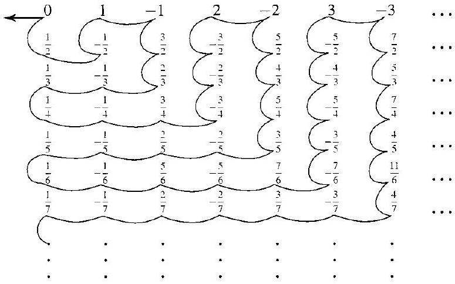
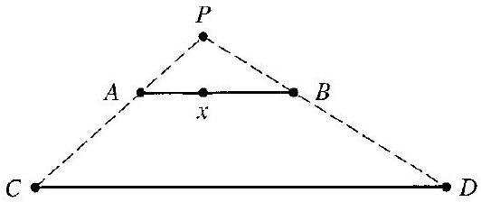

# Editorial records — Section 0: Sets and Relations

Status: source-reviewed formatting and saved-note lint complete; native rendered review and receiver receipt pending.

Original OCR: `Original Markdown/Section 00 - Original.md`. Source PDF printed pp.1–10.

## Heading formatting; preserves source section title.

Before:

```text
## section 0 Sets and Relations
```

After:

```text
# 0 Sets and Relations
```

## Join OCR page break inside the same sentence, printed pp.1–2.

Before:

```text
On the other hand, we

can consider
```

After:

```text
On the other hand, we can consider
```

## Restore relation symbol R misrecognized as B; printed pp.3,7,10.

Before:

```text
\mathscr{B}
```

After:

```text
\mathscr{R}
```

## Printed p.7 relation R misrecognized as S.

Before:

```text
yields a relation $S$ on $S$
```

After:

```text
yields a relation $\mathscr{R}$ on $S$
```

## Printed p.7 relation R misrecognized as S.

Before:

```text
this relation $S$ on $S$
```

After:

```text
this relation $\mathscr{R}$ on $S$
```

## Correct spelling typo in Exercise 28.

Before:

```text
satisifed
```

After:

```text
satisfied
```

## Remove scan speck beside relation symbol, Example 0.21.

Before:

```text
n . \mathscr{R} m
```

After:

```text
n \mathscr{R} m
```

## Remove scan speck beside relation symbol, Example 0.21.

Before:

```text
-3 . \mathscr{R} 5
```

After:

```text
-3 \mathscr{R} 5
```

## Remove scan speck beside relation symbol, Exercise 29.

Before:

```text
n, \mathscr{R} m
```

After:

```text
n \mathscr{R} m
```

## Restore omitted n in Exercise 36(c), verified printed p.10.

Before:

```text
residue classes modulo in
```

After:

```text
residue classes modulo $n$ in
```

## Restore math delimiter around relation symbol, Exercise 36(b).

Before:

```text
this ~ is the equivalence
```

After:

```text
this $\sim$ is the equivalence
```

## Restore math delimiter around relation symbol, Theorem 0.22.

Before:

```text
let ~ be an equivalence
```

After:

```text
let $\sim$ be an equivalence
```

## Place display closing delimiter on its own line.

Before:

```text
$$ $\square$
```

After:

```text
$$

$\square$
```

## Restore word spacing lost in OCR.

Before:

```text
Closing inline-math dollar immediately followed by prose
```

After:

```text
Closing dollar followed by a space
```

## Move printed footnote marker to the definition rather than an unmatched emphasis delimiter.

Before:

```text
Definition *A function
```

After:

```text
Definition A function
```

## Remove displaced footnote reference; attach it at its source definition below.

Before:

```text
[^0]If a subset
```

After:

```text
If a subset
```

## Normalize footnote syntax without changing footnote prose.

Before:

```text
[^0]:    * We should
```

After:

```text
[^0]: We should
```

## Formatting only: retain numbered source label outside reusable callout; add title to previously untitled statement, or retain the existing theorem title.

Before:

```text
Theorem 0.22
```

After:

```text
Theorem callout: Equivalence Relations and Partitions
```

## Formatting only: retain numbered source label outside reusable callout; add title to previously untitled statement, or retain the existing theorem title.

Before:

```text
Definition 0.18
```

After:

```text
Definition callout: Equivalence Relation
```

## Formatting only: retain numbered source label outside reusable callout; add title to previously untitled statement, or retain the existing theorem title.

Before:

```text
Definition 0.16
```

After:

```text
Definition callout: Partition of a Set
```

## Formatting only: retain numbered source label outside reusable callout; add title to previously untitled statement, or retain the existing theorem title.

Before:

```text
Definition 0.13
```

After:

```text
Definition callout: Sets of the Same Cardinality
```

## Keep source-specific pointer and footnote outside reusable definition; mathematical wording unchanged.

Before:

```text
(see Exercise 37) in Definition 0.12
```

After:

```text
See Exercise 37.[^0] outside the callout
```

## Formatting only: retain numbered source label outside reusable callout; add title to previously untitled statement, or retain the existing theorem title.

Before:

```text
Definition 0.12
```

After:

```text
Definition callout: One-to-One and Onto Functions
```

## Formatting only: retain numbered source label outside reusable callout; add title to previously untitled statement, or retain the existing theorem title.

Before:

```text
Definition 0.10
```

After:

```text
Definition callout: Function, Domain, Codomain, and Range
```

## Formatting only: retain numbered source label outside reusable callout; add title to previously untitled statement, or retain the existing theorem title.

Before:

```text
Definition 0.7
```

After:

```text
Definition callout: Relation Between Sets
```

## Formatting only: retain numbered source label outside reusable callout; add title to previously untitled statement, or retain the existing theorem title.

Before:

```text
Definition 0.4
```

After:

```text
Definition callout: Cartesian Product
```

## Formatting only: retain numbered source label outside reusable callout; add title to previously untitled statement, or retain the existing theorem title.

Before:

```text
Definition 0.2
```

After:

```text
Definition callout: Proper and Improper Subsets
```

## Formatting only: retain numbered source label outside reusable callout; add title to previously untitled statement, or retain the existing theorem title.

Before:

```text
Definition 0.1
```

After:

```text
Definition callout: Subset
```

## Add missing prompt as required by formatting skill; original example body retained unchanged as solution.

Before:

```text
Example 0.20: author supplies worked discussion without a separate question
```

After:

```text
Describe congruence modulo $n$ on $\mathbb{Z}^{+}$, and illustrate it with $15$ and $27$ modulo $4$.
```

## Add missing prompt as required by formatting skill; original example body retained unchanged as solution.

Before:

```text
Example 0.19: author supplies worked discussion without a separate question
```

After:

```text
For a nonempty set $S$, determine whether the equality relation on $S$ is an equivalence relation.
```

## Add missing prompt as required by formatting skill; original example body retained unchanged as solution.

Before:

```text
Example 0.17: author supplies worked discussion without a separate question
```

After:

```text
Describe partitions of $\mathbb{Z}^{+}$ according to the remainder on division by a positive integer $n$.
```

## Add missing prompt as required by formatting skill; original example body retained unchanged as solution.

Before:

```text
Example 0.14: author supplies worked discussion without a separate question
```

After:

```text
Determine whether the functions $f,g:\mathbb{R}\to\mathbb{R}$ given by $f(x)=x^2$ and $g(x)=x^3$ are one to one and onto.
```

## Add missing prompt as required by formatting skill; original example body retained unchanged as solution.

Before:

```text
Example 0.11: author supplies worked discussion without a separate question
```

After:

```text
Express addition of real numbers as a function, and describe its action on $(2,3)$.
```

## Add missing prompt as required by formatting skill; original example body retained unchanged as solution.

Before:

```text
Example 0.9: author supplies worked discussion without a separate question
```

After:

```text
Describe the graph of $f(x)=x^3$ for $x\in\mathbb{R}$ as a relation on $\mathbb{R}$.
```

## Add missing prompt as required by formatting skill; original example body retained unchanged as solution.

Before:

```text
Example 0.8: author supplies worked discussion without a separate question
```

After:

```text
Describe the equality relation on a set $S$ as a subset of $S\times S$.
```

## Add missing prompt as required by formatting skill; original example body retained unchanged as solution.

Before:

```text
Example 0.6: author supplies worked discussion without a separate question
```

After:

```text
Identify $\mathbb{R}\times\mathbb{R}$ geometrically.
```

## Add missing prompt as required by formatting skill; original example body retained unchanged as solution.

Before:

```text
Example 0.5: author supplies worked discussion without a separate question
```

After:

```text
Find $A\times B$ for $A=\{1,2,3\}$ and $B=\{3,4\}$.
```

## Add missing prompt as required by formatting skill; original example body retained unchanged as solution.

Before:

```text
Example 0.3: author supplies worked discussion without a separate question
```

After:

```text
List all subsets of $S=\{1,2,3\}$.
```

## Formatting-only changes

Definition/theorem and example/exercise callout wrappers; source numbers outside reusable callouts; examples have prompts with original working under `##### solution`; lesson-specific boxes remain teaching material. Original wording otherwise preserved.

## Formatting: replace raw image and source label with scientific figure; original caption retained.

Before:

```text

0.15 Figure
```

After:

```text
```scientific-figure
id: 3cc9a804-14f2-46e9-94ed-ccc324efbee1
numbered: false
title: ""
caption: Figure 0.15
captionVisible: true
captionPosition: below
columns: 1
panels:
  - path: images/70500c71-0bbc-4518-aa34-6a6e307e9b14-05_484_775_1591_730.jpg
    caption: ""
```
```

## Formatting: replace raw image and source label with scientific figure; original caption retained.

Before:

```text
> 
> 0.23 Figure
```

After:

```text
> ```scientific-figure
> id: ce862073-cb24-4e6a-a82d-ad0099ca4878
> numbered: false
> title: ""
> caption: Figure 0.23
> captionVisible: true
> captionPosition: below
> columns: 1
> panels:
>   - path: images/70500c71-0bbc-4518-aa34-6a6e307e9b14-09_224_532_234_845.jpg
>     caption: ""
> ```
```

## Restore all pairing arrows to two-headed vertical arrows as printed on p.4; scientific table preserves all paired values.

Before:

```text
| 1 | 2 | 3 | 4 | 5 | 6 | 7 | 8 | 9 | 10 | ⋯ |
| :--- | :--- | :--- | :--- | :--- | :--- | :--- | :--- | :--- | :--- | :--- |
| ↓ | ↓ | ⇧ | ↓ | ↓ | ↓ | ↓ | ↓ | ↓ | ⇧ |  |
| 0 | -1 | 1 | -2 | 2 | -3 | 3 | -4 | 4 | -5 | ... |
```

After:

```text
```scientific-table
id: 5e5812ff-7da5-49d5-b431-e238a9081c37
numbered: false
title: ""
caption: ""
captionVisible: false
captionPosition: below
rows:
  - - text: "1"
      align: center
    - text: "2"
      align: center
    - text: "3"
      align: center
    - text: "4"
      align: center
    - text: "5"
      align: center
    - text: "6"
      align: center
    - text: "7"
      align: center
    - text: "8"
      align: center
    - text: "9"
      align: center
    - text: "10"
      align: center
    - text: $\cdots$
      align: center
  - - text: $\updownarrow$
      align: center
    - text: $\updownarrow$
      align: center
    - text: $\updownarrow$
      align: center
    - text: $\updownarrow$
      align: center
    - text: $\updownarrow$
      align: center
    - text: $\updownarrow$
      align: center
    - text: $\updownarrow$
      align: center
    - text: $\updownarrow$
      align: center
    - text: $\updownarrow$
      align: center
    - text: $\updownarrow$
      align: center
    - text: ""
      align: center
  - - text: "0"
      align: center
    - text: "-1"
      align: center
    - text: "1"
      align: center
    - text: "-2"
      align: center
    - text: "2"
      align: center
    - text: "-3"
      align: center
    - text: "3"
      align: center
    - text: "-4"
      align: center
    - text: "4"
      align: center
    - text: "-5"
      align: center
    - text: $\cdots$
      align: center
headerRows: 0
rowHeaders: false
style: scientific
```
```

## Restore three answer blanks in Exercise 22, printed p.9; OCR misrecognized them as dots, underscore, dash.

Before:

```text
\boldsymbol{\aleph}_{0},|\mathbb{R}|, \ldots, \_,-.
```

After:

```text
\aleph_{0},|\mathbb{R}|, \underline{\qquad}, \underline{\qquad}, \underline{\qquad}.
```

## Restore math delimiters around mathematical set notation omitted by OCR.

Before:

```text
\{1, 2, 15\}
```

After:

```text
$\{1, 2, 15\}$
```

## Restore math delimiters around mathematical set notation omitted by OCR.

Before:

```text
\{(1, 4), (2, 4), (3, 6)\}
```

After:

```text
$\{(1, 4), (2, 4), (3, 6)\}$
```

## Restore math delimiters around mathematical set notation omitted by OCR.

Before:

```text
\{(1, 4), (2, 6), (3, 4)\}
```

After:

```text
$\{(1, 4), (2, 6), (3, 4)\}$
```

## Restore math delimiters around mathematical set notation omitted by OCR.

Before:

```text
\{(2, 2), (1, 6), (3, 4)\}
```

After:

```text
$\{(2, 2), (1, 6), (3, 4)\}$
```

## Restore math delimiters around mathematical set notation omitted by OCR.

Before:

```text
\{(1, 2), (2, 6), (2, 4)\}
```

After:

```text
$\{(1, 2), (2, 6), (2, 4)\}$
```

## Final TeX delimiter check

Before: `$A \times B=\{(a, b) \mid a \in A$ and $b \in B\}$`

After: `$A\times B=\{(a,b)\mid a\in A\text{ and }b\in B\}$`

Reason: join split set-builder math using text inside the expression; words and mathematical content unchanged.

Before: `$\{m \in \mathbb{Z} \mid m n=60$ for some $n \in \mathbb{Z}\}$`

After: `$\{m\in\mathbb Z\mid mn=60\text{ for some }n\in\mathbb Z\}$`

Reason: join split set-builder math using text inside the expression; words and mathematical content unchanged.

Before: `$\left\{n \in \mathbb{Z}^{+} \mid n\right.$ is a large number $\}$`

After: `$\{n\in\mathbb Z^+\mid n\text{ is a large number}\}$`

Reason: join split set-builder math using text inside the expression; words and mathematical content unchanged.

Before: `$\{x \in \mathbb{Q} \mid x$ is almost an integer $\}$`

After: `$\{x\in\mathbb Q\mid x\text{ is almost an integer}\}$`

Reason: join split set-builder math using text inside the expression; words and mathematical content unchanged.

Before: `$\{x \in \mathbb{Q} \mid x$ may be written with denominator greater than 100$\}$`

After: `$\{x\in\mathbb Q\mid x\text{ may be written with denominator greater than }100\}$`

Reason: join split set-builder math using text inside the expression; words and mathematical content unchanged.

Before: `$\{x \in \mathbb{Q} \mid x$ may be written with positive denominator less than 4$\}$`

After: `$\{x\in\mathbb Q\mid x\text{ may be written with positive denominator less than }4\}$`

Reason: join split set-builder math using text inside the expression; words and mathematical content unchanged.
